# ChatGPT满周岁：我在一线趟过的路，和看到的真金白银

> 来源：[https://w91h2gmtrn.feishu.cn/docx/PjhZdayZHoCFLExTorMctg3vnTe](https://w91h2gmtrn.feishu.cn/docx/PjhZdayZHoCFLExTorMctg3vnTe)

阅读提示：
1、全文约五千字，配图不少，建议PC端打开，阅读体验更好。
2、想私下聊，加微信：qiaobangzhu-cn（我会通过）。
3、我正在招收大模型实操训练营学员，课程分七个阶段，全程带练。

目录：
1、我的背景
2、我的班底
3、三个产品层次
3.1 引流：线上课程
3.2 信任：线下集训
3.3 盈利：企业级服务

大家好，我叫帮主。趁ChatGPT满一岁的节点，把这半年在一线摸索到的一些确定性机会，尽量原样讲给你听。今天这部分内容，直接来自我最近路演用的BP。

先去了龙哥盟的微天使路演：

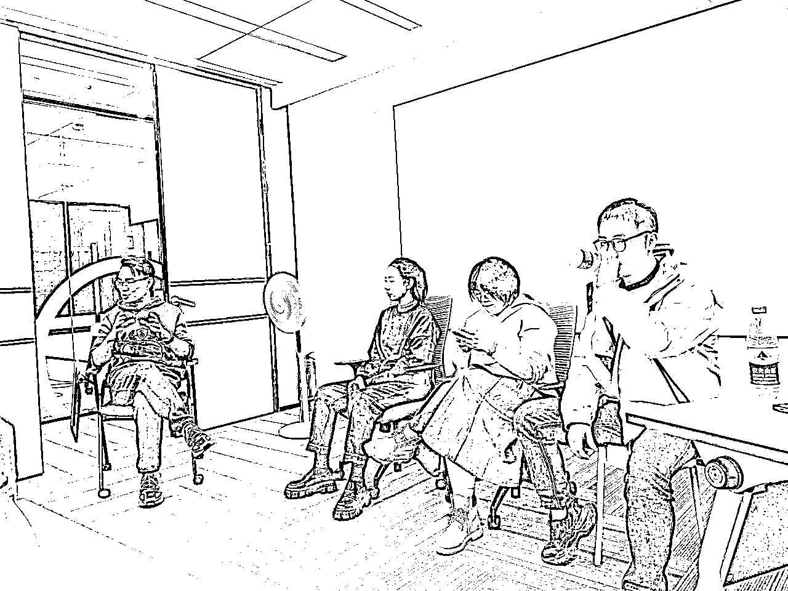

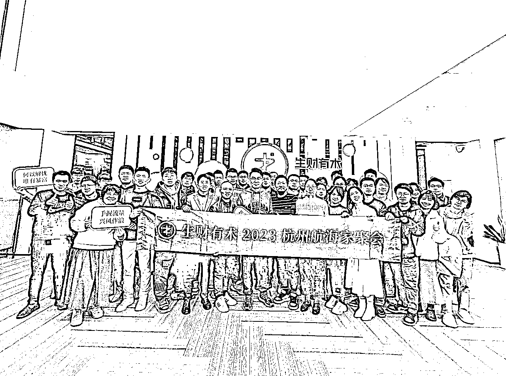

后来又获得阿里校友路演资格——50个项目报名，6个入围，我做的方向是其中之一。从淘系校友和流量圈的反应看，大模型方向是被看好的。

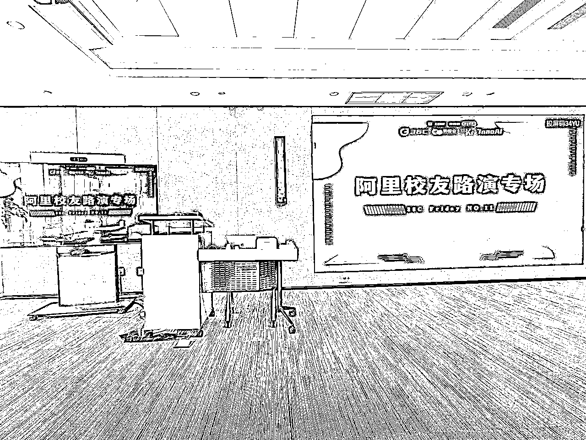

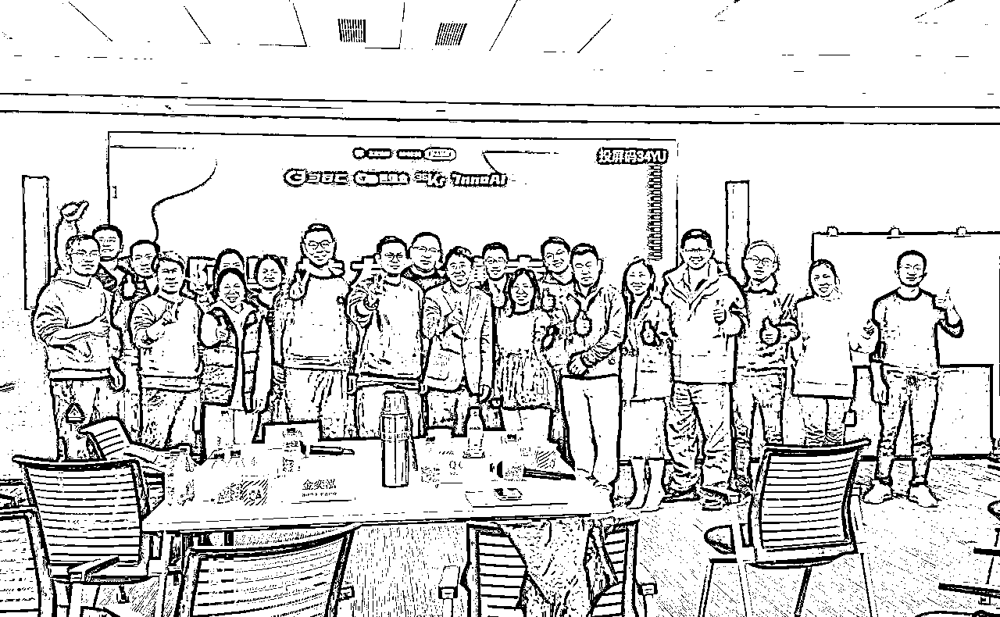

和龙哥、各路圈友、投资人深度聊过之后，我整理出下面这些核心判断。今天把路演PPT直接摆出来，希望有参考价值。

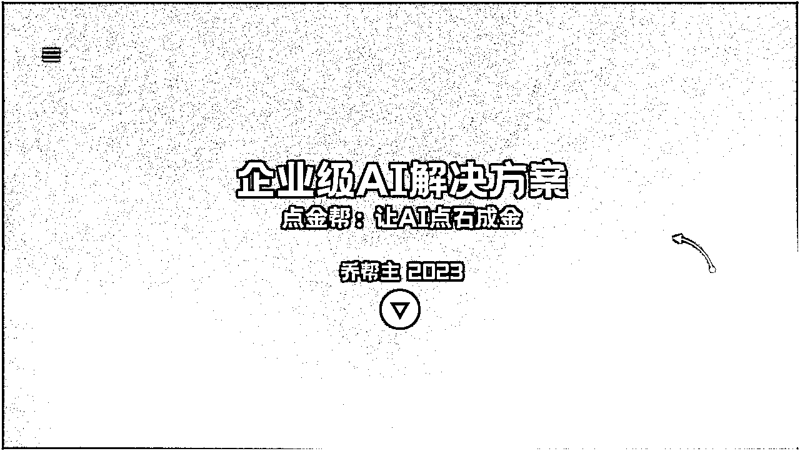

两场路演风格差异挺大。赚钱更活络，多为个人创业者，项目偏短视频、自媒体驱动；阿里校友更沉稳，大多做用户型产品，求大梦想。

我一直觉得，一桩生意能不能跑起来，由三个变量决定：带头人、队伍、事情。按重要性排序，带头人第一，队伍第二，事情第三。

# 1、我的背景

事要人做，而人能走多远，靠的是带头人的见识与决策力。团队是否给力，最终源头也在带头人。

圈里朋友都认得我，也看过我以前写的文章。这里简单交代：

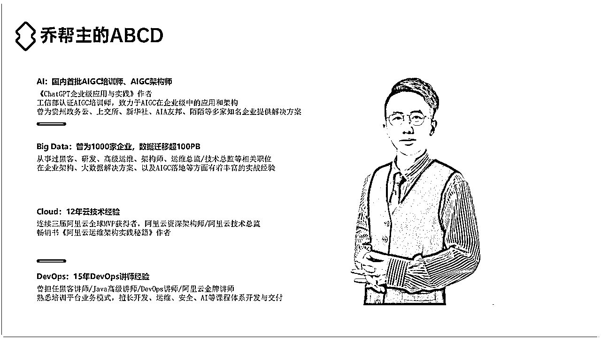

我在技术行业摸爬多年，擅长给复杂问题做整体方案；也做过多年讲师，擅长老课程研发与讲授。这两条线，正是我后来搭班子、选方向的根基。

# 2、我的班底

定下大模型赛道后，我从今年六月开始建队伍，过程挺顺，现在线下5人，线上约12人。

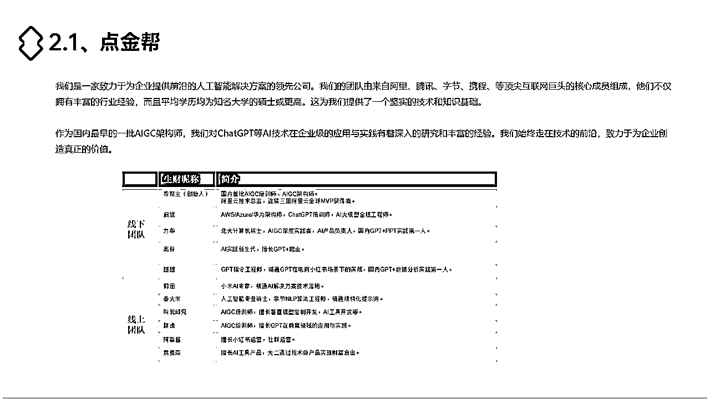

建队伍这件事，我花的时间精力比很多项目还多。原因很简单：一个人做不成大事，必须靠一群人。如果问竞争壁垒是什么，我会说：一个能打硬仗的队伍，就是最结实的护城河。

我创立的品牌叫“点金”，公司同名，和我的“帮主”标签形成呼应，好记好传播。

团队的底子，来自阿里、腾讯、字节、携程等公司，多数成员是名校硕士以上。我们是国内最早接触AIGC的一批架构师，对ChatGPT等大模型在商业场景里的应用，不是纸上谈兵，而是有大量实战经验。目标始终明确：为创业者和企业带来真实价值。

# 3、三个产品层次：引流、信任、盈利

下面进入正题。这一年里，我在大模型赛道跑出了几门生意，按产品层次拆解。

## 3.1 引流：线上课程

GPT-3.5在2022年11月30日刚发布时，市场像开了闸，第一波人靠卖账号、做社群赚得盆满钵满。今年上半年，又有一批知识博主和网红吃到了直播卖课的红利，像李一舟的199元课，抖音卖出三四千万。

我早就表达过看法：只追热点的流量生意，走不远，像吃了这顿没下顿。根子在于流量形不成闭环——低价卖了一大堆，后面没有信任产品和高客单价等着，用户留不住，也没法持续转化。这种钱更多靠运气，不是靠能力。

到了下半年，热度退了些，大家开始冷静看大模型到底能在哪里落到实处、怎么提效。不过认知差和信息差仍然巨大，这正是生意空间。

我们的引流打法，是通过一些特殊渠道，把市面上从几百到几万不等的课程信息都收拢起来，形成一个庞大的内容素材库；再结合自己的一线实践，做成9块9、99、199元的低门槛产品。用超值内容+极低价格，先和你建立第一次接触。

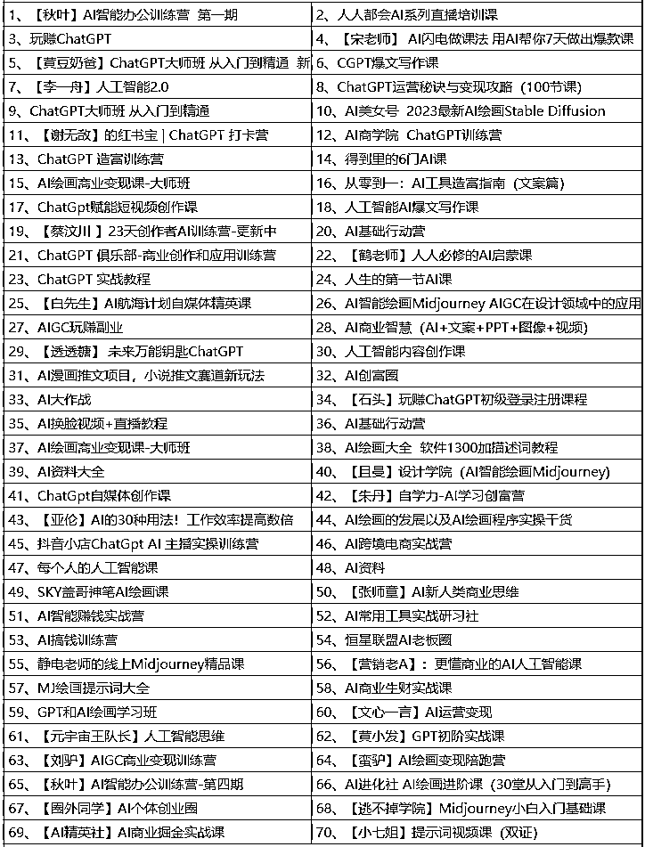

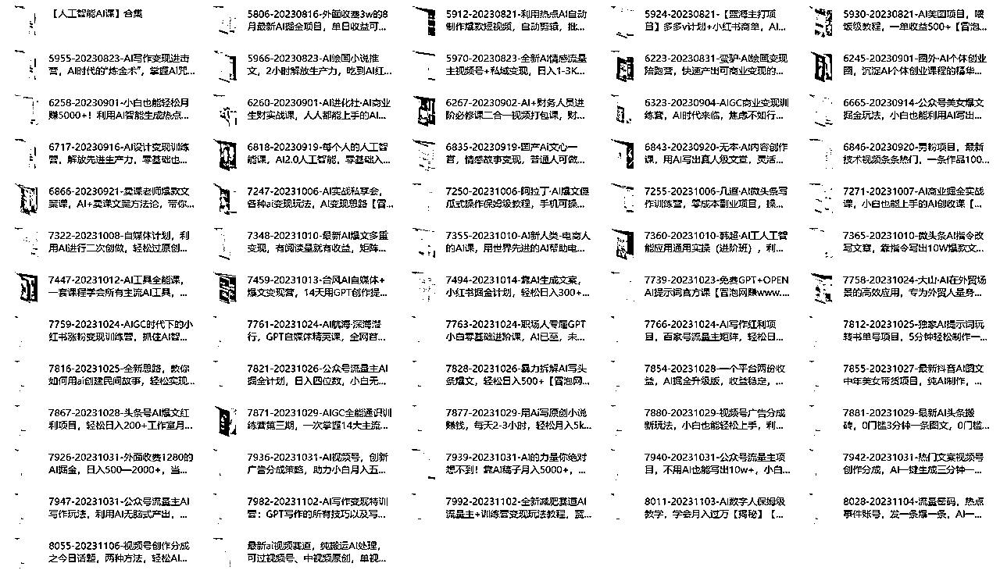

别人敢卖几千几万，我们直接9块9，属于高价值的降维打法。

## 3.2 信任：线下集训

很多人骂知识付费是“割韭菜”，主要因为录播课没有售后服务，质量还参差不齐。学不会没人管，可不就觉得自己被割了？

我们专门做线下面对面实训，手把手带大家跑完流程，为了积累口碑、建立信任。一旦信任建立，后续高客单价就是水到渠成的事。商业的底层，从来都是“信任成交”。

线下目前有四门课：

- 初阶：《ChatGPT教你学编程：普通人的编程入门课》
- 中阶：《ChatGPT实战营：掌握GPT+多维技能，成为领跑AI时代的高效能人士》
- 高阶：《ChatGPT企业级应用与实践——提高企业10倍生产力》
- 体系：《AIGC应用与实践》

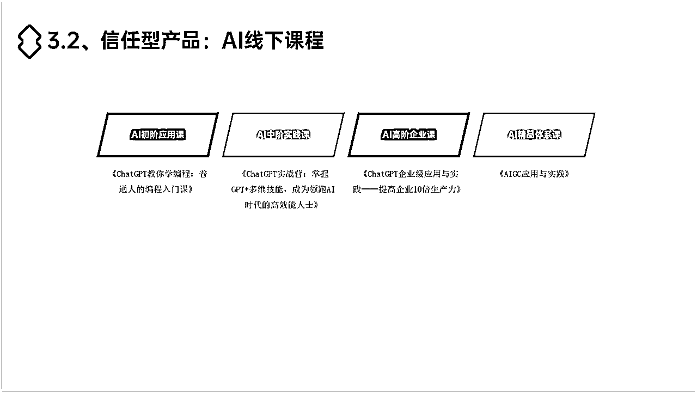

重点两门。中阶课面向大C和小B，上周末刚完成两天一夜集训，现场反响极好，直接谈下8位深度合伙人。

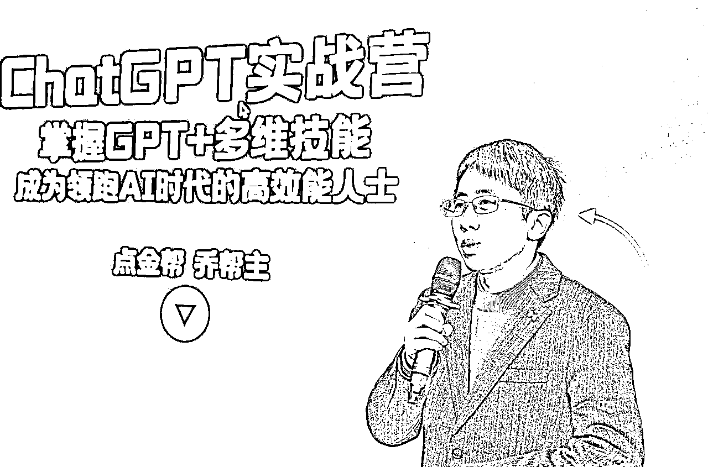

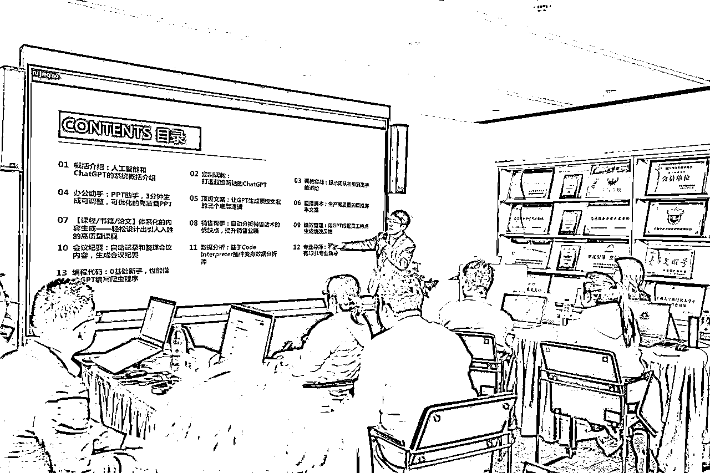

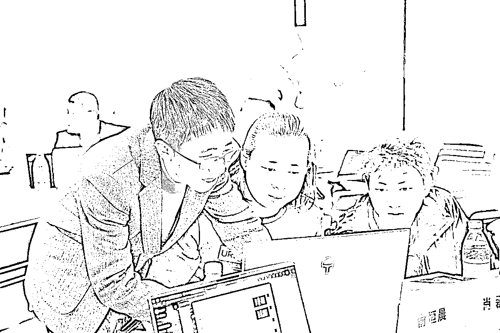

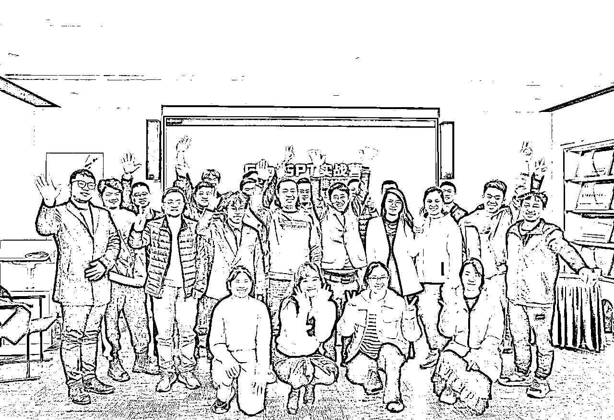

这种课除了自己办，更常与有流量的社群和机构渠道合作，交付更高效。自己操办一次，招募、场地、物料、售后全是事，实在辛苦。

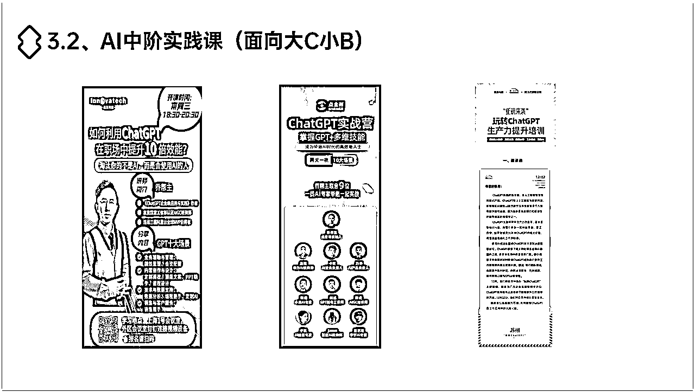

高阶企业课服务公司内训，近三个月交付了二十多场，现在基本每周至少两场。

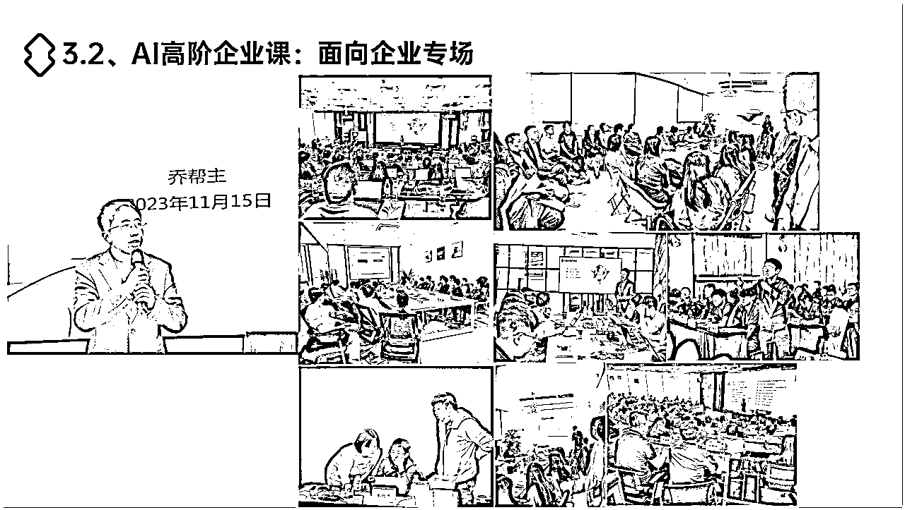

听到这你可能觉得我们是一家培训机构。真不是。线上线下课程，都只是售前手段，为了建立信任、曝光品牌。

B端客户往往不可能一次谈成，加上企业级大模型落地还在早期，流程、安全、业务复杂度都是坎。所以必须先用低客单价产品打开口子，再往深处转化。

君不见，有人用社群做低价，有人用训练营做信任，都逃不开“引流—信任—利润”的框架。关键是选适合自己的。线下培训对交付能力要求极高，没有相关经验很难撑起来。

下面是一张真实的企业服务报价单，属于大模型落地服务的入门款，含培训、咨询、账号、私有化平台、企业知识库等。你看，课程只是敲门砖，不是主菜。

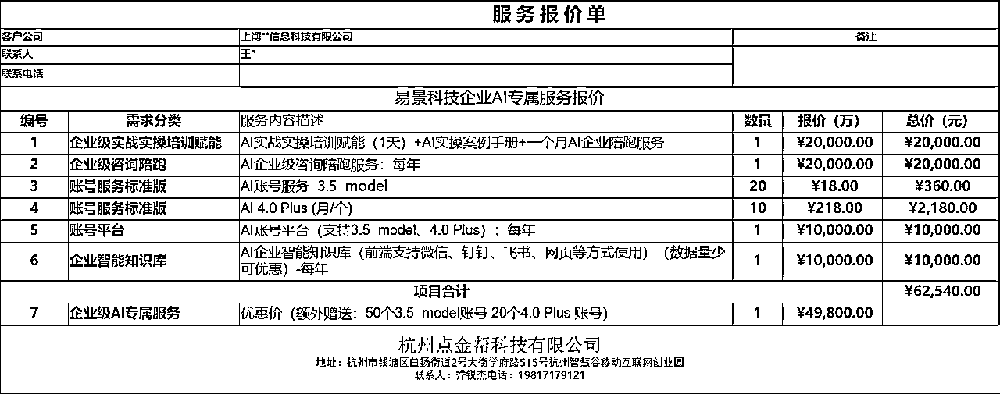

## 3.3 盈利：企业级服务

再来说核心利润来源：面向企业的落地服务。技术的价值不在技术本身，而在行业场景里。

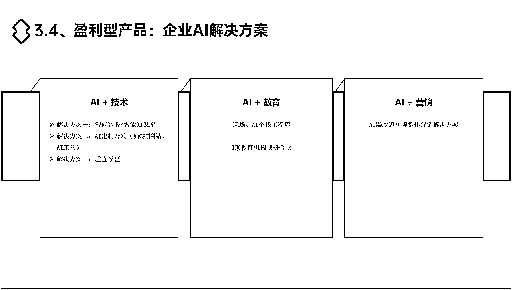

这半年，我们跑通了三个行业：技术、教育、营销。没跑通的，这里不展开。

路演中也有人质疑我们摊子铺得太大。我的回答：赚钱那帮人擅长线上获客，阿里校友擅长做产品，我们是中间态——用培训和知识付费获客，用企业服务升单。好比社群的逻辑：会员费是基础池，私董会是利润池。

终局，我想做的是一个大模型咨询服务公司，把流量和资源都聚起来，到那时后端是否亲自交付就不重要了。现在同时进三个领域，目的就是试错和确认最适合自己的赛道。

分行业来看。

**技术行业**

方案一：智能问答/企业知识库。这是目前最成熟的一类。我把自己上半年的几十篇文章、大约20万字，丢给一个垂直模型训练，得到“数字版的我”。

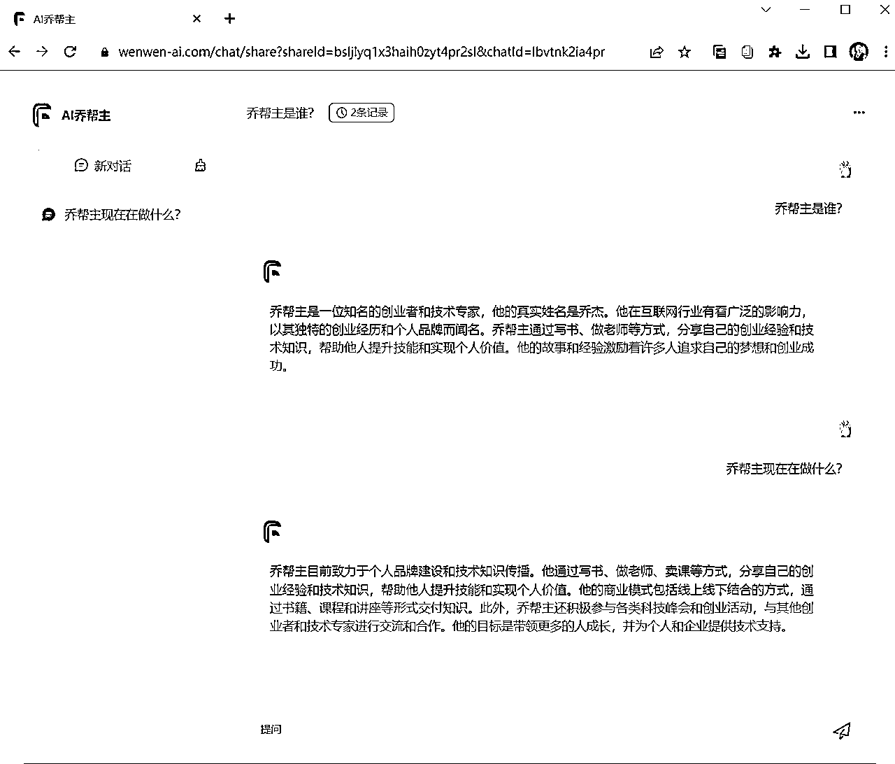

知识博主可以把过往的文章、朋友圈全部倒进去，等于造一个自己的数字分身——既能帮你写文案，也能回粉丝问题。

企业客户同理，把产品文档、知识库、客户信息喂进去，它可以自动解答客户问题、做新人培训，还能针对不同客户生成话术与方案。

这也是一款低客单产品，先用起来，再做深。

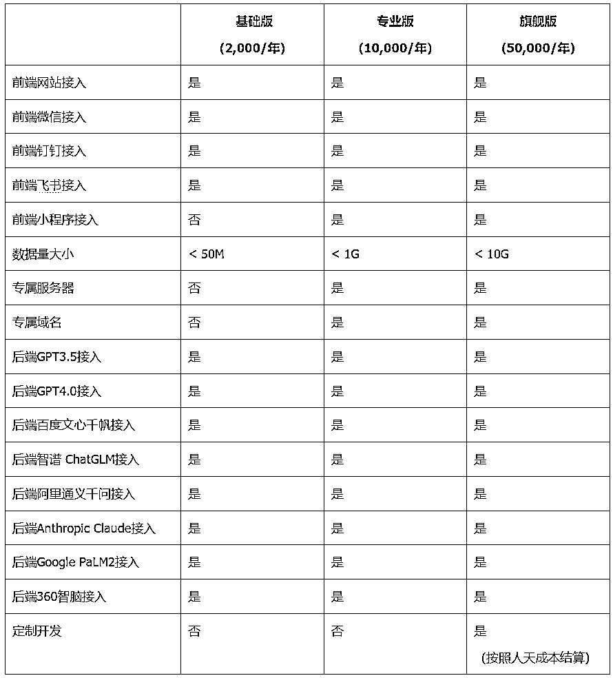

方案二：定制化开发。OpenAI开放API后，大家都可以把大模型能力接进现有系统。但ChatGPT在国内访问困难，很多人卡在第一步。我们基于合规API，帮企业部署一个国内能直接打开的站点。

下面这个网站是我们的合伙人开发的，李一舟课里用的那个站点，源码也是从我们这边拿的。

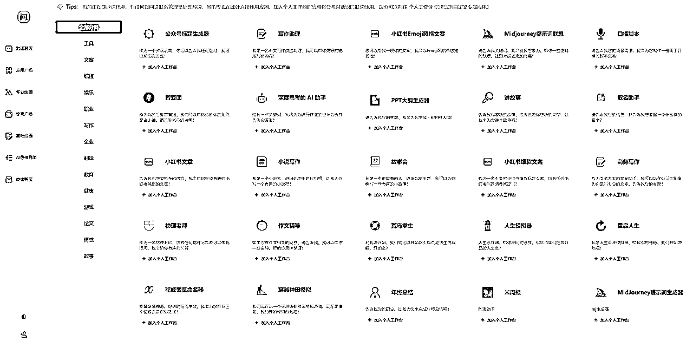

不止定制，还能基于API做各种工具。海外AI工具赛道，目前仍是可以下注的方向。

方案三：行业专属模型。我们有国内GPU资源，接过私有化部署的活，这类项目要调模型、调算力，门槛很高。眼下我们正与清华智谱合作推广ChatGLM。

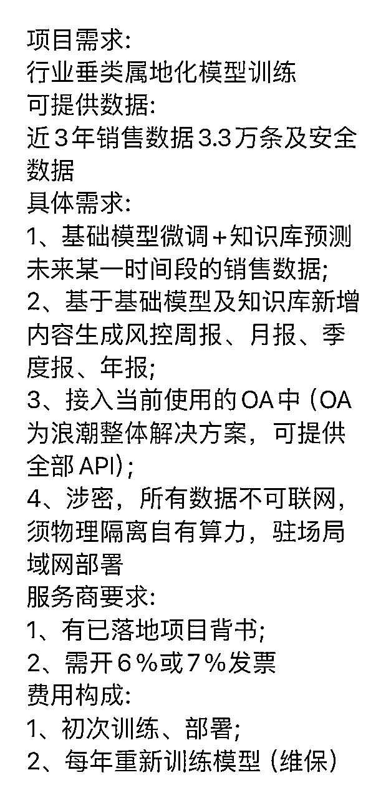

行业模型整体还在成熟过程中，不像公有云那样开箱即用。我们目前从培训切入，建立信任背书；也有不少企业找我们咨询ChatGLM和技术方案。我敢说，除了原厂，国内具备这种技术承接能力的团队不多。而我们在3月就买过GPU服务器做微调，是真有这个功底。

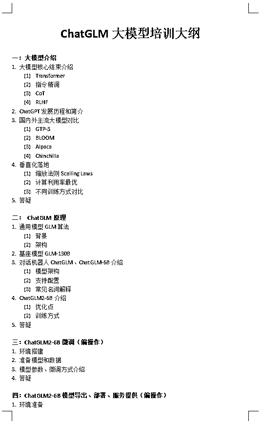

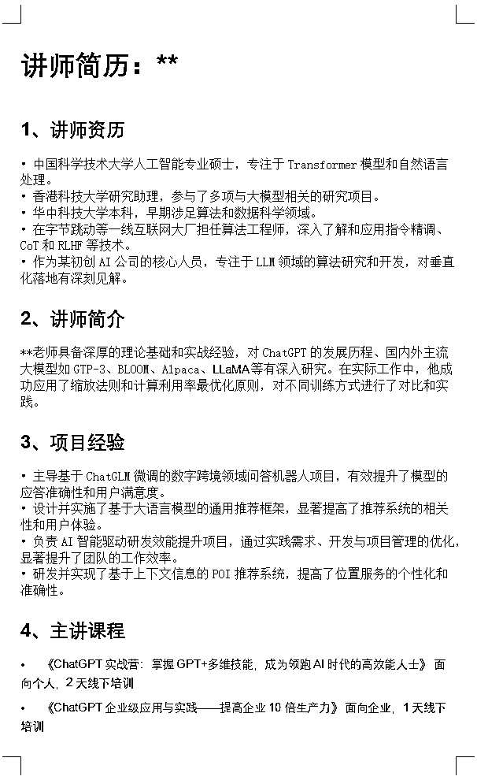

**教育行业**

传统K12和成人教育都卷成红海，而新技术的出现会把课程内容体系重写一遍。所以大模型+教育，是真正的蓝海。

目前我们已经有三个合作在推进（均为合伙人级别）：

- 把“课程+解决方案”打包，嵌入一家咨询培训公司的产品，卖给企业客户；
- 把课程卖给一家上市培训机构，给他们的讲师体系赋能；
- 和一家20年历史的IT培训机构（年营收2亿）合作，开设“职场+AI全栈工程师”方向；他们管道成熟，我们负责课程开发和赋能，年底合资，明年冲击一个小目标。

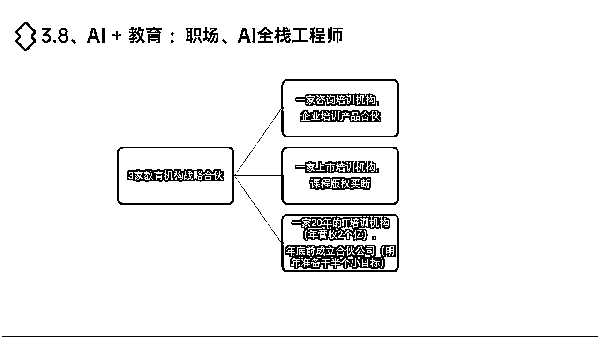

**营销行业**

压轴说营销，这是我目前最看好的方向；教育第二，技术第三。

我们合作的伙伴做了十余年短视频营销，在矩阵号上积累很深，擅长美业、培训、本地生活、新能源汽车。

我们的动作，是用大模型批量产爆款文案，每天最少一万条；再通过矩阵系统混剪、分发，还可结合定制数字人出镜。相当于每天往公域铺几千几万条短视频，织一张庞大的获客网。

B端客户从哪来？我们跟手中握有企业流量的机构、渠道合作，用“销转课”来做转化，课程体系由我们这边统一设计。

一句话概括：AI批量产文+矩阵分发+数字人。

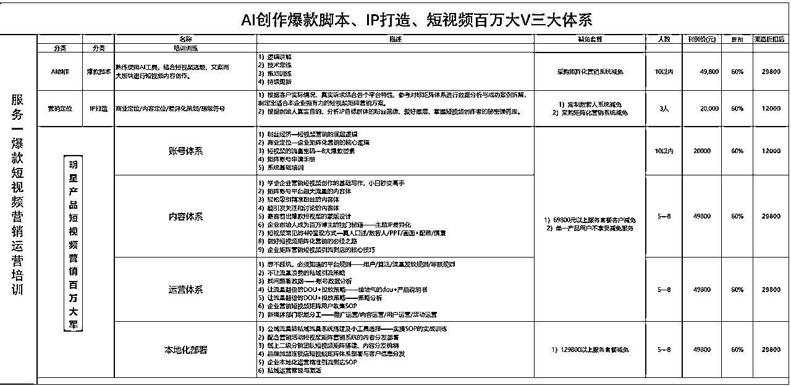

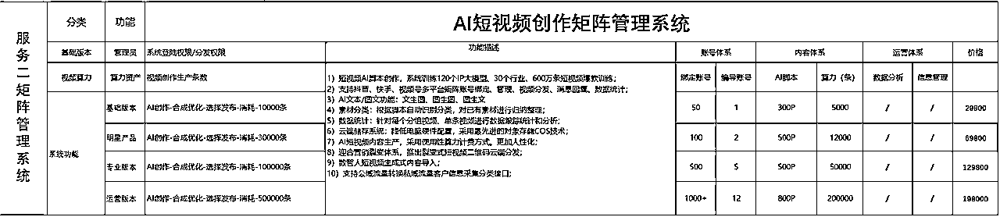

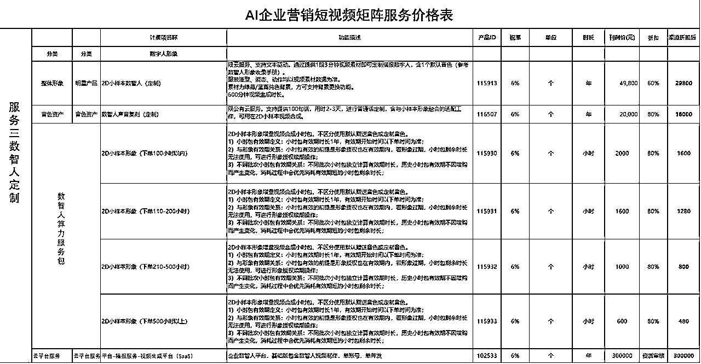

我们刚签了一个70万、一个190万的大单，上周在高净值研究院完成交付。那位院长很激动，说大健康、医美等传统行业卷到不行，而AI智能营销是他今年见过最有前景的事。

用新技术解决获客难题，用机器换流量——这对企业和创业者来说，诱惑力极强。我预感，它会在国内掀起一波浪潮。

* * *

我的大模型实操训练营正在火热招募，七个阶段带你从0到1玩转大模型：

* * *

往期干货精选：

往期干货合集：

微信：qiaobangzhu-cn

公众号：乔帮主的AI江湖

