如果把时间拨回2022年夏天，肖肖绝不会想到，一年半之后，自己能在微信的短视频生态里卖出超过300万的货，真正落袋的收益也有100多万。

更让人意外的是，他给自己的定位不是“天才主播”，而是一个刚刚及格的“六十分选手”。没有天生镜头感，没有口若悬河，有的只是肯下笨功夫的轴劲，以及一次次被平台规则按倒后，再爬起来继续跑的韧劲。

这不仅仅是一个人的逆袭故事，更是一份关于微信短视频电商在2022-2023年如何野蛮生长的私人记录。以下内容，来自他自己的完整复盘。

**第一幕：卖掉新车，刷爆透支卡，也要重新开始**

肖肖念的是重点理工院校，大学时就开始折腾项目。大三那年，一位校友看中他，把他拉进创业公司。从实习生一路做到总负责人，他带着队伍前前后后操盘过三个方向，每个方向都算跑出了名堂。但2020年后，整个大环境急转直下，公司业绩像坐滑梯一样往下掉。

他原本想着再撑一撑，毕竟对品牌有感情，也对客户有交代。但到了2022年上半年，理智彻底压倒了不甘。他决定抽身，去新赛道找活路。

某天他看到一篇文章，说自己所浸淫的那个行业，最风光的十年已经收场。文章里提到的每一波浪潮，他都经历过，也都错过了。看完之后，他整个人陷进低谷，觉得自己过去就像井底之蛙，守着眼前的一小块业务，错过了太多时代级的机会。

不过低落归低落，日子还得往前过。他给自己立下一条铁律：这次创业，不动一分钱老本。启动资金靠透支卡，赚到钱先把窟窿填上。他甚至把刚开了一年的车卖掉，用他的话说——把桥拆了，才能逼自己往前走。

**第二幕：一个链接，把他带进了新世界**

2022年4月，经朋友介绍，他接触到一个付费知识社区。朋友顺手发来一个盗版链接，告诉他可以先省点钱。他点进去翻了几篇，立刻被里面的内容震住了——原来赚钱的路子可以这么野，这么开阔。但他很快想明白一件事：盗版是死的，人是活的。真正值钱的是那些在社群里活跃着的人，以及彼此交换资源时的火气。于是，他转头去买了正版。

接下来的日子，他像掉进米缸的老鼠。知乎好物、某书商单、某宝蓝海、视频卖货……每一个名词都在刷新他的认知：原来这些年自己埋头做旧业务，外面早就换了一片天。看得越多，他反而越冷静：既然机会遍地，那就选一条自己最可能跑通的。

恰好社群随后上线了一个大型实战项目，他报名了其中的两条线：一条是微信视频卖货，另一条是某书带货。他想亲手测一测，到底哪边能更快给出正反馈。那21天里，他像备考一样，把操作手册反复啃了三遍，连延伸阅读都没放过。每天剪辑拼接上百条视频，最终在商品架上卖出十几单，赚了几百块；某书那边则颗粒无收。

成绩虽然谈不上漂亮，但他心里有了底：微信生态里的卖货，比某书更适合自己。更关键的是，他所在的群里，每天都有人晒出爆单截图，日入过万的大有人在。一个个鲜活的例子不会造假——这个平台的机会，是实打实的。

**第三幕：从无人值守直播到批量做号**

项目结束后，他继续照着手册自己摸索，但情况并不理想。视频偶尔有起色，商品架却无人问津。他一度以为是自己的剪辑技术不行，于是一边调内容，一边在社群里翻各种经验帖。那段时间，他记住了两个名字：M教练和E教练。

M教练的一篇实战文章写得特别有劲，他看得热血沸腾，私聊过去问对方收不收学员。M教练说正在筹备，但学费比社群年费贵一倍。他犹豫了半分钟，还是把钱付了。用他的话说：优质的圈层信息，本来就要付费，迟一步可能连汤都喝不上。

那期特训班，他听得半懂不懂。什么无人值守直播、半自动直播、虚拟背景，统统要先查资料。但M教练确实有货，几堂课讲下来，他脑子里那团浆糊瞬间清晰。那年7月，他跟着班里同学一起做无人值守直播，卖的是中年女性的夏季连衣裙。第一次体会到什么叫“起飞”：单场最高卖出几万块。可惜这种玩法太激进，十几天后平台开始大规模封禁，他的号被永久封停。他倒也没抱怨，毕竟这是跟规则对赌，输了就认。

无人值守直播黄了，他却意外发现另一个生意：当时平台对普通账号开通商品分享权限审核很严，一个已开通权限的账号，在市场上能卖到3000块。他自己手里恰好有两个，顺手转手就卖了6000。脑中火花一闪：为什么不专门做号来卖？于是，他拉了一名在校生做帮手，一个月做出28个权限号。价格却从3000一路跌到500，最后整体赚了几万块。虽然没吃到最大的肉，但这波操作让他第一次在社群里做了分享嘉宾，也为他撬开了更多链接。

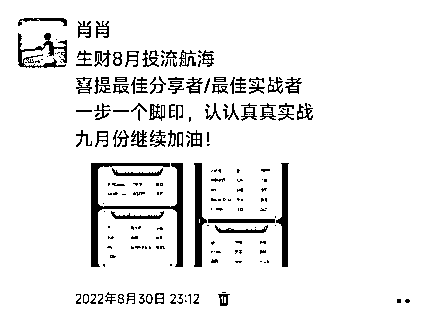

**第四幕：两次特训班，让他从不敢上镜到及格线**

车轮战打完，小半年过去，账上多了十来万。可他心里越来越虚：靠天吃饭，哪天风口没了怎么办？他动了系统学习的念头。恰好在社群刷到E教练的一篇挑货长文，干货密度极高。他顺着ID把E教练的早期内容翻了个遍，发现对方不仅会选品，还系统拆解过某音平台的半自动直播打法，甚至当过好几期特训班的教官。

他抱着试试看的心态去找E教练请教，没想到对方态度极好，问什么答什么，和印象中的“大神”完全不一样。后来，E教练发了一期招募：教某音的半自动直播，承诺只要播满30小时、没达到约定销售额就全额退款。他看完一点没犹豫，立刻抢了名额。

那21天，彻底改变了他对直播的理解。他像一块海绵一样吸收所有操作细节，从一个连开场话术都要打草稿的小白，硬是练成了能自然控场的“及格线主播”。三周交出5万成交额的答卷，还被当成了标兵。他说，从那一刻开始，他才知道自己能在镜头前活下去。

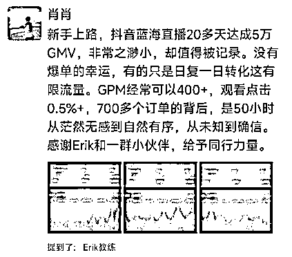

不过，等他杀回微信平台时，半自动动态虚拟背景的玩法已经被封死了。他自嘲：人赚不到认知以外的钱，那就真人上镜呗。

第一次出镜，他面部僵硬，眼神发飘。好在之前在另一平台练了50多个小时的半自动直播，话术早就滚瓜烂熟了。他一边播着原来的产品，一边又挑了一个推荐流里的爆款做备选。备选的要求很简单：可以让助手替他坐在镜头前，他只需在旁演示商品。结果备选产品一测试就爆了，短短几天卖出10万成交额，到手4万多。他第一次尝到“跟着爆款走”的甜头。

紧接着，全国开始放开，防护类产品的需求像火山一样爆发。消毒喷雾枪、姜汤、艾条、柠檬……一个接一个被高手们打爆，满屏都是他们的身影。他身边一位一起学直播的群友，一周赚了六位数。而他偏偏在那个时候全家中招，整整两周躺在床上，一边头疼一边看着别人抢钱，心里那种滋味，比发烧还难受。

身体恢复后，他拉上一位老同学，进入一场长达21天的连轴直播。他心里烧着一团火：不需要每一步都冲在最前面，但一定要一直往前流。

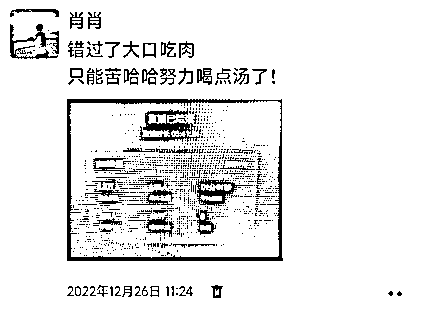

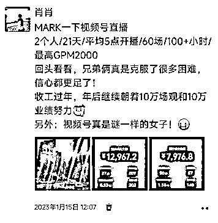

**第五幕：春节后，别人退场他进场**

2023年春节是一道分水岭。放假前，群里还在热火朝天地讨论怎么布局多账号，怎么用商业流量配上及格线主播复制盈利模型。节后一回来，所有人发现，推荐流量突然变差了，新号几乎做不起来。喧嚣一夜之间消失，就像年前什么都没发生过。很多人开始断言：这个平台的红利结束了。

只有他还在傻傻坚持。他招了外聘主播，继续挑货测货。也许是高手们离场留下了一线缝隙，他测的第二款产品又爆了。但平台也给他出了一道新难题：真人出镜配静态虚拟背景，连续被平台判定为低质量内容，总是在将要起飞时被按下暂停键。他被折腾得没了脾气，只能放弃虚拟背景，搭建实景拍摄。换完场景后，问题终于解决。

他养成了一个习惯：每天花一两个小时刷推荐流，看别人在卖什么、怎么卖。有天他盯上一款产品，转化数据很亮眼，赶紧联系供应商。对方嘴上答应发样货，拖了两天却拿不出物流单号。追问之下才知道，那个卖货的账号就是供应商自己的，他不愿意让别人来分食市场。但事情没有按对方的剧本走。他转头找到同品类里一个刚入驻不久的大品牌，对方还没有多少合作主播，遇到他主动上门，立刻开了专属高提成。他如愿以偿地把这款产品打爆：单场迎来9.3万观看，全推荐流最高。可惜他没能完全接住这么大的流量，那一场只成交了2.7万。而另一位朋友后脚打爆同类产品，8万观看就带来接近9万的成交。差距摆在那里，他看得清清楚楚。消息传开后，大批人蜂拥跟进，推荐流里一刷就是几十个同款。

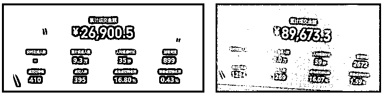

这款货陆陆续续播了一个月。他顺势铺开第二个账号，一边继续卖，一边测新品。很快，另一套模式也跑通了：用几十秒的短内容做钩子，视频爆了再开播，连续好几场之后，免费推荐流被慢慢撬动。后来哪怕不发新内容，外聘主播每天播4小时，也能稳定卖出几千块。这个账号又运营了半个月，直到产品热度过去、货源跟不上，才暂时停下，他继续回去测新的品。

有了打爆款的经验，他拿起同一类需求去选新货。果然，三场就起飞，而且客单价和利润率都更高。他开始尝试小额度投放，不敢放太猛，怕把免费流量带偏。好在整体投产比不错，这款货又稳稳播了一个多月，直到外聘主播临时离场，这个品才被放下。

转眼入夏，他在这个平台上已经做满一年。当初一起播的朋友，有的改做种草平台，有的跳去了别的平台，还有的留在原地换新玩法。真正坚持在微信生态里卖货的，免费流量也好，商业流量也好，掰着手指头都数得过来。但他发现，这几个坚持下来的人，今年都拿到了不错的结果。他问自己：下一步怎么走？心里的另一个声音说：接着往前冲，哪一关不是这么过来的？

于是他转身去试完全买量的玩法。因为没有系统学过投放，账户表现极不稳定，要么一波流，要么钱花不出去。跑了多场，一算账亏了几千。那是他这一年最难熬的二十多天。中途他还试过一次图文带货，手上有七八个万粉权限号，原本以为能派上大用场。结果平台审核各种卡，他反复改内容，把营销痕迹全部削掉，终于过审了——可过审之后，内容已经完全失去转化力。更气人的是，多挂几条商品链接，权限反而被收回，要重新发布10条原创内容去申请复核。折腾两个产品，都是同一个循环，他果断放弃。

他给自己做心理按摩：图文带货是更高门槛的玩法，跟直播卖货本来就是两套逻辑。别分心了，回到自己最熟悉的赛道上，才是正解。

**第六幕：几点真心话**

回望这条路，肖肖总结了五句话，看似朴素，却是他用真金白银换来的。

第一句：机会不会消失，只是换了张脸。很多人把“红利结束”挂在嘴边，他却始终觉得，窗口期永远在，但玩法不断翻新。有人留下，有人离开，每一轮规则调整都会淘汰一波人，也会成就一波人。关键是你愿不愿意跟着变。

第二句：别迷信单干，但先学会单干。他不推崇一个人包打天下，因为一个人扛不了多久；但创业第一年，跑通0到1必须靠死磕。他后来招外聘主播、开第二个账号，都是在把自己从“单兵”变成“队伍”。可他很清楚，如果没有当年那个拼命活下来的自己，后来的一切都无从谈起。

第三句：高手的经验，是省时间的好东西。他在M教练和E教练那里花过两笔学费，如今看来都是最低成本的投入。好信息总是待在少数圈子里，付费是最直接的筛选器。看准一个人，就早一点行动，因为机会不等人。

第四句：最大的分水岭，是能不能接住流量。9.3万观看只卖出2.7万，8万观看却卖出接近9万，这中间的差距，不是运气，而是控场和转化。打爆款只是开始，“接住”才是关键。能在流量涌来的时候稳住节奏、把成交做厚，才是新手通往高手的龙门。

第五句：把“关关难过”当成日常。他不信运气，只信“稳住”。规则会变，流量会变，同行会变，唯一不变的是，机会总是偏心那些愿意一遍遍迭代、在别人退场时还赖着不走的人。

他说，2024年的小目标，是在这个平台上继续深耕，把队伍带成真正的组织，跑一个更大的盘子。

如果你也在视频电商里摸索，或者正在找一个值得扎下去的赛道，希望他的故事能给你一点信心：风口不会消失，它只是换了件衣服。

与每一个还在镜头前坚持卖货的人，共勉。

机会往往藏在不经意的那一瞬间。

照常刷着直播广场找感觉，一个品映入了眼帘——好几个直播间都在带，顺手看了看数据，都不赖。凭着一套熟得不能再熟的操作节奏，我迅速跟了上去。没想到，这一把直接让我破圈了。

尝到微付费的甜头之后，第二场我直接用这个策略开新号起量，结果当场就拉爆了直播间，一口气做到了27000的成交。连着跑了几场，接着复制到第二个号上，套路不变、打法照旧，数据反而更猛——四场持续递增，直接冲到了单场11万GMV，打破了个人纪录。整个过程正好赶在上半年的尾巴上，落地了我年初立下的目标。这个品，一个月给我带来了30万佣金。

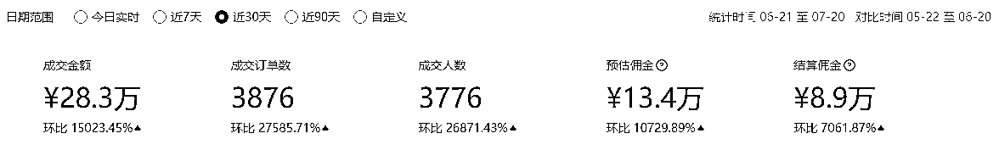

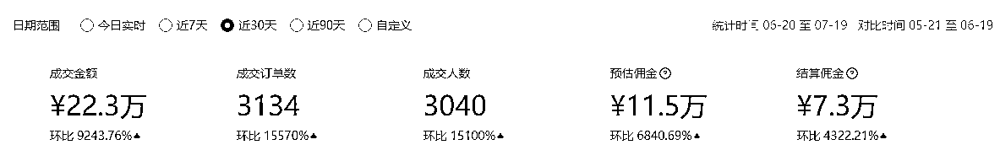

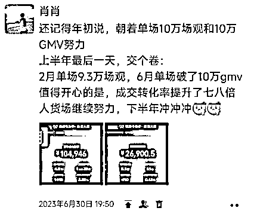

### 纯付费直播

后来这品交给兼职主播团队播了一个半月，跟风的人实在太多，市场被做滥了——不光转化率开始明显下滑，时不时还会踩到违规的线。我只好把视线转去下一个品，心里同时也在琢磨，什么样的玩法才能更稳。那种感觉就像又回到了六月的瓶颈期。

再回头看当初纯付费测的那个品，虽说是我亲手测失败的，但在直播广场上我仍然看到有人在用纯付费打它打得风生水起。说到底，问题还是出在我自己对付费投流的火候掌握得不够。

我下定决心要把这事儿啃下来。想去找个训练营补课，没找着合适的；后来看到有同行开线下课，基于大家在一个圈子里，彼此也算有信任基础，就专程飞了趟杭州，上了两天一夜的课。可说实话，那课堂更多是面向想入局视频号的企业和运营负责人，我这种已经在这块实操一年的人，早就超出了他们的精准受众范围，所以课程内容并没有喂饱我。

好在这条路没堵死——我绕了个道，去请教圈子里那些在付费投流上跑出过结果的大哥们。

他们分享的碎片信息，我一块块地拼起来，再对照我自己过往积累的付费数据分析和对底层逻辑的理解，竟然真让我琢磨出了纯付费打法的门道来。那段时间，我自己既当主播又当投手，每场提前安排好预约计划，开播测试流量的起法、承接转化的做法，下播就埋头做数据复盘。

带着这套总结出来的方法，我决定再战六月份那个失败过的品。

组合计划一搭，三场，测通了。跑得很稳。

为了验证这套打法到底是不是运气，我又接连测了好几个客单价接近的品，越打越顺。纯付费流的曲线居然能跑得跟自然流一样平稳，有的品甚至还打出了相当高的ROI。接触到了更多做纯付费的玩家之后，彼此一交流，发现大家的投放策略和底层逻辑竟然大同小异。那一刻我彻底确信了，我的打法站得住。

也是在那个阶段，我终于明白了付费玩家为什么愿意一直烧钱——甚至连自然流怎么玩都懒得学，也敢大手笔投。因为纯付费直播，确实是更稳定的一条路。

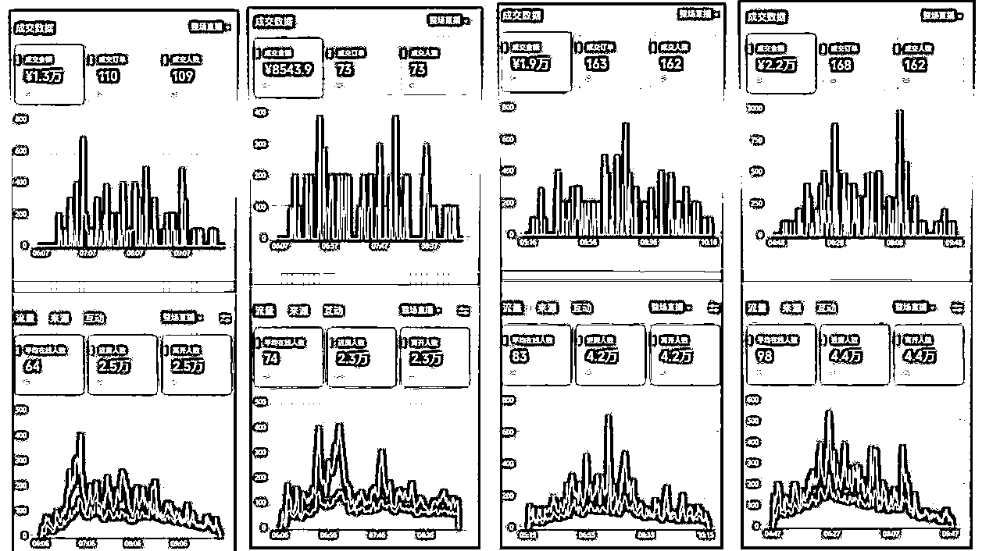

## 06 玩法迭代，殊途同归

### 短视频带货VS直播带货

不管是短视频带货还是直播带货，本质上都属于兴趣电商的范畴，也是交易效率最高的电商模式。你可以只押注其中一种，也可以把重心偏到某一侧，这完全走得通。但如果从平台的产品逻辑来看，短视频负责种草、抓流量，直播间负责拔草、做成交，这才是最顺滑最高效的组合。

真正厉害的电商团队，一定是左手短视频，右手直播，两头都硬，深度配合，把运营做到极致。

对大多数普通人和个人玩家来说，完全可以根据自己的底子和优势选一条路入门。短视频带货确实门槛更低、更容易上手，但如果你看完我这一路走过来的经历，就会知道直播带货对新手也并没有想象中那么难入。

视频号现在还在高速增长的红利窗口期，不出意外的话，未来一年依旧有不少空间。但有一点要警惕——平台的发展方向摆在那里，短视频端在明显往原创倾斜，搬运、混剪那些黑科技操作的生存空间会越来越窄；直播端也在加速规范电商各个环节的体验。最后能活得好、走得远的，还是那些沉得住气做长期主义的玩家。

### 自然流VS付费投流

从自然流打到微付费，再打到纯付费，我最真实的两点体感是：

自然流，拼的是能力和技术。

付费流，拼的是资源和资金。

新手玩家没有捷径可走，必须先在自然流的战场里厮杀，把一身本事给练出来，赚到第一桶金。等你冲出来了、积累够了，付费投流才能真正帮你把结果放大。但一直笑到最后的人，靠的还是打铁自身硬，不停止学习。

很多人没碰过投流，可能会好奇微付费和纯付费到底分别在什么场景下有用。

微付费有三大作用：一是拿来测试和验证人货场，没流量的时候就花点小钱买量看看数据反应；二是辅助起号；三是补充流量、放大业绩和利润。低客单价的品通常更适合用微付费辅助起号，中高客单价则既可以辅助起号也能放大业绩。

纯付费的逻辑更简单——根本不用管有没有自然流，归根到底就是算账，只要付费流量转化下来的最终ROI为正，就大胆地持续加投。

而放到微信这个大生态里看，真正称得上顶级的玩家，玩的一定是IP人设和私域运营。这也是视频号里商业价值最高、爆发潜力最大的公私域联动打法——多元的流量来源、专业的人货场、精细化的运营策略，再到客户全生命周期管理，每一步都在跟平台共舞。

## 07 兴趣电商，黄金万两

### 1. 条条大路通罗马，专注才是王道

抖音也好，快手也好，视频号也好，哪怕小红书，到今天都仍然处处有机会，蓝海赛道也从来没有消失。还记得我在2021年见到不少大佬靠淘宝蓝海赚钱的事儿吗？这几个大平台，从来都不缺赚钱的案例和机会。你觉得自己在走下坡路，很多时候只是因为落伍了、掉队了、停止学习了、没跟上玩法而已。

站在视频号带货这个赛道里，以我亲身的经验来讲，每一种打法都仍然有人在持续赚钱。条条大路通罗马，深扎一个领域，把细节吃透，你的高光时刻自然会来。爆单可以是天降好运，但更可以是厚积薄发。

我向来崇尚专一的创业理念。哪怕受挫受阻，可以换赛道换玩法，但既然换了，就别再东张西望。静下心来像个小学生一样，把这一种玩法研究透彻、把每一个细节摸清楚，破局的那一天，恰好就是你能力进阶的时刻。

### 2. 把对标调研清楚，把案例拆解到位

我很认同坤哥的蓝海理念，更认同他今年反复提的那个观点——把70%的时间放在寻找和研究对标与案例上。

当然这话得全面理解，它不是让你每天固定拿70%的时间去做调研拆解，而是说要有一个阶段性的重心。一旦确定好复制对象，就埋头开干，动作和细节都必须拉满。赚钱本质上就是复制，这是一句朴素的真理。

调研拆解要看什么？比如对标账号或直播间的流量来源分析清楚没有、人货场能不能打得过对方、有什么细节上的门道、市场里的竞争烈度如何。回看我过去多次创业经历，赚到钱的项目无一例外都做对了一件事——有大量的人已经用这个模式赚到了钱；而没赚到钱的，要么没把真实情况调研明白，要么就是资源、团队、执行层面最后没做到一比一的复制。

每一个账号背后，其实都是一个鲜活的赚钱故事。先致敬，再超越。

### 3. 一切选品，必须紧紧围绕客户需求

干兴趣电商，最终能赚到钱，功劳一定归于选品，或者说是供应链的优势。产品为需求而生，为特定的人群服务。一切选品都必须紧紧围绕客户的需求展开。

一个很明显的感受是——品选对了，对场景和主播的要求就会直接降下来。这也就是为什么大家总说追爆品、追热点、品带人。同样的道理，偏蓝海的品因为竞争小、需求并不小，也很容易跑出来。

我之前提过：80分选品＋70分场景＋60分主播，是适合普通人入局直播带货的姿势。这句话背后，其实正是我对选品的深度思考——主播能力弱一些没关系，那就把功夫往选品和场景上使劲。等主播的能力成长起来了，自然就形成了碾压的优势。万事开头难，先把60分的主播做到。

选品还有两个很关键的体感。

第一，被验证过的爆品，隔段时间还会再爆。原因不复杂——是人群需求和竞争程度共同决定的。这个阶段竞争饱和了，转化率自然会变差；但视频号源源不断有新手用户进场，又会推动这个品进入到下一个生命周期。

第二，要学着吃透一个需求，而不是盯死一个品。需求在，这个品不行了，换个品照样能干。如果你恰好踩中了某个客户需求，那别废话，把执行力拉满，趁这波钱好赚赶紧赚够。

### 4. 高价高佣打付费，低价高佣甚至低价中佣也能打付费

这可能是今年最刷新我认知的一点。

因为一直深耕在视频号，到了下半年才陆续听说很多在抖音用付费去打低客单价产品的故事。但当你理解了用户行为和流量转化的完整漏斗后，仔细一想就明白了——这完全是成立的。说到底就是算ROI的账。大家可以自己琢磨琢磨这个逻辑。

今年我很长一段时间都在做自然流直播，主打中高客单价、中高佣金的产品。但为什么后来开始从自然流去微付费、纯付费？其实也是清晰感知到了平台流量分配正在往那个方向倾斜。

说得再直白点，两个建议给到大家：

如果你现在做的是中高客单价产品，利润还可以，千万别沉迷于薅自然流，得注意把付费流量加进来；如果你中高客单价品做得极其吃力，那为什么不试着换个低客单价的产品去跑一跑？

自然流和付费流，在某种意义上，各自有各自明确的战场。

### 5. 赚快钱和赚慢钱要分阶段，也需要两种不同的能力

到底赚快钱还是赚慢钱，取决于你当下的阶段、目标、能力和资源。

如果你是一个新手，我还是建议从小的切口进入，目标就是拿到正反馈。先赚到一点钱，建立信心，让团队活下来，再慢慢做一些有积累的事。要沉得住气。第一个30万，或者说第一个20万、第一个10万，要尽可能快地攒起来，这个阶段拼执行力大概率就够了。

但有一点你需要提前知道——赚快钱和赚慢钱，常常是两种完全不同的能力。赚到快钱了也别沉迷在里面，要及早铺排更稳定的打法，为下一步做准备。

# 二、从航海实战船员到教练的修炼之路

如果说龙哥盟是一个运营上极其出色的星球，那赚钱航海在我看来就是一个伟大的作品。

每一期带领上万名船员一起下场实操，再通过持续航行去放大每个人的成果，产生的商业价值总量数以亿计。从去年第一次登上万人航海的大船起，我就一直以用户的身份，亲眼见证着这款产品被打磨得越来越好。

昨天受郭晓文老师邀请，在龙哥盟的直播间做了一场访谈，聊了聊我从船员一路走到教练的感受。说实话，回看这段成长的历程，心里有十足的满足感，也有一点骄傲。这对我来说是一笔极为宝贵的成长资产，也是精神财富。

## 船员

翻了一下赚钱航海的主页，这一年半里，我先后参加了6期共12条船——去年6月有两条船没显示出来——其中船员身份一共参加了10次，每一次都按引导要求认真完成了航海打卡。

作为船员，简单分享几点感受。

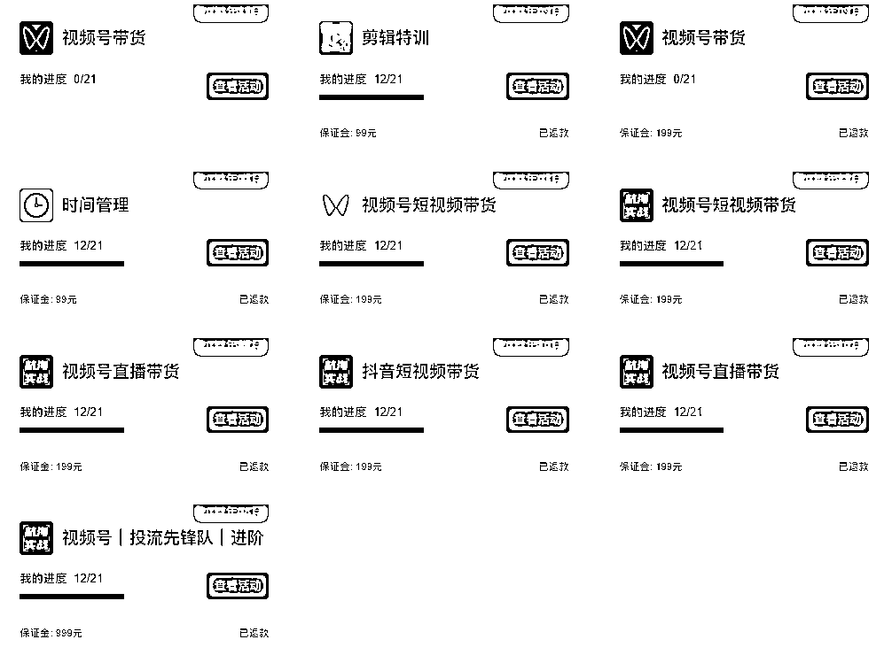

### 航海实战，重在实操，一定要下场去干

星球和航海是两种完全不同的定位和功能。星球帮大家开眼，实战带大家下场。而下场之后沉淀下来的宝贵资料，又会回到星球里反哺更多人。知行合一，循环优化，这个设计简直精妙绝伦。

关于怎么使用赚钱的方法和技巧，很多圈友都用心分享过，我可能用得还比较浅。我觉得就一句话——先出发，先上路。在路上多交朋友，选好自己的船，跟着航海线路图，干就完了。遇到问题，要么去星球找资料，要么找圈友交流，解决掉一个，再来下一个。

### 光下场干还不够，最好要再干出点名堂

大家都在下场，主动也好、被推动也好，接下来就要看谁真把手弄脏了。你有没有把手弄脏，说到底就看时间投入在哪里——这些都清清楚楚写在你的航海日志里。记得我当船员的时候，就很认真地在卷日志，冲着精华楼去写，让每天都有一点点进步。

写日志听起来像公司要求的日报周报，但千万别以为这是写给组织或者领导看的——这是写给未来的自己。

### 在选定的赛道，最好持续扎根，复利价值极大

选平台＞选赛道＞选品。选择大于努力，这句话确实讲得很透。方向不对，努力白费。

一旦选定赛道，就要做好持续航行的准备，一路打怪升级。创业本身就是一场修行，翻过一座山，还有下一座。持续在船上，就能第一时间接收到动态信息和最真实的数据，长期积累下来的复利价值非常大。

这也是为什么我一直说，赚钱实战航海是一个伟大的产品——它真真切切在帮助个体创业者提高成功上岸的概率。

## 分享嘉宾

赚钱航海的机制设计真是绝了——不只是带大家实战，还会给一部分人一个展示的舞台。

记得前半年航海时，我有两次被邀请以船员身份做分享嘉宾。那之后我破圈了，被更多人看见和认识，开始有了个人影响力。当然，能被注意到并受邀，根本原因还是我先干出了一点成绩，同时通过表达和输出让别人了解了自己。

做分享嘉宾的好处不用多讲，我更想说的是——我是怎么看这件事的。

### 找准需求切口，攻其一点，把自己打造成标杆

除了实操项目本身，更重要的是站在需求者的角度去想，我能够满足圈友怎样的迫切需求或者普遍需求。

拿我自己来说，去年8月参加视频号投流航海时，我是唯一一个纯纯粹粹的小白。但我发现当时做投流挂车需要购物车权限，而这个权益是大多数账号都没有的。我这个批量产出了几十个购物车账号的经验，就成了稀缺价值。

又比如今年9月在航海以教练身份做分享，我结合自己做直播带货的经历，分享了一个普通人如何成为60分主播、怎么去入局直播带货的路径。这个内容对于很多想尝试直播带货的圈友来说，多少是打开了一扇窗。

### 80分带60分，60分带30分，分享的接力棒

我知道很多船员不敢分享，哪怕只是在群里回答几个问题都会犹豫半天。他们总觉得自己不够好，怕说错，给自己设了很高的门槛，最后选择沉默寡言、埋头做事。

这也没什么，有人爱安静，有人爱热闹罢了。

但留意一下那些拥有更多机会的人，你会发现一个共性——这些人真的很能蹦跶，敢分享，勤分享。而我最喜欢赚钱的一点，就是这种分享的机制和理念。让我敢在小白的阶段就做分享嘉宾、在星球上发帖的底气，来自于“80分带60分，60分带30分，30分可以带10分”的认知。

现在我也越来越体会到：比你优秀一些的人，才是最值得你学习的对象——而不是那些优秀你太多倍的大佬。

## 教练

要说今年最开心的事，除了业务上不断刷新纪录的高光时刻，就是得到赚钱的认证，正式成为了一名航海教练。赚钱的大佬和高手很多，尤其视频号带货这条一直很热的大船，能成为其中1/8的教练，真的觉得特别荣幸。

目前我只做了两期教练，还处在一年级。教练这个角色上，往后还要向李诚、向宏这些前辈多多学习。眼下也谈不上有什么特别深的感悟，先认真做好教练该做的事。如果以后有机会、条件也允许，我很希望可以持续为赚钱航海保驾护航，为圈友们分享更多经验和干货。

## 训练营导师

有些事情真的是计划不来的，尤其知识付费这件事，很难刻意做出来。因为自己从0赚到了100多个W，因为不断在成长过程中帮助别人、收获了很多圈友的认可——上天就真的为你把一扇扇窗打开了。

前阵子，我在赚钱的贵人，也是我的直播启蒙老师Erik，邀请我担任视频号带货训练营的导师，一起给学员做交付。这一路走来，我是非常感激Erik的指导和帮助的，他也亲眼见证了我的成长，有这样的合作机会我当然倍加珍惜。

所以我几乎是倾尽全力，把自己一年多实操积累的经验毫无保留地输出。看着学员们的成绩，再一次验证了我过去走过的每一步都没有白费。

# 三、写在最后，一路走来的7点心得

有圈友好奇地问我：为什么你一直笃定视频号带货？为什么你可以不断切换玩法还能一路升级？为什么你好像走到哪儿都左右逢源？

在文章的最后，我仅代表自己，分享一些这些年摸着石头过河攒下来的创业心经，与大家共勉。

有道无术，术尚可求；有术无道，止于术。术法道器势，各有其妙用。

### 1. 一次只认真做好一件事情

贪多嚼不烂。不管是项目还是打法，专注做好一件就已经够厉害了。每进入一个新项目或者换一种新玩法，都要拿出小学生的姿态去学、去练，并且怼够一定的量。量变到一定程度必然引质变，细节里藏着魔鬼。

一个人的注意力和精力都是有限的，每次只去做好一件事，沉浸进去，那种心流状态本身就是一种奖励。

### 2. 差异化，并且尽力做得足够出色

不管做业务还是个人成长，本质上都在赛马，尤其是在算法时代。既然是赛马，就一定有多个衡量维度，有显性的也有隐性的。回看过往创业经历，我感触最深的商业策略就是差异化——但光有差异化还不够，还要把这种差异化做到足够出色，才能真正让人记住你。

### 3. 去种草，猥琐发育，自然生长

不要去追一匹马。用追马的时间去种草，等春暖花开的时候，会有一批骏马任你一匹一匹挑。

前期就该种树种草，猥琐发育。尤其是个人创业和小团队创业，一定要用最低成本去启动。宁可一个人先干，也别一群人先开会。效率永远是第一位的。

业务层面，找最短的路径去变现，先把MVP跑通。耐得住寂寞，忍得住孤独，自然生长，静待花开。

### 4. 向上社交，价值交换和付费思维，多结交好大哥

就算你有一颗真诚的心，但不懂向上社交的姿势，也很容易碰壁。早期我自己就遇到过这事——关注了一些大佬，没有及时发自我介绍、没有清楚说明自己的需求，导致交流始终不太顺畅。

后来在赚钱看到一些向上社交的经验分享，恍然大悟：原来如此。从那时候起，我更懂得怎么去跟想链接的人做向上社交了，也因此结交到了一些真正的好大哥。

### 5. 向下兼容，攒人品思维，扩大群众基础

但凡你愿意在公开场合做一些分享，就一定有人来链接你——对他来说那是向上社交，而你需要做好向下兼容。

向下兼容是在给自己攒人品。也许会搭进去一些时间和精力，但长期来看，你会收获很多认同。群众基础厚了，人品攒够了，未来哪一天你想做点事情，很快就能拿到一大波支持。

### 6. 真诚利他，合作双赢

有天看到一句话：利他是什么？利他是一种商业模式——你能为别人创造多大的价值，你就拥有多大的价值。深以为然。

没有真诚之心、利他之心，哪来的合作，更不用说什么多赢局面。尤其在当下这种互联网环境下，将来除了传统的招聘、自营模式，会有越来越多的线上团队和合作模式涌现出来。

### 7. 以终为始，行稳致远

创业的目标和意义是什么？每个人答案都不一样，也会随着时间和阅历不断改变。

但踏上创业这条路，我们在搞钱之外，还应该想一想：自己能看到的终局是什么样子？这决定了你选择什么样的路径往前走。以终为始，能够更清晰地判断自己当下所处的节点，步子稳了，路才能走得远。

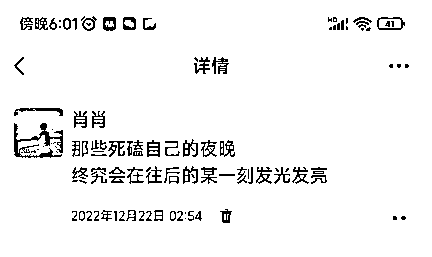

这篇文章不像我之前发过的那些精华帖，没有什么能直接拿去落地的技术型干货，也没有负债几十万绝地反击的那种戏剧性爽感。但它是我动笔以来最有心流的一篇——写的是真实的创业记录，是笃定一条赛道之后攻坚克难的过程。回过头才发现，原来已经迈过了这么多道坎。

不管你是全职创业还是做个人副业，是个人玩家还是小团队，在做项目的路上，都会有太多太多艰难时刻。需要抉择、需要取舍。中途下车和放弃，是大多数项目夭折的原因，但反过来看，它同时也是一个结果——你选择了放弃，所以项目才夭折。

希望这篇文章能给你一些力量。卡点来了、困难来了，想尽一切办法去把它解掉，也许下一拐角，就是柳暗花明又一村。

凌晨四点半的城市，路灯还没熄灭，我踩着影子出门。那段日子，整个人像被什么推着走——不是闹钟，是心里那团火。写作这篇长文，不只是记录，更像替许多一起走过这段路的人，把记忆重新擦亮。视频号经历过的那些起伏、转折、寂静和爆发，都像一帧帧画面，嵌在我们共同的年轮里。

回想这一年半，脑海中总会跳出几十个名字。我们从没见过面，却比很多熟人更懂彼此。龙哥讲“把手弄脏”的时候，我知道他是说别怕沾泥，下场才能摸到门道；坤哥的“蓝海”两个字，像一束光打在不被看见的角落；木易的“执行力”落在心头，提醒我光想不做等于零；晓文的“碎片拼图”，让我学会把零散信息拼成完整地图；Erik三小时起步的直播风格，硬生生把“做不到”三个字磨成了“再试一次”。他们的话，在我最吃力的时刻，像补给站的水和干粮。

说来也奇妙，这里最值钱的从来不只是赚钱的门路，而是一种少见的气息：用商业的逻辑，搭起了人文的骨架。它讲规则，也讲温度；谈效率，也谈情义。我一个粗嗓门大老爷们，写着写着，竟也忍不住心头一热，想说一句——龙哥盟，我是真的喜欢你。