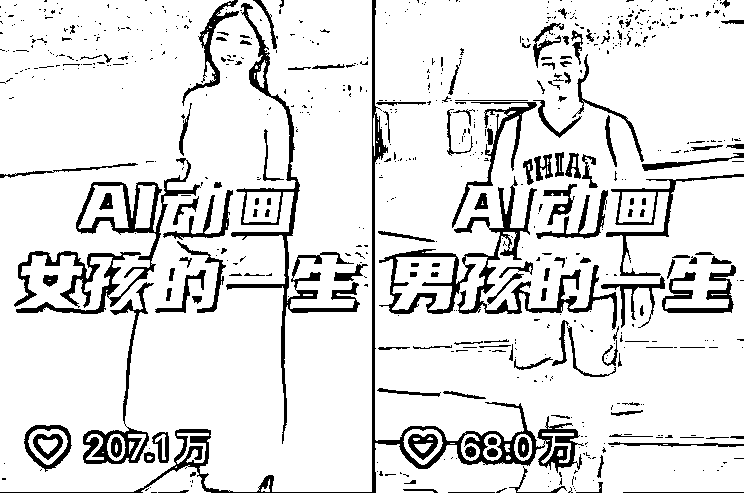
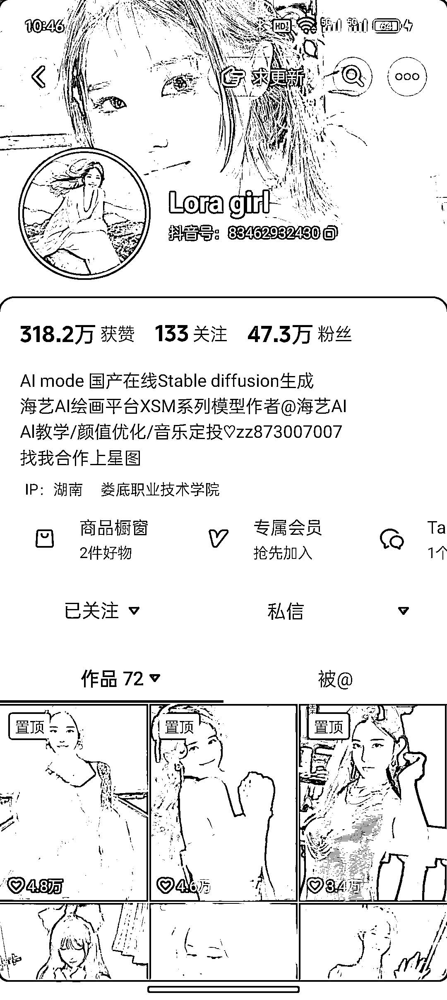
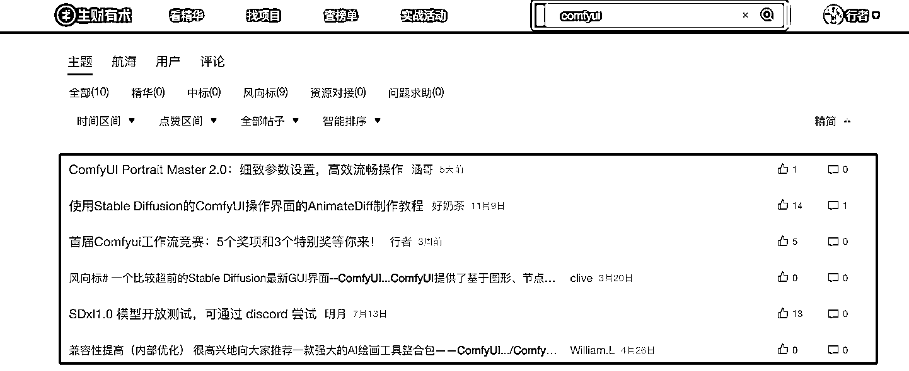
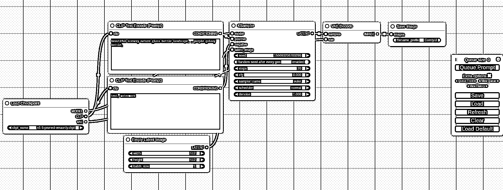

在 AI 绘画这片热闹赛道上，ComfyUI 正以黑马之姿闯进大众视野。它凭借独有的节点式工作流和对显存更友好的设计，迅速圈粉大量开发者和个人玩家。搭配 AnimateDiff 后，你甚至能生成如丝般顺滑的动态视频——还记得抖音上刷屏的“一个男孩/女孩的一生”吗？那类作品的背后，就有这类工具的身影。如今 SVD、Turbo、Krita 实时渲染等新玩法层出不穷，AI 的进化速度在 2023 年简直像开了倍速。

翻翻抖音，也不难发现那些打着 AI 美女旗号的账号，画面效果几乎能以假乱真，吸粉势头猛得惊人。比如截图里这个账号，涨粉就像坐火箭。眼下大家还在拿真人影像去生成 AI 内容，未来会不会演变成“由 AI 生成视频再去创作新 AI”的循环？这个想象空间不可谓不大。

我特意在生财社群里翻了一圈，发现关于 ComfyUI 的内容屈指可数。趁着小航海即将启航，干脆整理一份适合新手的 ComfyUI 入门手册，希望能给同路人垫块砖。

### 一、ComfyUI 到底是什么？

简单来说，ComfyUI 是一款基于节点流程的 Stable Diffusion 绘图工具。你可以把它理解成“装上 Stable Diffusion 引擎的 Substance Designer”——把原本线性的绘图流程打散成一个个独立节点，这样一来，每次生成都能实现更精准的流程定制，复现性也大大增强。当然，节点式操作也抬高了部分新手的学习门槛，这点无可回避。

### 二、用 ComfyUI 能带来哪些实实在在的好处？

先说最硬核的一点：它为 Stable Diffusion 提供了一个极具操控性的节点界面，让你拥有更高的自由度与复现能力，同时对显存的要求也更友好。实测相比 WebUI，ComfyUI 的出图速度能提升 10% 到 25%，而且显存占用更低——现在哪怕只有 8G 显存，也能在 ComfyUI 上顺畅跑起 SDXL 工作流。

除了硬件优化，ComfyUI 本身也是一套容易上手的工作流设计工具。它支持可视化搭建、快速切换不同工作流；不光是文生图、图生图、高清修复、面部修复、局部重绘、LoRA 这些常规操作，连 Reactor、ControlNet、IPAdapter、AnimateDiff 等热门插件也能无缝集成。

对于企业用户来说，更香的地方在于：把工作流打磨好之后，只需一键就能跑通全流程。比如批量替换背景、一键抠图，或者搭建一套专属的摄影工作流。而且 ComfyUI 的另一大杀手锏是——你可以直接导入别人分享的工作流文件，加载后立即可用，无需从零开始。

考虑到全文篇幅较长，为了更好的阅读体验，欢迎移步飞书继续阅读：

[`jrnoijjrwm.feishu.cn/docx/QVeOdYtiHooLkRxmOzccLdb5nKc?from=from_copylink`](https://jrnoijjrwm.feishu.cn/docx/QVeOdYtiHooLkRxmOzccLdb5nKc?from=from_copylink)