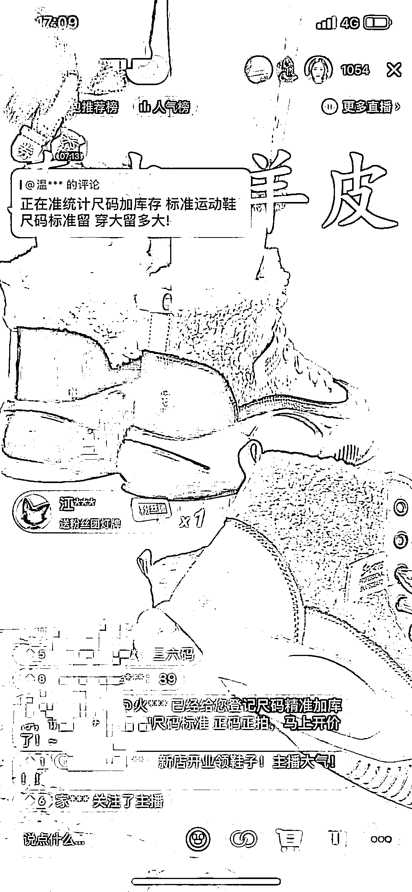

# 单品打爆直播间：绿幕手播带货实操分享

嗨，我是钱哥老矣，苏州人，今年37岁，算是互联网创业路上的老玩家了。我的赚钱路径大概是：淘宝卖货 → 淘宝客 → 无人直播 → 半无人手播 → 抖音IP直播/视频号直播。目前主要做抖音/视频号带货、IP带货。凭着自己的打拼，已经还清了100万贷款，2024年轻装出发，相信一定会有大爆发。在生财看到不少年轻有为、认知很高的朋友，真心羡慕你们在最好的年纪就有了这么好的思维格局，忍不住感叹“钱哥老矣，尚能饭否？”希望有机会多和大家交流，向你们学习！接下来分享的是我这半年一直在做的项目：**抖音单品打爆直播间绿幕手播带货**。觉得有用的话，别忘了点赞收藏留个足迹，咱们认识一下。

详细内容请移步飞书文档：

[`v1e5tzw5w2.feishu.cn/docx/DDfydGAL7oJppXxDx0BcMGnaneg?from=from_copylink`](https://v1e5tzw5w2.feishu.cn/docx/DDfydGAL7oJppXxDx0BcMGnaneg?from=from_copylink)

评论区——

执着：上半年一直在搞女鞋半无人直播，下半年想转不露脸，结果没坚持住[撇嘴]

钱哥老矣：你入场那么早，机会很大的，不做了确实可惜。

陆陆66：视频号有没有尝试过这种模式？

钱哥老矣：视频号也不是不行，只是主播必须真人露脸；绿幕背景只能用静态图片，放视频是不行的。

陆陆66：如果来做复盘，你觉得有哪些关键动作加快了结果？又有哪些失误拖慢了进展？

钱哥老矣：说到底，最关键的一点就是信念感。你打心底相信这事能成，它才有成的可能；要是连自己都犯嘀咕，结果多半不会好。

蓝天：可以加个联系方式链接一下吗？

钱哥老矣：wfishfans，加的时候请备注“生财圈友”。

