# 视频号史上最全实操干货全文！

直播带货这件事，想用几句话就给你讲明白？基本等于痴人说梦。

今天这篇长文，是一份实打实的视频号直播带货作战手册，送给那些没有雄厚资本、没有人脉光环，但依然想在直播江湖里闯出点名堂的朋友。这份手册会按照你从零起步的经营顺序，由浅入深地拆解每一个关键环节，你可以直接拿来对照着用。

我在这行摸爬滚打了九年，踩过坑，也拿到过结果。这次把我脑子里关于视频号的核心理解，一次性倒给你。

# 一、先别急着开播，想清楚你为什么要干

张一鸣有句话说得特别透：你对一件事的认知水平，就是你在这件事上的竞争力。

认知到位了，再谈选赛道，顺序不能乱。

现在都说直播带货是红海，卷得没法干了。这话对抖音来说成立，但放在视频号身上，故事才刚刚翻开第一页。视频号的带货生态还处在早期红利阶段，很多细分类目的付费用户甚至还没有被完全开发出来。2023年下半年，视频号用户增长创了历史新高，更难得的是，内容质量也跟着水涨船高，用户的体验感明显提升了。

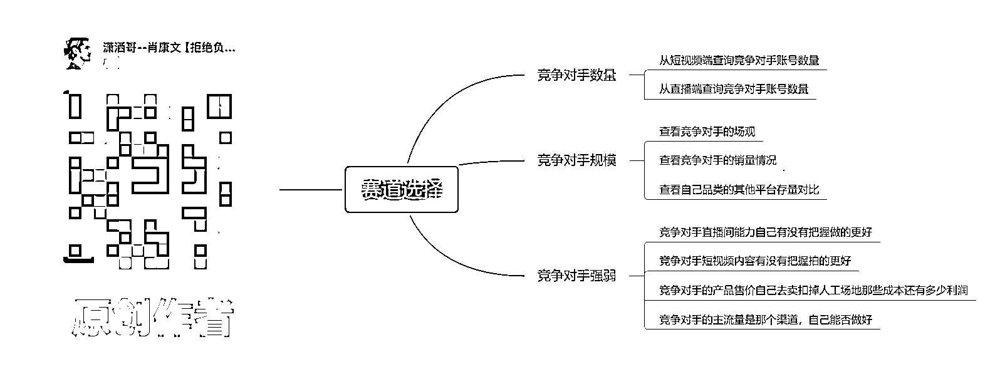
为什么我说视频号才刚刚起步？因为平台官方在2023年中期就定下了一个战略：大力扶持中腰部商家进驻视频号，直接给流量扶持。从这一步棋就能看出来，视频号对自己的定位心里非常有数，也清楚地知道自己在这个直播竞技场里的位置。

用一个通俗的比喻：视频号就是微信的亲儿子，而微信，就是那个坐拥海量用户的世界首富。其他平台做梦都想要的用户黏性、用户规模，微信天生就有。视频号真正要做的，并不是像抖音那样费尽心思去站外引流，它只需要做好一件事——接住微信生态里源源不断的流量。只要有优质的内容能够承载这份流量，就能形成正向循环。

2023年官方明确邀请其他平台的中腰部网红入驻视频号，这直接说明视频号的战略层已经完全觉醒了。也正是这一系列动作，让23年下半年成为视频号近年来增长最猛的一段时期。我自己在线下课时也分享过，有一天上午，我在抖音刷到的视频，转头就在视频号又刷到了。这说明什么？大量原本在抖音做内容的博主网红，已经开始把视频号当作了第二阵地，内容都是同一批，分发到两个平台而已。

一边是抖音那边用户增长基本见顶，另一边是视频号高歌猛进——这就是电商平台红利期最典型的样子。用户的体量还在持续爬坡，平台处于高速生长的阶段，流量红利自然源源不断。

当然，视频号里也已经有一些品类进入了刺刀见红的阶段。原因也不复杂：这些赛道的商家入局早，见效快，比如你卖牛仔裤在产业带靠视频号爆单了，隔壁同行马上就能知道，然后一股脑全涌进来，竞争维度迅速白热化。

所以，选赛道必须死死盯住三个核心问题：
1. 你的竞争对手有多少？
2. 你的竞争对手有多大？
3. 你的竞争对手有多强？

入场之前，先把行业格局和竞争烈度摸清楚。盲目乱撞，就是给未来的败局埋隐形炸弹。怎么判断一个行业卷不卷？去数短视频的数量，去数直播间的账号数量，再和其他平台的存量做个对比，基本就能看出来。

除了看对手，还要看自己。你的团队强在哪儿？如果擅长拍摄、美工、剪辑，那就去做素材驱动的玩法；如果主播能力强，那就把重心放在直播间内；如果手里有强大的供应链，那就把供应链的优势发挥到最大化。

赛道选择的终极意义，就是找到最适合自己团队的那条路，然后把自己最有优势的那块长板发挥到极致。只有赛道选对了，后面所有的技术手段才有用武之地。

# 二、产品和玩法之间的关系是什么？

顶级操盘手必须拥有一个商业全局观，要懂得一个底层逻辑——什么样的产品，决定你能玩什么样的打法。

市面上所有的带货直播间，本质上只有两种：单品直播间和多品直播间。流量也分两类：一类是付费投流或素材种草带来的精准流量，另一类是不太精准的广场流量、以及靠爆款短视频吃瓜引来的泛流量。

有些产品天生就不适合某些玩法。举个例子：普通杯子的认知价格就是几块到几十块，但如果你有个杯子因为特殊功能要卖几百块，这时候你却想靠广场自然流去卖它，那从起手就错了。广场流量进来的人目的性不强，精准度不够，靠这个承接高客单价产品根本不现实。

所以做广场极速流这种打法，选品端就必须选有价值认知差的产品。比如你卖一台未拆封的iPhone 15，市场认知非常统一，你只要半价卖，核心动作就一个——证明它是正品、无瑕疵。观众贪便宜的心理被你牢牢拿捏，自然就愿意下单。

但如果你卖的是高客单、高价值的产品，普遍高于观众的认知价位，那就需要提前种草，或者精准流量的引入，否则根本成交不了。

同理，团队和玩法之间也存在着天然匹配的问题。开始之前，一定要建立系统的团队认知，才能走得更远、更久。

# 三、视频号的算法，究竟在算什么？

直播的玩法千变万化，有憋单、平播、自然流、微付费、纯付费、打素材、打人设，甚至演戏、套路……但所有能跑通的打法，本质上都在做同一件事：迎合算法。

我自己从淘宝刷单做到抖音直播养鱼，种种操作，说白了都是顺着算法的脾气调整动作。所有电商平台的幕后，都是一台电脑机器，有一套自己的计算公式。

先搞清楚一个根本区别：抖音是纯粹的兴趣电商，而视频号是社交电商和兴趣电商的结合体。正因为视频号叠加了社交属性，直播间权重中社交功能占了不少比重。如果你用抖音的兴趣电商维度去套视频号，保准跑偏。

兴趣电商的算法逻辑其实很直白：系统给你推了100个人，其中95个人一进来就划走，只有5个人留下来，互动、关注、灯牌、下单……样样都做。系统当然会记住这5个人喜欢你直播间的内容，下一次就会推更多类似的人进来。你不断地接住，系统不断地推——慢慢地，你的账号标签就被打上了，系统知道该给你推荐什么人了。到这一步，你的号就算起成功了。

算法的核心，就是判断“谁更喜欢你的直播间”。谁喜欢你，则看用户在直播间的各种表现数据：曝光点击率、点赞、停留、互动、关注、灯牌、小黄车点击、小黄车停留、下单、成交……这些都分配着不同的权重。视频号还有两个特别功能需要重视：分享功能和预约功能。具体的权重高低，和你的账号处在哪个阶段密切相关。

有一点要特别注意：系统是以曝光量为基准来计算数据的，因此曝光进入率——也就是用户进入的精准度——有时候会让数据呈现出极度夸张的起伏。所以你可能只是换了个直播场景，流量就有了巨大变化。记住一句话：主播IP和主播本人，本身也是场景的一部分。拿流量的核心就是在赛马机制中，让某一个数据维度极度爆发，或者让多个数据维度综合达标，这样系统就会持续给你供流量。

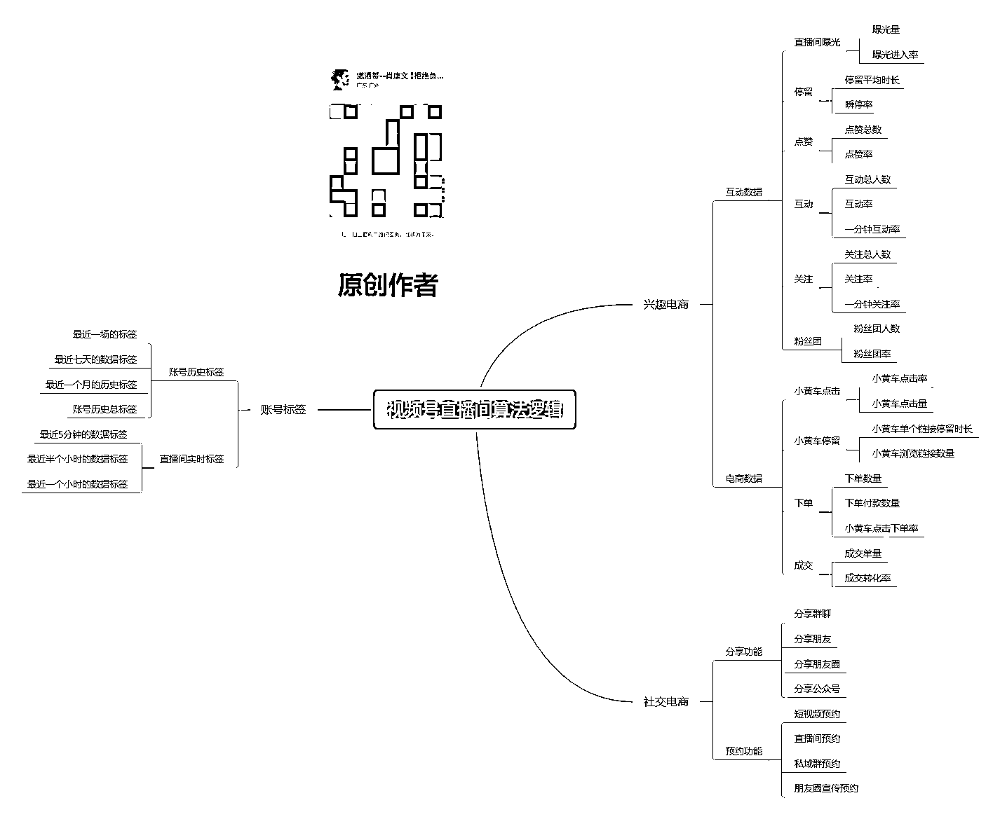
视频号算法考核的数据维度，我帮你列全：
曝光进入率、停留、点赞、互动、关注、粉丝团、小黄车点击、小黄车停留、下单、成交、分享、预约。

在不同的账号阶段，你需要侧重的数据也是不一样的。之前线下课我把这个问题专门讲透过，尤其是系统如何去定义分享和预约这两个维度的权重——这非常重要。

# 四、看懂内容，才可能看懂直播

内容维度要拆成三块看：直播内容、短视频内容、投流素材内容。分析一个账号，必须从这三个板块同时入手，才能判断出它的优势到底出在哪一环。

直播内容还可以进一步拆成：场景内容、直播节奏内容、产品内容。

大家最感兴趣的通常是直播节奏内容。我把所有带货直播间都归纳成三个节奏环节：拉人、洗人、打单。拆解直播间的时候，你要分析他的节奏里这三个环节分别占据多少比重，为什么这么安排，又是如何跟场景、产品做搭配的。

场景内容又可以拆为：直播间场景、道具场景、人物场景、表述场景。每一块都解决不同层面的问题，比如信任感的建立、玩法的匹配度。

产品内容也还要拆成：组品、排品、产品划分、产品展示内容、产品吸引力内容。很多团队只关注了组品和排品，剩下三块基本完全没意识——这才是差距所在。

短视频内容和投流素材也是一样，需要拆成若干细分的小块去琢磨。只有把内容拆到足够细，你才能真正理解它、看懂它。

操盘手的核心敏感力，就是从不断拆解内容、追踪数据反馈的过程中慢慢沉淀出来的。这种能力一旦建立起来，你就对内容有了原创设计能力，也有了对好内容的学习模仿能力。说到底，操盘手最大的竞争力，就是内容理解力。

# 五、话术的真相：理解逻辑，而不是背台词

我培训主播时，有一套自己的方法，把话术拆成了13个细分类别，分别是：

1. 活动话术——制造主题氛围，让观众觉得今天与众不同，提升营销感染力。
2. 痛点话术——把用户正在遭遇的烦恼、不满直接说出来，刺激购买欲望。
3. 卖点话术——把产品解决痛点的能力讲透，持续提高购买欲。
4. 场景话术——用假设的方式描述用户拥有产品之后的生活画面，激发想象。
5. 信任话术——解决“为什么买、为什么找你买、为什么今天买”这三个信任维度，是临门一脚的关键。
6. 开款话术——介绍完卖点和保障后，引导用户马上下单的话术。
7. 踢单话术——针对犹豫不决的客户，制造紧张感，比如“最后只剩一单”，直接踢单逼定。
8. 保障话术——用正品保障、假一罚三、运费险等承诺打消用户顾虑。
9. 转场话术——在线人数下滑时，主动创造新话题，重新抓住用户注意力。
10. 互动话术——注意，评论不等于互动！点击进直播间、点赞、关注、加团、评论、点小黄车、下单、点福袋、看直播——用户的一切行为都是互动，引导用户做这些动作的话术就是互动话术。
11. 指导话术——教用户如何操作，或者暗示做出某种操作会有什么好处。
12. 留存话术——用主播的价值描述和吸引力透出，让用户停留更久。
13. 配合话术——助播、场控、中控等所有直播间其他成员，配合主播输出氛围、逼单、踢单的话术，本质上是帮主播分担输出压力。

为什么有些团队能无限复制自然流直播间、无限复制主播？核心就在于操盘手真的吃透了话术背后的逻辑，还能原原本本地讲给主播听，甚至亲自演示。

22年我跑一个玩法模型时，准备了12个维度的话术模板，一个月内优化了500多次，一个字一个字地根据数据表现扣细节。直播间各种状况都有对应的脚本应对方案，细节到主播的姿态动作和情感表达都完整记录。所以哪怕来一个完全没干过直播的新人，到了我手里，3到7天就能上岗，而且不见得比老主播差。

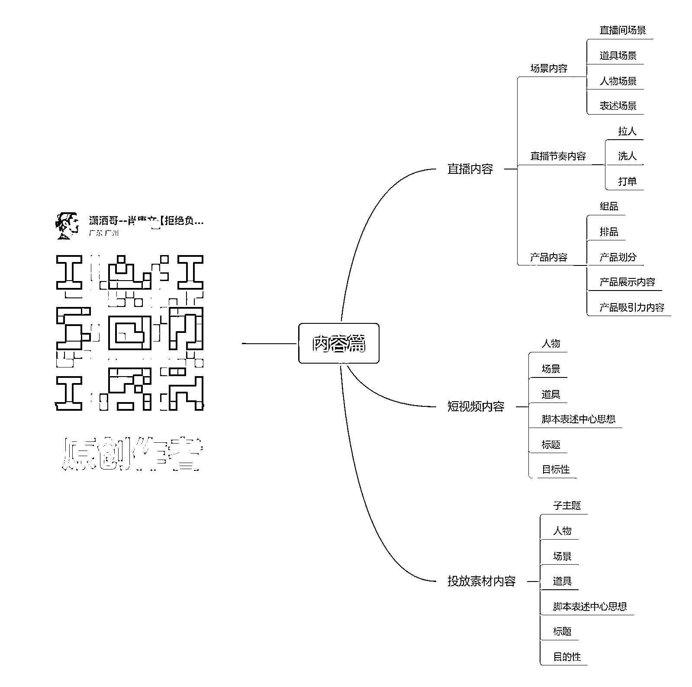
但对主播来说，记住一个核心原则：你不是背话术的机器，你是表达意思的人。逼单话术不是要求你把那段话原封不动说出来，而是要求你在当下那个情境里，用适合你自己的方式去完成逼单。话术只是文字层面的载体，你要理解的是文字背后那个真实意图。死记硬背只会让你的主播生涯永远卡在一个浅层的位置。

拆解话术的时候，要一个字一个字地拆，还要搭配说话时的肢体动作和场景内容去综合理解。人和人的沟通，30%靠语言，70%靠肢体。光拆文字不拆肢体，等于白拆。做直播的人，一定要学会拔取同行的话术，拆解、分析、学习、借鉴——这是最高效的生长方式。

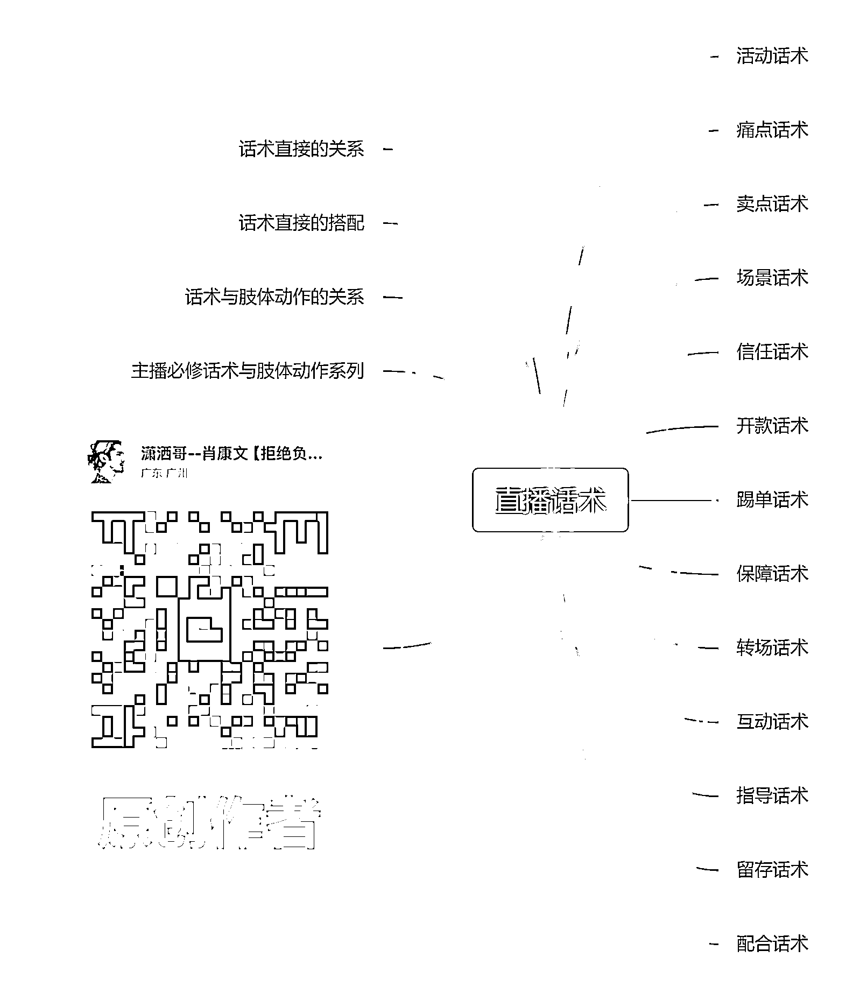

# 写在最后

素材里还有更多关于投放、复盘、团队搭建、直播间场景打造、运营流程、辅助工具、抖音与视频号的电商历史对比、商人思维以及我个人九年电商经验的避坑分享……每一个话题都值得单独展开。但话术有尽，认知无穷。

请你记住全篇最关键的那句话：**话术是死的，主播是活的。** 所有话术，都是在与数据的持续博弈中不断修正、打磨、升级的——没有一劳永逸的完美话术，只有始终在迭代的精进之路。

视频号的红利窗口已经打开，你此刻的认知深度，将直接决定你能接住多大的风浪。共勉。

## 六、数据篇——不同打法的直播间，看数据的侧重点不一样

直播间的流量推送本质上是有因果关系的。真正专业的电商直播团队，都会盯着数据变化去不断迭代内容。做电商就绕不开数据梳理与统计。

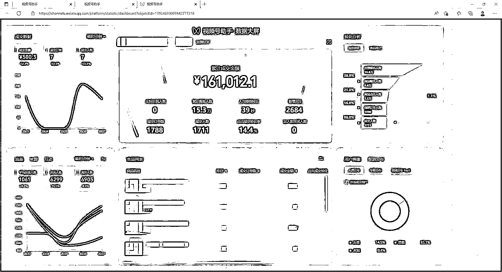

**01、如何拆解流量来源**

点开数据大盘里的流量详情，就能看到各渠道的占比情况。怎么解读要看当下环境。

关键在于，不同玩法主攻的流量口不一样。比如有人主攻短视频，有人砸付费，有人靠直播推荐。这三者的主要来源完全不同，所以必须结合自己的打法去看。

新号起步，重点看的就是你主攻口的流量占比 + 直播推荐占比，基本就够用。通过占比能判断流量结构。通常主攻口和直播推荐是互相带飞的，主攻口爆了，推荐也会被拉起来；如果主攻口本身就是直播推荐，那爆发会更直接。

看完渠道占比后，直播间的承接策略也要跟着调。因为不同渠道的用户精准度不同，承接方式自然不同。比如视频端来的用户，往往是被种草素材吸引进来的，本身偏精准，这时候更适合直接打单承接。而直播推荐广场来的用户，泛得多，承接就要更普适。

看渠道占比一定要建立数据台账，用周期环比去对比，能看出近期哪个渠道在起势，再及时调整内容。新号前期主攻口可能很单一，流量集中在一两个入口，但所有入口的占比都要实时监控，发现变化就立刻优化。

**流量拆解要点总结：**

**流量渠道里存在大量不精准的流量，不及时处理还会反噬。所以盯主攻渠道的同时，也要盯住其他渠道的波动，做每场登记，用周期环比来对比分析。**

**02、用户画像的判断技巧**

主要用于新号打标期。点开大盘右上角的画像罗盘，就能看出当场人群模型。如果模型不准，需要排查：流量占比最高的来源是不是对的、引流品选品有没有问题、付费投放的人群包是否跑偏、直播内容是否改变导致来的人群变了。确认后人工干预，把人群模型纠正回来。

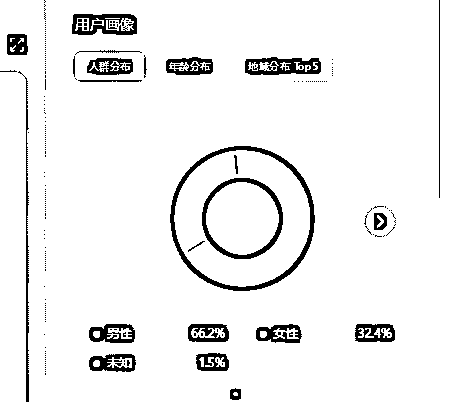

**03、互动类数据的分析方法**

核心看：停留时长、点赞率、评论率、关注率、加粉丝团率、分享人数。这些指标交叉起来，大致能判断直播间热度。市面上说的“停留多久合格”“加粉率多少达标”并不可靠，任何指标都要同周期、同品类去对比。比如一个开播不到半个月的新号，就找同流量级别或更高级别的优质账号去对标，才能找到优化空间。另外要分渠道看表现，系统算交叉权重时是渠道对渠道，考核直播推荐的数据，就是以直播推荐渠道进来的这批人为主。小团队流量基数小，渠道单一，可以不用拆这么细。

**04、交易类数据的分析方法**

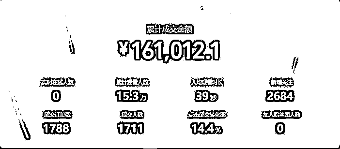

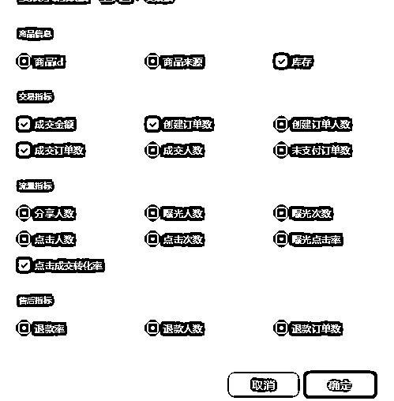

重点看：GMV、小黄车点击率、小黄车停留时长、小黄车成交率、整体曝光转化率、千次转化金额等。每个指标对应不同的优化方向。GMV 代表本场成交总量，和历史成交额对比、和过去 7 天环比，就能看出近期走势。人均 GMV 更适合做周期环比，一周、两周来看，因为客单价提升不是单场能体现的，需要一个爬坡周期。其他指标同理，各自优化对象不同。

**05、流量规模类核心指标**

看：场观、峰值、流速、流速稳定性。这四个最直接反映流量规模和流量模型类型。场观建议按周统计。常见情况是场观周期环比下降，主攻渠道占比也在下降。峰值要分开看，开场峰值受上一场场观和近 7 天直播历史影响，推荐峰值则受当场互动和电商指标影响。

**06、直播间的流速表现**

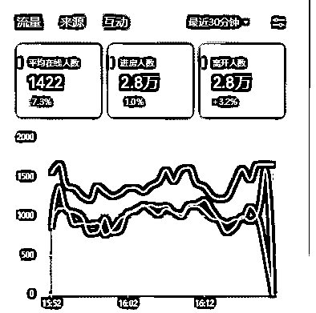

视频号罗盘没有抖音运营专业版的大屏，只有普通版，但流速数据是明确的。大屏左下角的流速情况，能实时算出当前流量的留存，同时推流人数体现流量健康度，也反映互动和交易指标完成度。一场合格的直播，在进入下半场前，五分钟数据应该呈螺旋上升，这样才有机会拉升推荐峰值。数据稳定后会推送更多广场流量，优化方向就是互动和电商两个维度。

**07、实时评论的观察价值**

反映引导程度和健康程度。评论区的扣评，大多由活动和主播引导决定。活动类直播间，要重点看扣评回复的频率和质量；平播类直播间，要关注用户真实提问，从中提炼主播话术优化点。遇到恶意评论，可以用引导配合主播把氛围带正。

**08、转化漏斗拆解**

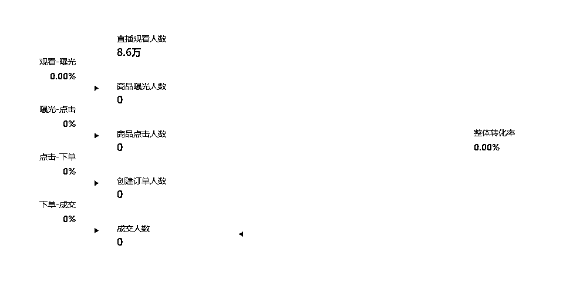

进入直播数据，找到单场数据，点进数据详情里的带货数据，看整体转化漏斗。依次是曝光转化率、点击转化率、下单转化率、成交转化率。大致就能定位问题环节。曝光点击率反映封面和直播内容质量，点击转化率受购物车排位、卖点设置、主播话术影响，下单转化率受主播引导、定价、详情页影响，最终成交率受逼单效果和商品吸引力影响。每个分层对应具体问题，漏斗任何一环收紧，都会大幅影响成单。

**09、商品优劣分析**

重点关注三类商品：爆款链接、引流品、测款爆款链接。爆款链接是连续多场排名靠前的商品，可作为主推。引流品要看每场小黄车点击率和成交率，更核心的是引流时在线留存率，很多操盘手忽略了这一点。引流品生命周期短，要及时补位，多备链接，通过选品不断上新。劣质商品即售后问题多、退货率高的商品，会虚高业绩却拉低小店评分，必须及时淘汰。

仅靠直播罗盘分析是不够的。视频号内部数据目前未对第三方开放，等平台成熟后才可能出现像抖音蝉妈妈那样的工具。现在第三方数据不准，可参考性低。正因数据不透明，视频号仍有大量蓝海类目未被发掘。

## 七、投放篇——抖音千川、小店随心推、视频号微信豆、ADQ

视频号付费刚起步，ADQ 也刚上线，仍在洗量期，和抖音千川刚上线时一样，数据波动很大。目前实测 ADQ 的 ROI 各方面都明显弱于微信豆。所以现阶段以微信豆为主，ADQ 可先观望。今天重点讲微信豆的投法。

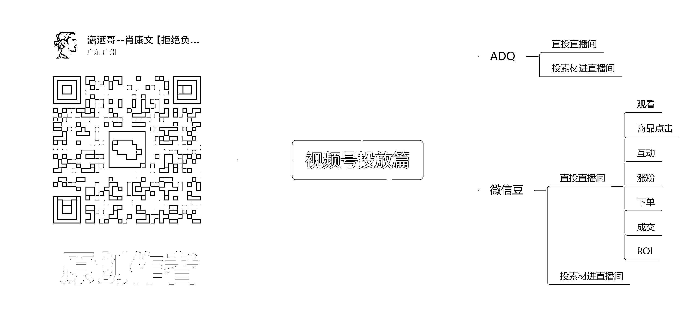

先明确底层认知：投流是花钱买流量，会从两个层面影响直播间。第一，影响实时标签数据；第二，影响实时综合数据。如果是纯付费玩法，这两点可忽略，但希望大家最终能做出内容设计拿到自然流。

其次，付费里有不同目标选项，直接决定出价高低和流量精准度。

你在投放时可选的目标：
**1.观众**【买观众进入直播间】
**2.商品点击**【买观众进入直播间且提高点击小黄车概率】
**3.互动**【买观众进入直播间且提高互动概率】
**4.涨粉**【买观众进入直播间且提高关注概率】
**5.提高订单下单**【买观众进入直播间且提高下单概率】
**6.提高订单成交**【买观众进入直播间且提高成交概率】
**7.支付 ROI**【买观众进入直播间且提高成交概率并满足 ROI 要求】

了解这些选项要明白，你付费后是在告诉系统要什么人，系统按目标去找人。目标越深层，价格越贵。想要便宜拿量，就需要内容承接配合，不同指标承接方式不同。

我个人很少用互动和涨粉这两个选项，性价比低。更常选商品点击。想做互动和涨粉，可以靠优化主播话术和频率实现。因为互动或涨粉的流量价格可能是商品点击的数倍。用 100 块买 100 个商品点击的意向用户，通过话术优化自然能带动互动和关注；但用 100 块买互动或涨粉，可能只买到 30 个，且这批人只是爱互动爱关注的人群，系统卖得贵，所以没必要花冤枉钱。

下单、成交、ROI 的关系同理。直播间逼单能力强，可选下单；逼单弱则选成交或 ROI 更稳。

投放还有很多细节，比如何时付费能撬动自然流、何时付费会压制自然流，不同场景用法不同。今天先讲具体投法。

**微信豆多笔投法：**

视频号微信豆和抖音随心推最大区别是，随心推基本能把预算花完，微信豆是 500 块一笔，等于 5000 豆。比如投 30 笔，合计 1.5 万，实际每笔往往只消耗三分之一，大部分计划消耗 100-200 就停了。要放量就必须多笔打。【自然流为主的前期，尽量用观看、点击这类浅层目标承接，别一上来就投成交，深度目标会把系统的探索空间压缩】

要知道，所有投成交都是以 ROI 为核心考核。投点击、观看，核心是看对直播间其他维度的助益，ROI 是次要的。

为什么浅层目标更容易烧出去？因为视频号还在洗标签期，成交类目标的供给有限，尤其是大额成交计划，往往烧一点就停，需要多笔建立计划。每条计划都是一个探索口子，情况各不相同，所以要多笔建。

投流先问自己为什么投，不同玩法播法节奏和流量结构不同，投放策略也不同。

## 八、复盘篇——复盘是直播公司的核心关键

我认为复盘是直播环节里最关键的一环。好的复盘才能找到真问题。很多公司复盘只是聊聊数据怎么样，有的结果说得头头是道，却连录屏都没有，这样的复盘没意义。复盘核心是定位本场数据不好的维度，依据具体原因找时间点，明确哪个时段哪个维度掉链子，进而给出优化方案。操盘手必须跟播，记录直播细节，复盘时能具体点名哪个时段没做好。

**复盘维度：**

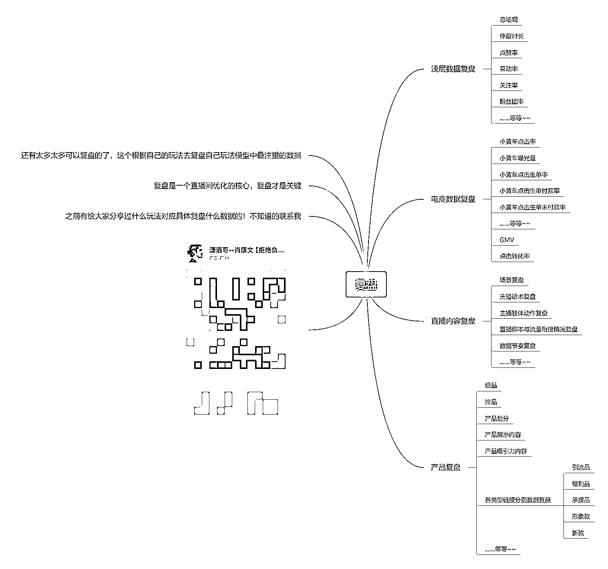
**1.本场数据维度复盘**
和一周环比对比：gmv、场观、互动率、关注率、停留时长等，按打法优化。环比各时段数据，找到高点和低点，反推原因。
**2.商品维度复盘**
每个产品的曝光点击率、点击转化率等表现，保留高表现产品，淘汰或减少差产品，调整排品组品。判断引流品引流强度、利润品承接能力、爆款周期是否在衰减等。
**3.主播及团队能力复盘**
基于团队表现优化直播内容。
**4.流量维度复盘**
各渠道占比增减、该渠道转化率变化。
**5.付费预算与财务复盘**
整场总投入产出比、退货率等财务层面。

**复盘总结：**
**复盘维度还有很多，比如视频端与直播间的配合情况。思维导图都写不完。复盘要根据自身玩法定核心维度，不限框架，之前也分享过不同玩法对应的复盘要点。**

## 九、直播玩法篇

市面上所有玩法，无论形态、场景、话术、氛围多么不同，核心都是顺应系统算法的内容底层逻辑演化而来。不同玩法的本质区别，在于解决数据的方式不同。

我见过的玩法有几十种，今天只列最常见的，原理吃团队能力的特殊玩法就不全讲。以下每个玩法都会总结特性，建议多理解原理思维。

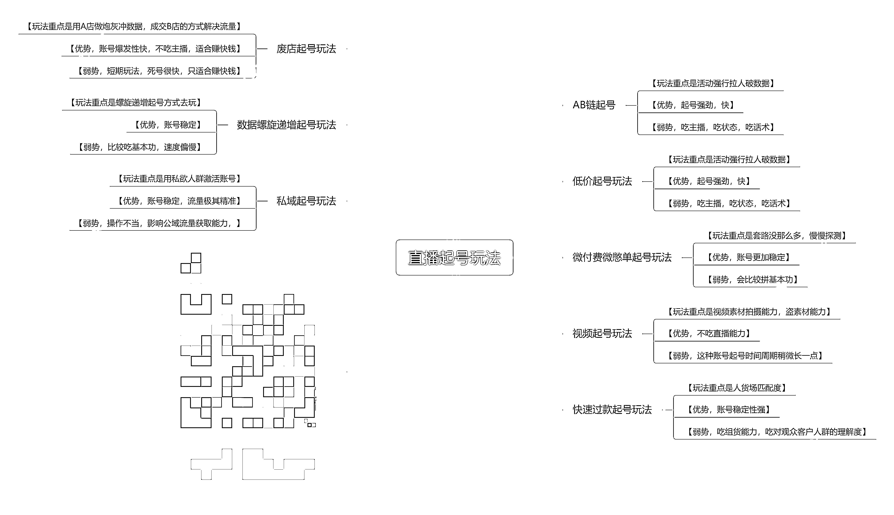

**第一种**

### **AB 链原理玩法**

老玩家都听说过。AB 链最贴合系统直播推荐机制，也是自然流里最常见传播最广的玩法。这种玩法在抖音现在玩起来风险高，但在视频号正是最火的阶段。底层逻辑是用产品福利感激发用户想买特价品，从而引导用户做出停留、互动、关注等数据行为，第一波数据出来后，系统会推第二波人进来，第二波人进来后洗人，筛出意向客户打单成交，成交对象是第二波人。AB 链是循环往复的逻辑，偏向单品爆款直播间。

AB 链核心原理总结：系统推流是线性流动，时时有人进有人出。AB 链利用福利先做数据，靠第二波推荐人筛选精准客户形成成交。

优点：起号极快，强团队 2 场就能拉爆，正常 3-7 场可爆。缺点是吃话术和主播表现力。【强烈建议新手小团队先学这个玩法，虽然操作繁琐，但学会后其他自然流玩法会更容易上手，这是必学基础。】

我之前发过万字超详细版 AB 链玩法文章，需要的联系我！V:18127870025

**第二种**

### **低价起号玩法**

“亏品起号”很多人都听过，低价起号玩法里很常见。核心是用一个极具性价比的低价品拉停留、互动、关注、下单、成交，因为产品本身吸引力强，成交相对容易。

常见坑是引流品和承接品人群不匹配。比如用轻奢风格打底衫做引流，承接轻奢大衣，人群是重合的，后续筛大衣客户也顺理成章。但如果用家具引流卖大衣，人群完全不同，起号会失败。

低价起号核心原理总结：用引流品做数据，营造福利感后转款承接品，关键在于转款话术的丝滑度。

这种打法的好处在于起号非常猛，爆发速度极快，实力强的团队两场就能把盘撑起来，一般情况下3到7场就能起飞。短板也很明显，对话术和主播的个人能力要求很高，选品搭配的能力也必须在线。【我个人比较建议小团队去做这个方向，因为门槛相对友好，前期只要直播间的硬性投入不大，起号本身花不了多少钱。】

我之前整理过一份万字级别的低价起号实战拆解，有需要的直接找我！V:18127870025

**第三种**

### 私域蓄水起号

私域起号的本质，是把手上已有的私域人群导流进直播间完成转化。做电商的、做2B的、做美容美发的老板，基本都沉淀了一批私域用户。这个打法很像线上的会销，提前在群里预热几天后的直播福利，等到开播就把线下会销搬到线上。更妙的是能实现零成本裂变，什么是零成本裂变？比如美容行业的私域客户去线下会销还需要场地成本，线上直播会销就不需要，直接一键转发邀请，朋友再拉朋友，私域圈层自然放大。我身边好几个美容老板靠这个玩法赚得盆满钵满。之前我还出过一套私域撬动公域流量的打法，把私域和公域打通互联，价值直接翻倍。

私域玩法核心就一句话：**用存量私域人流进直播间做活动式会销，达成爆单目标。**

这个打法的优势：**能带动私域裂变，营业额可观，线上成本低效率高。缺点就是你必须有私域基础盘。**我之前发过万字长文版本的私域起号详细方案，需要的加我！V:18127870025

**第四种**

### 微付费+微憋单起号

微付费微憋单是当前市场最主流的打法之一，很多高客单服装直播间、品牌直播间基本都是靠这个上来的。

核心逻辑是：用憋单制造紧迫感，配合话术营造福利氛围，再叠加少量付费流量，让系统在冷启动期就能感受到直播间的互动和停留，从而更快识别人群标签。很多新手不清楚数据标签是什么，简单说就是观众在直播间里的行为反馈强度，系统会根据这些反馈判定你的直播间适合推送给谁，标签越准推流越稳。

微付费微憋单的核心总结：**制造活动感，丰富数据维度，帮系统快速识别人群。**我更建议这个打法拿高客单产品去做，太低客单的更适合纯自然流暴力起号，视频号目前依然是自然流为主，还在洗标签期。

优势：**高客单能加速起号，数据维度多元化，稳定性更强。**缺点是成本会比纯自然流高一些。我之前有万字长文版的详细操作，有需要的联系我！V:18127870025

### 第五种：螺旋递增起号【网上常说的7天螺旋】

7天螺旋这个说法我一直不太认同，7天本身就是个伪概念。数据好的团队3天就能爆发，甚至2天就起来；数据爬坡慢的半个月也没动静。给固定天数会误导思维。

螺旋递增的本质是平台通用的流量运营逻辑，无论你玩哪种玩法，只要实现数据螺旋向上，系统每次推人你都能接住，除非有人比你数据更好，否则你在算法里的综合得分就会更高，自然获得更多流量。这个打法很稳。

核心在于各项指标的螺旋式上升，或者至少场观的螺旋上升，保持在一个优秀或合格区间持续爬升即可。

优点：**是系统最偏爱的反馈方式，最稳定。**短板是周期相对拉长，对数据调控能力要求高，一旦螺旋断掉就很难修复。我之前写过万字长文版的螺旋起号实操，需要的联系我！

**第六种：**

### 快速过款起号

快速过款是自然流最友好的一类打法。核心思路是让同一类人群在直播间像逛商场一样不断挑选款式，自带停留属性，比其他形式更容易拿到自然流量。

原理总结：先锁定一个核心人群，用人群的痛点特性去做选品和场景搭建，让直播全程围绕这一群人的需求展开，形成不断换款、不断选择的观看体验。套路设计很隐蔽，类似平播逻辑。

**一、为什么自然流这么多？**
因为这个玩法本身就是用兴趣内容去设计的。比如女装快速过款切的是女人爱挑的兴趣，百货快速过款切的是爱占便宜爱促销的兴趣。以人群兴趣点为内容载体，可看性远高于普通直播间。直播的承载力决定了一切。

我把这类直播间分成两类：
**1. 兴趣型直播间【可看性为主，促销感为辅】**
**2. 促销型直播间【促销感为主，可看性为辅】**

可看性指直播间的吸引力：主播动作、表情、情绪、直播间统一性、人货场匹配度、戏剧性等，所有产品之外的吸引力总和。

**二、为什么能持续稳定？**
单品直播玩的是爆款，靠福利拉人、靠产品细节洗人、靠逼单成交，节奏分拉人、洗人、打单三段，数据波动大，爆款也有周期。

快速过款玩的是人群，全程有活动感，节奏细密，套路隐蔽。拉人时报价格不挂车这种空单技巧很多观众看不懂。能满足同一人群多重需求，比如你想买衣服，逛到一家从袜子到大衣全是你的风格还在活动，你能走得掉吗？

**三、为什么有的能爆有的做不起来？**
核心是促销感和兴趣感能否达到阈值。判断维度：
**1.场景**
**2.主播与场景的契合度**
**3.直播流畅度**
**4.产品人群是否统一**
**5.排品节奏**
**6.戏剧性**
**7.主播话术关键点的准确性**

做得越细，爆单越必然。

产品一定要切一个人群，选品要围绕这个人群做基准。

**常见问题解答：**
**1.快速过款能做高价吗？**
能，女装里很多高营业额的都是快速过款。
**2.会不会弱化人设？**
不会，切的是统一人群，客户粘性更高，除非产品或定位混乱。
**3.能不能用精选联盟？**
能，抖音上半年很多榜单直播间就是这种打法，后来被平台关注才被打压。这是纯自然流最合适的玩法，视频号现在很多高场观也是这种。

起号思路是前期多放钩子产品穿插进过款节奏，或备些亏品来启动数据。

**第一天：**播2小时左右，正常过款，多穿插钩子，准备互动关注话术，重点在互动和关注。
**第二天：**根据前一天数据针对性递增，并拉长时长。这类直播拼的是直播底层基本功，对半吊子运营很友好也很致命。
**第3-7天：**持续递增即可。视频号有技巧可以第一天二开，第二场直接拉爆…兄弟们我保留一点核心。

数据哪里掉就优化哪里。停留不够就从产品吸引力、场景、主播过款介绍等维度调。转化率不够就从场景高级感、价格吸引力、人群统一性、款式等维度调。这就是拼基本功的玩法。

玩法本质仍是兴趣内容设计。

**【女装快速过款切的是女人爱挑的兴趣】**
**【百货快速过款切的是爱便宜爱促销的兴趣】**

可看性更高，承载力决定一切。

**1.完全兴趣型直播间**
**2.完全促销型直播间**

我之前有万字长文版的快速过款详细方案，需要的联系我！

**第七种**

### 短视频种草起号

短视频起号也是主流打法之一，主战场在素材端，和主攻直播间的玩法不同。核心是用短视频素材把精准的自然流量引到直播间，这个打法对主播依赖度低，主播能力弱的团队更适合。客单价和利润率通常也更高。

原理：以短视频种草引流。视频端已经做了精准种草，来的观众质量很高，直播间只需正常讲解即可，能很好弥补主播短板。常和单品付费打法结合，短视频做好永远是优势。

优点：**起号后更稳定，标签更精准，对主播要求低。**缺点是起号周期偏长，对素材团队要求高，且视频号盗素材现象严重，若主播能力不足可考虑此方向。我之前发过万字长文版的短视频起号方案，需要的联系我！

**第八种**

### 废店玩法

废店玩法在视频号很火，最近一两个月特别猛。核心就是“废”一个店。以达人挂优选联盟链接为例，把A店和B店链接分开挂。A链接是炮灰，比如苹果15 50块包邮，原装正品，假一罚三，激发无脑成交欲望，转化率极高，快速把数据拉上去。数据起来后介绍B链接成交。A链接属于A小店，B链接属于B小店，A链接拍了不发货，B链接正常发货盈利。A店被废，B店盈利。

这是赚快钱的直接方法之一，就是费店费实名。现在视频号已开始严打，但变种依然存在，操作更复杂，对团队要求更高。

优点：**小团队适合快速捞钱。**极不稳定，不适合成熟团队长期做，纯快钱可考虑，追求稳定尽量避开。

以上是8种常见玩法，市面上还有很多，我就不一一展开。这8种里有几套我写过可落地的万字拆解，需要的可以联系我。

**玩法总结：**
任何玩法都比不过系统赛马。每个曝光每份流量都有原因。玩法的本质是解决数据问题。各大电商平台都是做流量分发的，你要理解的不是玩法表面，而是玩法背后如何解决数据维度。玩法有简单的也有复杂的，想做好必须学会沉淀积累。

我之前有万字长文版的废店玩法方案，需要的联系我！

## 十.如何根据团队情况选对玩法

找到最擅长的并做到极致才是赢法，扬长避短。

为什么要讲匹配？因为我见过太多踩坑案例。美工剪辑出身的人却去硬玩话术强直播间，放弃了最擅长的素材路径，能力就水土不服了。就像文科生去做理科工作，注定困难。

人确实有天赋偏好，来自以往经验积累的性格属性。所以无论一个人、几个人还是大团队，都要搞清团队的核心能力偏向。偏视频就选素材型打法，偏销售人性思维就选强直播间打法。

有些玩法拼资本，有些拼供应链。真正上手前一定要对玩法和团队属性有清晰认知，这会直接决定你的赛道、对手、优势能否发挥。之前线下课讲过直播间几大类型：拼人、拼货、拼资本等，对应组织架构该怎么选。

个人或小团队只要考虑两点：主播销售型还是素材剪辑型。更深层的是中等或大型团队、大资本进入的方向选择。

还有一个关键点：公司定位是赚快钱还是做长期稳定。有些玩法本身就是快钱玩法，想做稳定去选快钱就是错配。目标明确是必选项，否则可能错过最佳布局时机。

匹配篇在我看来是最重要的篇章，很多兄弟觉得无关紧要，其实这是“道”的层面，社会运行规律。道学好了，术学差点也能行；道错了，术做得再好也跑偏。

**团队匹配总结：**
一定要用强项去竞争，这才是成功的核心原因。

## 十一、团队篇-0到1搭建直播团队

组建团队要先确定产品和打法，再决定岗位权重。

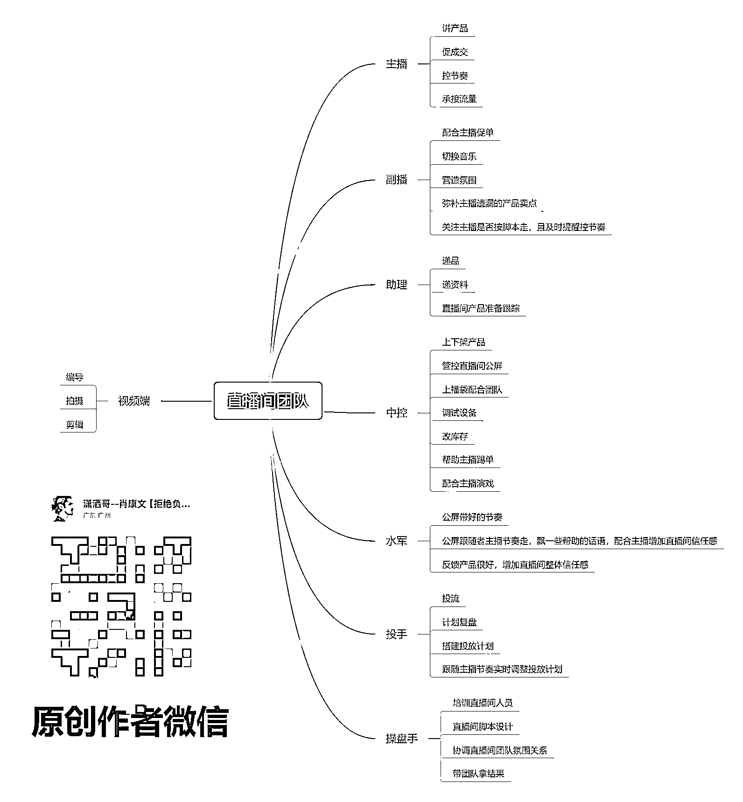
初创团队只需要两个核心岗位：**主播**、**运营**。主播负责直播、拍摄、协选品；运营负责中控、小店后台、客服发货，水军、投手、助理都可以合并由运营兼任，副播也能一人顶。

很多团队在招聘考核激励上没有完善体系，结合我的经验，这些问题都可以聊聊。

在直播这条赛道里，招人永远是第一道坎。市场上大致分三类主播：刚入行的新人、做了1年以上的老手，以及在某个玩法上打过硬仗的高手主播。

到底该押新人、要老手，还是砸钱去请高手？答案从来没有标准答案，完全看你公司的现状和你的目标。

如果你手里正好有一个很强的操盘手，他既能带团队又懂数据拿流量，还会手把手带人，这时候招一批新人性价比最高。反过来，如果公司本身就是新手小白，什么流程都还没跑通，那更适合先招老主播。衡量老主播不只是看他会不会播，更看他能不能帮你把公司里不懂的坑先填上，少走弯路。甚至可以让高手主播去带老主播，用利润分成的方式把高手和老主播的利益捆绑起来，让高手有动力去扶老手成长。

直播拼的本质是执行力、细节和信息差。老板如果长期窝在办公室，视野很容易被锁死。建议多往外走，多去广州、杭州这些信息更前沿的地方看看。很多玩法在南方年初就已经泛滥，北方可能要到年底才开始被讨论，这就是典型的信息差。信息差不补上，今天做的再好，过段时间也会掉队。

聊到主播面试，标准完全不一样。

老主播要看历史账号表现、核心数据、离职原因，以及跟你产品的人群匹配度高不高。新手主播则更看重过往的工作和人生经历，他是不是销售性格，表达是否清晰，有没有销售相关背景。最关键的是工作意愿和做这个岗位的目标感。我筛选主播时最看重的一点，就是他对这份工作的决心有多强。

要明白，主播本质是销售。销售要的是决心、执行力和持续优化能力。如果一个人只是想来试试，抱着播一天算一天的心态，直接pass。招人的核心不是只看现在会什么，而是看学习力和执行力。公司如果没有完善的培训体系，就优先选有经验的老手来补上信息差。试播阶段一定要看镜头恐惧、口音、表达是否清晰，从形象气质到感觉上是否跟你的目标客群匹配。

操盘手的面试更复杂，市面上履历造假太严重。很多人说自己带过爆款账号，一打电话过去问，才发现他只是当时的一个中控。顶级的操盘手基本都在创业了，不会在市场上招人。现在能面到的多是普通操盘手，懂点玩法、懂点直播流程，但商业认知和产品思维比较弱，偏重技术操作。如果老板自身商业和产品认知很强，或是有强大的选品团队，招这种操盘手是可以用的。另一种做法是请一个顶级操盘手来带一批新手操盘手，帮他们把控关键细节，避免犯大错。

还有一类人是刚做过中控，听了点课看了点文章就跑来应聘操盘手。这种一定要让他提供过往账号和真实数据，并且还原当时的操盘细节，面试完再去原公司核实。麻烦是麻烦，但直播行业拼的是人才、执行力和信息差。任何岗位的背调都是在为团队打地基，避免踩坑。

中控的面试同样要看决心和执行力。中控相当于操盘手的学徒，如果学徒都是混日子的，团队根本没有竞争力。直播公司的核心竞争力之一就是狼性文化和创新能力。

我们公司更强调赋能和授权。先定好战略方向，拆解到高层，再由高层拆到中层，最后落实到每个岗位。每个员工都有长期、中期、短期和每日目标。管理上重表扬、重规则、少批评，让制度去约束，用上级鼓励为主。批评时要简单直接，公司文化里真实是非常核心的价值观，多奖励少压迫。考核和激励要分岗位，主播、操盘手、中控的标准完全不同。

主播考核分两层：第一层是基础工作态度，开播是否准时、状态如何、学习速度；第二层是数据指标，互动、成交、流量。每一场复盘后都要给下一场立目标。数据好自然有激励。新主播前期很难出单，这时可以对非数据指标的完成给予奖励，特别是在小城市，招到合适的主播本身就难。主播和操盘手可以走销售额提成。其他岗位如中控，走的是工作量和失误率考核，表现好给非固定比例的奖励，更像是对工作能力的认可。

实操中，主播一定要了解运营思维和推流底层逻辑。不懂这些的主播很难理解自己在做什么，话术和节奏也掌控不好。反过来，操盘手如果从未播过，也会有弊端，他很难真正理解主播在镜头前的状态和心境，沟通时容易变成纸上谈兵。我能培养出自然流主播，很大程度上因为我自己是主播出身，理解他们在镜头前需要什么，也知道在哪个阶段该给什么压力。

初期一个直播间，两个核心角色就够了。增人增岗有两种触发点：一是订单量暴涨，需要单独客服分担运营的客服、发货压力；二是直播时长拉长，需要在各岗位上补人。

最后说一个共性结论。公司文化因老板而异，但直播团队本质是销售团队，必须有狼性文化和创新意识。多激励、多发奖金、多表扬，比压迫式管理有效得多。我访谈过几百位操盘手，强团队的共性都是员工有自发创新。老板要做的，是评估每项操作背后的风险和影响，做一个可控授权的人，这才是直播公司长期变强的关键文化。

## 十二、场景篇- -优质直播间打造攻略

传统企业做直播常犯的错误，就是一上来就砸钱装修直播间，觉得越高级越好。现实是，有些直播间很普通月销几百万，有些装修豪华却起号都难。直播间打造的核心是匹配，不是豪华。核心是人货场匹配，场景要服务于玩法和产品定位，违背定位的装修只会拉低转化。

例如你做的是性价比清仓，弄一个豪华直播间进来的人群就变了。0到1阶段，尽量化繁为简，等跑通再升级。

场地选择三点：
第一看面积。服装类需要大面积陈列、试衣、拍摄区；零食类从办公室隔出能放货架的空间即可。
第二看层高。层高够，空气流通好，主播不闷，灯光也更好。层高太低，上部光源会过度集中。
第三看隔音。低楼层办公室开播，楼下马路施工噪音直接导致断播迁移，这是血的教训。

硬件方面，手机基本够用，iPhone 12及以上即可。摄像头、单反根据品类选择，品牌感强的可上单反提升质感。视频号目前对动态绿幕直播严格管控，无人直播的后遗症还在。

场景布置的关键是人设驱动。大多数直播间同质化，就是没结合人设布局。布置前先问清：我是谁、我卖什么、我主推什么、我能提供什么额外价值、目标人群喜欢在哪种场景下成交。

人设决定风格，定位是服装设计师，墙面、地板、道具都要有设计师调性。卖什么决定基础布景，人模和展架要突出货品类别。主推什么要确保用户观看每一秒都能看到。额外价值用贴纸道具体现，如顺丰包邮、运费险、买一送一。

场景总结就是把空白处利用起来。空白处要输出吸引力、购买欲、产品价值和活动感。大促时设计活动感装饰和KT板，能给整场直播赋能，拉升数据。

## 十三、直播间运作流程- -直播团队必备运营技能

成熟运营团队必须具备直播脚本、短视频脚本、直播间辅助维护等基本能力。拍摄这些技能现在普及，直播带货对短视频创作门槛降低了很多。小团队甚至不需要专职摄影剪辑，运营和场控兼职即可。前期性价比更高。

视频号在23年中旬引进各大平台中腰部达人，流量开始爆发，内容和直播团队都在加速进入。红利期要抓紧提升能力。

带货团队核心技能分三类：

1.直播脚本能力
没有原创能力时，先模仿抄袭。直播电商没有绝对版权，模仿是最快的进步路径。

关键点在于流量类型。精准流量如付费入池、短视频种草来的用户，脚本要直接介绍产品逼单。自然流广场流量用户无明确购买意向，需要用套路憋单、筛选，用桥段拿数据。两者也可以结合。合格的脚本必须完整、顺畅、有逻辑，要围绕一个活动主题设计全套排品和应对细节。

2.短视频脚本能力
同样先模仿后超越。带货短视频和娱乐短视频逻辑不同。娱乐视频要点赞评论，带货视频目的直指直播间成交。

合格的带货脚本满足：商品即主角。所有分支都围绕商品展开。不需要过多渲染悬念，用卖点层层展开。单纯陈列枯燥，需加入跟商品相关的剧情和槽点增加丰富度。拍摄剪辑要求被弱化，小团队主播自己拍剪即可，需要复杂技巧抖音搜索即可快速学习。

3.直播间配合辅助维护能力
操盘手要熟练账号功能、后台管理，如视频号小店、视频号助手、数据复盘、付费投流如ADQ、微信豆。

另外几个新手易错点：

老号直播 vs 新号直播。老号先看开播历史，无开播史要看粉丝画像是否匹配品类。开播过要看历史数据，长期数据差的号权重已受损，翻盘难度比新号更高。

达人号 vs 开通小店。并非所有账号都要开小店，达人号养到1000粉即可挂车，后期注销更方便。开小店需要营业执照，流程麻烦。个人小团队不发货更没必要开。

养号 vs 不养号。养号不能主动打标签，打标签靠作品爆流。养号是为了避免被判定为异常账号。视频号打击矩阵违规账号，新号注册后应做点赞、评论、看直播等正常操作3-7天再发作品。

## 十四、协助小工具篇！！

做直播必看行业和对手数据，但视频号官方未向第三方开放内部数据，所以第三方软件数据参考性低。我个人试过两家，都是坑，收费高数据空。

更实际的做法是用抖音的数据工具去找同玩法同节奏的账号。能卖的玩法抖音能卖，视频号也能卖。进视频号后再判断竞争维度。

抖音第三方推荐蝉妈妈和达多多。达多多我最近用得较多，手机版查看对手流量渠道、自然流还是付费很方便。缺点是数据库不如蝉妈妈大，新号可能蝉妈妈有记录达多多还没收录。

达多多优势是可以看到付费流量占比。蝉妈妈现在也补上了这个功能。蝉妈妈产品数据库更强，全面性更好，性价比更高。提醒一下，开蝉妈妈会员不要直接官网开，有渠道更便宜。

这类工具能帮你看行业产品表现、账号表现、大盘和对手，相当于一个信息作弊通道，让你更清楚行业动态。

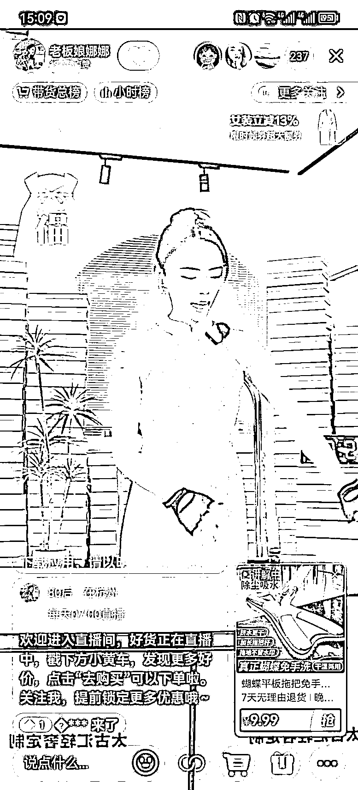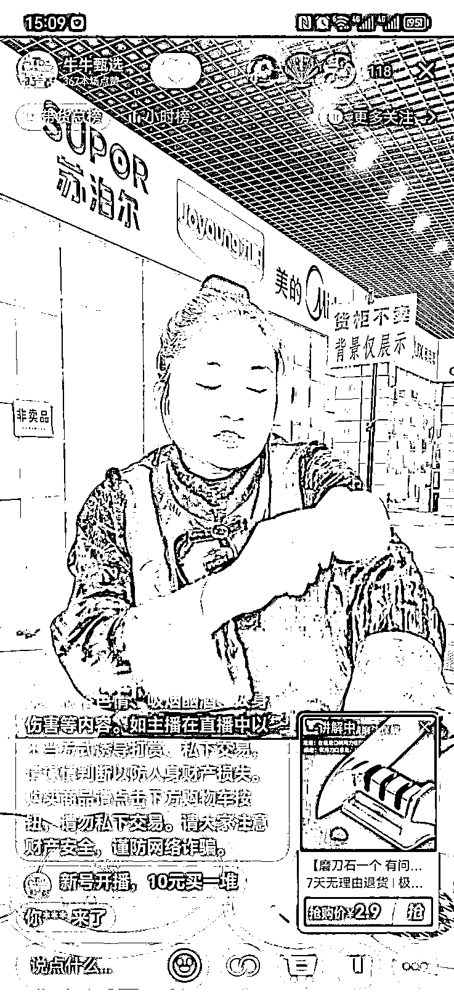

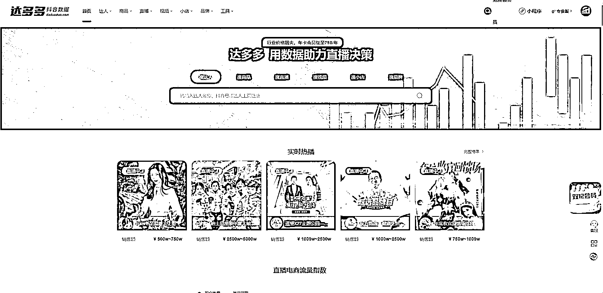

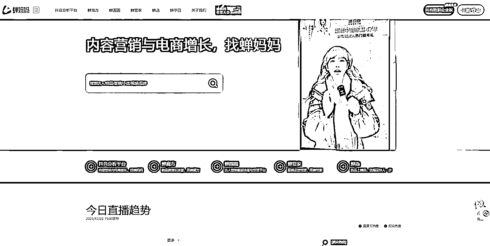

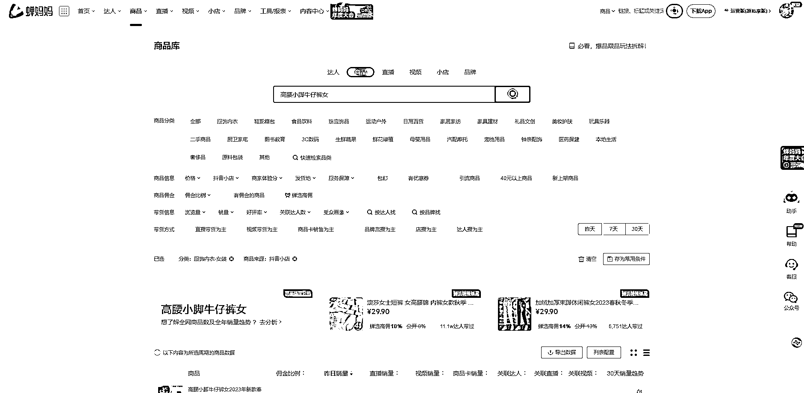

做直播这行，拼到后面，拼的往往不是熬夜的狠劲，而是判断的准头。判断从哪来？要么从经验来，要么从数据来。前者需要时间积累，后者却能快速缩短你与高手的差距。

这篇就聊两件事：一怎么用工具看清市场、拆穿对手，二怎么看懂抖音和视频号这两块阵地的未来走向。

先说工具。市面上做电商数据分析的第三方软件不少，蝉妈妈是其中比较常用的一款。但很多人对它的用法停留在“看热闹”层面，刷刷榜单、看看销售额，看完就完了。真正会玩的人，用它解决的是一个核心问题：我想做的这个品，在抖音到底卖得动卖不动？卖了多少？把这件事核实清楚，再转身去视频号布局，就不会两眼一抹黑。

具体实操并不复杂。举个例子，你打算做女装，看中了一条法式收腰牛仔半裙。打开蝉妈妈，搜索框里输入这类商品的通称，然后在结果页把筛选条件切到“商品”这一栏。页面会列出所有在售的同款链接，销量、价格、店铺信息都在。你花几分钟翻一遍，基本就能感受到这个细分赛道的体量。

这里有个细节要提醒：越是大众品类，数据越庞大，反而看不出门道。这套调研方法，真正的用武之地是小众、冷门的长尾市场。在这类赛道上，有没有量、量有多大，一搜便知。

除了数据后台，还有一个更轻量的招——抖音自带的识图搜索功能。把你要做的产品对准镜头拍摄，系统会自动匹配外观相似的商品链接，然后你挨个点开看销量。这种方法采样更贴近真实消费者，往往比在后台看大盘更直观。

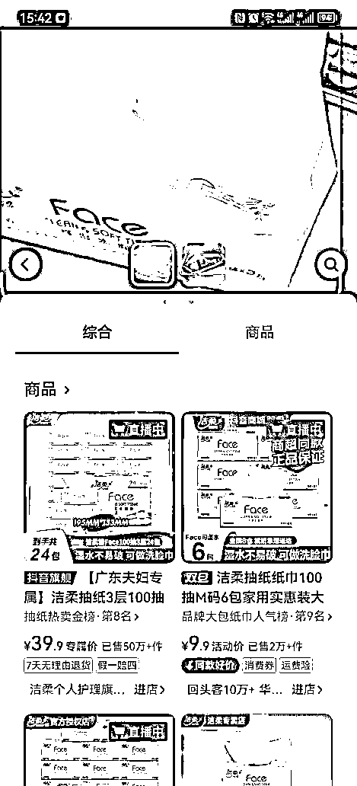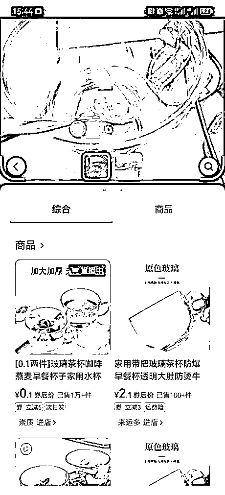

第二个核心场景：拆解竞争对手的流量结构。

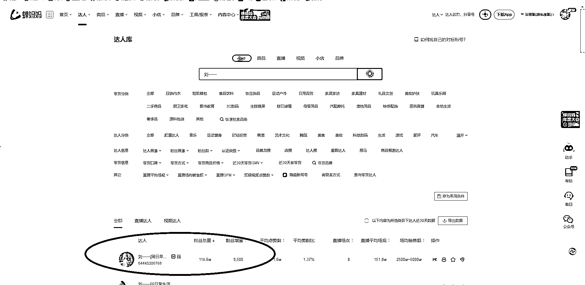

具体操作不绕弯子：你在视频号里看中某个对标账号，记下它的风格和播法，然后去抖音搜一个类似的账号。搜索出来以后，进入账号主页，找到直播分析，再找到流量结构表。这张表会告诉你：对方的观众里，付费推荐占了几成、自然推荐占了几成、关注页又有几成。付费占比一清二楚。

但拿到数据之后，别着急下结论。抖音和视频号的流量逻辑，中间隔着一条河。抖音里轻度付费的直播间，放到视频号很可能就是纯免费流；抖音里重度付费才能活下去的直播方式，视频号上也许只需要轻投放。原因在于，视频号还没到全面卖流量的阶段，大部分账号天然能获得免费推荐，只有凤毛麟角的直播间完全靠买量续命。换句话说，只要掌握了基本的开播逻辑，在视频号上获取自然流量没有那么高不可攀。

所以，拆解对手的流量结构，最终目标不是抄作业，而是看清它的流量模型——付费和免费分别是多少、靠什么撬动、能不能长期维持。把这些看明白了，你自己该走哪条路，心里就有数了。

当然，这一切有一个前提：视频号后台的标签体系正在被一点一点清洗和补全。等标签数据足够完整，平台就能实现更精准的分发，那时视频号的商业价值会变一个量级，也将迎来真正的高速增长期。而在眼下，由于大量用户画像还不够清晰，平台在投放时无法做到像抖音那样精确定向，很多流量的匹配是“大概可用”的状态。恰恰因为这个“不够准”，视频号的流量采购成本被压得很低，让商家有了一个低成本试错和起量的窗口。

蝉妈妈这类工具还有不少可玩的花样，但更多偏功能性的细节，我就不在此处展开来讲了——工具是死的，思路是活的。接下来把篇幅留给更值钱的东西。

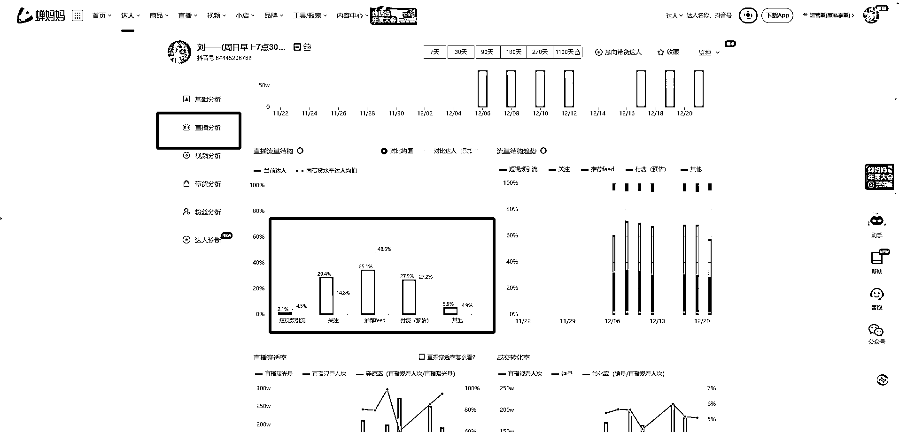

工具篇总结一句话：做直播，一定要学会借力。数据工具就像是你的前哨，帮你探测市场温度、摸清对手火力。如果连基本的第三方工具都不愿意上手，在这个信息迭代极快的行业里，掉队是迟早的事。带团队的管理者、做决策的老板，尤其要把这项基本功刻进日常。

说完了工具，再把视野拉高一点，看看抖音和视频号这两大平台的底层博弈。

抖音的位置，在2023年依然无人能撼动。它占据整个市场一半以上的份额，在短视频和直播两个赛道都是绝对头部。只不过，用户增长的红利已经消耗得差不多，大环境进入存量博弈阶段。平台内部的价格战一轮接着一轮，商家想靠纯兴趣推荐获取新客也越来越吃力，因为抖音在“直接触达老客”这个环节上始终存在短板——它没有给商家提供一套比肩微信的私域沟通机制。但这些短板，并不影响抖音作为行业老大的基本盘。

视频号的情况则完全不同。它起步晚、体量小，前几年一直默默无闻，没有折腾出什么水花。转折发生在2023年年中，战略方向终于清晰之后，下半场用户规模、停留时长、内容质量全线飙升。我经常在线下交流时用一个比喻来解释两者的差异：视频号相当于微信的“亲骨肉”，抖音则需要靠投放和内容把用户从公域里捞过来。视频号不一样，它只要把内容和体验做好，微信生态的天然流量就会自动汇入。早些年它没发展起来，是因为总想着复制别人的路，却忽略了自己最大的资产正是微信的社交流量池。

2023年下半场那一波增长，直接验证了这个判断。官方大力邀请各平台中腰部达人入驻，给流量、给扶持，内容供给迅速被填满，用户停留和互动数据一路上扬。我在2023年9月之后，也把公司的业务重心逐步转向视频号，原因很简单：一个平台的爆发周期一旦启动，早期布局是最划算的。

回顾支付市场的往事，或许更能理解这场较量。支付宝深耕互联网支付十年，微信支付却靠一个春节红包，几乎在几个月内就打穿了市场壁垒。红包功能问世之前，微信支付始终找不到破局的方式；一个春节过去，局面彻底改写。今天看视频号与抖音的关系，是不是隐隐有当年那种味道？

在我个人的框架里，中国互联网所有产品最终都绕不开一个超级应用——微信。因为你可以卸载很多App，但不能不用微信。商业上天天提私域，私域的本质其实就是走到微信里，和用户建立一条直接、稳定的连接线。抖音里的粉丝关系，终究隔着一层算法；微信上的好友关系，才是随时能触达的资产。视频号之所以有资格叫板抖音，最硬的那张底牌就在这里——它和微信是一体的，用户资产天然可以沉淀、可以复用。

所以视频号要超越抖音，差的或许只是时间。即便最终无法完全取代，也绝不会沦为配角。微信的体量摆在那里，视频号作为它的战略级入口，崛起几乎是确定性事件。市场上偶尔传出“视频号入口被移到通讯录旁边”的说法，虽然并不属实，但它反映出一种普遍预期：微信正在等待视频号成长到足够强壮，到那时，流量会毫无保留地灌进来。过早喂太多量，反而会撑坏内容生态，这才是微信迟迟没有全力助推的深层原因。

关于两个平台的趋势，做个简短结论：抖音目前的统治地位不用怀疑，但视频号手里的牌比多数人想象的更好。官方战略明确、达人持续迁入、内容质量不断提升，这些都不是偶然。2023年下半场的数据曲线，已经说明问题。聪明的操盘者，现在应该已经看清方向了。

接下来换个视角，说说商人该怎么看这盘棋。

我做了九年电商，从2014年淘宝起步，到2020年all in抖音，一路看过太多同行起落。身边不少朋友还守在老模式里，他们并不是完全不了解新平台，试过、碰过、没做起来，最后不了了之。最根本的原因，是老生意还在赚钱，所以对新机会始终下不了狠心。但直播这条赛道，吃的就是落地能力和专注度。三心二意、浅尝辄止，注定拿不到结果。眼下视频号正是红利阶段，这一波再错过，可能真的要说再见。

电商这行，做到头来你会发现没什么高深技术，拼的是认知差、速度和细节。我记忆很深的一次对话，是向一位业内老大哥请教直播的核心，他只答了四个字：“信息不对称。”业务本身不难，难的是两眼一抹黑地把自己关在小黑屋里。从那以后，我更愿意走出去，多聊、多看、多碰撞。情报差之外，就是行动力。当舒适区还能供给你安全感的时候，你是很难下决心换赛道的；但直播电商奖励的正是那些愿意跳出来拼一把的人。

生意人的账其实很好算：哪个平台流量便宜、回报率高，就带着团队往哪走。到今天，直播短视频赛道的机会依然充裕，而视频号恰好是眼下那个水位明显更低的入口。如果传统生意人还在犹豫，那可能不再是错过风口的问题，而是错过整整一个时代。

聊完平台和策略，再讲点私货——我这些年踩过的坑，每一段都算数。

2014年闯淘宝，赚过一笔快钱，后来因为能力撑不住运气，亏到负债。再后来进电商公司做运营，卖衬衫，一路做到销冠；然后离职做抖音，摔过跟头，重新打磨，终于打进月销榜前100。到现在，十几个直播间的盘子，背后是我从主播到操盘手、从选品到团队管理的完整经历。直播链条上所有环节我几乎都碰过，也正因为如此，我才敢说：有些弯路，真的不必再走。

第一堂课：把算法当朋友，不做无效功。早期搭建直播间，主播有了、货品有了，每天雷打不动播六个小时，结果场观连500都突破不了。后来才想明白：抖音的底层就是一套算法系统，你要顺着它的打分逻辑去优化内容，推荐量才会起来。到现在还有很多团队在用笨办法死磕，这真的是2020年就有人踩过的坑了。

第二堂课：走进圈子，把价值换着花。人最怕的是自嗨，以为自己已经跑得够快，抬头一看，领先者早没影了。圈子能让你看见真实的市场水位，也能让你交到愿意拉你一把的人。人和人的连接，本质上是价值交换——把自己会的掏出来，才有机会换来别人脑子里那部分。我现在坚持输出内容，就是想持续做这种交换。

第三堂课：情绪稳定，预期别拉满。网上天天有人晒直播间一夜破百万千万，但那属于极小概率事件。多数直播间的起量是滚雪球式的，前期慢、中期稳、后期涨。如果刚开始就给团队打鸡血、定不切实际的目标，后面心态很容易崩。把预期降下来，把动作练扎实，数据的反馈反而会超出你原来的想象。

第四堂课：保持学习，保持冲锋。我这几年的经历像一条波浪线——高峰时赚到过钱，低谷时欠过债，但从没真正放弃。支撑我走到现在的，是专注力和学习力这两样东西。当你持续把注意力投在一件事上，一两个月的密度足以让能力发生质变。再往前，还需要一点赌性——放弃高薪去走难路并不容易，但选对了方向，时间会给你超额的回报。

最后，说回视频号。

它的上升势头已经清晰可见。你只要留意身边的家人朋友，就会发现有越来越多人开始刷视频号，内容也不再是印象里的中老年画风。从淘宝时代到微商、再到拼多多和抖音，每一波平台更替都造就过一批赢家。现在视频号这趟车正在启动，抖音或许还是那个一哥，但视频号背后的微信生态，可能像当年红包突袭支付市场那样，以你想象不到的速度改写格局。

对于想要抓住这波机会的人，我的建议很朴素：关注当下，也别忘记抬头看路。风口是会转移的，这一波结束之后，下一波在哪里、以什么形态出现，需要持续观察。只有提前站在趋势那一边的人，才有资格在下一个时代来临时，做定义规则的人，而不是追随者。

