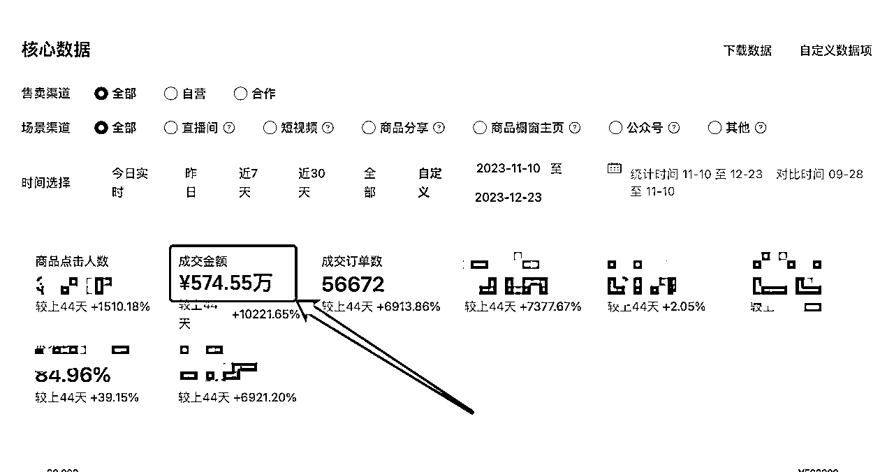
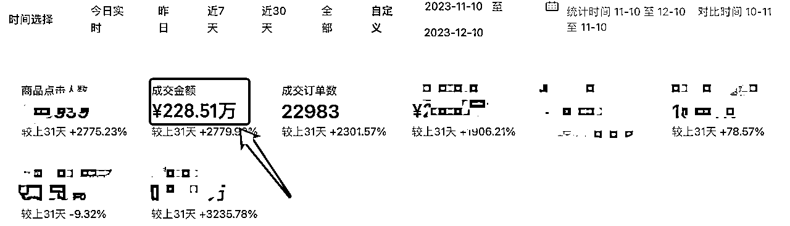

# 被冻住一百万后，我才明白视频号小店这场局该怎么玩 | 晋四喜 2023 年终复盘
作者：龙哥

原文链接：[`www.yuque.com/for_lazy/thfiu8/icc8ogas577gvee5`](https://www.yuque.com/for_lazy/thfiu8/icc8ogas577gvee5)

各位同行大家好，我是龙哥，算是老熟人了~ #视频号

现在的工作重心主要放在🛰️视频号小店的后端运营上，品类聚焦在生鲜和中医图书，同期也在推进无卡支付相关的项目。

写下这篇，主要源于近两个月视频号小店经历的剧烈震荡。现金流被卡、规则变动，让我在创业思路上完成了一次比较彻底的觉醒，想把这份感悟整理出来，供圈内朋友参考。

为了阅读更顺畅，建议直接跳转到飞书文档查看完整版：

下面附上阶段性的数据轨迹：

* * *

评论区互动：

乌云密布 : 一个月被冻结一百多万，产品是不是太拉了？能说说选品上踩过哪些坑吗

晋四喜 : 品控不是核心问题，关键在于售后处置的打法不一样。相关的避坑点我已经在飞书链接里更新了。

乌云密布 : 赞，坐等更新～

晋四喜 : 已补上，可以刷新链接再看一遍。

乌云密布 : 还是有点没吃透，售后爆发的根源是不是用户预期没对上？这个预期偏差是主播话术造成的，还是货本身造成的？在处理售后时楼主有拆解过原因吗？感觉为了压评而压评，并不是长久之计

晋四喜 : 归根结底当然是往高品质走，但创业分阶段，现在还没到做品牌的时候。现阶段的优先级是，在平台规则允许的范围内把钱挣到手。你估计是不做投放的吧？产品成本抬高后，投放根本覆盖不住。先做到合格线就行，损耗在所难免。

* * *