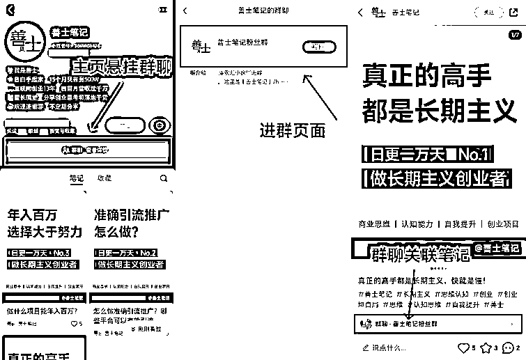
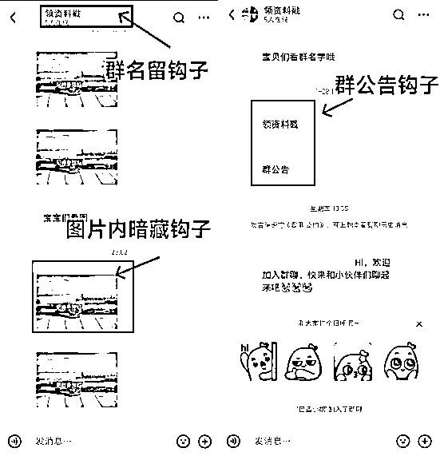
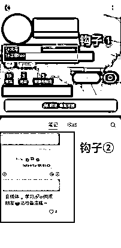
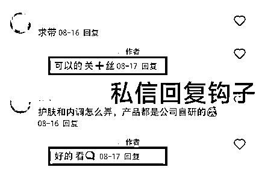
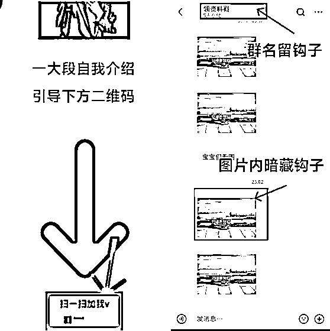
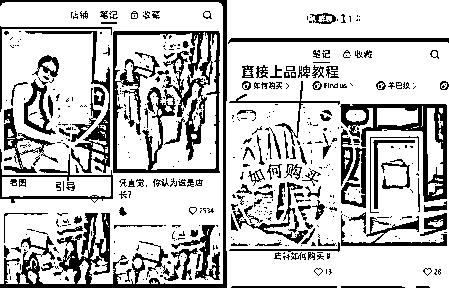
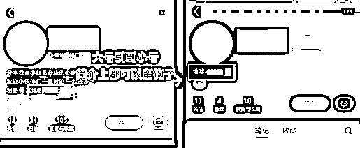
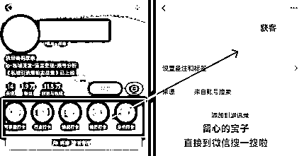
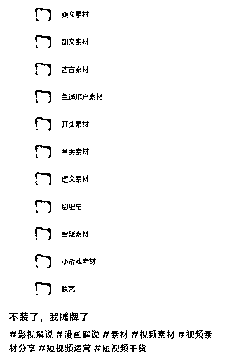
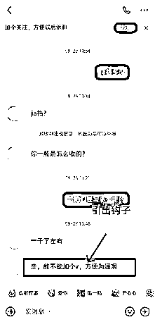

# ('小红书怎么引流？9 个亲测有效的好方法！', (2, 22))

小红书引流怎么搞？亲测9招，安全又管用！

小红书今年的势头确实猛，4月起就开始打通站内全闭环，从种草到转化都留在站内，同时官方也明显在收紧站外引流。很多伙伴想给自己的账号导流，但又怕踩雷。我自己试过不少路子，有踩坑也有收获，最后沉淀出9个相对稳妥、也确实有效的引流方法，今天一次讲清楚。

**方法一：把粉丝群用起来**

小红书账号主页可以展示粉丝群，这是平台允许的功能。用户要是对你感兴趣，很容易顺手点进群。粉丝群的好处在于：能直接关联笔记，群聊链接还能放进评论区，相当于给用户一条顺畅的“入群通道”。

等粉丝进群后，群名称、群公告、群内内容都可以变成你的展示位，把联系方式放进去就行。注意两点：一是小号负责活跃互动，大号保持名片气质，别让大号天天发广告；二是群名和公告只要不触碰系统敏感词，就能一直挂着，后进群的人照样能看到。

**方法二：小号悄悄接应**

大号照常更新，引流的事交给小号。小号可以在简介里直接@大号，再配一篇带钩子的笔记，两个入口同时放着，用户总能看到其中一个。

**方法三：评论区放钩子**

每次刷评论找答案的人特别多，置顶一条钩子评论，让用户第一眼就看到。回复内容记得避开敏感词，用emoji、同音字或符号代替，安全永远是第一位。

**方法四：私信引流**

私信也能玩，不过建议用矩阵小号来分摊风险，同一个微信号别反复发，回复时换着不同的ID。二维码、带微信号的图片、AI生成的艺术二维码都可以尝试，只要不明显暴露微信信息，都有机会。群聊的那些操作思路，私信同样适用。

**方法五：置顶笔记当广告位**

很多人逛进博主主页，会习惯性先看置顶内容。所以置顶笔记就是天然曝光位，可以放使用教程，也可以直接留下联系方式，越显眼越好。

**方法六：简介里藏钩子**

账号的基础设置也能做文章，简介中只要能过审的文字，都可以用来导流。要么把用户引到小号，要么直接留微信、邮箱等联系方式。注意别把手机号直接甩上去，用emoji或同义表达变通一下，通过率会高很多。

**方法七：瞬间打卡**

瞬间这个入口也别浪费，把联系方式放进打卡内容里，既不会显得生硬，又能悄悄给对方留下印象。

**方法八：把干货晒出来**

直接亮出你的资料或干货，真正感兴趣的人会在评论区主动留言，这比硬推自然得多。

**方法九：反着来，让对方留微信**

平台拦着不让主动导流，那就换个思路：在内容里引导用户留下自己的联系方式。这样做几乎不会触发风控，可以说是最省心的一招。

最后还是要提醒一句：小红书上没有百分百绝对安全的引流方式，只有相对稳妥的操作。平台规则一直在变，方法也得跟着更新，边测试边调整，才能找到真正适合你的玩法。

