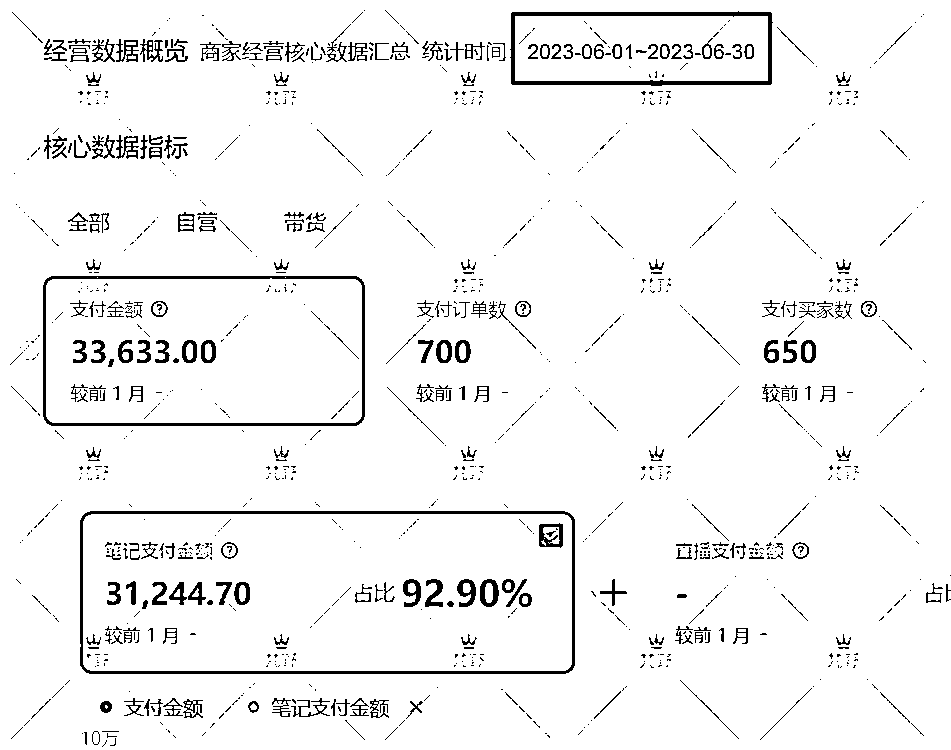
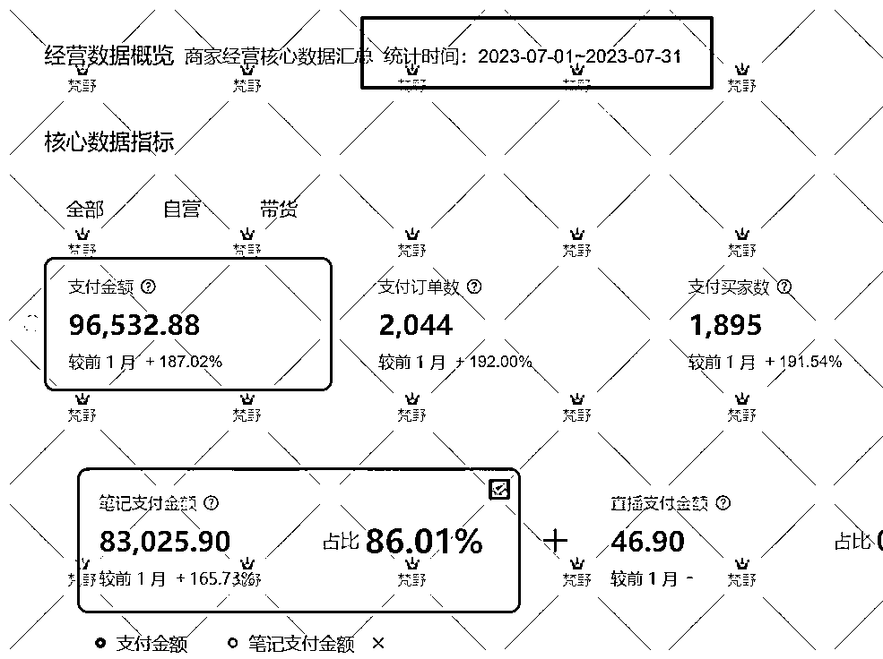
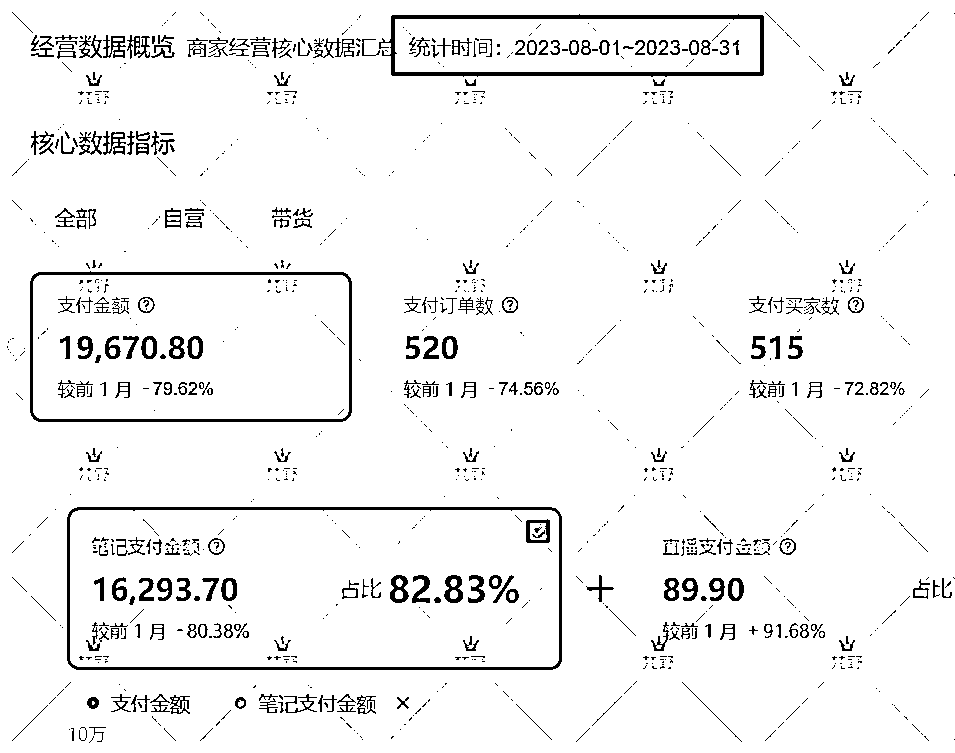

# 从 400 元到 25W+，📕无人直播 30 天踩坑到爆发

30天，从400元启动金做到25W+GMV，📕无人直播这个项目，我们终于跑出来了！我是梵野，一个90后宝妈，过去两年一直深耕视频号，今年视频号爆发，团队跟着吃到了一波红利。11月底，视频号玩法更迭，我们在探索新玩法的同时，把目光投向了📕。

其实6月份的时候，我们跟风做过两个月店群，3个店铺GMV大概20W+。下图是其中一个店铺的数据：

后来因为无货源稽查，加上主要精力都在视频号上，店群就被放下了。但正因为有了那段店群经验，11月底我们重新组了个两人小分队去测试📕无人直播。起初一天只有几百GMV，月中加了设备，30天累计GMV冲到了25W+。

这个过程中踩了不少坑，也有一些心得想分享。图文太多，详细内容我都写在飞书文档里了，点链接就能看：

[`iqwin9cn5r.feishu.cn/docx/KfiwdVNIuo8v3mxYZbFcPrJmnQe?from=from_copylink`](https://iqwin9cn5r.feishu.cn/docx/KfiwdVNIuo8v3mxYZbFcPrJmnQe?from=from_copylink)

评论区里大家的问题，比如号废了要不要注销重来？怎么判断号费了？提示一次违规就废了吗？可以申诉吗？这种号必须用自己的吗？我在文档里都做了解答。

还有疑问的话，评论区见，我尽量挨个回复。