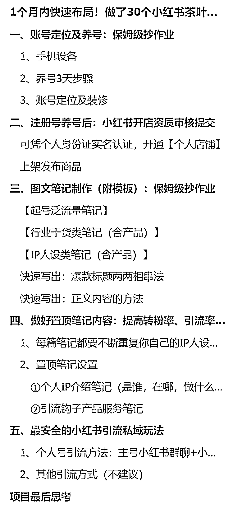

# 一个月铺30个小红书茶人号，我把这套玩法掰开揉碎讲给你听

最近后台总有人问我：茶叶赛道在小红书上到底怎么起号？一个人能不能同时管多个账号？

刚好，我前阵子跟一个茶叶供应链团队合作，专门帮他们做小红书流量赋能。这一个月里，我们直接铺了30个茶叶茶人IP矩阵号，跑出来不少爆款。今天就先把最实操的部分拿出来分享——至于爆款背后的底层逻辑，等大家先做出数据，我们再加餐聊。

先交代下背景：接触的茶人朋友大多深耕产品、钻研匠心，线上运营这块确实没太多精力去系统学。所以我分享的时候，不太喜欢讲一堆大道理，更愿意直接給大家能上手的动作，先把号做起来、把数据跑出来，再回头讲方法。

那这30个矩阵号具体是怎么一步步布局的？我把整个流程整理成了保姆级文档，点开就能看：

点击飞书链接：[`gifi56ymyi6.feishu.cn/docx/N7PudcItJonWrUxc4VhcuAPwnud?from=from_copylink`](https://gifi56ymyi6.feishu.cn/docx/N7PudcItJonWrUxc4VhcuAPwnud?from=from_copylink)

* * *

评论区里有朋友问得很实在：30个号得几个人管？我自己做3个号都嫌乱，这30个是怎么有序推进的？

我的回答是：这套打法的核心逻辑，是用“培训陪跑”的方式，带着茶叶店、茶叶行业的代理商和员工一起来做。不是一个人硬扛30个号。

如果是自营盘，我一般安排1个员工负责10个IP矩阵号。具体怎么跑？先集中火力把单个账号的爆款形式测出来，然后直接复用到其他矩阵号上。一个模板跑通了，就继续测新的爆款模板，再复制到更多账号上，形成滚雪球式的起号节奏。

* * *