# 你家楼下的快递驿站，到底藏着多少条赚钱线？
作者：龙哥

## 家门口的驿站，不只是个放快递的地方

作者：阿木
日期：2023-12-26

一个快递驿站能赚什么？收寄存费、收点上门费？

我手上在管 53 家驿站，今天就聊点不一样的。

先说行业里的常规钱怎么来。派费分成是基本盘。一个包裹总派费大概 1.1 元，快递员自己揽走 8 毛，放到驿站里驿站能拿到 3-4 毛。

光靠这几分钱，店根本活不下去。所以我会把上门送件的功夫用活，加客户🛰️，进而做淘客、做社区团购。这个盘子才真的赚钱。我之前团过红枣干，一个小时就净赚过万。

如果你是新手想入行，我的建议是先别急着开店，先做代运营。电商件占了 99%，100 个包裹背后就至少有 99 个商家。驿站就是天然的商家雷达，拿到这些资源做代运营服务，稳定做下来月入过万很常见。

沉寂三年很少出来讲，这次素材攒了不少。我会把驿站现在的生态、能怎么变现、可复制的赚钱模型、以及新手的起步路径，都摊开讲清楚。最后也聊聊我为什么一直死磕这个赛道。

赚钱的兄弟们好，我是李欣键，网名阿木，现居贵州黔南。

目前在做的事大概有：

1. 黔南本地 53 家快递驿站的运营管理
2. 拼多多、抖店代运营，私域卖家 2.7 万人
3. 本地云仓+礼品网，日均出货 6 千件左右
4. 本地同城平台、本地团购

这些年基本都是围绕着快递和驿站的资源在做扩张。现在两家公司在跑，一家管线上代运营和礼品网，一家管线下驿站和同城团购。团队 83 人。

几年的积累下来，驿站这个看似不起眼的末端网点，其实藏着不少项目。这次分享希望能给你点启发。

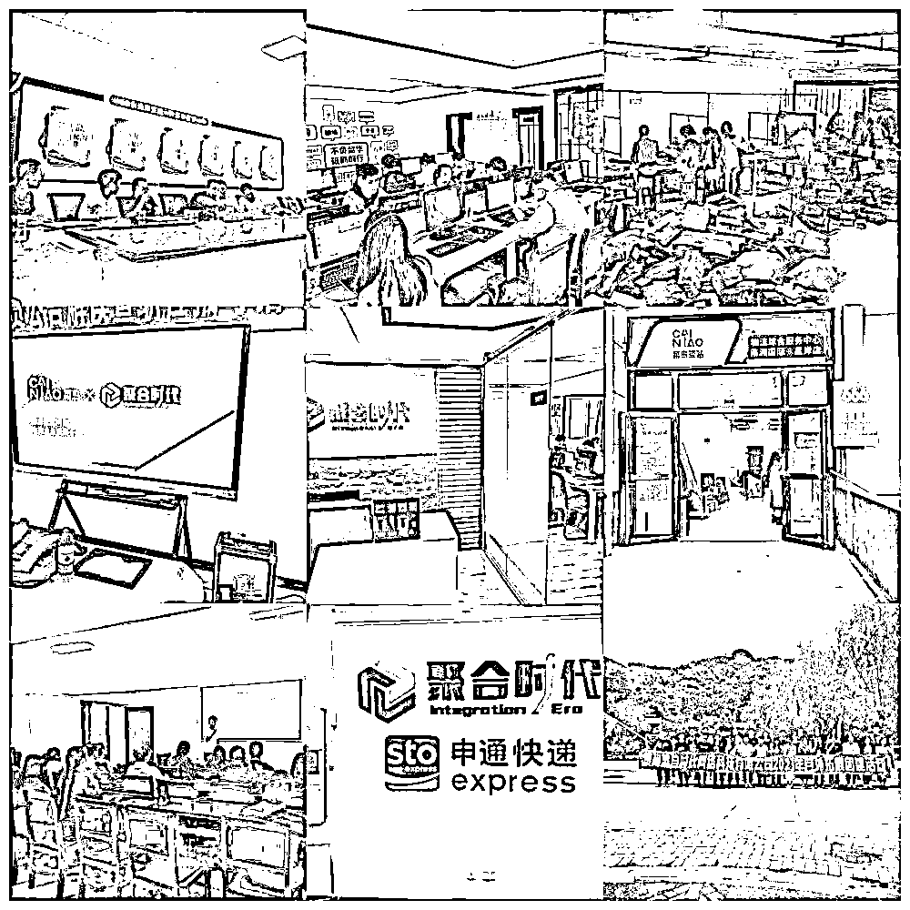

文章信息量比较大，我先给你一个目录，方便跳读：

一、快递驿站的现状分析
二、驿站能怎么变现
三、实操案例拆解
四、用商家资源做到稳定月入万
五、我做这件事的初心

核心就是围绕驿站资源，怎么让普通人也能复制变现。

驿站现在遍地都是，每天人人都在用。很多人私信我加盟、开店的事。下面几节会先帮你建立认知。

坦白说，驿站是实体生意，有地域性，也需要快递经验，门槛不低。所以和赚钱主编沟通时，我特意多讲了个更轻的路径。

第四节我会重点讲，如何从包裹面单里拿到商家资源，给他们做代运营来变现。实操三年，这个方向依然很卷但机会还在，普通人上手也能稳定做到月入万元以上。

最后第五节，我聊聊自己的创业经验，希望对还在路上的你有点帮助。

## 一、快递驿站的现状分析

**1、趋势：量涨不等于钱涨**

我 18 年就开始玩快递，亲眼看着驿站从爆发到内卷。

我们县城日均派件从 3 万飙到 8 万，但驿站收入并未同步。包裹越多竞争越激烈，单件毛利被不断压低。要想增收，必须靠业务多元化。

我自己也是靠返利淘客、本地团购、资源置换这些增项活下来的。这些副业不仅提高利润，也把客户粘性拉住了。

现在驿站正处在转型期，单纯靠派费活不下去，必须做加法。

**2、驿站在链条里的角色**

驿站是快递末端最重要的枢纽，作用非常关键：

1. 覆盖网络的毛细血管，从城市到乡镇到小区都有
2. 提供自提寄件，方便上班族和不方便收件的人群
3. 分担核心网压力，快递员不用一趟趟上门
4. 取送时间更灵活，用户自主权更高
5. 降低最后一公里成本，集中处理效率更高
6. 提升整体体验，用户能自主掌握包裹动向

简单说，驿站是整个快递体验的压舱石。

**3、现实的痛点**

驿站最核心的收入就是派费分成。算笔账：总派费 1.1 元，快递员 0.8 元，驿站拿 0.3-0.4 元。

一天收 1000 件，就是 300-400 块。寄件差价也能赚点，首重成本 5 元，收客户 10-15 元。

很多驿站是快递公司网点自营加盟，比如中通区域量 500 单，加盟费 5 万，确保包裹都流进来。日均也就 150 块收入。

账面好看，实操很苦：

1. 竞争白热化，加盟费越来越高
2. 收入不稳定，受政策和品牌博弈影响大
3. 多元业务利润薄，零售、缴费赚不了钱
4. 人力成本高，基本全年无休，体力活
5. 价格战被动卷入，服务费抬不起来
6. 包裹处理压力大，高峰期效率和体验都下降

**4、机会点在哪**

1. 稳定的社区客群，天天见面容易做信任
2. 驿站老板本身专业性弱，给支持就能绑定成渠道
3. 线下交付+售后，可信度高，适合做本地业务
4. 能升级成社区服务中心，生活缴费、零售都能加
5. 和电商、零售、本地企业合作，导流互补

机会是存在的，关键看怎么用。

**5、普通人不建议直接去三四线开店**

想靠开驿站当饭碗，我不太建议新手直接入局：

1. 单件收益在持续下降，量补不了价
2. 资金风险大，有些地方没省区支持，是网点自己说了算，容易被坑
3. 品牌间内卷，驿站可能被迫只接少数品牌的件，收入受限

没有行业经验和市场判断，别轻易砸钱。

## 二、快递驿站的赚钱机会探索

不建议开店，不代表资源没用。围绕驿站做生意，反而更香。

**1、从递送到淘客**

2017 年我回老家入股申通，被合伙人坑了一把。低谷期我转做淘宝客，发现菜鸟驿站就是天然的流量池。

我就在小区驿站搞免费上门送件引流，送件时顺带推返利，效果非常好。

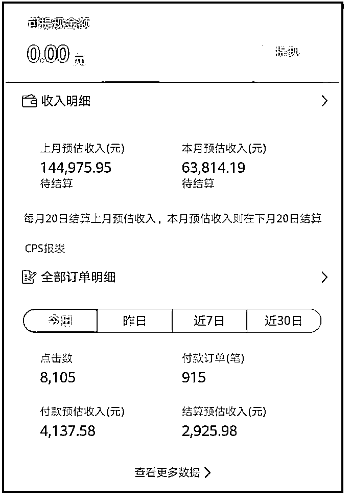

**2、社区团购一小时赚一万五**

有客户在群里问有没有红枣干，我在淘宝联盟一查，19.9 券后，佣金 50%。我找山东厂家谈好，进了 3000 包，成本 4.7 元。

我在群里铺垫价值后，直接放价：线上 19.9，驿站自提 9.9。发完消息去洗了个澡，回来订单已经爆了。一个小时赚了一万五千多。

虽然利润不高，但几乎零成本起盘。那一周我都在跑腿送货，彻底点燃了我对社区团购的兴趣。

后来我组建了运营团队，47 人左右；同时建了云仓作为驿站分拣中心。一步步从一家驿站做到如今的 53 家。

## 三、驿站运营的实际案例

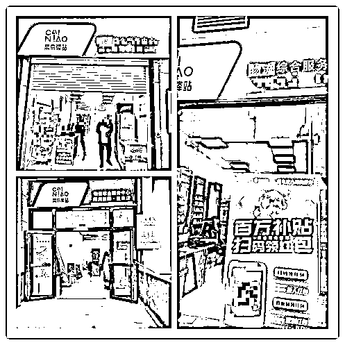

我现在负责的 53 家店里，挑一家典型的小区店给你拆解：入住率 95%，房价中等，模式是驿站+零售。

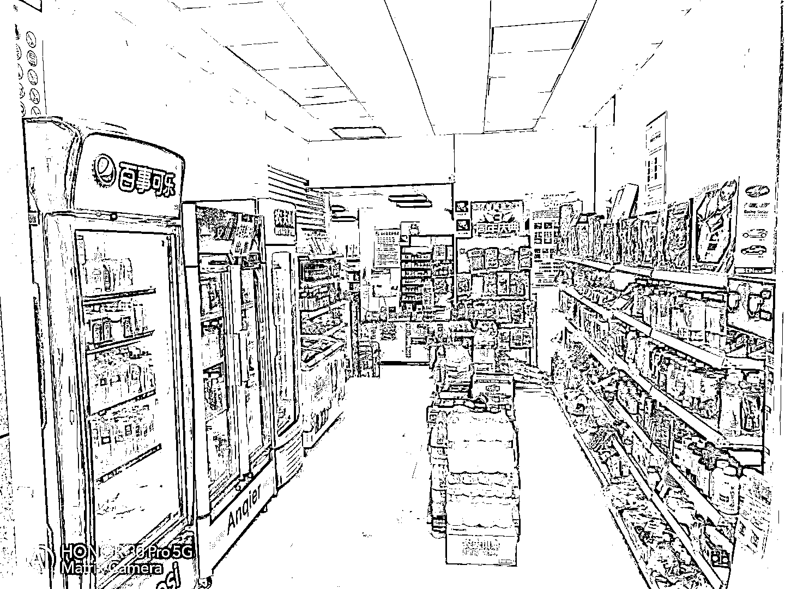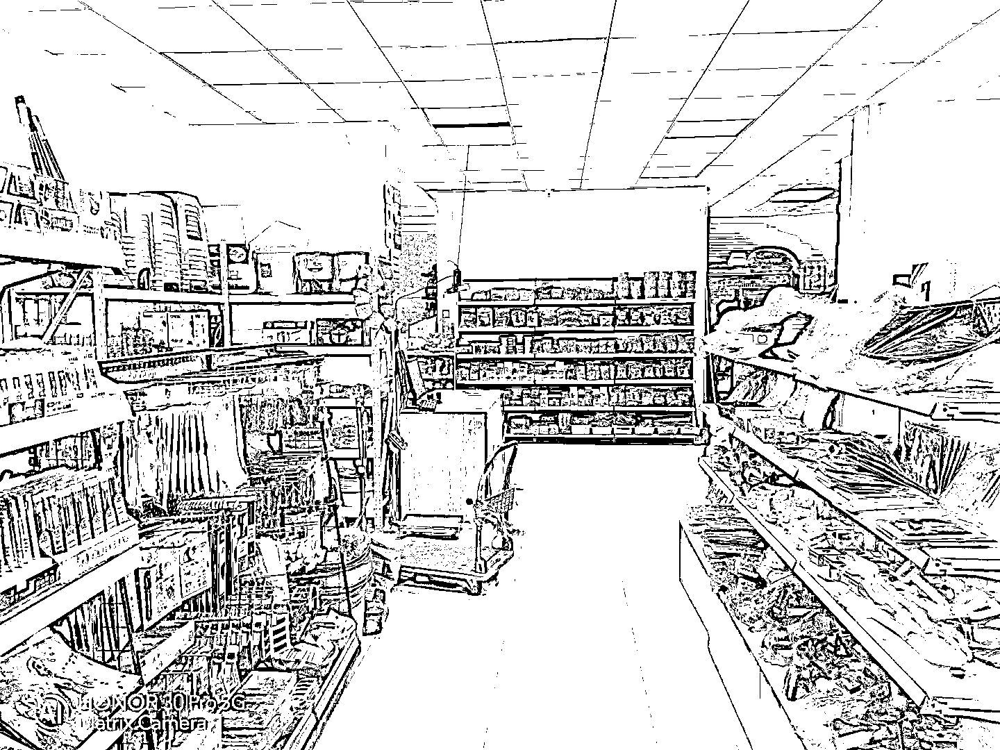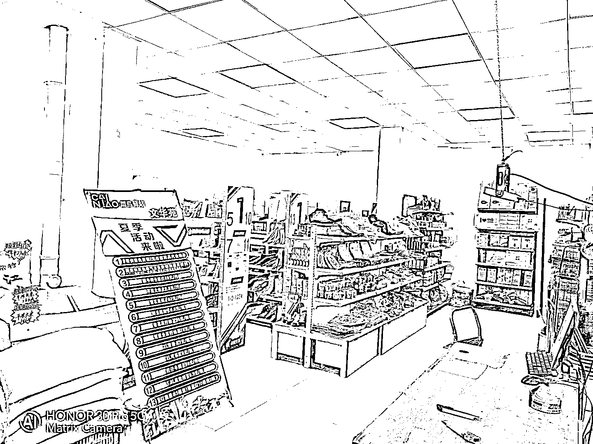

**1、存放量和收益模型**

黔南这边经验公式：住户数/2 *0.3

1200 户的小区，日均存放收益约 180 元。如果附近还有竞争点，会打折。

成本主要在租金、人工、维护。收入是存放费+零售+附带业务。

**2、淘宝客+私域**

返利淘客和驿站简直是天作之合。

18 年我就测过，现在暂停是因为人力放在云仓和同城平台上，但随时能重启。

引流靠送货上门，本地人工 2500+，送件时加🛰️或付费上门，一周内能把小区客户基本收齐。

教会他们怎么返利，再用朋友圈裂变，单客户月均收益能做到 45-55 元。

**3、自营产品销售**

今年中秋我们搞了同城礼盒：都匀毛尖 50g + 云腿月饼 400g + 蜂蜜 500g，成本 87 元，售价 118 元，利润 31 元/盒，驿站分润 10 元。

🛰️群下单，仓库直发驿站，驿站上门。

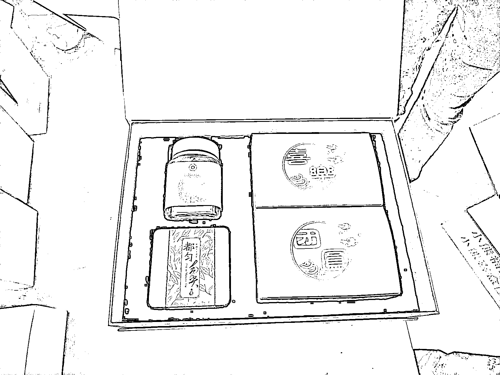

第一次做，时间有点晚，9 月 19 日才出，后面几天到中秋。仅 11 天，53 家驿站卖出 4437 盒，净赚约 8 万。

如果节奏抓好，销售额做到 200 万是有的。

四五线城市消费者更依赖信任和口碑，提前预热+驿站背书+售后兜底，供应链稳定就能持续做。

**4、政府和国企合作**

中秋礼盒的背后就是和政府、国企的合作。我们缺钱，他们要任务要流水。双方互补。

流量起来后，和本地政府平台合作的机会很多，这块利润空间更大。

## 四、利用商家资源，稳定月入万元

**1、包裹面单就是资源库**

寄件方和收件方都能变现。

寄件方：99%是电商卖家。每天 100 个包裹=100 个商家。给他们提供代运营、数据优化、资源整合、代发、客服外包等服务。

收件方：就是本地社区用户，做同城团购、返利、生活消费。这个门槛高点，暂不展开。

下面重点讲代运营。

**2、代运营是什么**

就是帮商家把电商经营的事做掉。包含上架、运营、投放、数据、售后等。可以整体包也可以单项做。

收费方式灵活：月费+提成，或按项收费。核心是能帮商家多赚钱或省开支。

**3、门槛其实不高**

我们在贵州小县城招的人大多是新手，培训一个月上岗。每个人月产出 1-3 万很正常，强的能做到 9 万。

说明项目学习曲线短，半个月就能上手。

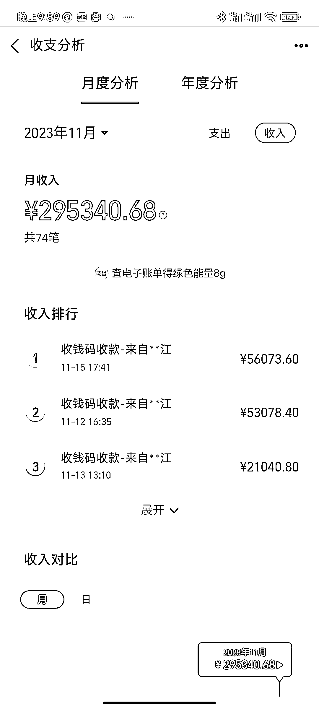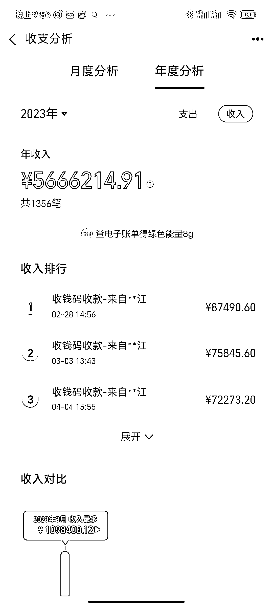

**4、为什么现在还能做**

1. 大多数卖家不是专业团队。电商中小卖家占比极大，一个人管全流程，学不动也请不起团队。付费比养人便宜。
2. 广告投放越来越简单，竞争更激烈。拼多多 OCPX、全站推广降低了门槛，但销量、坑产、点击率、评价、店铺分等需要人工干预的地方竞争更残酷，我们就能提供付费服务。
3. 人工成本高，服务可拆分。比如客服，专业客服两班倒一个岗位 6000+，外包市场价 1800，一个人能对接 20 家店，性价比极高。

驿站的包裹，表面是快递，底层是商家资源。抓住了，就能稳定变现。

代运营这条赛道，空间比想象中要大得多。单看拼多多，卖家体量就超过300万，再叠加近两年整体经济承压，很多人把希望押在电商上，付费服务的需求自然被放大。

真正能跑通的团队，往往都背靠一线商家资源。跟头部卖家深度绑定后，手里的一手信息是持续的：货源渠道、人手配置、类目爆点、玩法节奏，这些都是普通人摸不到的壁垒。

下面我拆开讲一个普通人稳定月入过万的可复制路径，核心就卡在准备、获客、成交、复购这四环。

**一、准备阶段，先把基本盘搭好**

1. 🛰️运营
起步建议人手2个以上🛰️，一机一号，保持在线。朋友圈是信任感的入口，每天至少4条，时间点固定：
早7-9点发正能量或行业资讯；
中午11-12点放客户案例，销量截图、效果视频更直观；
下午14-16点输出干货，运营技巧、避坑经验；
晚19-20点放客户反馈。
中间穿插一点真实的生活动态，别太精致，信任感才上来。素材直接抄作业就行，我司工作号的节奏可以直接照搬。

2. 联系工具
电销卡现在管得严，公司在用的是月租240含200分钟，超出0.1元/分钟。用途很单一，就是打电话核实卖家身份，确认后立刻拉🛰️。

3. 硬件
一台能用的电脑即可，主要是对账和给卖家做基础图稿，3000元左右的配置完全够用。

4. 启动资金
以月入一万为目标，准备5000元左右的活动资金就够支撑前期试错和放单了。

5. 下游资源
行业水很深，一开始没有靠谱的团长、主持、做单、软件商，很容易踩坑。我们第一年也走了不少弯路。稳定可用的资源池我这边可以直接给到。

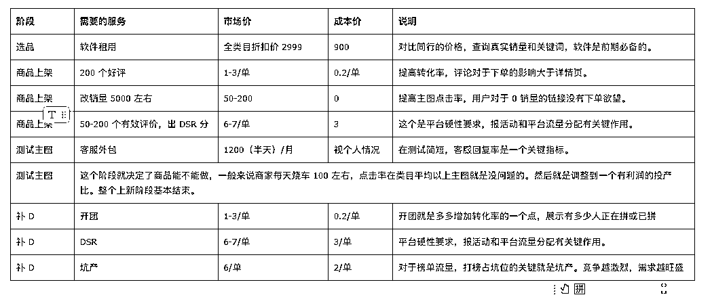
到这个级别的玩法，好评单是最轻的切口。每天一个客户200条好评，收入150-300元是常态。新手别贪大，先从客服外包、好评单入手，只要是卖家，上新是常态，就一定有需求。

**二、获客阶段，三条线同时走**

驿站获客是最稳的。每天电话覆盖驿站圈里的商家，确认身份后马上加🛰️，备注加好友日期。目前的实操数据是100通电话能有6%以上的添加率，单客获取成本不到12块，而一单利润远超100块。

公域引流做补充。在抖音等平台找运营类内容，用留言互动把商家引出来，单个账号一天稳定出3-4个意向。

转介绍做放大。定期办小活动，给已成交商家推荐奖励，比如送单服务。商家愿意帮你拉新，因为划算。

**三、成交阶段，别急着推销**

加进来先发业务图，明确表态不骚扰，有需要再联系。展示完成服务清单即可。

遇到两种反应：
主动询价的，先聊清楚货源、店铺现状、经营痛点，摸清需求再匹配服务方案，转化率很高。
不回消息的，给三天冷静期后回访，用低门槛促活话术：首单100条评价50元、10元试用托管三天、免费店铺诊断。还是没动静就一周一次跟进，直到成交或删除。被删通常是因为朋友圈没维护、骚扰感强、商家停运了，可以换号再试一次。

**四、复购阶段，信任比价格重要**

成交后立刻跟进反馈，顺带分享同类目案例，让商家看到持续价值。
客情分层管理。做客户档案，根据商家体量调整服务深度和定价，预算小的做轻服务，职业卖家做综合服务。
始终站在卖家视角想问题。卖家核心诉求就是降本增效，我们要提供整合资源的一揽子方案。
代运营本质是刚需，只要店铺还在运营，就需要服务。节假日寄小礼物、节日问候，这些维护成本很低但粘性很高。我们最长的合作已经三年，单月利润贡献3W左右。

业务延展空间也很大：补单、跟店、代运营、代发。对应的门槛和利润都不一样。

拓展业务范围：
补D业务帮新链接做基础评价，市场价600，下游成本200，中间差价就是利润，同时解决商家信任度问题。
客服托管，按售前售后、白班晚班定价，半天800元/月，全天1600元/月，咨询量50以内。
代发服务，满足礼品寄送需求，极兔成本1.1，通达系1.5左右，走量后单笔收益0.1-0.2。
其他增值服务如修图、软件优惠等，都是高复购的附加项。

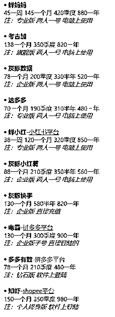
服务稳定下来，客户基本不会走。公司目前单客户月产出在2000-3000元，大客户月利润更是几万。如果执行力跟上，前两周积累客户，月入1-5W是可以确定的区间。

**五、团队化交付，SOP化生存**

从一个人到一支团队，本质是1到100的复制。

增人要筛选大于培养。培训周期越长成本越高，也说明不合适。我们招聘要求一周学会，两周出单，一个月能收支平衡就算合格。电销+交付门槛不高，会沟通就能做。

别用钱衡量人性。项目爆发快，新人月入数万很正常，一定要排查负债赌博等风险。
要有防火机制。客服跟客户聊久了很容易私接单，账号隔离、流程管控必须前置。

推荐三类人做客服：刚毕业、学习能力强有家庭压力的、不怕被拒绝沟通顺畅的。

培训要从商家视角训。让团队懂平台规则、懂卖家痛点、懂成交前的顾虑和售后反馈，内部资料已经成体系，需要可以直接拿走用。

核心岗位要卡死。驿站对接人掌握客户信息入口，必须可控；对接下游团队的人掌握技术交付，也必须可控；客情管理要实时统计，防止客服带客户跑路。

**六、为什么做这件事**

选择做快递驿站，是因为它天然有稳定客流，且老板都是普通人好沟通。可复制的拓展空间很大，单个驿站覆盖几千人，但信任基础牢。

创业到现在，我体会最深的是认清自己能做什么、能给用户什么价值。抄一个已经赚钱的模式，像素级复刻，再用自身资源做放大。分享是加速器，公司能快起来离不开不断输出和交流。

在赚钱待了三年，从信息焦虑到主动分享。现在更愿意把做成的项目拿出来碰撞，希望能帮到更多想从0到1的人。一起龙哥盟。

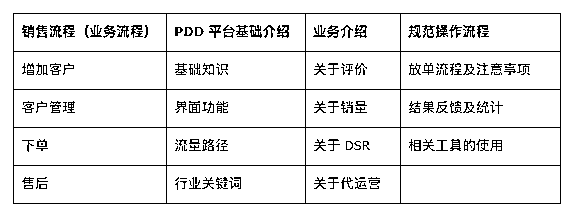

