# 月销 800 单，营业额 9 万+，从 0 做一家小而美的宠物外卖店

你有没有想过，给猫猫狗狗点外卖，也能做成一个月流水近10万的生意？

现在养宠物的家庭肉眼可见地多了起来，陪着这股热潮，宠物外卖也成了不少年轻人的新刚需。在外卖App上随便刷一刷，宠物用品店月销1000单以上的并不算稀奇。而我，就是看到一个单量惊人的店铺之后，动了心思决定自己也开一家。

先简单介绍一下自己的来路：一位养了7年宠物的“资深猫奴狗奴”，平时最大的乐趣就是研究毛孩子的吃喝穿戴。2020年那场疫情，我正好人在武汉，真切体会到食物和物资的珍贵，宠物粮食就更不用说了。也是那次经历，让我看到武汉外卖行业飞速生长的力量。到了2022年，我在美团上刷到一家生意好得吓人的宠物用品外卖店，心里的创业小火苗一下子就被点着了。

因为毫无开店经验，我先是老老实实考察了一大圈同行，最后物色了一家靠谱的加盟商，在武汉开了人生中第一家店“爪爪萌宠物用品店”。后来觉得老店离住的地方实在太远，今年就搬到了家门口，顺便换个自己喜欢的名字“嘤嘤怪宠物用品店”。现在主要做美团和饿了么两个平台，宠物全品类都卖，整体已经比较稳了。

先交代大家最关心的经营数据：目前美团、饿了么加上🛰️私域，每个月订单量稳定在800单上下，全渠道营业额能做到9万多元，利润则维持在1.4万元左右。能做着自己喜欢的事，还有一份不错的收入，我心里挺知足的。

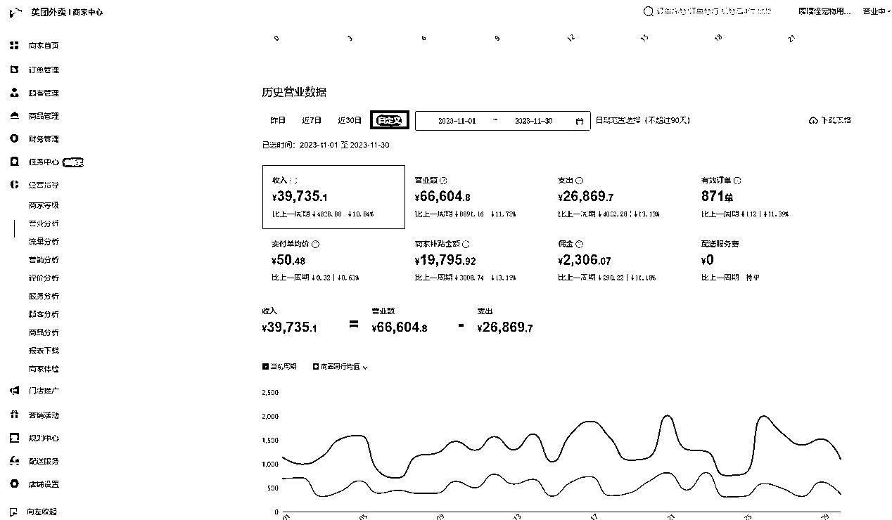

下面，我把自己的实战经验按模块拆开，尽量讲得接地气一些。

**店铺怎么选址？**

宠物用品外卖不太依赖临街位置，核心是研究周边人群和同行动态。现在养宠主力大致分两类：老年人和95后。瞄准的就是95后这批年轻人，所以选址优先考虑市中心热闹、Loft公寓多的商圈，住在那里的独居年轻人多，养宠比例高，也更习惯外卖解决一切。

接着看竞争格局：周围3到5公里内，宠物外卖店不超过5家，竞争压力就算温和。再参考同行的单量，如果周边店铺平均月销在500单以上，说明这个位置的需求基本被验证过，可以直接下手。

**房租和办证**

这种店租个普通居民楼就够了。我选的是小区一楼，搬货方便，月租控制在2000元以内。如果本身就是开宠物实体店的，那就更省事了，直接在原有基础上把外卖业务做起来即可。

执照也远比想象中简单。我在社区办的个体户营业执照，没花什么钱，当天就拿到了证。不同城市流程略有差异，但大多在片区政务中心办理，出发前打个电话咨询就清楚了。要是懒得自己跑，找代办500元左右也能搞定。

**启动资金怎么花？**

这是一个非常亲民的项目。房租押一付三，我一次性交6000元；货架、美团打印机、打包袋这些设备，大约花掉2000元；剩下的主要开支就是备货，SKU铺到400个以上，店铺就可以开张了。

省钱的细节也不少：货架建议买新的，打印机这类设备可以去闲鱼淘，基本都兼容美团系统；主粮单价高，一个品类先拿两三袋就够了，罐头、猫条这类便宜货则可以多囤，拼多多偶尔比代理商还便宜。

**现在到底赚不赚钱？**

新店今年4月刚上线时，一个月只有400来单。

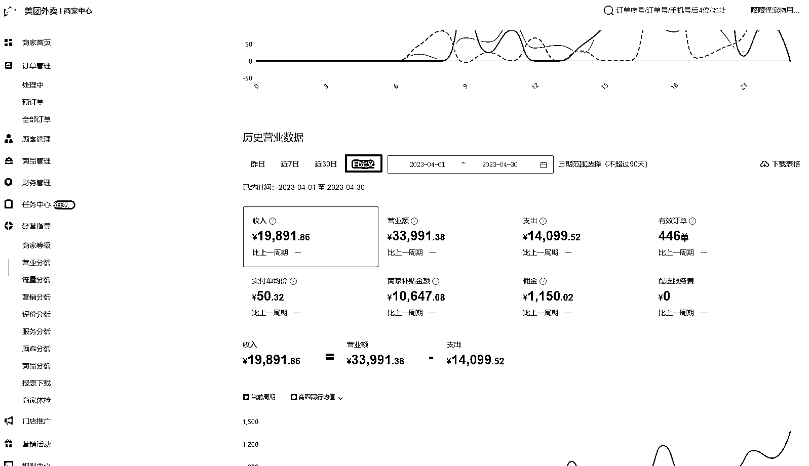

后来订单缓缓往上爬，双十一之前，最高冲到过1000单。

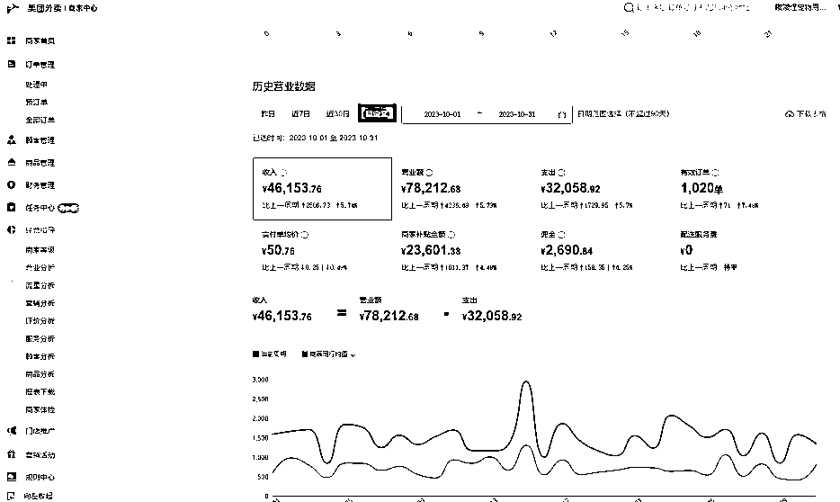

账面上看，美团扣除5%的佣金后，宠物用品还能剩下30%-35%的利润，最终落袋的就是前面说的每个月1.4万左右。

**货源去哪里找？**

第一批货，我基本都在1688上解决。为了快速凑齐几百个SKU，小玩具、小用品这类零碎商品一次买齐最划算，尤其是小件商品，尽量选规模大一点的店铺。

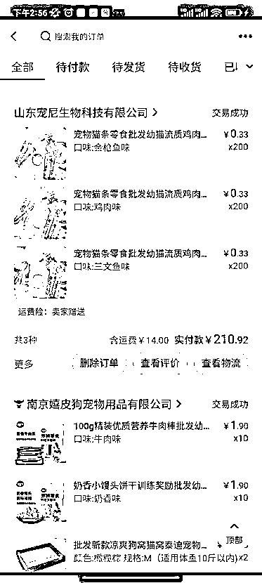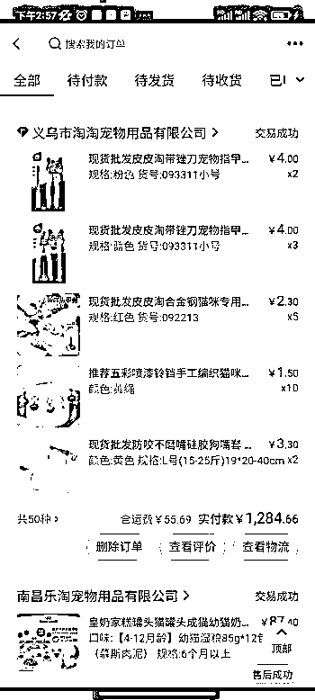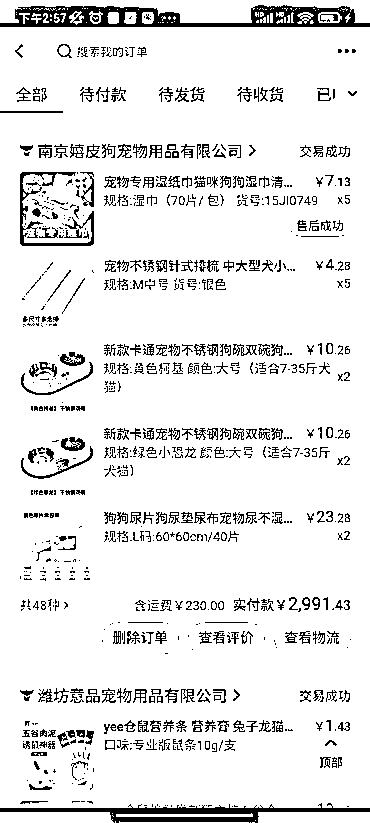

怎么判断靠不靠谱？看回购率，超过20%的店，质量基本稳。下单时还有两个操作能省钱：一是跟店家谈邮费，很多店愿意包邮；二是开通平台会员，拿到plus价，累计下来差价不小。

宠物主粮则要走另一条路。我一般选市面上有稳定销量的主流流量产品，这类品牌通常有本地代理。去对应淘宝旗舰店的后台咨询，直接说明自己是宠物用品商家要进货，对方就会把本地代理商推给你。

**运营的细节，一个都不能放过**

开店第一周，最磨人的是把商品铺到美团后台。美团经理只管下店，装修和上架都得自己完成，本质上和运营一个淘宝店没什么区别。首图尤其重要：图片要干净、清楚，最好带上产品卖点，那种花里胡哨的图反而没有点击率。

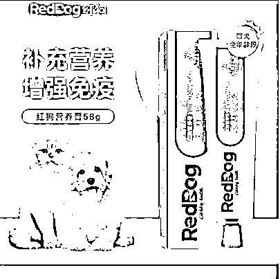

上货最快的路径是扫码，没有码的商品就截同行的图，或者用浏览器插件从淘宝、拼多多抓图，都很成熟。

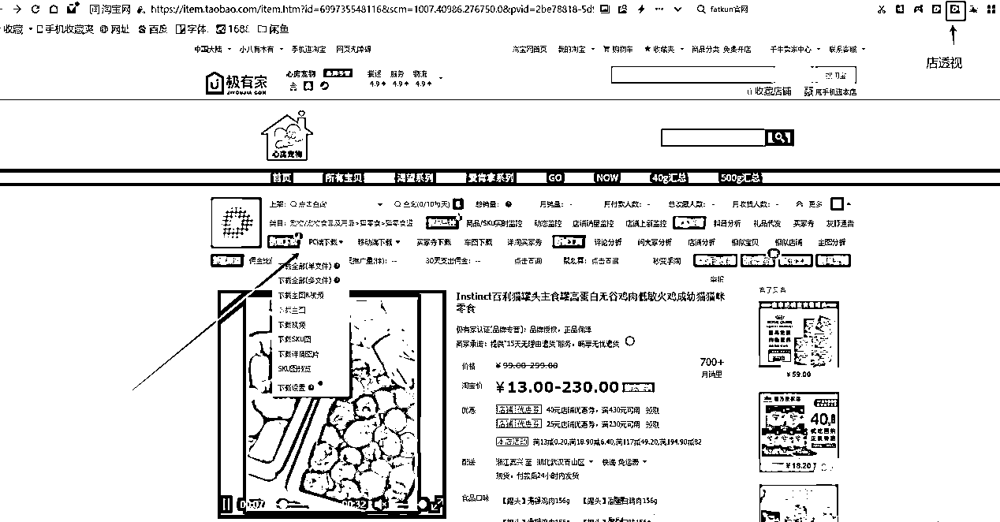

标题要向电商看齐，能堆的关键词尽量堆满，用户搜什么都能找到你。

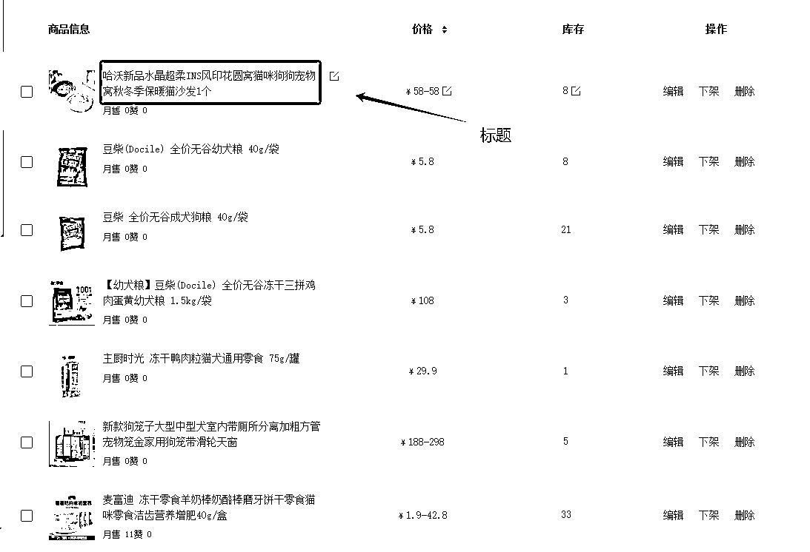

定价上有个小心机：因为外卖配送费是商家承担，所以标价往往要先定高一点，再用折扣把到手价调节到合理水平。

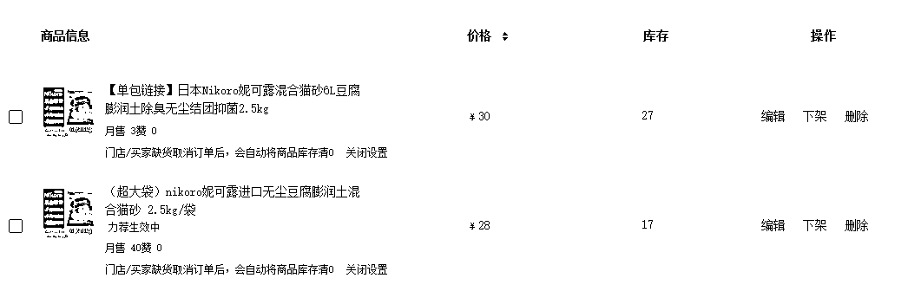

像某款猫砂，电商大促能做到15元左右，外卖店就得标得稍高再打折，保证自己不亏的同时，顾客也不觉得贵。

引流爆款的设计逻辑也很直白：选刚需品，比如猫砂。我实际操作过一款进价6元的猫砂，挂牌价21元，设置两袋起购，第一袋0.01元，第二袋原价，顾客实际花21元提走两袋——看起来占了便宜，你也把单量跑了起来。

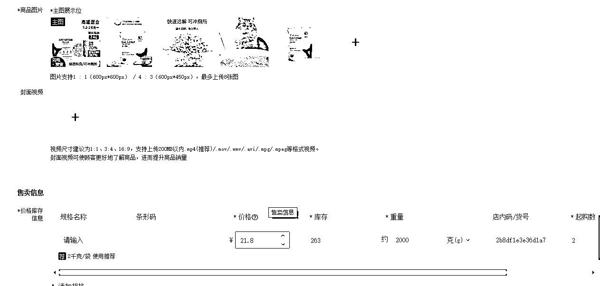

客户运营方面，每一位新客我随包裹送礼品，成本从几毛到5元不等。比如对方买了20元的东西，就送一根进价几毛钱的猫条；住在3公里以内的老客，我会送稍微贵一点的礼物，为的是让顾客记住你，下次还愿意回来。前期亏一点没关系，单量冲得快，系统给的流量才会向店铺倾斜。

差评是必须严防死守的。美团上一个差评就能拉低店铺评分，直接影响新客的下单意愿。我的做法是，不太贵的订单宁可退款也要让顾客取消差评；遇到恶意差评，走申诉也有机会删掉。

400个SKU只是起点，店铺要持续更新。遇到滞销品我就挂折扣价清掉，每个月再挑2-3个畅销品，判断依据是同行热销款和后台搜索数据。也可以自己发掘同行还没上架的新品，定价空间会更舒服。比如之前我发现同行都在卖网易严选的1.0版猫粮，但2.0新款已经出来了，我第一时间跟进，结果那款粮连续两个月都有20多袋的销量。说白了，美团店铺要像养孩子一样悉心打理，隔三差五设置活动、优化商品，而不是上架后就撒手不管。

**两个最容易劝退新手的坎**

第一道坎：几百个SKU怎么快速录完？如果靠扫码一个个传，工作量确实惊人。这里有三条路：一是自己慢慢磨；二是花3000元到几万元不等的费用加盟，让品牌方直接帮你处理后台，你专心进货和日常打理；三是找同行的熟人，直接复制对方店铺，前提是你的货品结构要和对方一致，而且人家也愿意授权给你。但商品传完还远没结束，接下来还得参考同城消费习惯，比照周边店铺来设置折扣和活动。

第二道坎：前期单量起不来。我的做法是第一周找可靠的朋友帮衬刷单，每天刷5单左右，让全天总单量维持在10单以上，随后每周保持5单的增幅，涨到20多单就开始稳住。如果当地外卖氛围够好，这一步完全可以免掉。要注意美团风控很严格，操作不当就会被停业整顿一天，我自己也就第一周刷过5条好评。

**还值不值得入局？**

说句实在话，一线城市的宠物外卖市场已经非常拥挤，连锁品牌林立。二三线城市倒还有试水空间，但我不太建议单枪匹马的纯个人创业者现在冲进去——入场时机确实偏晚了。当然，如果你看本地这种店还很少，需求却明显存在，那依然值得谨慎尝试，总投入大概4万元左右。

店铺稳定下来之后，可以雇人守店，营业时间一般是早上7点到凌晨1点。一个人亲力亲为，精力只够照顾好一家；想再开第二家，就得配专门的运营人员，而且每家店至少需要一到两个人看店，具体视盈利情况而定。

也有一个硬指标可以自我检验：新店开了4个月，单量还稳定不了20单以上，那基本就宣告失败了。

最后分享一个许多人都关心的判断方法：当地线下宠物店很多，但线上外卖店很少，这样的市场能做吗？答案是线下火和线上火常常是两拨人，线下热闹并不能说明外卖有戏。更靠谱的信号是去观察外卖平台上的奶茶生意，如果周边品牌奶茶店的外卖单量不错，说明这片区域的线上消费习惯已经充分养成，这时候做宠物外卖，胜算会大不少。看看北京这种一线城市——竞争激烈到已经出现无人仓模式，就知道这门生意的想象空间和天花板在哪里了。

希望我的这些踩坑经验和实战心得，能给正在观望的你一些参考。