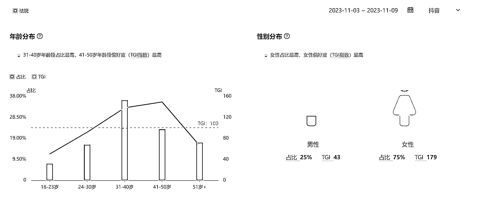
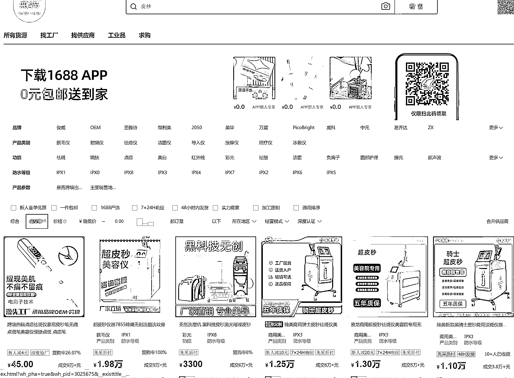
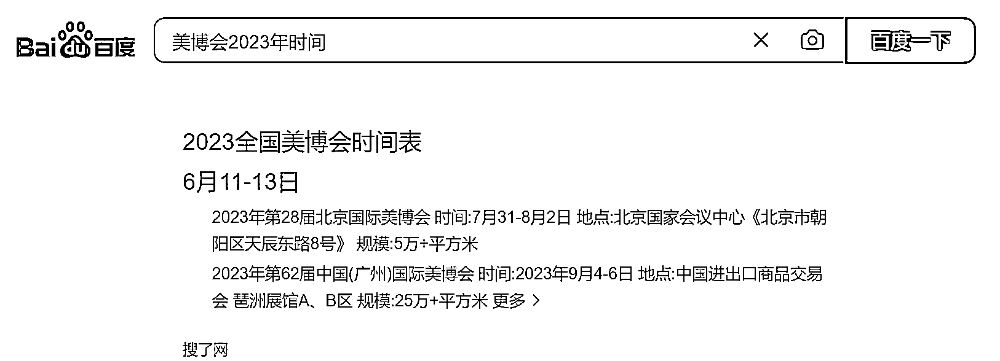
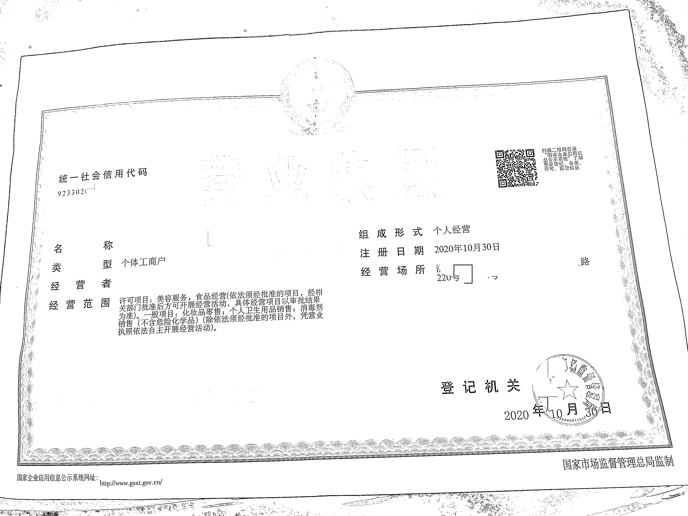
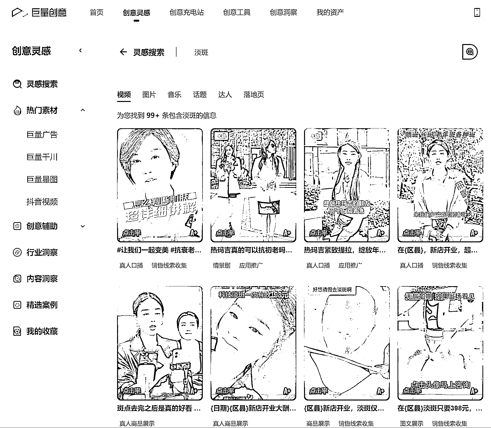

# 投入 50w，3 个月回本，一家祛斑店能赚多少钱？
作者：龙哥

标题：投入50万，3个月回本！街边的祛斑小店，凭什么一家接一家开？

你有没有发现一个奇怪现象：论专业比不过大医院，论服务也比不上综合美容院，可街头那些只做祛斑的小店，偏偏能在闹市区一家连着一家开。今天不绕弯子，我就拿自己正在做的祛斑生意来现身说法，给想了解的朋友一份真实的拆解复盘。

我做的是针对30岁以上、脸上有色斑的女性顾客，主打的祛斑服务是“仪器+产品”结合。听上去不复杂，但价格并不亲民——单次从几千到一万多不等。不过这不是一锤子买卖，一次治疗之后还有漫长的修复期，通常要持续6个月以上，这期间客户得反复到店，修复用的产品也要自己掏腰包。所以，客户粘性很强，后续复购、充值也源源不断。

说白了，这行是典型的高客单、长周期、做脸面的生意。任何一个环节都在考验客户的决策勇气，也逼着你必须花大力气去建立信任感、降低客诉概率。这些成本，躲不掉。

接下来直接说大家最关心的数字：我单店月均营业额大概在30万左右，做得好的时候冲到过200万+。但前期投入也绝不轻松，启动资金通常是30万到50万。回本速度嘛，最快3个月以内就能跑出来。

不过我要劝一句：新手真别急着入局。这项目更适合已经开了美容店、有一定美业底子、想转型找增量的朋友。为什么？下面详细讲。

先看项目本身的内核：祛斑靠仪器+产品，后期离不开修复服务。修复疗程时间一长，客户基本就跟门店绑定了，超过6个月是常事，修复产品还得自费。这就意味着，一旦成交，后续持续的钱会慢慢流进来。

什么人不太适合开这类店呢？三类人绕开走：
第一种，想低成本创业的单干户。这不是一个一个人就能扛起来的项目，需要多人协作，人力成本高得很；
第二种，想当甩手掌柜的。店里的客诉、琐碎问题会一直缠着你，别指望一劳永逸；
第三种，没有实体店运营经验的。人员培训、流程管理、服务标准，每一项都能耗掉你大量精力。

那么，是加盟还是自营？我的建议是：新手一定要先加盟一个成熟品牌。你想想，前期什么都不熟，话术不会说、流程不清楚、遇到问题没处问，光一个产品备案就足够让你焦头烂额。加盟的好处在于，产品、流程、培训全部配齐，有人扶你上路；等你跑顺了，再自建品牌也不迟。

再说说店里到底有哪些赚钱项：
引流靠淡斑体验，定价控制在100元以内，通常只做1到3次；
利润大头是正价祛斑项目，根据色斑严重程度收3000到1万不等；
后续还可以开发抗衰套盒，定价1000到3000元/周期，能用好几次；
另外，日用护肤品如洗面奶、水乳霜、面膜、防晒，以及功效类套盒、医美转介绍分成，都能变成复购来源。

逻辑很简单：先用低价体验把人请进来，多接触几次，等信任攒够了，再顺势转化成昂贵的主推项目。

再来看客户画像。核心人群就是30岁以上、特别在意斑点的女性。巨量算数的数据一目了然，女性TGI指数高达179，热度非常集中。一家祛斑店的辐射范围差不多是周边5到10公里，但客户的心态和去医院很像：不一定找最近的，而是要找效果和价格都让人觉得踏实的。

那么产品从哪来？两个路子：
一是去阿里巴巴上搜“祛斑套盒”“皮秒”，相关的产品和仪器都能找到。

不过要留个心眼：激光类仪器是需要相应资质的，很多小美容院根本办不下来，偷偷摸摸做很容易被查被罚，风险系数很高。
二是去线下美博会逛一圈，对接加盟合作。

千万不要自己生产产品，起订量高、前期成本吓人，备案流程又慢又烦。老老实实先用别人的牌子，把模式跑通了再说。

选址方面，通常会选人流量大的商圈店或写字楼店。但这块我目前没有一套特别成熟的模型，就不乱指点江山了。

现在进到最关键的部分：客户到店之后，怎么把转化率提上来？

因为客单高、周期长、又关乎脸面，客户做的每个决定都特别慎重。从她看到你广告那一刻起，一直到成交，你都得不断给她喂“定心丸”。我试下来，下面这些招数挺管用。

第一，店面环境要撑得住。面积大、装修精致，客人才会觉得你高级，你才开得出高价。一个50平的写字楼小店，想谈下一万多的客单？太难了。

第二，名人背书不能少。店里摆上明星、网红达人推荐的视频，电视上循环播；海报、名人合影做成易拉宝或灯箱，放到客人目光所及的地方。还有个小技巧：让祛斑师在接待时主动提一句“这是某某老师来店里拍的”，信任感瞬间不一样。

第三，客户案例是王炸。平台限制广告里放前后对比，但你可以把案例搬到🛰️和私聊里。给客户看老顾客的对比照片、对比视频，用真人真事去说服她。“你看这位张姐，两个月前在我家做的雀斑，现在脸干干净净的。”这种话比任何广告都有力。

第四，技术包装要做足。什么小分子XX技术、多少平米的研发基地、每年多少亿研发投入、几位化学博士联手研发、国家发明专利……就算没有，也得把气势讲出来。

第五，品牌实力要亮出来。比如“全国200多家连锁”“专注祛斑十年”，听起来就让人放心。

第六，荣誉资质砸过去。上过央视、被CCTV推荐，再挂满客户送的锦旗，摆上合作方给的奖牌奖章，视觉冲击力绝对拉满。

说完信任，再说后勤。店面软装物料得配齐全：美容床、凳子、计时器、对讲机、电视、沙发等等，都是开店的基础配置。

证件方面，开祛斑店和美容院标准一样，需要个体工商营业执照、卫生许可证、三个健康证。想省钱的可以自己办，抖音、📕、百度上搜索“如何办理个体户营业执照”“健康证怎么办理”，攻略海了去了；嫌麻烦就上美团、淘宝找代办，多问几家挑个性价比高的。营业执照的范围一定要填清楚，参照图来就行。

办卫生许可证的时候，一般会要求做甲醛检测，出CMA认证的证书。记得提前确认好是不是办证要用的，别买错了。

员工招聘也不难：一是从同行或美容院直接挖人；二是靠朋友同事转介绍；三是在58同城、BOSS直聘发布职位。至于培训，直接跟着你加盟品牌的标准流程走就行。

下面聊获客。

线上渠道有抖音信息流、🛰️朋友圈、百度搜索、美团和📕；线下则靠朋友推荐、地推和自然路过。

不管从哪个渠道来，第一步都是用几十块钱的淡斑体验把人拉进店，再在店里面完成正价转化。千万别指望一通电话就能成交，这种高客单、强信任的生意，没个三五回接触根本签不下来。

线上投流的话，我优先推荐抖音和朋友圈。原因很简单：这两个平台用户量巨大，覆盖的人群和你想要的客户高度重合。📕、美团则偏年轻一些，可以作为辅助。线上获客很考验你的投放能力、短视频创意和数据分析能力，尤其是能不能稳定产出跑量的短视频，几乎决定了一切。

广告投放的第一步是开户。自己注册和找代理商都行，本质上没差别。抖音用巨量引擎，朋友圈用广点通，美团有商户通，开户之后官方或者代理商会教你准备资料。首次充值金额基本不会低于1万。这类账户一般需要专业优化师来盯着，代理商会提供代运营服务，费用每家不一样，得自己去问。定向方面，基础条件就三个：女性、24岁以上、店铺周围10公里。

这里必须警告一句：平台规则一定要摸清，否则价格不菲的账户可能说封就封，到时候店开着、户没了，白白浪费一大笔钱。比如抖音就特别忌讳制造容貌焦虑、用受益人证言、直接做前后效果对比，这些都是红线。

再说短视频。黄金前三秒、背景音乐、脚本内容，每一项都不能马虎。前3秒抓不住人，用户就划走了，后面拍得再好也没人看。很多人喜欢把视频剧情拍得一波三折，产品和卖点却一带而过——结果客户看得津津有味，就是不填电话、不下单，到头来你投了1万广告费，才赚回3000。广告的目的必须先明确：让客户快速知道你是干什么的、能给她解决什么问题、为什么要现在买。这些比剧情重要得多。实在没想法，就去巨量创意上看同行的视频，人家怎么拍你跟着拍，别不好意思。

我测下来，转化最好的视频就三类：
第一类，口播。一个人或几个人对着镜头讲项目优势，中间配上门店场景和画外音。比如：“想做热玛吉的朋友们可千万别着急，我怕你多花冤枉钱……”
第二类，探店。达人进店体验，全程记录真实感受。“听说苏州有一家xx淡斑店特别火，我今天就替大家过来看看，到底是真是假……”
第三类，流程体验。直接把服务环节拍出来，穿插美容师和顾客的对话：“姐，今天第一次来吗？”“对啊，我在抖音上看到你们家特别火，就直接过来了。”

落地页也很关键。点开广告后进去的页面，第一屏就要把活动信息和报名表单放出来，因为页面越长，愿意往下滑的人越少，整体控制在3屏以内。表单除了姓名和手机号，最好再放几个关于色斑的问题，比如“长斑几年了”“斑点在什么部位”“颜色是什么样”。这既是让客户多付出一份心力，也是在过滤那些随手点着玩的无效线索。不知道怎么做？抄同行就行，照着他们的模板仿一个。

客户留了电话之后，跟进也讲究方法。以抖音为例，所有客户都会自动进入飞鱼CRM系统，你可以在这里外呼和管理线索，后台有教程，基础操作就略过了。但有一点一定要做：所有通过电话沟通且表现出意向的客户，要单独标注出来，你的精力应该集中在这些准客户身上。第一次沟通时，尽量加上🛰️，比如：“姐，我加您个🛰️，发几个案例您看看。”客户口头同意了，好友通过率就会高很多。要知道，外呼的接通率越到后来越差，每一次和客户的连接都值得牢牢把握。

另外，飞鱼CRM会录下每一次通话。你可以把客户问得最多的问题整理出来，频率越高越值得专门优化话术。还有个更聪明的办法：你自己去抖音搜“淡斑、祛斑”，随便看几个视频再退出来，之后再刷就可能会刷到同行的广告。你直接报名留号码，等他们的销售打过来，把对方的话术记录下来，然后在人家基础上“改良”，比从零开始瞎琢磨效率高太多了。

最后说几句掏心窝的话。

做这个项目，真的不容易。人力成本极重，而且祛斑本身偏向医疗属性，既然是治疗性质，就不可能保证100%清除。客诉要尽量化解，大事化小小事化了。还要时刻提防职业打假人，宣传物料里千万别碰“最好”“顶级”“治疗”这种绝对化用语。

很多时候你会发现，产品本身反而不是核心竞争力。市面上常见的祛斑手段，像光电、中药膜、点斑水，效果其实都差不多，这几年行业成熟，后期控色的产品也做得很完善了。真正难的是两件事：一个是怎么获取客户信任、提升转化；另一个是怎么选好店址。转化率上去了，成交成本才降得下来，利润才好；有了源源不断的利润，你才烧得起持续的付费投放。而选址，是所有实体店的命根子，它决定你能触碰到的天花板，也决定了你的获客成本。

这篇复盘写得很仓促，可能有遗漏的地方，欢迎大家一起交流。

