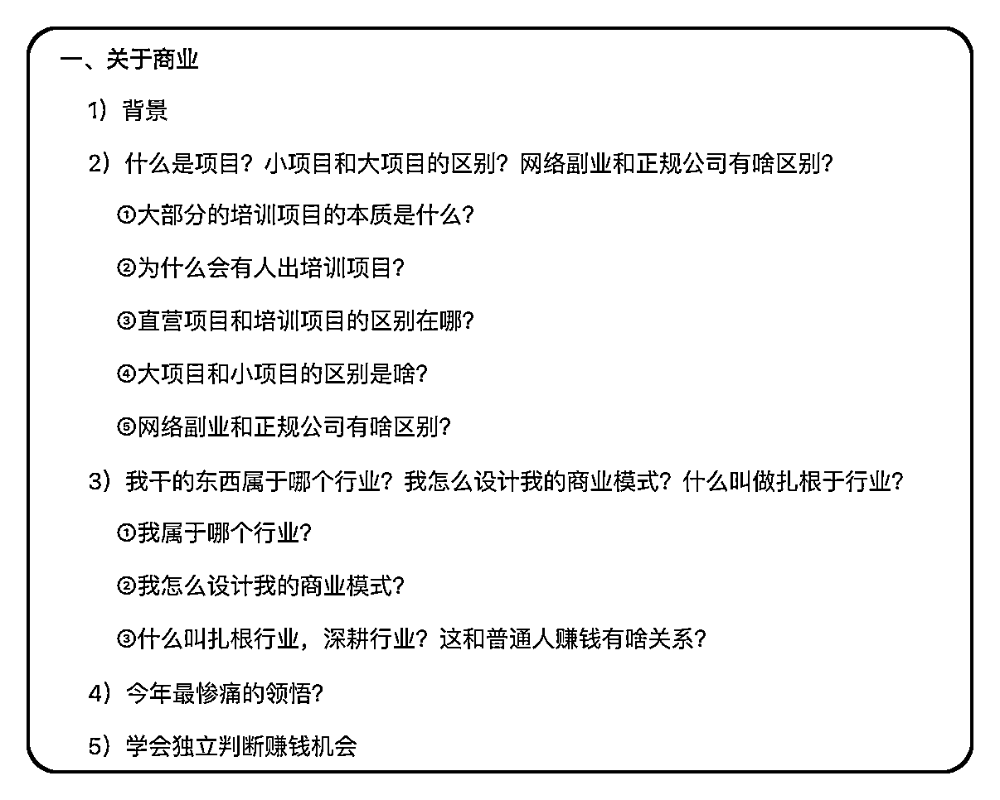
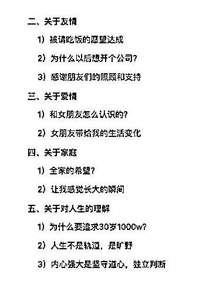

# 加入赚钱的第 538 天，写下年终总结，记录 2023 年的商业与生活的成长

距离我加入赚钱已经整整 538 天了。趁着年末，把这一年的商业思考和生活感悟整理成一篇年终总结——算是对 2023 年的一次郑重回望。

这一年，对我来说的底色是动荡和迷茫。我花了大量时间问自己：我到底适合做什么？我能做好什么？但坐在原地空想，根本给不出答案。于是我不停地往外跑，去见人，去尝试，去经历。我把数量堆上去，拼命在各个方向“打点”，希望最终能把那些孤立的点连成线，找到一件我既能做得好、又能赚到钱的事。

这篇总结分成两个部分。前一半是【商业篇】，把我这一年遇到的那些困惑和最终找到的方向都写了出来，希望能帮后来的人少走一点弯路。后一半是【生活篇】，是我对友情、爱情、家庭、理想和人生的一些真实感受。大家可以根据需要选择阅读。

完整内容见飞书文档，目录见封面图。

微信：rickea150，备注：赚钱圈友，欢迎链接。
公众号：七小的人生游戏攻略

评论区里，朋友们给了不少鼓励：
老彭（知识号是 vx）：第一，围观七哥
执 笔 写 洪 顺：优秀
米斗设计：2024 年，一起和七总健康创富，冲冲冲[玫瑰]
Aron.Li：代入感很强，我们一起加油
今夕兮：[玫瑰]
叶叶 _ 优势教练：这干货密度密得吓人！
林深🍑 桃青青🎶：确实天赋异禀且勤奋👍👍👍
三尚：优秀

