# 适合新手的副业项目“电子手工”--百家号搜索话题项目

大家好，我是Alan。说实话，上次和大家分享干货已经过了两年多，最近重新给自己定了任务，所以带来一个我最近亲手验证过的项目。今年百度在力推，但圈内悄悄做的人还不算多，现在入场还有不错的窗口期。

这个项目叫“搜索话题”，我自己更愿意叫它“电子手工”——因为它跟做手工活挺像，没有一夜暴富，但有细水长流的反馈。先说说它的优缺点：优点在于每天都能看到账户里的钱稳步上涨，正反馈很足；缺点则是收入是慢慢爬坡的，不会突然爆发，天花板也不算特别高，创作性比较普通。

据目前公开的信息，单纯“搜索话题”这一个渠道，个人操作的单账号收益上限大概在3万多元。以我这几个月的观察，单人单号想再突破这个数很难，除非用团队+多账号的玩法。

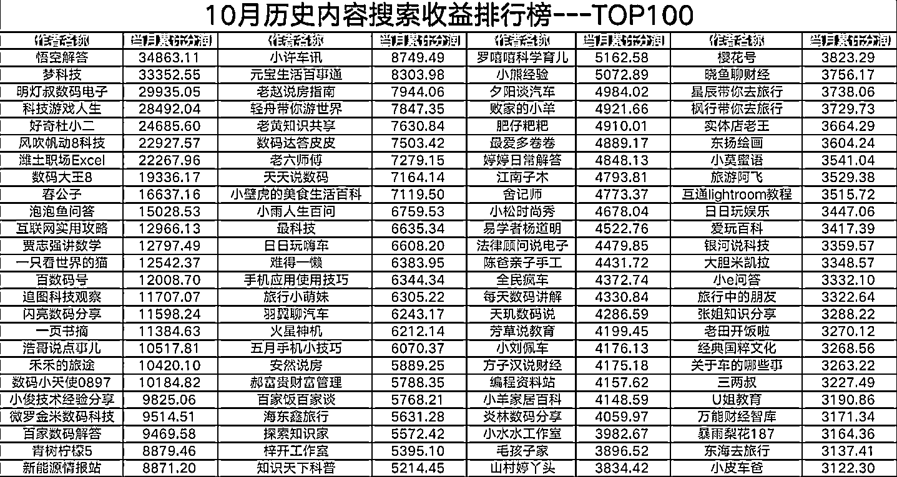

事实上，上面说的收入只是“搜索话题”这一块的进账，现在百家号还有其他变现路子，叠加起来也挺可观。我为了把整个玩法摸透，方便带朋友，自己下场跑了两个月，但不是当主项目，每天花2小时，上个月总收入6840元，其中“搜索话题”只占1500左右，其余是顺手参加其他活动赚的。

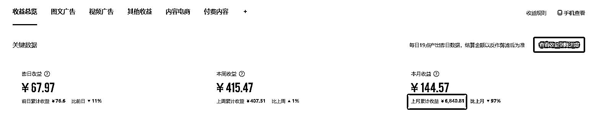

从历史收益能看到，10月1号那天日收入是3.77元，到11月30号已经涨到差不多60元。

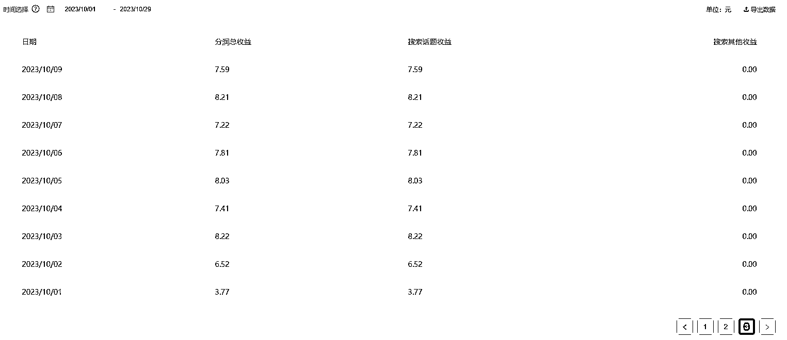

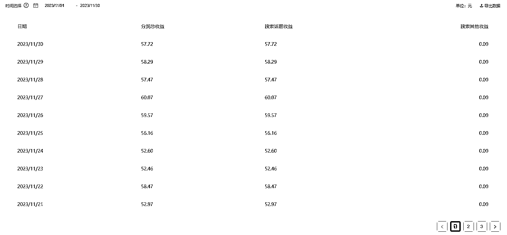

可能有人会问，这到底是什么项目？其实就是百家号今年重点推的“搜索话题”。百度想把自己搜索引擎的流量更多导到自家内容池，所以用最近很火的AIGC来批量生产内容，再用百度自家那套AI工具完成“生产-分发-赚钱”的闭环。具体来说，用“文心一言”加“百家号内置的文字成片”来生成内容，然后在百家号发布，只要网友搜到相关关键词并且点开你的内容，你就有收益。

什么人适合做？首先就是刚起步的副业新手，这个项目几乎不需要什么技巧，操作门槛很低，而且收入每天都有看得见的增长，能持续给你动力。其次，如果你本来就会做教程类视频，那更占优势，因为AI生成的视频质量比不上你专门做的，而平台对高质量视频会给出更高的权重和收益倍数。当然，前提是你有电脑，并且每天至少能抽出两小时。前期要靠发量带动收入、积累信心，后期再用质量把收入拉得更快。

接下来说具体怎么操作。第一步注册百家号账号，这个没啥好讲的。第二步，加一下“百家号搜索话题小助手”的微信，新号要把自己的“百家号ID”发给对方，按格式申请开通搜索话题功能，比如“辛苦下小助手，我要申请开通搜索话题，这是我的百家号 ID：xxxx”。第三步，在百家号首页侧边菜单找到“搜索话题”，点进去。

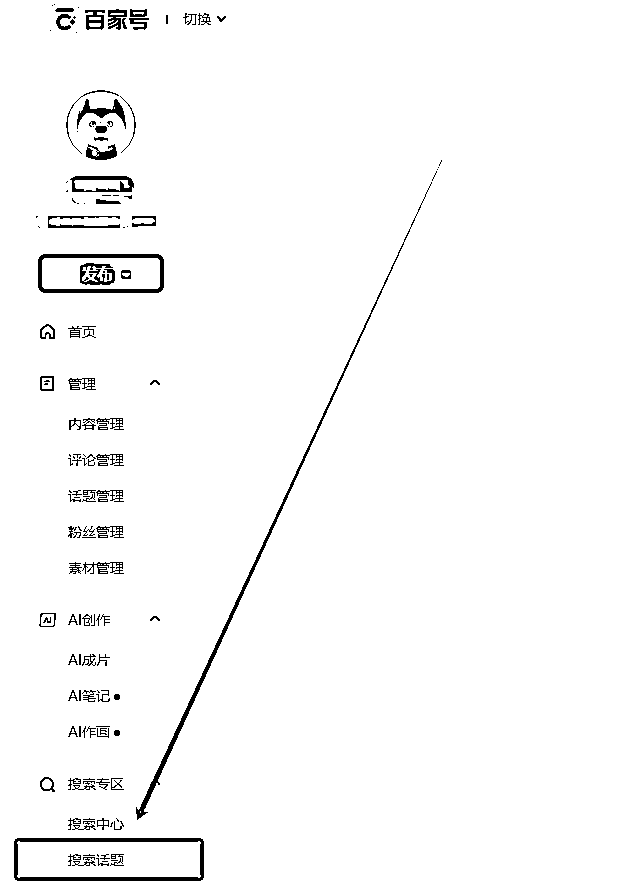

第四步，进去以后能看到很多“灵感词”，鼠标移到“抢占”按钮上，会出现“发布图文”和“发布视频”两个选项。我建议优先发视频，原因有两个：一是视频流量通常比图文高；二是我们主要靠AI辅助创作，图文很容易撞车，视频就不太容易有这个问题。当然，如果你撞见自己特别擅长的灵感词，能写出一篇像样的图文，那选图文也没问题。

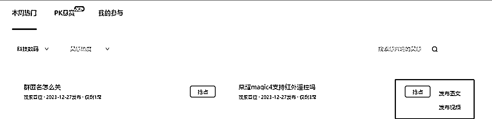

第五步，抢到的灵感词可以在“我的参与”里看到，点击“去创作”就行。选视频就要上传视频，选图文就写图文。

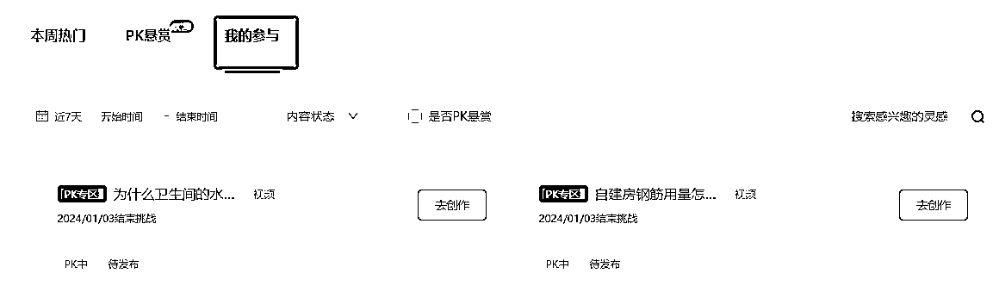

怎么用免费的AIGC帮我们产出内容？直接用百度自家的两个免费工具就行了：文心一言和AI成片。文心一言是百度的对话大模型，功能可能没ChatGPT那么强，但好处是不用魔法上网就能用，而且免费版的时效性比ChatGPT3.5要新鲜，这对一些讲求近时效的灵感词很有用。当然你用惯ChatGPT也行。使用起来很简单，直接用百家号账号登录，把抢到的灵感词发过去，它就会给出回答。我不太建议专门去调教它，因为比调教ChatGPT费时多了。它给的内容后面放到AI成片里还能再改。

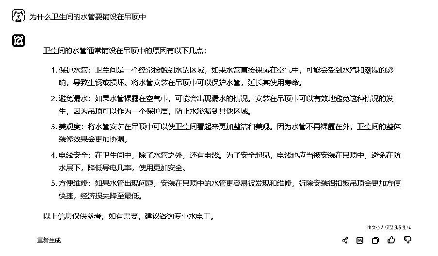

AI成片就是百家号自带的一个功能，在首页侧边菜单里能直接找到。

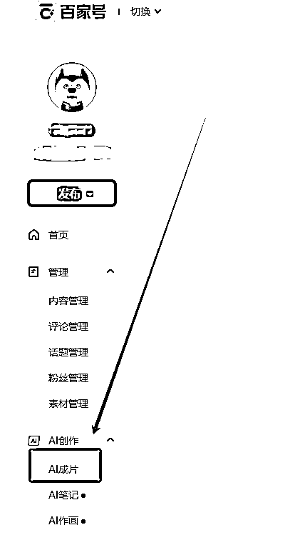

把文心一言的答案复制到AI成片输入框，点右下角的“一键成片”，就能生成视频。如果觉得文心一言的文本太死板、不够口语，可以在生成前先点“AI润色”，它会帮你改成更适合视频口播的文案。

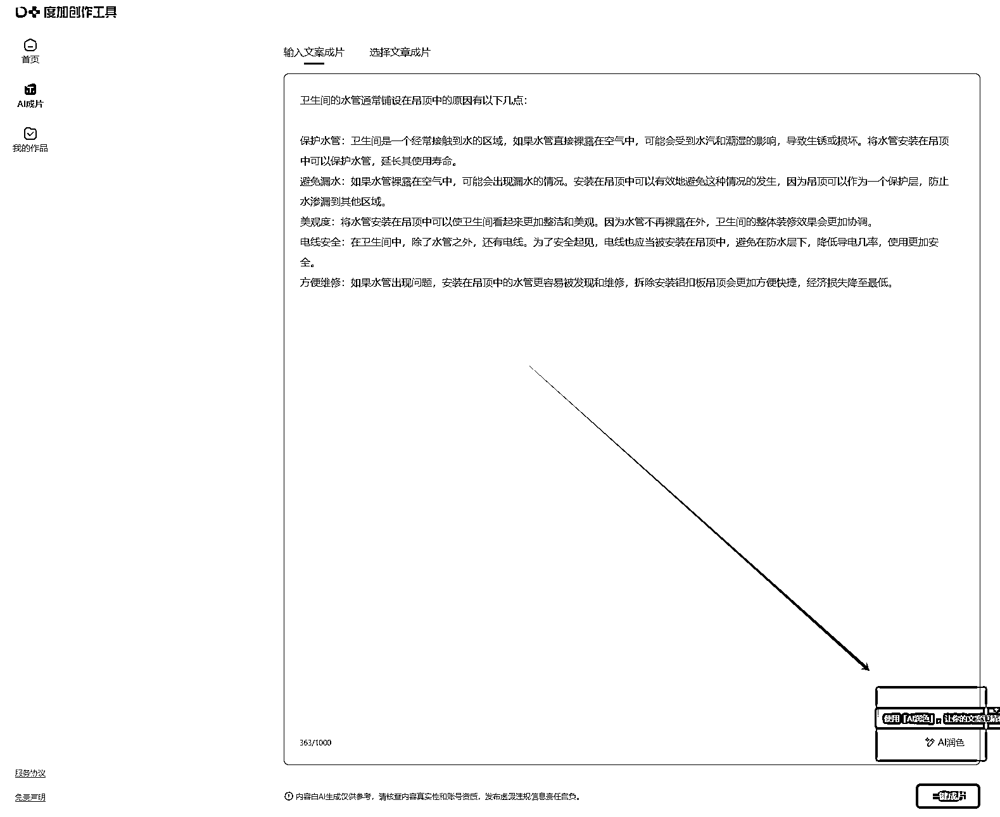

这里有个重点：生成视频的界面右上角有“发布视频”，要点它，然后选“生成视频”；千万别选“发布到百家号”。因为直接发布到百家号不会关联搜索话题里的灵感词，那跟普通百家号视频没区别，拿不到搜索收益。

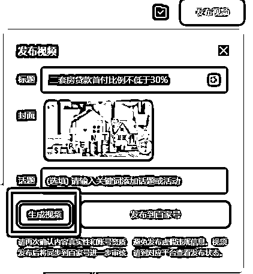

有时候生成的视频素材和内容对不上，可以检查一下，在素材库里换掉不合适的片段，再重新生成。

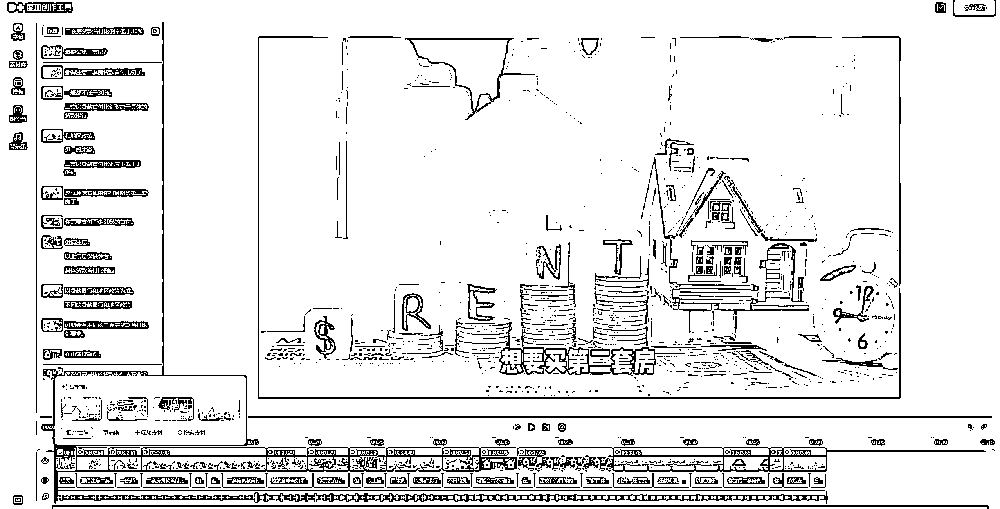

视频生成后右下角会提示，点“立即发布”会跳出新界面。这时候也别急着直接发，原因同上——没关联灵感词就没有搜索收益。这个视频会先进草稿箱，然后你回到搜索话题的“我的参与”，找到对应的灵感词，点“去创作”，从草稿里选这个视频发布就行。

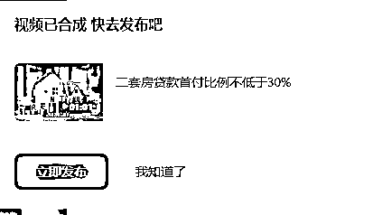

别看步骤写得多，实际操作一遍很快就能上手，真没难度。

那怎么才能把收益做高？首先得知道“搜索话题”里不同类目的收入差别很大。从收益排行榜能看出来，排在前面的基本都是科技数码，然后是旅游、育儿。这些领域容易赚钱，但竞争也最激烈，每天得花不少时间盯灵感词，稍微慢一步就被抢光了。

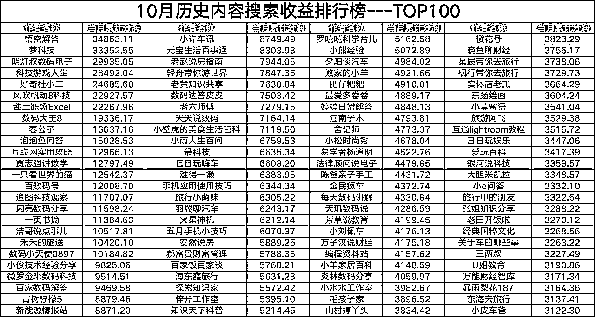

其次，灵感词本身也有区别。搜索话题界面有“本周热门”和“PK悬赏”两个入口。

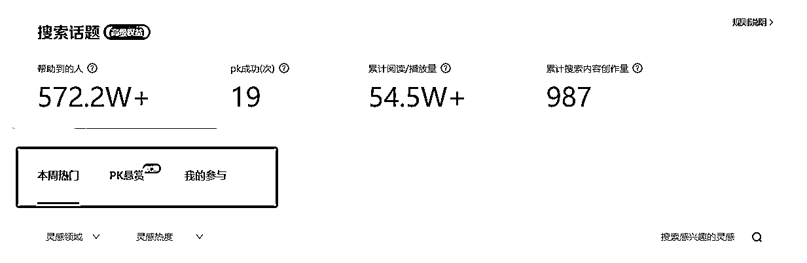

“本周热门”下的话题看到就能抢，一般每个词能容纳20人；只要内容合适就上，做得好你的内容能排在网友搜索的首位。“PK悬赏”下面则是已经有人做过的内容，你要去跟别人PK，每个词一般只能进5个人；赢了能享受多倍收益，最高可以到18倍，就算输也有普通搜索收益。所以只要看到PK悬赏，建议优先抢占和创作。

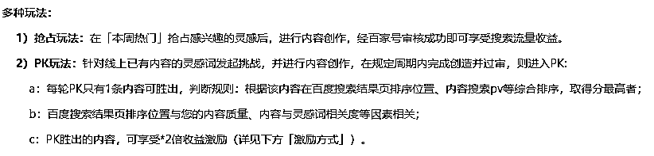

另外，灵感词下面偶尔会有角标，常见的是[搜索超热][搜索高热][搜索首位]，在PK悬赏里还有[N倍收益]。这些标记的含义大家直接看图。

结合这些标记，我建议的抢占优先级是：【PK悬赏】>[搜索超热]>[搜索高热]>[搜索首位]>[普通话题]。按照这个顺序来，才能尽早把收益拉满。

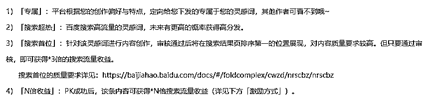

创作者等级也会影响收益。百家号有【基础权益】【进阶权益】【高级权益】三个搜索身份等级，其中【高级权益】最香，特别是自带“多倍收益”和“搜索流量扶持”，同样内容能拿到更多钱。新注册默认是【基础权益】，不过要升高级并不难，只要你持续做这个项目，“月搜索话题审核通过率≥100”这个条件很快就能达成，基本第二个月就能升到【高级权益】。而且【高级权益】不要求粉丝量，反而比【进阶权益】好拿；【进阶权益】虽然粉丝要求也能刷出来，但得花点成本，没必要。

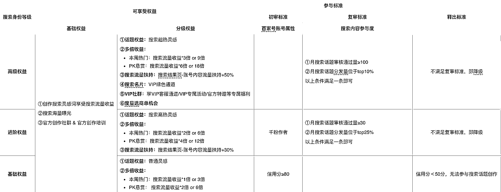

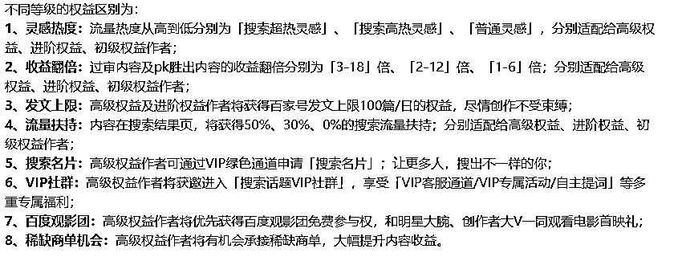

最后想说说这段时间的变化。这篇文章其实12月4号就开了头，写了大部分，因为拖延症到现在才补齐。但就是这几天，“搜索话题”项目来了不少大变动。

百家号官方最近搞了一波大规模封号，很多每天收入上百的账号也被封了。封号的问题倒不是无解，小道也有办法，我还帮一些朋友处理过。不过解封之后收入会降不少，需要很长时间慢慢恢复。另外，有一些日收入近千的大号没被封，但收入直接腰斩甚至脚斩。我分析了一下，原因是多方面的，但很大一部分是官方在有意压制大号，不想让少数账号抢走太多收益，同时希望新人有更多机会、也顺便降低平台成本。所以现在的局面其实对新人更友好，建议大家直接用新号干，老号不一定比新号好使。

这次分享就先到这。有问题欢迎留言，我很乐意帮忙解答。祝大家龙哥盟！

