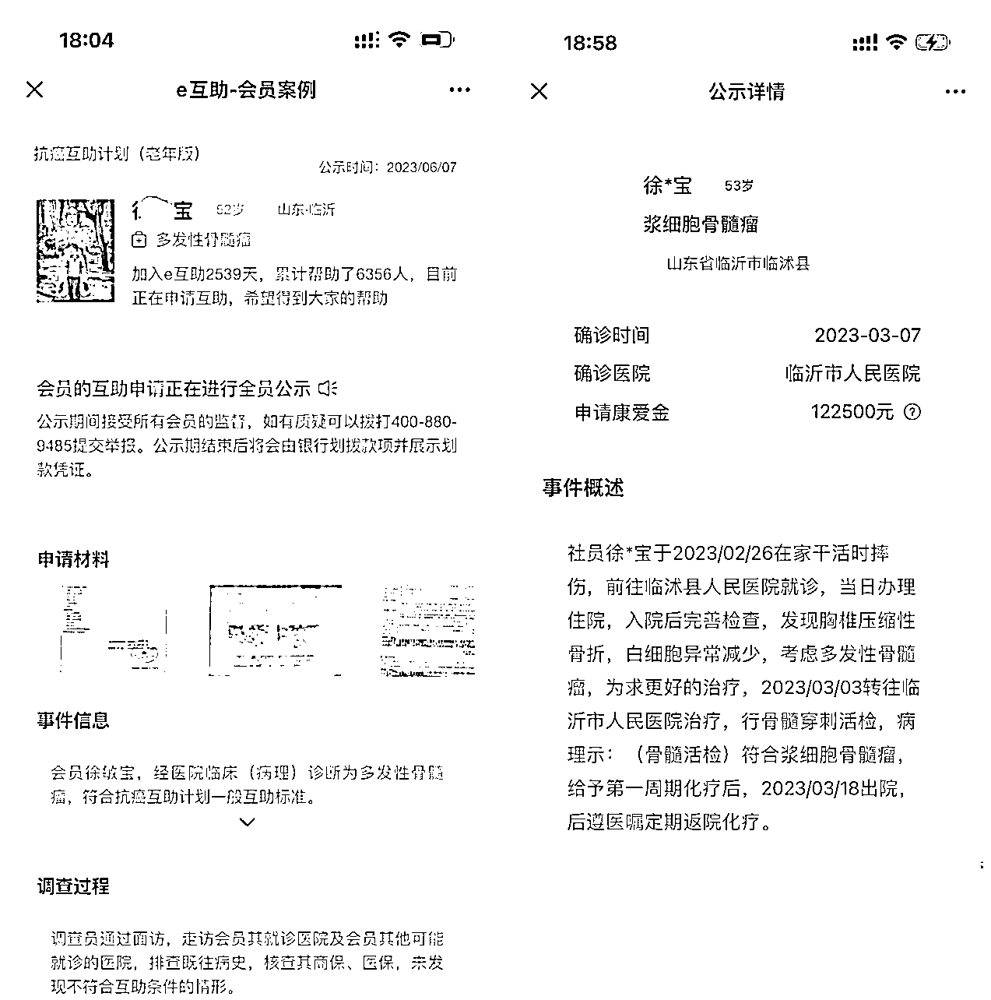

# 我人生第一笔重疾理赔，25万到账，可给我钱的不是保险公司

你敢信吗？我人生中收到的第一笔重疾理赔款，整整25万元，居然不是保险公司打来的。

先介绍一下自己。我叫徐启伟，老家山东，目前在上海工作，是一名互联网AI产品经理。早年在美团、360这些大厂待过8年，做过理财、360互助保险、营销中台，后来才转做AI产品经理。

2023年快结束了，我想把这段亲身经历记录下来。我相信每个看到这篇文章的人都能有所收获。只要你看懂了，它的价值可能远超10万块钱。

先说清楚：这篇文章不是卖保险的，我自己也不卖任何保险产品。因为以前做过360互助的产品经理，我自认对保险这东西门儿清。接下来要讲的观点可能有点“暗黑”，但普通人真的有必要了解。这篇文章主要写给普通人看，如果你年收入过百万，那我这套经验可能不太适用。

内容太多，为了让大家读起来更轻松，完整版放在了我的飞书文档里，点下面这个链接就能看：

[`xuqiwei1986.feishu.cn/wiki/ZtUVwNcRbin0GDkmZrGc4jDKn5d`](https://xuqiwei1986.feishu.cn/wiki/ZtUVwNcRbin0GDkmZrGc4jDKn5d)

文章发出来后，评论区也炸了。有人说“受用”，有人后悔买的保险不是消费型；也有人觉得就当强制储蓄了。还有保险经纪人表示，自己配的也是消费型重疾险，并且提醒大家：如果从互联网平台自己买医疗险或重疾险，健康告知一定要高度严谨，体检报告、门诊住院记录、社保卡外借情况都得考虑进去。也有圈友建议，普通人除了医保，配上百万医疗、重疾险和意外险基本就够用了。还有人问，先天心脏病的婴儿除了新农合还能买什么保险。

