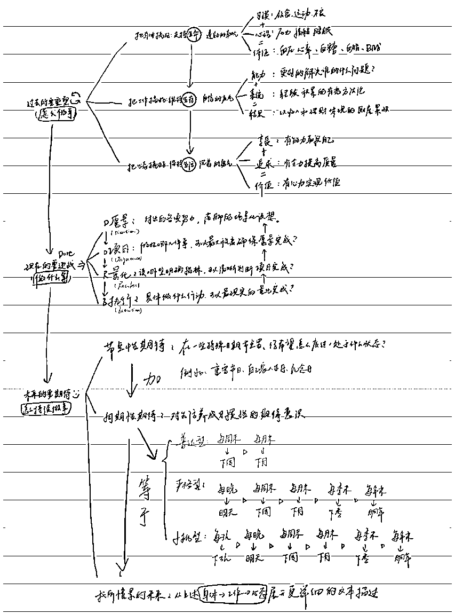

# 从普通到年入百万，我拆解了自己的成长操作系统
作者：龙哥

嗨，这里是桃都督。

先丢几组标签，方便你对号入座：

98年，8岁触网，11岁开始接触运营，目前已实现三年连续百万年收，明年迈入第四年。连续七年多在朋友圈做复盘沉淀，阅读量破七百本，观影量超一千一百部，豆瓣前250也通关了。

我不靠天赋吃饭，走的是后天堆量+不断复盘迭代的老路。所以这套经验，对普通人来说复刻成本更低。

这次首发在龙哥盟，本可以立刻上硬核变现打法。但第一篇，我想先谈“道”。也就是支撑我走过这些年的底层思维模型。

前后花了约1.3万字，把个人方法论完整摊开，命名为《曙光系统 1.0》。它会持续迭代。

无论你此刻正处在高光期还是低谷期，我都希望这套东西能帮你理清当下困局，拆解当下卡点，找到一点点继续走下去的乐趣。

当光很亮的时候，请记得抓住它并好好珍惜。

当黑夜很长的时候，请相信第一缕曙光已经在来的路上，并且会越发明亮。

《曙光系统 1.0》 密码：aehl[`www.yuque.com/taobingzheng/butaoxue/pku02a8pkfgkope9?singleDoc#`](https://www.yuque.com/taobingzheng/butaoxue/pku02a8pkfgkope9?singleDoc#)

* * *

评论区：

梵野 : 哈哈哈 必须得留着睡前看 还的是你

田新一 : 收藏慢慢看，还得是你

周彦充 : 没看到怎么赚 100 万的，[呲牙]

桃都督 : 哈哈哈，这篇是写道层面的，以后慢慢更新术层面的~

桃都督 : 田总好[呲牙]

桃都督 : 梵野姐又看到你啦～

梵野 : 哈哈哈我给叨叨说下次我们组小局，必须叫你，喜欢听你讲，哈哈哈

周彦充 : 哈哈，可以更新下具体项目产品层面的[呲牙]

* * *