TikTok 2023年度广告榜单全解读：哪些赛道在闷声发财？

2023年已经收尾。这一年里，TikTok毫无疑问成了国内外品牌绕不开的营销阵地。借助Pipiads的数据，我们把不同赛道的广告投放、销量表现和运营思路重新梳理了一遍，看看谁在吃流量红利，哪些品类还能继续押注。

01 广告受众画像：年轻用户撑起大盘，美国依旧最热

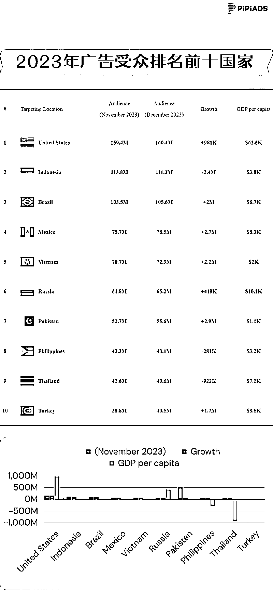

TikTok的核心受众是年轻人，Z世代和千禧一代是绝对主力。大家爱看娱乐性强、有学习价值、又能表达自我的短视频内容。目前TikTok的主要市场分布在欧美和东南亚，广告投放量最大的三个国家分别是美国、印尼、巴西。印尼市场近期出现一些波动，TikTok选择和本地电商Tokopedia联手，砸下15亿美元继续布局。巴西虽然电商潜力很足，但高关税和电商基建跟不上，多数卖家只能暂时观望。真正能发力的还是美国市场，尤其TikTok Shop的快速增长，让出海商家看到了新机会，也带来了更高挑战。

02 美区平均CPA：一单25美元，选品要守住价格线

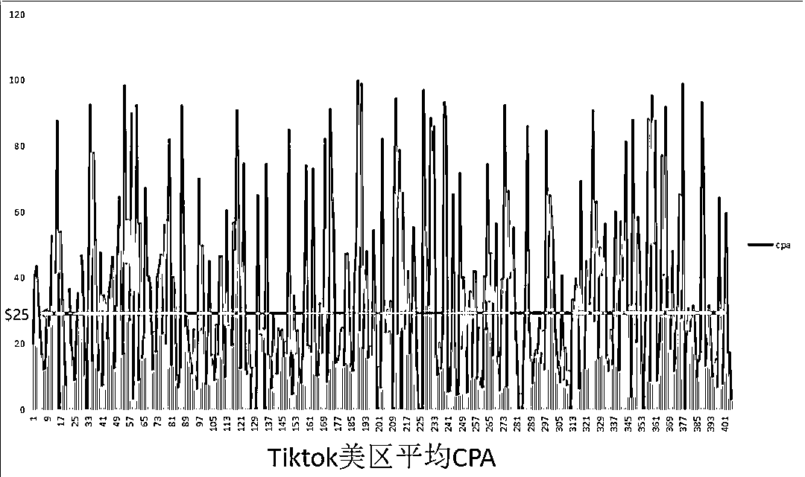

Pipiads拉出大量数据后发现，目前美区平均一单的广告获客成本大约是25美元。也就是说，2024年选品的时候，客单价起码要覆盖这笔广告费用；而大多数广告主的产品定价会放在35美元以上，给自己留足利润空间。想入场的话，可以沿着这个价格带去找品。

03 11月投放网站榜：品牌站是消耗主力，爆品站也在突围

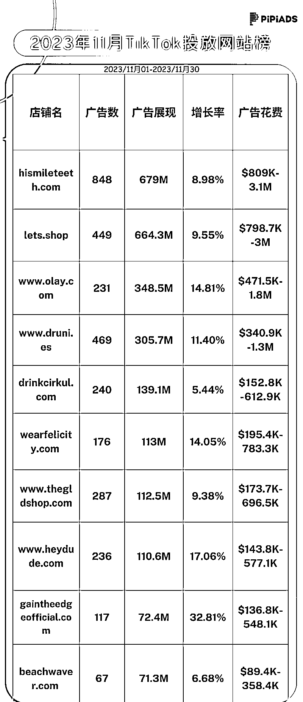

从11月的数据来看，广告消耗大的玩家大多是有品牌的独立站，同时也杀出了一些精品爆品站。很多吃到TikTok红利的品牌，每年都会专门留预算做品牌曝光和宣传。比如hismileteeth这个例子：2021年开始投放，累计广告展现量冲到8.9B，累计投放天数达到738天。这是很典型的营销出圈型广告主，产品生产成本极低，口腔健康赛道的需求又明确，所以品牌营销端可以一直加码。

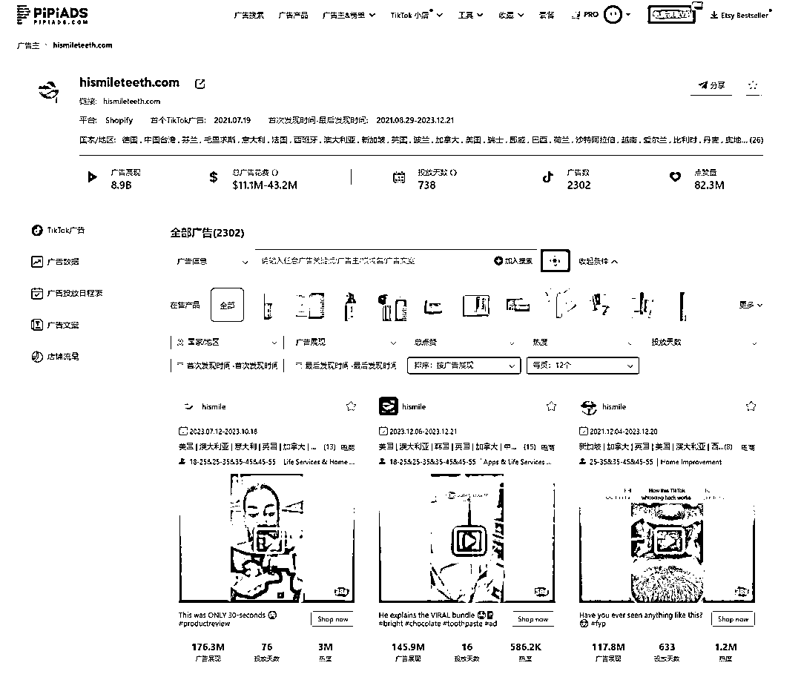

04 独立站爆品：服装类和定制类最出量

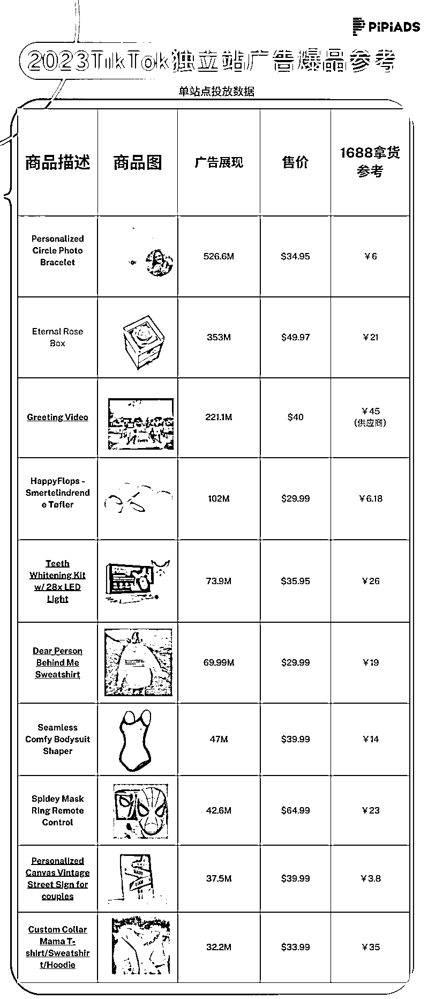

TikTok上最容易产生爆品的两个大类目，就是服装和定制产品。不管是小卖家、垂直站，还是大品牌站，都靠这两个方向拿过大量订单。2024年做独立站，定制赛道依然值得持续关注和研究，机会仍然存在。想看品的话，Etsy是一个很好的参考渠道，大多数定制爆款在Etsy上都有影子；TikTok投放玩家还能去etsyshop.ai做同类差异化的选品迭代。

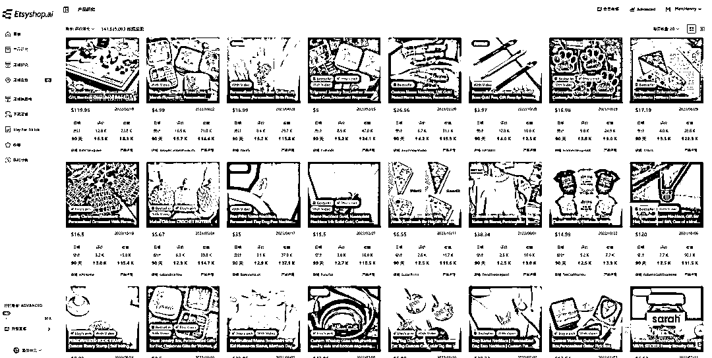

05 CPA偏高的类目，投放前先想想受众

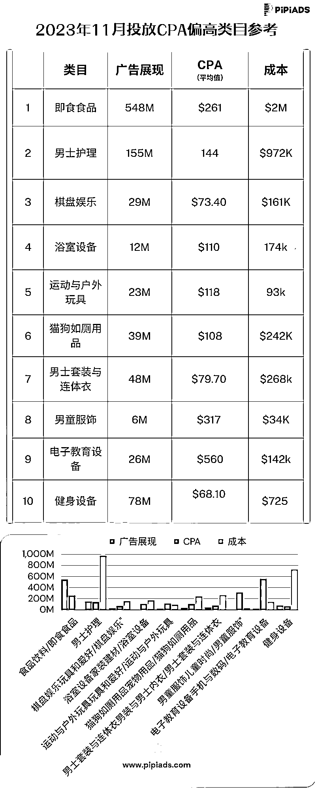

做投放和迭代时，最好优先锁定受众面广的类目。小众产品或者需求规模不足的赛道，投放效果往往不太好，很难把模型跑正。当然市场随时在变，想抓住下一波风口，可以多关注Pipiads发布的行业趋势。

06 小店销量榜：这些品类成了流量收割机

小店广告排名1-10的商品：

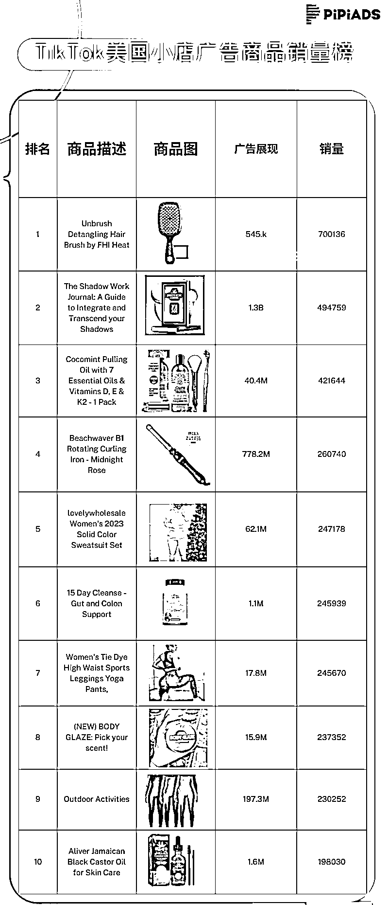

前十名里，女装、美容、个人护理是销量最猛的几大类。像Unbrush解结梳和Cocomint提取油，就是典型例子，个人美容产品需求很强，配合大量建联达人和广告投放，结果非常亮眼。
另外，互动数据和销量呈正相关：Unbrush这款梳子播放量累计超过545亿次，点赞数达到1500万，和它的高销量完全对应。
广告投入也能看到回报，Unbrush在广告上花费超过740万美元，换来了榜单里的顶流销量。
再看评分，大多数畅销品的评分都保持在4.5以上，评论区的好坏直接影响用户下单决策，属于典型的社交证明。
产品描述同样重要，像Unbrush和The Shadow Work Journal这样描述详细、卖点清晰的，转化会更稳。多埋一些自我提升、美容、个人护理相关的关键词，也能让产品更容易被刷到。
趋势上，Cocomint提取油、15天清理产品的热度在上升，看得出大家越来越关注健康和内在调理。

小店广告排名11-20的商品：

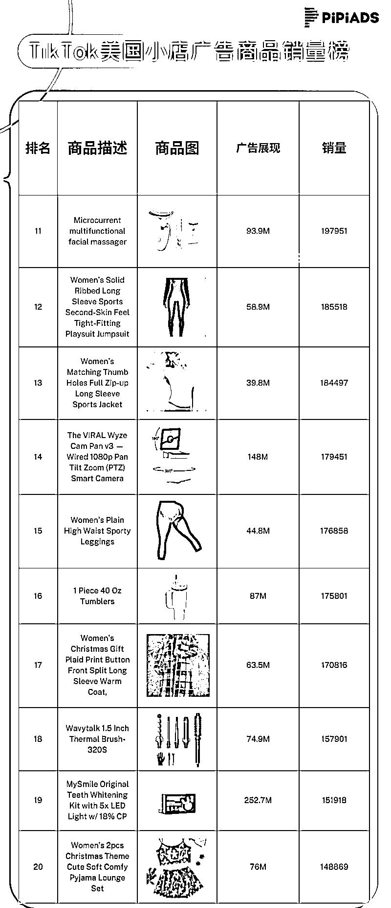

第11到第20名的商品比较杂：美容个护、女装穿搭、运动健身、家用电器、节日礼品都有代表。比如排名第11的多功能美容仪，播放量做到了93.9M，销量达到197951。之前不少独立站广告商已经盯上这款产品，如今放到小店里继续测试，照样跑出结果。可以说，每个细分赛道都有爆款机会，2024年可以继续期待。

小店广告排名21-30的商品：

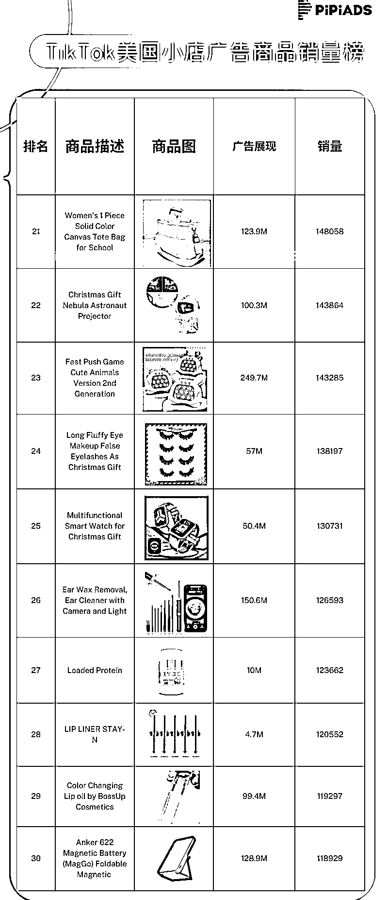

年末榜单里，排名24的假睫毛称得上大爆款。Pipiads和赛道卖家交流后发现，广告ROI能做到3点几，订单量直接暴涨。
它成功的原因不难理解：本土货盘是大趋势，假睫毛的运输成本、仓储成本和拿货成本都不高，再加上需求明确，达人的强背书一推，爆款自然就诞生了。

小店广告排名31-40的商品：

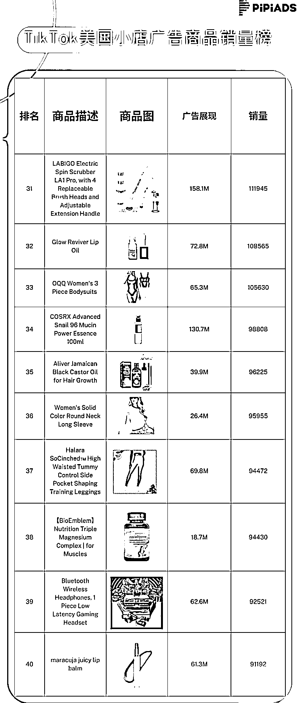

第31到40名里，功能性女装依然很抢眼，尤其是塑身衣，从独立站火到小店，销量奇迹还在继续。达人多场景展示，穿上之后的反差感特别强，这是用户愿意买单的核心原因。说白了，产品能解决痛点、效果看得见，再赶上高需求和大量达人铺量，美国市场很容易被点燃。

小店广告排名41-50的商品：

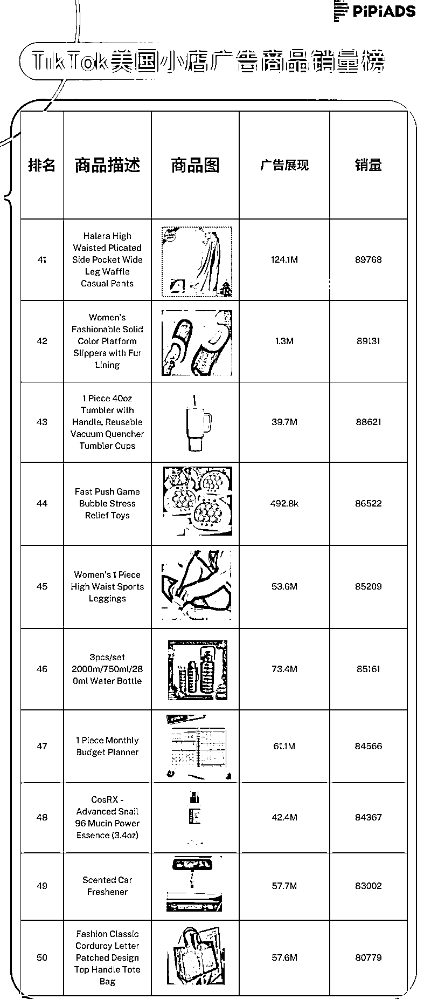

选品的本质，就是找需求。2023年下半年，日程本在小店突然爆火，从1688拿货的中小卖家，到拿过融资的DTC品牌，大多拿到了大大小小的结果。机会和商机一直存在，想拆解更多案例，可以回看Pipiads之前的案例文章。

07 小店店铺榜：谁在闷声赚大钱？

美国小店排名1-10店铺：

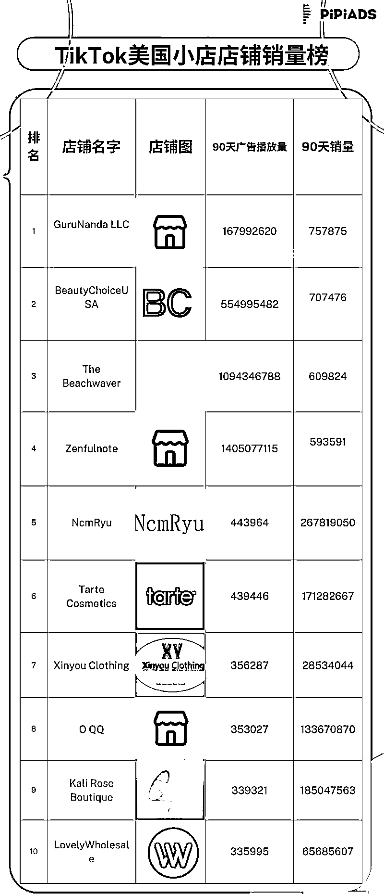

店铺榜排第一的GuruNanda LLC，是美国食品药品大众零售领域中治疗性芳香疗法的头部品牌，靠TikTok小店三个月拿下75万订单。可以预料，2024年会有更多品牌入驻小店，或者直接在TikTok上增加营销预算。

美国小店排名11-20店铺：

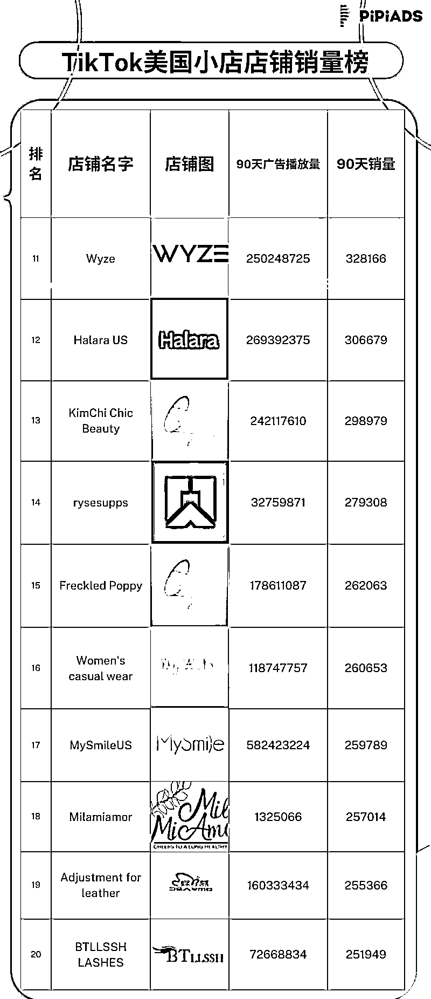

排在第11位的Wyze累计拿到30万+订单。这家公司做智能家居和无线摄像头，总部在美国西雅图，创始人是前亚马逊员工，2017年组建团队，四个创始人里有两位华人。
他们最关键的成功因素，就是把极致性价比打穿了：带WiFi连接和APP的无线摄像头，直接定价到20美元，而当时同类产品普遍在100美元，甚至150美元以上。又好又便宜，用户自然愿意买单和传播；同时坚持以用户为核心、找到优质代工厂、保持自主研发能力，这几件事缺一不可。

美国小店排名21-30店铺：

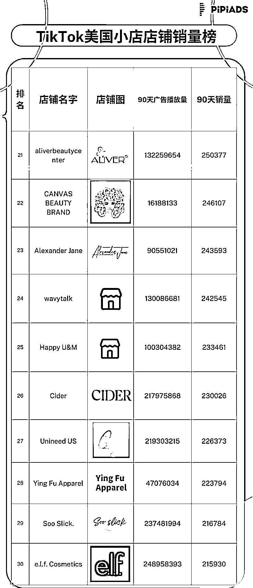

排在第21位的aliverbeautycenter，同样是做美容和个人护理的公司，牙齿、皮肤、头发等全身护理都有布局，三个月TikTok店铺销量做到25万单。

美国小店排名31-40店铺：

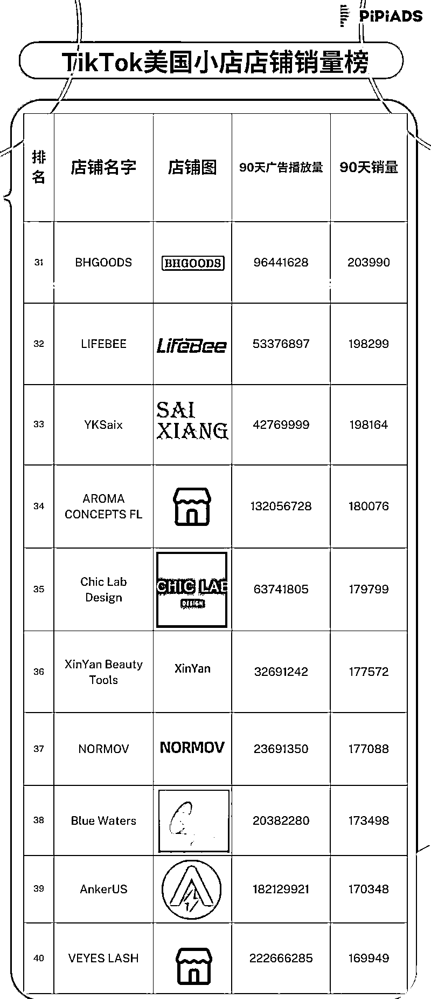

排在第31位的BHGOODS，主打带柄保温杯。今年这款产品在TikTok上成绩非常猛，全托管模式以极低价格切入市场，一下子就带起购物热潮。全托管店铺还能拿到官方多方面的扶持，比如流量倾斜，但反过来也更考验供应链有没有核心竞争力。

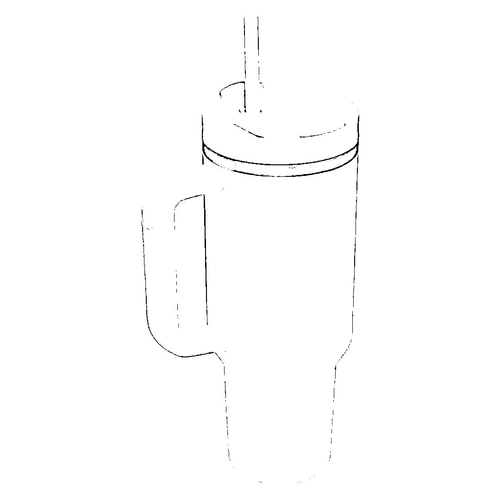

美国小店排名41-50店铺：

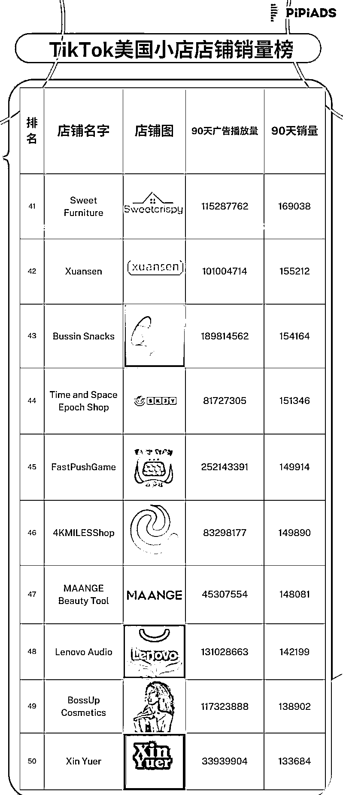

Sweet Furniture是家具品牌，小店三个月累计销量16万单。TikTok上做这种大件商品门槛很高，目前类目竞争不算多，所以既是壁垒，也是机会。2024年小家居赛道能不能大放光彩，我们拭目以待。

以上榜单数据由Pipiads提供支持，仅供大家参考，部分数据可能存在误差。想持续追踪风向，不妨留意Pipiads的内容更新。

