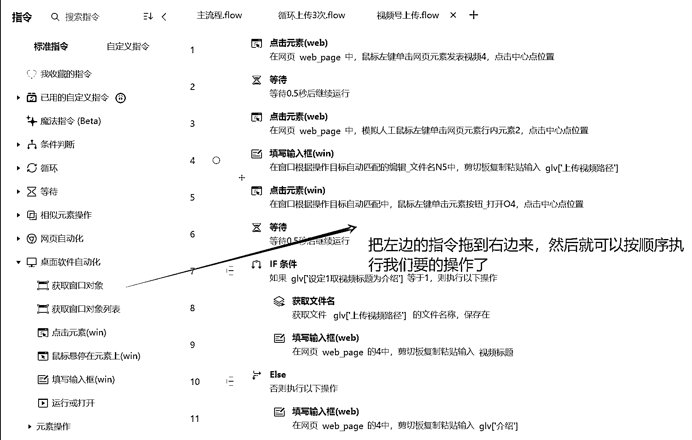
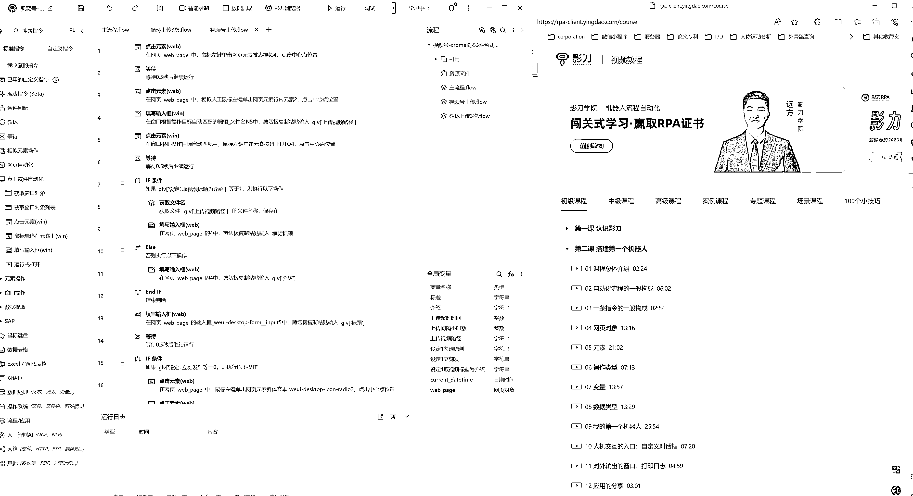
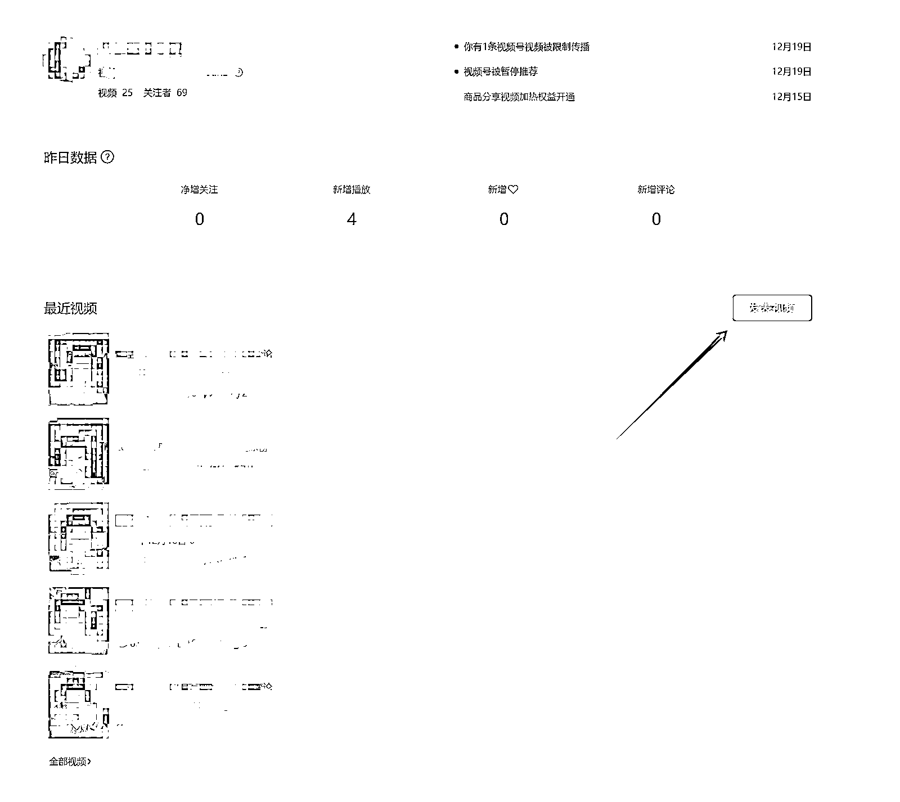
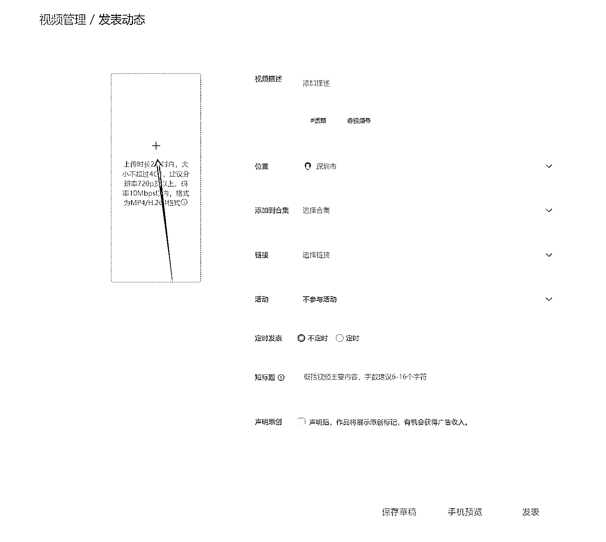
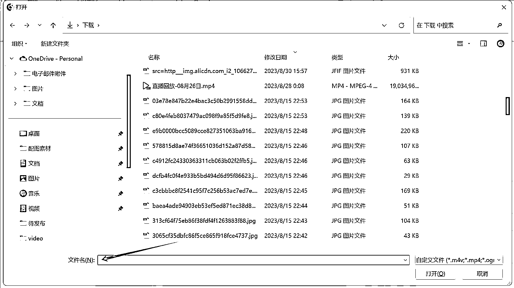
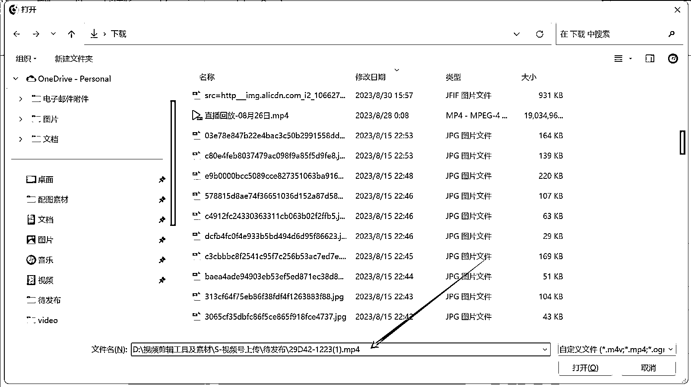
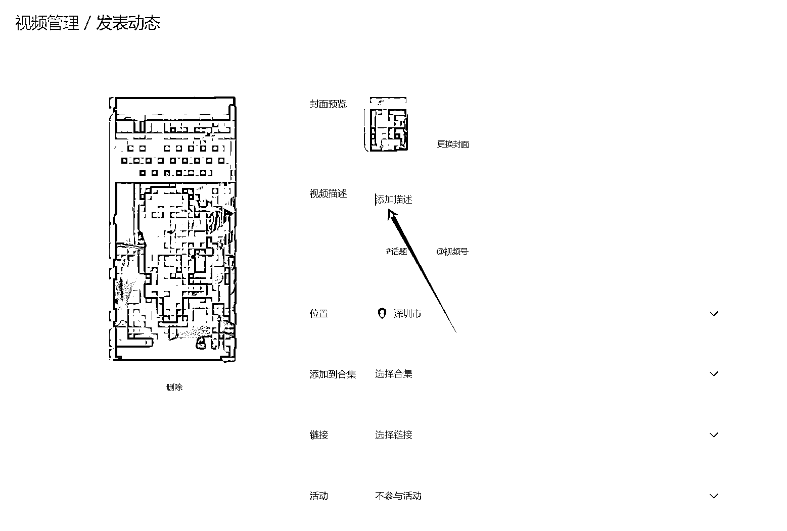
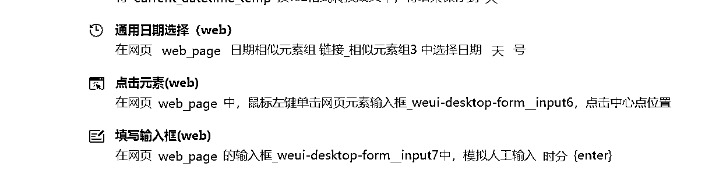
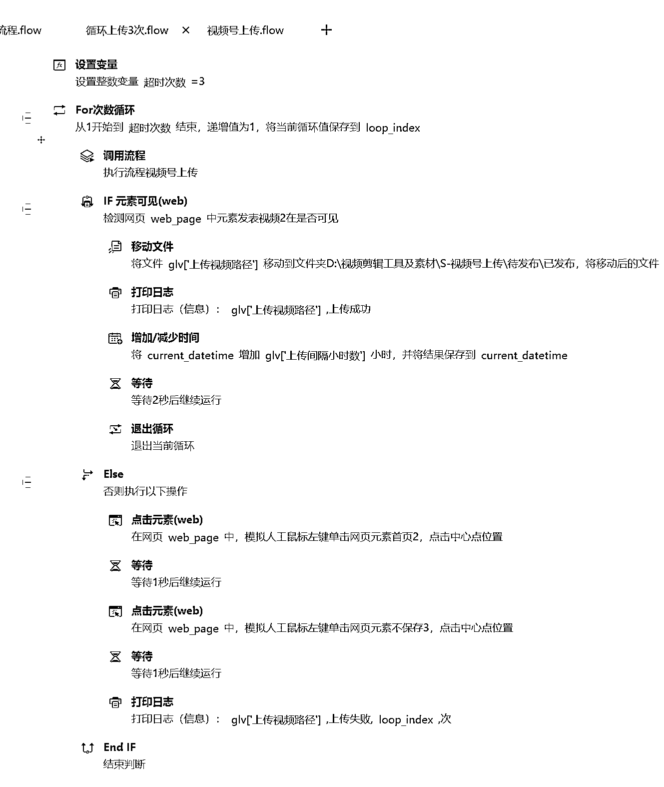

# 15个视频号同时跑通，我用这套“无感打工人”把宝妈副业拉满效率
作者：龙哥

## 宝妈副业也能多开矩阵：视频号批量上号的RPA实战

作者：旋子

日期：2024-01-05

**先自我介绍一下**

大家好，我是龙哥，90后宝妈，同时也是干了10年AI产品的高级产品人。曾经在深圳冲顶，背上700万房贷，哺乳期被生活推着只能另起炉灶做副业。

上回我复盘了《职场宝妈从0到1靠视频号电商变现40万》，有很多朋友私信问我：带娃怎么还能兼顾副业？你是不是超人？其实也没那么神，我只是把重复的机械活全丢给了RPA，让它替我干脏活累活。

文末我会把自己搭RPA的思路和部分截图放出来，代码写得挺糙，程序员朋友请手下留情。这套方案原本只在团队内部用，这次整理一个版本分享出来。

# 一、RPA到底能干嘛

说白了，RPA就是一台听指令的虚拟助理，会把你设定的重复流程原封不动地执行下去。比如视频号每天最耗时的批量上传、每天例行的对标账号数据巡查，这些一看就很适合交给它。

## 1、RPA在我这里解决了什么痛点

我刚入局视频号的时候踩的是2022年的老玩法，抖音搬运到视频号的日更模式。当时一个号一天要上50到100条内容。手工点一点上传，单条大概要30秒，50条就是半小时，还巨无聊，点错删错更是常事。

那时候副业刚起步没什么现金流，买几十块的自动发布工具都觉得肉疼，于是自己琢磨出了一套批量发布的RPA。它的节奏和真人几乎一致，但发布时我可以去看娃、做饭、写脚本，机器在后台默默跑，我的精力被彻底解放。

## 2、自己搭RPA的三个实实在在的好处

**第一，零成本。**
市面上的自动化工具单看不贵，但做矩阵号各种小工具一加起来，每月开销就不小。自己搭，完全免费。

**第二，想怎么改就怎么改。**
刚开始只是为了省那几十块，后来才发现自由度才是最大的价值。做项目时经常会蹦出一些很小的需求，外面很难找到现成的软件，自己写个RPA可能几分钟就搞定了。
举个例子，批量发布做出来后，换赛道时旧号里一堆视频要清，手动一个个删要命，写个删除脚本几行就解决了。

**第三，更贴近真人操作，更安全。**
很多市面上的工具为了效率会用平台不允许的操作方式，容易触发风控。RPA是模拟真实鼠标键盘动作，走的就是正常流程，风险低很多。

# 二、RPA入门，其实没想象中难

## 1、别被编程吓退

不少人问我：我完全不懂代码，能学吗？我也不是科班程序员，几个小时就上手了。因为我用的隐刀RPA，界面跟小朋友玩的积木编程几乎一样，会拼积木就能做流程。

## 2、怎么开始学最快

别想着先把理论啃完再动手，那样很容易中途放弃。RPA最好的学法是边上手边看教程，边卡边查，成就感会推着你往前走。

影刀自带的入门课真的很友好，0基础的我半小时就能跑通第一个流程。教程入口：[rpa-client.yingdao.com/course](https://rpa-client.yingdao.com/course)

## 3、搭建思路：先跑通，再优化

我的做法是先搭一个能用的最小可用版本，等跑起来了再根据使用中的问题慢慢加功能。这样进步快，也不会一上来就被细节淹没。

# 三、视频号自动发布RPA是怎么搭起来的

## 1、核心流程：一条视频的自动化上架

1、鼠标定位点击“发表视频”按钮

2、点击“上传视频”入口

3、打开文件选择框，自动输入文件名。这里我的做法是把所有待发素材统一丢进一个固定文件夹，路径固定，后续读取就很省事。如果不懂怎么读取当前文件夹下的视频列表，可以来问我。

4、填充视频标题。提前把标题整理好放在备用文件里，RPA直接读取填充。

5、设定发布时间。视频号的发布天数需要点选，具体的时分可以手动输入框填写。

6、等待上传完成并自动发布

核心功能很快就活了，实际用起来很顺，就是网络不稳时偶尔会超时报错，视频没传完就跳下一步。

## 2、加一个容错机制更稳

针对超时和失败，我加了错误处理逻辑：

1、没发成功的视频要重试
2、发成功的视频要自动移走，避免重复发

最终我做了三轮重试的机制，成功后视频自动挪到已发布文件夹。

# 四、最后一句话

副业这件事，效率差一截，结果差十倍。选对项目的前提下，谁能把同样的动作做得更快、做得更多，谁就更有机会坚持下来。别人发10条的功夫你才发1条，收益自然拉不开，坚持也难。

RPA只是其中一种提效手段，批量剪辑、批量下载这些工具也能大幅省时。这篇文章想传达的更多是一种思路：把重复劳动工具化，把省下来的时间留给家人和真正需要思考的事。

我是专注在视频号深耕的旋子，欢迎交流。

愿大家都能在效率里多出点时间，好好陪伴家人，工作生活都更从容~~

* * *

评论区：

跨境老兵聊电商 : 分享个小技巧，上传环节直接调用获取文件夹功能就行了，省去手填路径和打开文件的步骤

旋子 : 感谢大哥指点！文件夹这块我当时折腾了挺久

Rio : 影刀商城里有第三方轮询本地文件的控件，可以解决这个问题。

* * *