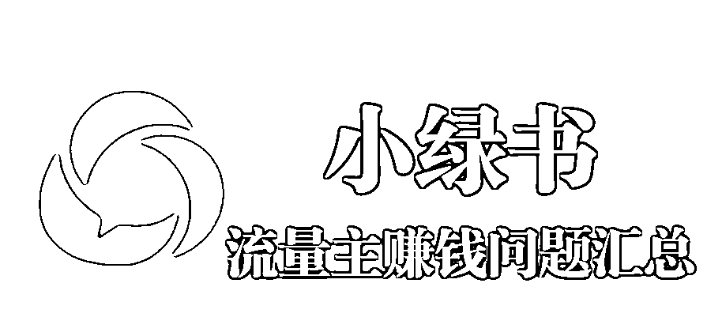
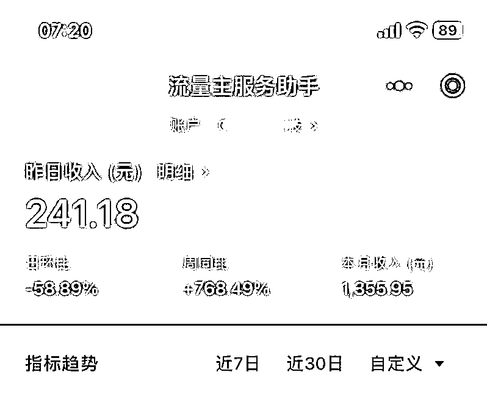
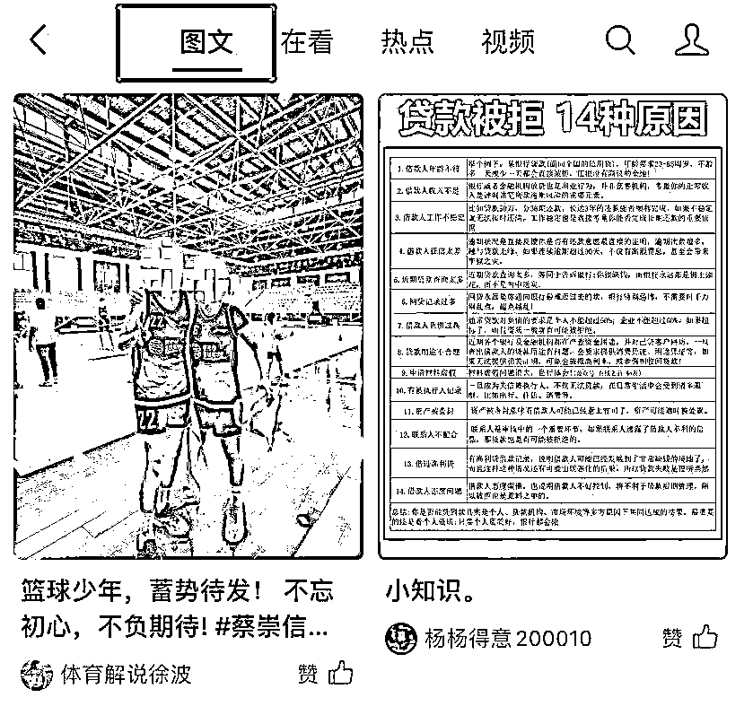
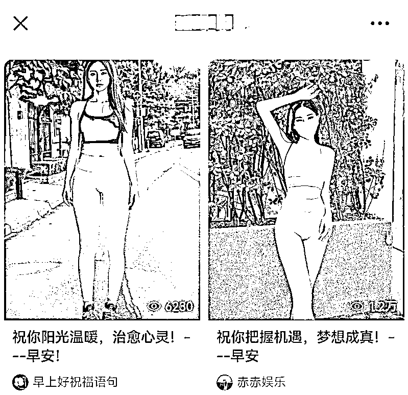

# 关于小绿书目前的问题一次说清楚

最近，圈内不少人都在聊“小绿书”，热度确实上来了。很多人被它吸引，主要是因为流量主能带来收益；当然也有人关心引流的事，不过这块不是今天的重点，下次有机会再展开。

跟👸号爆文靠流量主赚钱不同，做小绿书不需要写长篇原创，也用不上复杂的AI流程，整体门槛低很多。再加上小绿书的内容调性和小红书很搭，两边几乎可以无缝“跨平台搬运”，这就吸引了不少原本深耕小红书的运营者。与此同时，大量👸号从业者也纷纷转型入局，热度自然就起来了。

对还在观望的朋友来说，搞清楚这个业务的底色和走向很重要。可以确定的是，小绿书不会是昙花一现，但具体能火多久，谁也没法打包票。我们可以从三个角度来理解它的潜力和底气：

第一，**腾讯看到了小红书的快速增长，也想分一杯羹**。这种布局背后有实打实的利益考量，不是一时兴起，还关系到平台的市场地位，所以一旦决定就不会轻易放弃。目前官方还在试水阶段，入口放得不多，但接下来几个月很可能会有更多动作。

第二，**激活那些不爱发朋友圈的人**。小绿书面对的是公域流量，不用顾虑私域好友的眼光，对普通用户来说，写写笔记、分享生活是非常自然的切入点。很多人可能没用过小红书，但微信基本人人都有。

第三，**补全内容矩阵**。微信现在有订阅号长文、朋友圈短图文、视频号短视频，唯独缺了中长图文这一环。小绿书的出现正好填上这个空白，让内容生态更完整。目前微信体系内还没有其他渠道有类似的展示形式。

下面说说老刘最近被问到最多的一些问题，整理如下：

**一、流量主门槛**

官方要求500个粉丝就能开通，这个门槛真不高。毕竟能产生收益，比起在小红书发笔记纯靠热爱发电，已经强不少了。只要内容贴合用户兴趣，有点浏览量，每天自然涨粉也不难。而且账号不需要认证，完全免费，公司、个体户、个人都能做。

**二、👸号数量**

目前一个自然人免费注册一个👸号，个体户能申请两个，公司虽然从五个降到了两个，但只要运营正常，后面还能陆续申请扩量。以前最多能扩到50个，现在具体能扩多少，暂时没有最新数据。

**三、流量主收益归谁**

默认情况下，收益归账号持有人，填好财务信息就会定期打款。个人的话要代缴个税，公司的需要寄发票，然后全额结算。个人账号也可以让第三方公司或他人代收，但需要提供本人身份证照片并签一份代运营协议。这块是很多人特别关心的细节。

**四、入口在哪**

小绿书目前没有统一的入口。部分灰度用户在看一看页面能看到图文的Tab，但大部分人没有。多数人是通过刷别人的小绿书图文，再顺着推荐点进去，一层层往下刷，就能看到大量内容。

**五、哪些领域能做**

基本上每个细分领域都有机会，新号入池也快。不少原来做小八卦的号已经转成了小绿书玩法，发发娱乐明星图片之类。目前爆文主要集中在娱乐八卦、成长智慧、明星身材、电影情节、生活技巧、体制生存、男女关系、搞笑图文这些方向。

这边顺便整理了几个爆文链接供参考：

娱乐八卦 3.0W [`mp.weixin.qq.com/s/LWYuoSA2Rhqu4m3S8K2uHw`](https://mp.weixin.qq.com/s/LWYuoSA2Rhqu4m3S8K2uHw)

娱乐八卦 2.0W [`mp.weixin.qq.com/s/WEi5M0s-FSTv_TB50MtNbQ`](https://mp.weixin.qq.com/s/WEi5M0s-FSTv_TB50MtNbQ)

罗翔说 5.5W [`mp.weixin.qq.com/s/psxhvL3-M222JIExvOHjUQ`](https://mp.weixin.qq.com/s/psxhvL3-M222JIExvOHjUQ)

罗翔说 1.1W [`mp.weixin.qq.com/s/7uoJRrZM5jfQeevc9OG4xA`](https://mp.weixin.qq.com/s/7uoJRrZM5jfQeevc9OG4xA)

娱乐八卦 3.2W [`mp.weixin.qq.com/s/t238MftYQReDLO2Gu5UjWA`](https://mp.weixin.qq.com/s/t238MftYQReDLO2Gu5UjWA)

明星身材 1.3W [`mp.weixin.qq.com/s/vNewbyRUFS1YBX8PxmAfmg`](https://mp.weixin.qq.com/s/vNewbyRUFS1YBX8PxmAfmg)

明星身材 5.4W [`mp.weixin.qq.com/s/cYFYbK5w8LcY27Vlgilllg`](https://mp.weixin.qq.com/s/cYFYbK5w8LcY27Vlgilllg)

电影情节 10W [`mp.weixin.qq.com/s/yCUoHmKAP2DwulGEa3yvPQ`](https://mp.weixin.qq.com/s/yCUoHmKAP2DwulGEa3yvPQ)

电影情节 10W [`mp.weixin.qq.com/s/O8xEel5bCG6NcaVNUcE0Uw`](https://mp.weixin.qq.com/s/O8xEel5bCG6NcaVNUcE0Uw)

生活技巧 10W [`mp.weixin.qq.com/s/KBFYJOfn4MEVo86C4zTE0A`](https://mp.weixin.qq.com/s/KBFYJOfn4MEVo86C4zTE0A)

体制生存 2.2W [`mp.weixin.qq.com/s/qRMu_4iidMg2jL446Dbx7Q`](https://mp.weixin.qq.com/s/qRMu_4iidMg2jL446Dbx7Q)

创业成长 1.6W [`mp.weixin.qq.com/s/B58MpBz2Sbu7zUBCX5sv_w`](https://mp.weixin.qq.com/s/B58MpBz2Sbu7zUBCX5sv_w)

男女关系 1.1W [`mp.weixin.qq.com/s/JBu_72mzQ26iyOvToTK7uQ`](https://mp.weixin.qq.com/s/JBu_72mzQ26iyOvToTK7uQ)

男女关系 1.4W [`mp.weixin.qq.com/s/Qf4vbgY_lh2HW5or5sxEdw`](https://mp.weixin.qq.com/s/Qf4vbgY_lh2HW5or5sxEdw)

青春爱情 6.6W [`mp.weixin.qq.com/s/dyVajHtaN5gV4UkDgdkHkA`](https://mp.weixin.qq.com/s/dyVajHtaN5gV4UkDgdkHkA)

男女关系 10W [`mp.weixin.qq.com/s/GZjwvmwbkAf_B15p5yGy1g`](https://mp.weixin.qq.com/s/GZjwvmwbkAf_B15p5yGy1g)

搞笑图文 8.8W [`mp.weixin.qq.com/s/0ExrmCd8vXnyhth3Z3mLpA`](https://mp.weixin.qq.com/s/0ExrmCd8vXnyhth3Z3mLpA)

**六、版权问题怎么处理？**

原创内容自然没有版权困扰，有风险的是搬运。目前小绿书还处在野蛮生长阶段，平台也没有提供“原创声明”的选项。但这不意味着可以不原创——原创的保护不靠平台，而是靠版权方的意愿。

即便如此，可用的无版权素材依然不少，比如一些小众APP、自由论坛，或者一些大媒体的内容，很多时候对方懒得追究，真要追究也未必轮到你。另外，现在有AI加持，很多内容可以直接生成，成熟的领域完全可以借助AI实现原创。

**七、流量主收益怎么样**

浏览收益取决于很多因素，关键是能不能匹配到高价的广告方，这部分不是我们能控制的。单账号如果没做精细化运营，利润其实一般。目前一万浏览大概在50-100元之间，有时还更低。正常运营的账号，在不碰爆文的情况下，每天收益大约是2-10元。

可能有人觉得这收入不高，想赚更多就得批量运营。但对比一下：很多两三百人的老淘客社群，发一天单也就产出10块20块；这边一条图文可能就顶得上其中一半了。这么看，还是挺不错的。

今天就先聊到这里。老刘一口气能想到的相关问题差不多就这些，可能有遗漏，感兴趣的朋友欢迎一起交流。

