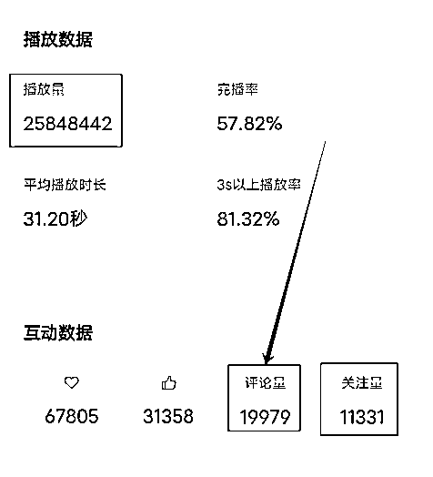
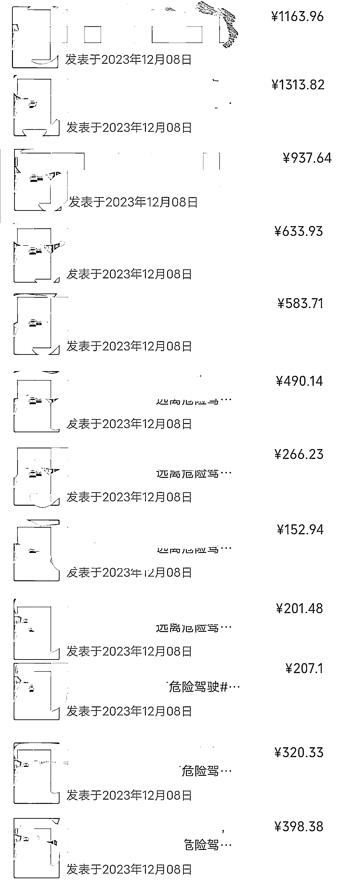
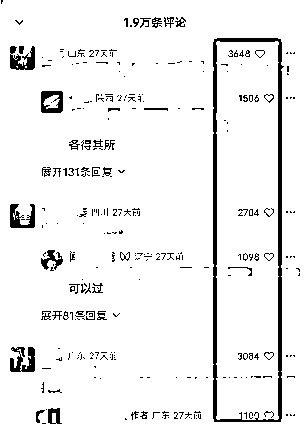
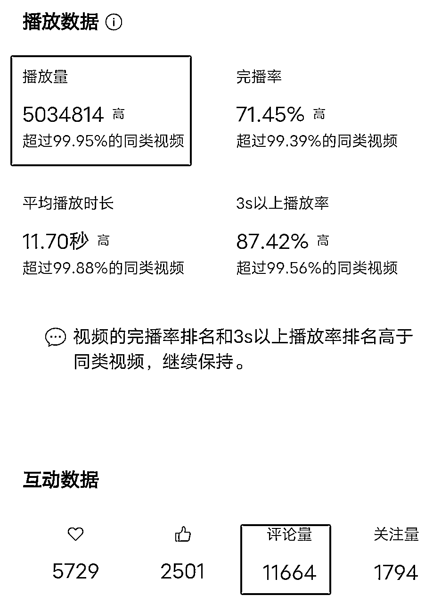

# ('创作分成计划一条视频赚了 7200 元，分享一种提高视频评论量的方法', (2, 36))

先按圈子惯例亮个成绩：我参与创作分成计划的一条混剪二创视频，播放量一路冲到了近2600万，评论区收到大约2万条留言，靠广告分成赚到7200多块。

这是每天的收益曲线：

从第15天开始，这条视频的每日收益就掉到100块以内了，后面不再展示。

乍看之下，这条视频的评论率其实很低：2万除以2600万，约等于万分之七——换句话讲，平均一万个观众里只有7个人愿意留言。

那是不是评论数越多，广告收益就越高？

绝大多数人都会点头。

但真相恰恰相反。

更准确的说法是：真正决定广告收益高低的，是“围观评论”的人数。

也就是说，关键不是“评论率”，而是“想点开评论区”的观众比例。

为什么这么肯定？看看这条视频里高赞评论的数据：

点赞前三名的热评，再加上这三条热评下面点赞最高的回复，一共6条评论，点赞数加起来超过了1.3万！

这说明很多观众明明自己不留言，却会把评论区从头到尾翻一遍。

所以，高收益视频未必评论率惊人，但“看评论率”一定很高。

那问题就变成了：怎么让观众觉得评论区值得一看？

经过反复测试和复盘验证，我总结出两个特别有效的方法：

第一，选题要自带“争议空间”。

别去碰那种一眼就能分出对错的素材。比如“王自如比当年被罗永浩怼时进步了”和“中年男人都应该向王自如学习”——后者明显更具火药味，评论区想冷清都难。

第二，用“坏人”的第一人称，去讲述“自己”做得对、过得好的部分。

我那两条播放量高的视频，一条是2600万播放的爆款，另一条是500万播放的，都是以一个违法坐牢的人为第一人称写文案。因为主角是明确的“犯错者”，观众骂起他来毫无心理负担，评论率自然被拉高。这是我用这个方法优化后的数据：

这条只有500万播放的视频，评论量却达到1.1万，评论率明显比那条2600万播放的爆款还高。甚至，它的评论总数超过了“喜欢”“推荐给朋友”“转发”的加总：

那段时间后台私信里涌进不少骂声——因为他们真以为我就是视频里那个犯下重罪的人。

这大概就是“找骂即流量密码”的现场版。

但为什么还有那么多人点赞、转发？因为我的文案写的都是客观事实。就像《色戒》里的梁朝伟，角色明明是个汉奸，导演却偏要让他帅、让他深情、让他舍得为女人花钱——这种叙事方式，很难不火。

再给生财圈友举个更熟悉的例子：

假如有人发一条视频，说自己花2000多块加入了“生财有术”社群，然后天天刷帖子到凌晨一两点，白天上班出错被扣了奖金；第一次参加航海，交了1000多块押金报6个项目，结果一个成果都没拿到，还因为摔断腿住院没时间打卡，押金也没退回来；焦虑之下又花1万块报了一个圈友的陪跑营——视频到此结束。

你猜评论区会不会炸？

一定会有大批圈友忍不住冲进去留言。因为对绝大多数圈友来说，“生财有术是个好社群”就像“梁朝伟演的是汉奸”一样明显——抱歉用这个比喻，请只关注“明显”这个词。更何况，成千上万的人靠它赚回了远超门票的钱。

比如我，一条视频就赚回了3倍门票。如果真看到这样的视频，我一定会去评论一句：“就这？我一条视频赚回3倍门票！”

请注意，视频里说的可能全部是客观事实，但它照样能勾起我的评论欲——因为评论的那一刻，我获得了爽感。

所以，提高短视频评论的底层逻辑是什么？

说白了，就是让观众能够特别轻松地表达观点，并且很容易得到认可。这是一种真实存在、需求巨大的心理体验。

短视频是“货”，评论和围观评论就是观众在花“钱”。要让观众心甘情愿地掏钱，就得让视频满足他们的某种需求。赚钱的本质就是满足需求；你能满足一种需求，你就会有钱；你能快速满足很多人的同一种需求，你就能快速赚到很多钱。

生财有术，但不只有“术”；透过这些操作方法看到背后的“道”，才能举一反三。

我始终认为：复制不了的经验，价值为零；分享复制不了的经验，还会误导别人。上面这两个方法，都是我自己多次验证过确实有效才写出来的，希望能帮到大家。

欢迎圈友实操之后来评论区报个喜，那样我会很开心。

第一次写长文，文笔有限，大家多包涵。