# 付费课程拆解后，我把📕实操全盘托出

## 📕丨砸钱上课得来的实战复盘

作者：王卷卷在成长
日期：2024-01-04

哈喽，我是卷卷，九三年生的在带娃的同时做内容，累计变现已过十万元。2023 年下半年主要精力都压在📕这条线上，摸索出来的方法相对成体系，今天把踩坑总结一次性讲清楚。

入行前我也是零基础，听闻素人也能起号，感觉很轻松，自己上手却无从下手。

网上搜集的资料大多零散，东一榔头西一棒槌，拼凑后操作，投入了大量时间，号却没什么起色。

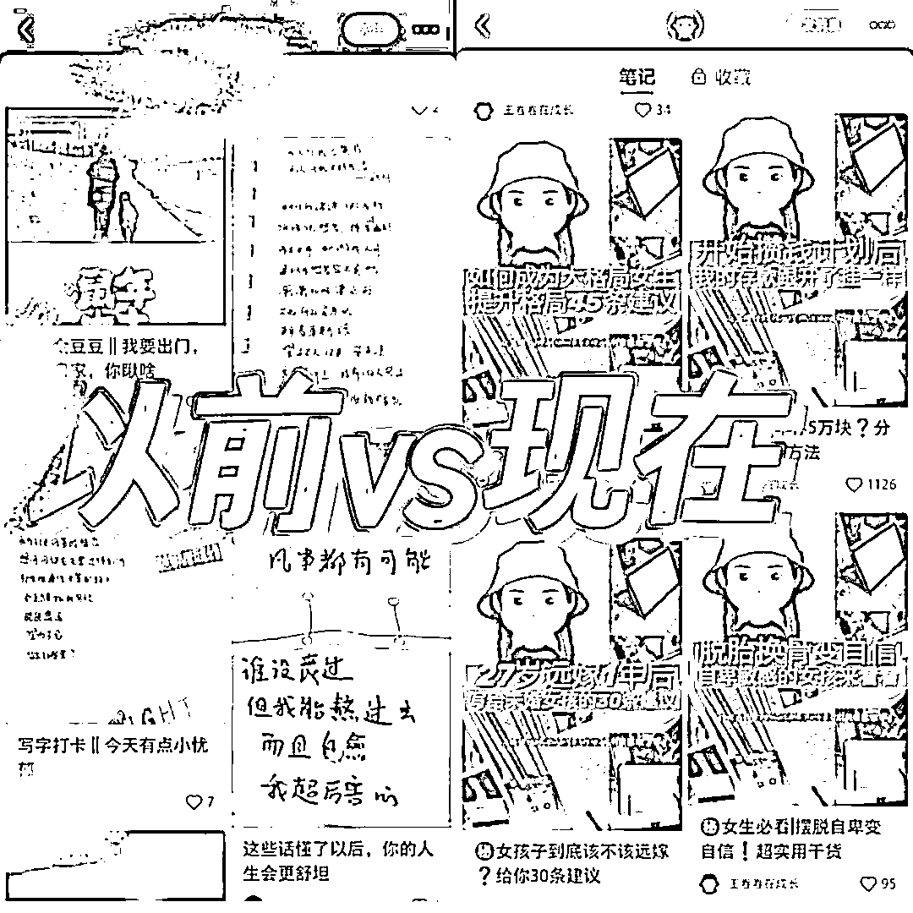

（上课前账号没有美感也没有清晰定位，学习后笔记质感明显提升）

后来报名了老师的系统带教，每天孩子入睡后开工写稿做图，多数内容都是抱着娃完成的。

结营时粉丝突破一千。

粉量七百左右就拿到第一笔美物推广，正式开始产生收益。

之后回娘家，宝宝水土不服，我基本停更，恰好此前未爆的几篇开始释放长尾流量，粉丝逐渐来到两千附近。

季节转暖，孩子长大身体恢复，我想验证知识迁移性，便另开了一个矩阵号。

新号人设偏弱，专注爆款打法，一周内数据抬头，三个月新增三千粉，广告询盘不少，只因报价偏低未接。

变现路径其实很多，账号跑通后不用担心收益问题。

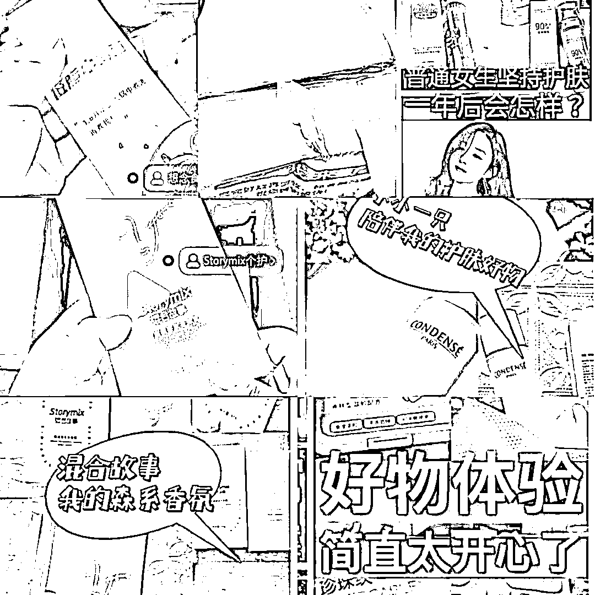

（部分好物体验实拍）

我给自己设的目标是一个月到五千粉并开通蒲公英合作，后面靠持续发帖达成。

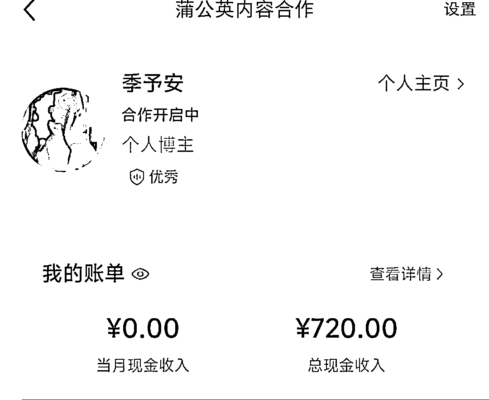

如今信心很足，重新开号做到千粉对我而言已是常规操作。

今天把付费课程里学到的东西，结合自身实践，完整分享出来。希望能帮你们少走弯路。我也是从完全不懂开始摸索，明白那种迷茫，所以想陪同有相同起点的人把路走顺。

ps：我认为这份笔记价值不止几百，希望你能细读、吃透并落地，而不是收进收藏夹变成电子垃圾，那样永远无法靠📕赚钱。

**以下十个节点是我做号的主线：**

1、确定要做的赛道
2、起号前准备及是否需要养号
3、研究对标账号并建立选题池
4、主页搭建：头像、简介、背景、ID、昵称
5、学会制作单篇笔记及个人主页呈现
6、首篇笔记撰写与发布
7、用工具筛查词库规避风险
8、正文控制在千字以内
9、笔记数据异常但无违规提示的处理
10、主动捕捉灵感

**一、赛道选择**

仅聊我接触过的以及当前平台热度较高的方向。

1、成长类：
我手上有一个全职妈妈成长号，兼顾女性成长、婚姻以及自媒体心路，目前处于停更状态，未来可能转型。

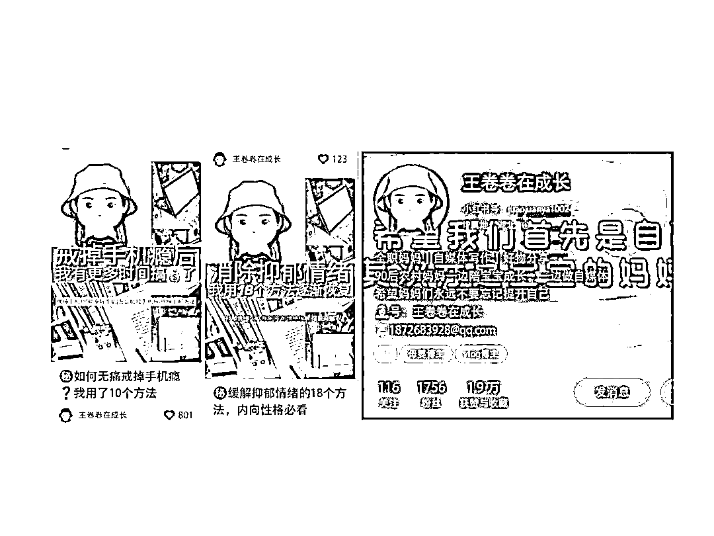

个人成长号截图

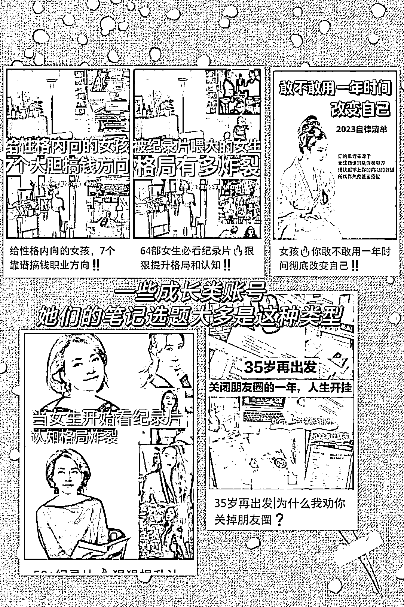

**成长博主内容形态**

2、情感类：
另一个号起初做女性成长，后转为情感恋爱方向。定位不够清晰，盲目追逐爆款，导致粉虽涨但广告意向弱，后期主要靠好物体验转化。

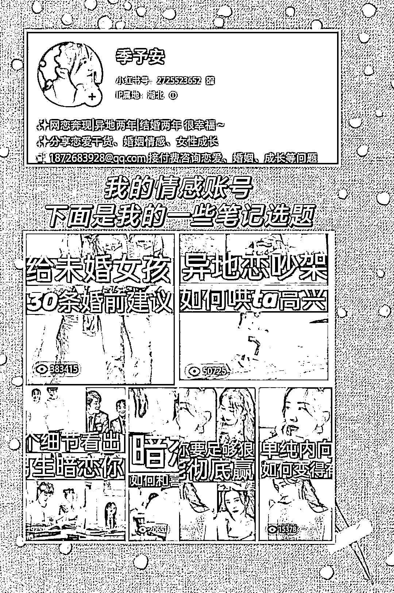

可作参考路径。

3、读书类：
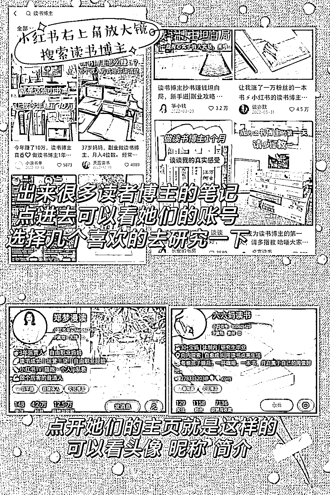

不少人喜欢读书却不做输出，觉得记住就行。其实烂笔头胜过好记性，把读后感与个人经历结合，能塑造出辨识度的读书人设。

只要内容对读者有价值，数据会慢慢累积，三百粉左右即可尝试书籍置换，长期合作很稳定。我第二个号即常被出版社找来推新书，也算实现部分纸质书自由。

4、Vlog类：
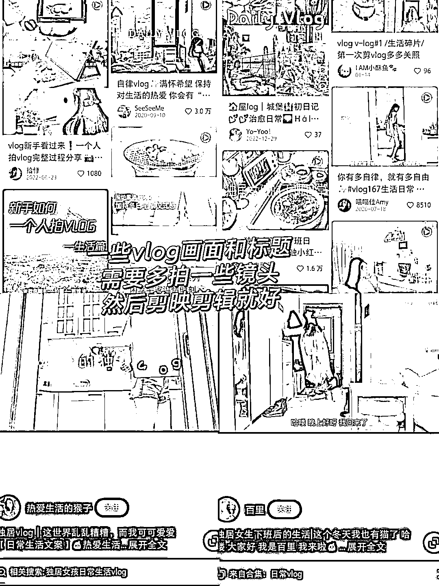

我曾尝试，拍摄剪辑成本很高，一分钟成片需多机位素材加字幕配乐，耗费精力。

不过很多宝妈做得不错，用日常记录带娃、吃饭睡觉等真实片段，后期植入广告痕迹轻且变现面广。

若你有耐心喜拍视频，可尝试。先在平台搜索对应主题即可上手。

***注意：**
目前平台精致独居、精致育儿类视频已饱和，若条件与呈现手法达不到同等质感，可反向用普通人视角共鸣。

5、文案号
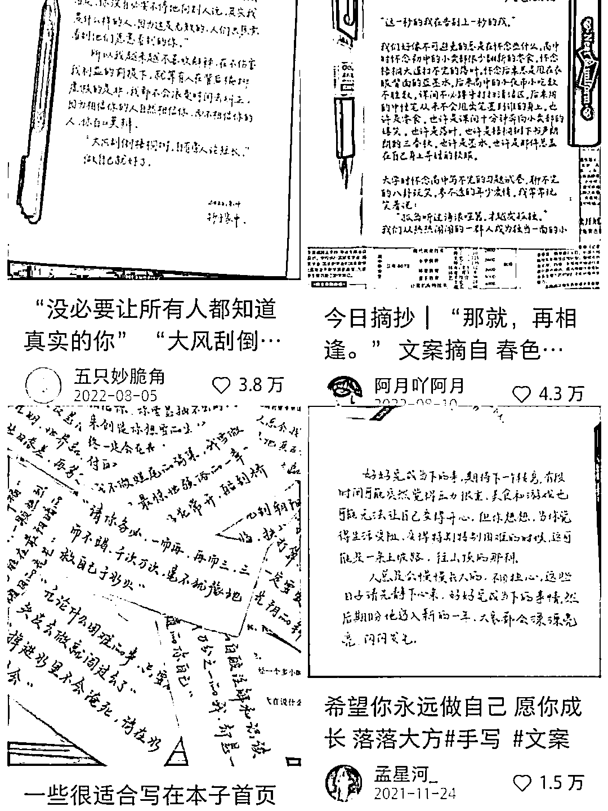

若仍无方向，可做文案号，手写好看就手写，不好看就搭图。爆款概率高，但账号商业价值偏低，后期多靠👸号推广或售号。几千粉号售价不高，自行权衡。

6、育儿/母婴
我此前开过一个育儿号，赛道竞争激烈，自己发娃照与带娃日常，涨至六百多粉后停滞，仅做过几次置换后注销。

想进入的可走两条路：
一是干货型育儿，不出镜，靠排版。工具可用稿定设计、黄油相机、美图秀秀，进阶可学PS。

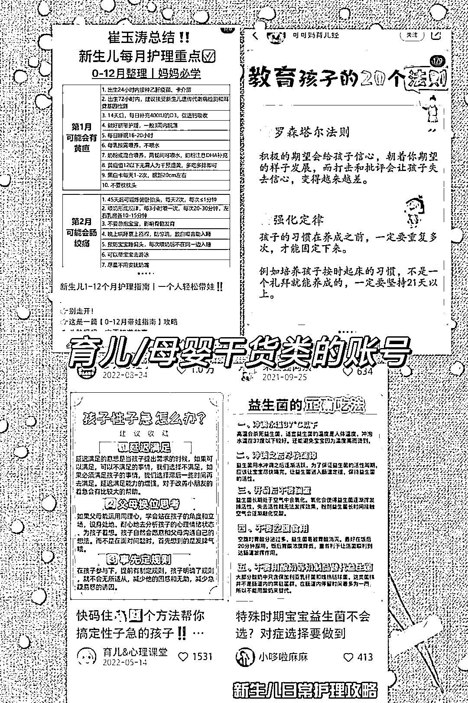
二是Vlog记录带娃生活，真实的生活切片同样吸量，坚持下去广告位自然增多且不突兀。

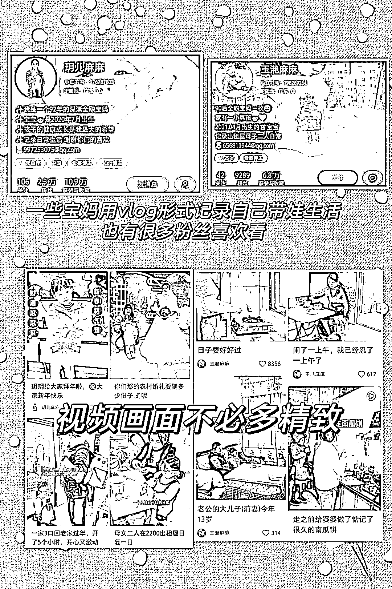

以上纯属个人观察，供参考，其余赛道暂不展开。

**2、起号准备与养号**

先建立长期主义心态，接受初期无反馈的阶段，准备一台固定使用的手机。

**关于养号：**
我注册后未明确定位，未改资料，每天刷推荐、点赞收藏关注，纯刷了一周多。关注超百人后，第一篇笔记获得十几个赞，展现六百多，连续发三天出小爆款，涨粉一百多，之后还有多篇万展笔记。

养号时长看个人安排，时间充裕可多刷，时间紧可缩短，仅作经验分享。

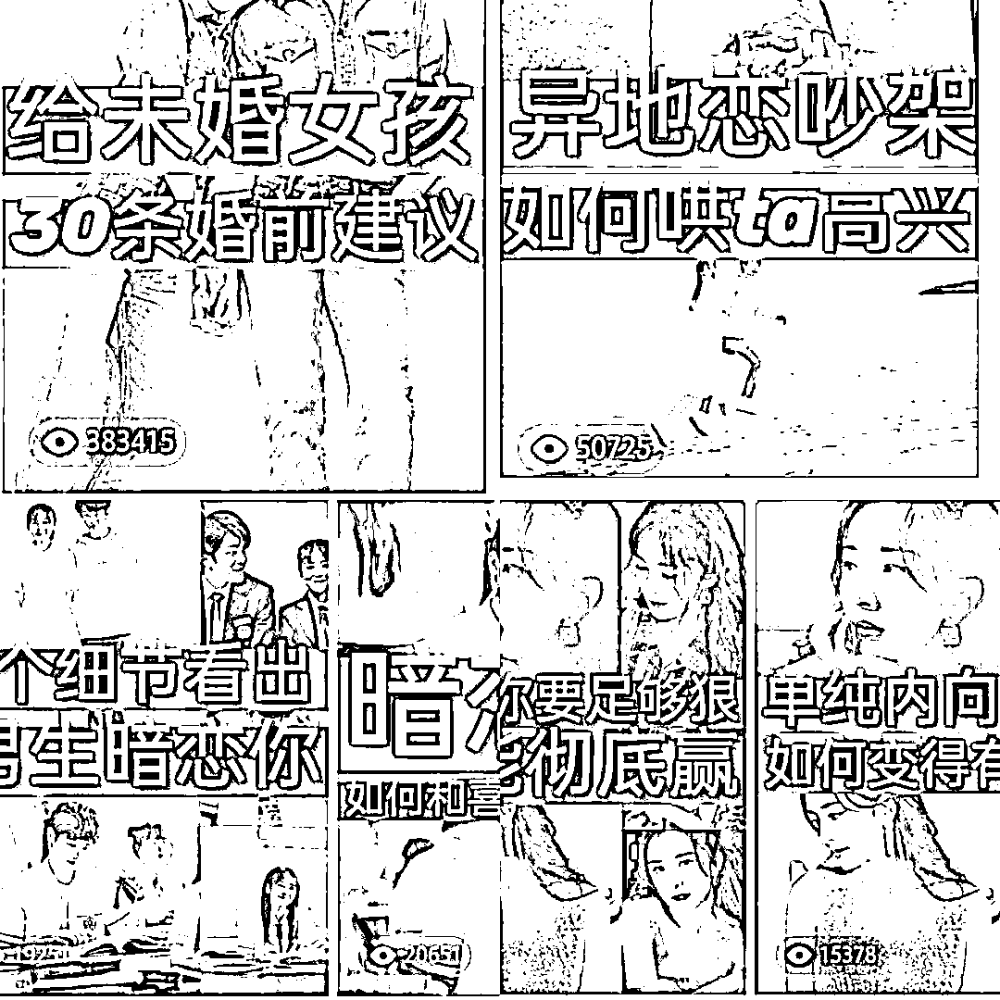

**3、找对标**
确定赛道后，用关键词搜索同类创作者，如育儿、读书。可搜用户也可直接在笔记页关注。对标建议多账号并行。

**4、主页包装**
方向明确、研究完对标后即可注册，需手机号。

尽量用同一设备登录同一账号，避免频繁换机带来限流风险。素人号保持简洁即可。

昵称：与赛道相关，易记。如读书类可用XX读书、书单笔记等。

简介：
首句说明定位，输出内容类型；
次句点出人设，如全职妈妈；
第三句可放座右铭或正能量句子，也可省略。初期权重低不要放邮箱。

ID：具备引流作用，确定后再改，只能修改一次。

头像：真人照最佳，不愿露面可用漫画头像。我用美图秀秀的动漫化功能制作，操作简单。

5、个人主页搭建

以我的王卷卷在成长为例：

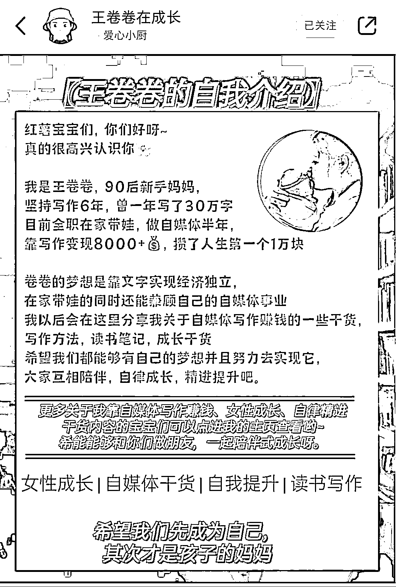

黄油相机区域：

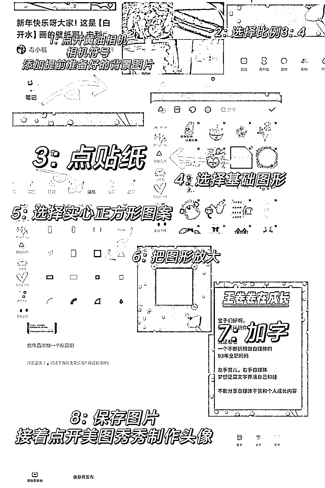

名字字号放大，提升记忆度。

自我介绍区：
一句金句贴合定位，点缀小表情。

美图秀秀区：头像
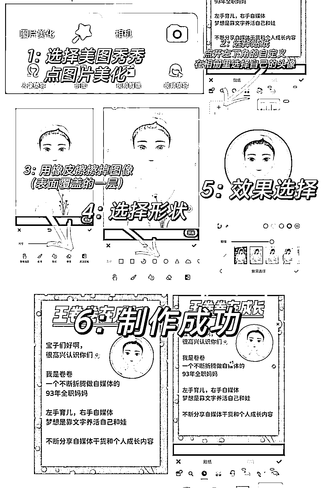

使用贴纸抠图做成圆形。

起初我未做主页介绍，觉得无内容可写，后发现想法错误。坚持早起一年、大学期间赚取的金额等均可作为亮点，每个人都有闪光点，用精炼语言提炼即可。

**6、首篇笔记发布**
包装完成后开始写稿。找对标过程中可明确自己擅长的角度。爆款可复用，用个人经历与思考换角度写作，切勿抄袭。

**7、查词避雷**
成稿后用零克查词检测违禁词，必要时用谐音或表情替代。确认安全后再定标题，标题控制在二十字内，可加表情。封面标题与笔记标题可不同，提升点击率。

**8、文案长度**
正文建议别超一千字，写不下可放图里。超了就提炼小标题，把干货放图。分段排版，避免大段文字影响阅读。女性用户多，小表情与小标题更友好。

**9、笔记异常处理**
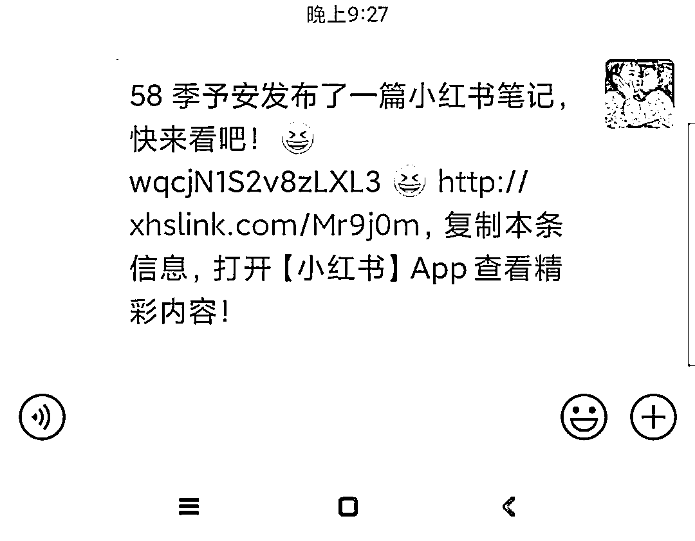

发布后复制链接到🛰️打开，查看是审核中还是受限，及时调整。正常情况下展现会上涨，有互动则说明正常，无需反复检查。

**10、灵感获取**
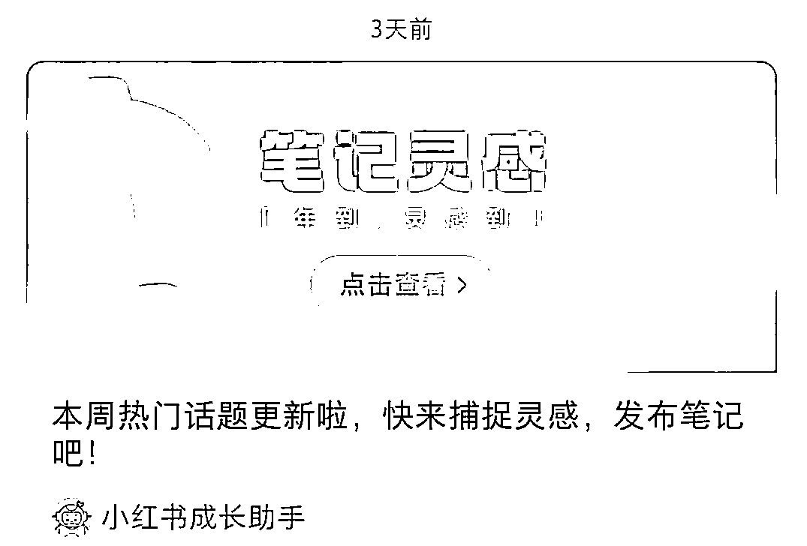

多刷推荐页观察当下爆款形态，到热门话题与官方活动找灵感，可分得额外流量。

以上是我三天整理的0到1实操拆解，全文五千字配多图，希望你能真正执行。

吃透内容再动手，定能做出可盈利的📕账号。

实践中如发现我未提及的问题，欢迎评论区交流。我不一定全知，但可一起讨论，或许答案就在对话中。

祝各位早日见成效！

#📕#📕干货

* * *

评论区：

林林 AIGC 写作 : 谢谢卷卷的分享，祝 2024 多出爆款～

王卷卷在成长 : 谢谢林林老师的鼓励呀

Annie : 感谢分享，请问可以加你吗？

阿格 : 从文字看的出来王卷卷老师是一个很真诚的人，谢谢分享

王卷卷在成长 : 谢谢阿格的夸夸😊

Love&Peace : 谢谢卷卷老师的分享，真的很有参考价值，辛苦啦

辰风 : 感谢卷卷分享

王卷卷在成长 : 谢谢辰风[害羞]

* * *