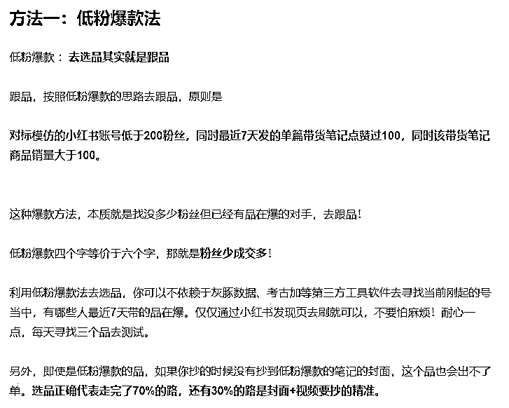
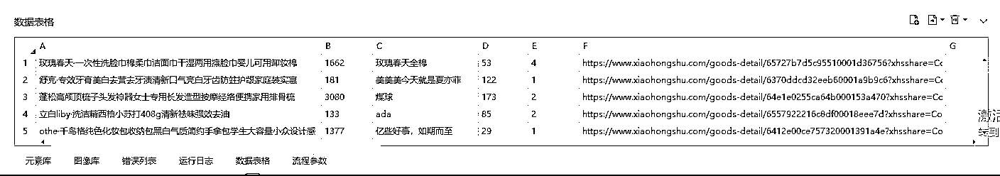
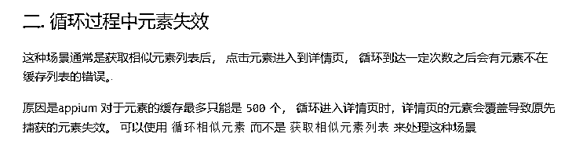

有些内容发出去可能石沉大海，可让人意外的是，它却被别人在收藏夹里惦记了很久。

Rio之前看完@锦城随笔分享的那篇影刀RPA批量获取小红书低粉爆款商品教程后，自己也动手重写了一遍，而且当晚就写完了。但他当时觉得发出来没多大意思，也不至于加精，就一直没发。结果过了这么久，竟然还有人来留言催更。那就兑现承诺，这次直接安排上。

先把运行效果放出来：

这套脚本不是凭空想的，它严格照着伟豪那篇《小红书单店铺单月6000+利润选品保姆级教程》里的选品逻辑来落地。

拆开来看，整个自动化流程是这样走的：

1. 打开小红书App，进入购物列表；
2. 逐个点击商品，抓取“已售”数量，已访问过的商品会自动跳过，不会重复点击；
3. 如果已售数大于100，就继续点进店铺，采集粉丝数；
4. 判断店铺粉丝数不足200后，再去笔记列表翻前10页的点赞情况；
5. 把点赞破百的笔记数量统计出来——注意，这一步是锦城原版没有的；当这个数字大于1时，就判定为低粉爆款商品；
6. 最后筛选出的爆款统一写入表格，表头分别是：商品名、已售数、店铺名、粉丝数、过百点赞笔记数、链接。

说实话，Rio一开始觉得这条件太苛刻，不一定能跑出结果。结果脚本默默跑了一整夜，一觉醒来，整张表已经填得满满当当。

整个过程中遇到最大的坑，是回到列表页时，页面元素凭空消失了。好在官方给出了说明，搞清楚原因后，技术问题也就迎刃而解。

核心代码比较长，这里把骨架逻辑拆出来看：

```
主循环：回到首页 -> 进入购物列表
对每个商品：判断是否处理过，未处理则读取已售数
若已售 > 100：读取店铺粉丝数
若粉丝 < 200：读取前10页笔记点赞数
统计点赞 > 100 的笔记数，若大于1，则记录为低粉爆款并写入表格
```

Rio平时最喜欢干的事，就是把实战经验变成能自动赚钱的机器，目标是有一天能躺赚5W+，也期待在途中遇到更多同频的人。

评论区里，有朋友担心采集频繁会被封号，问频率怎么设置比较稳。Rio直言：用小号采集就行，没区别。还有位朋友留言“一直惦记着呢”，Rio回了一朵玫瑰。也有人感叹：大佬就是大佬，实干家。

