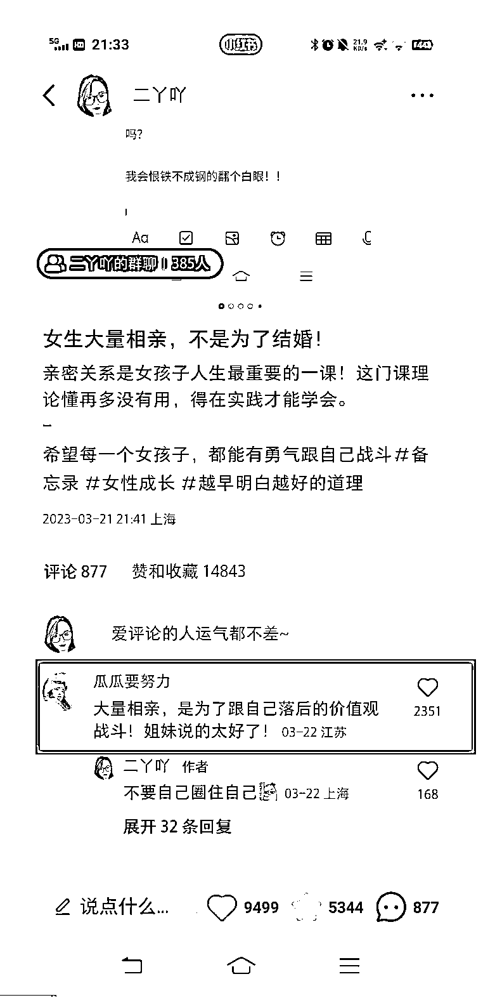
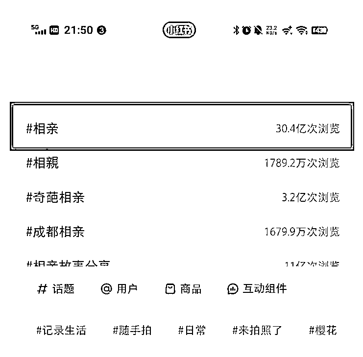
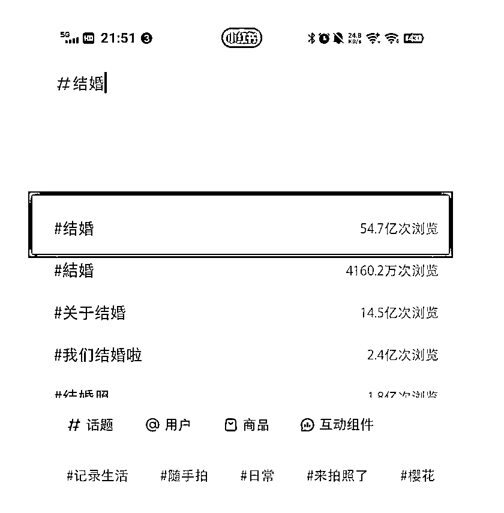
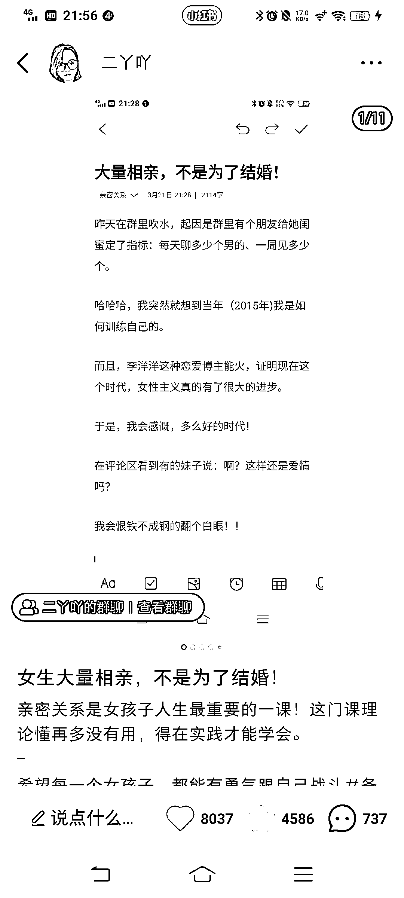
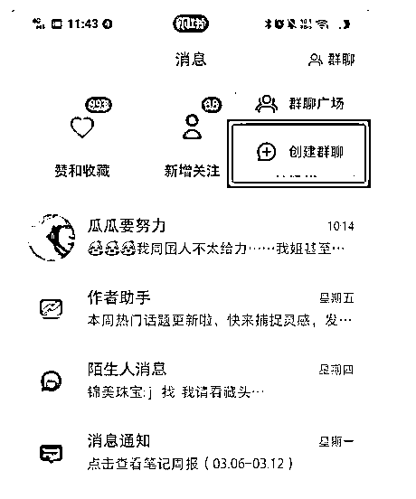
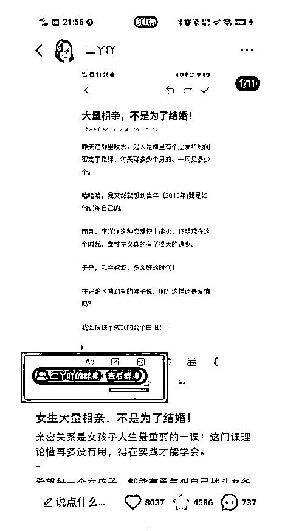
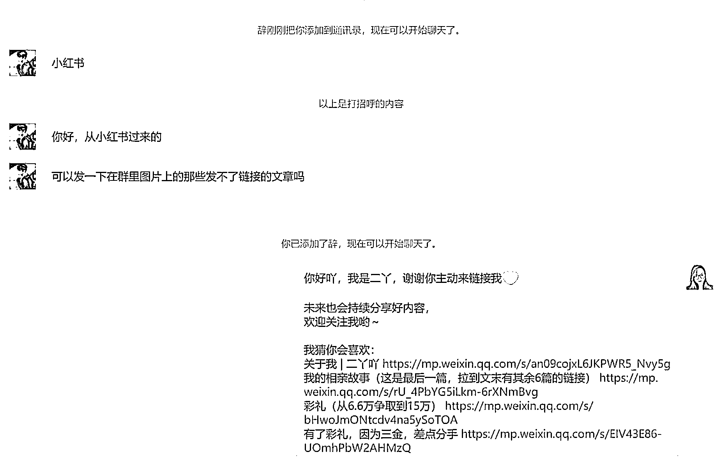
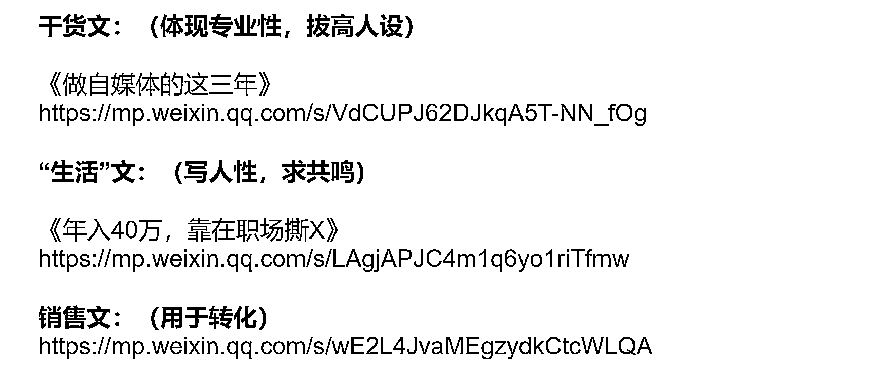
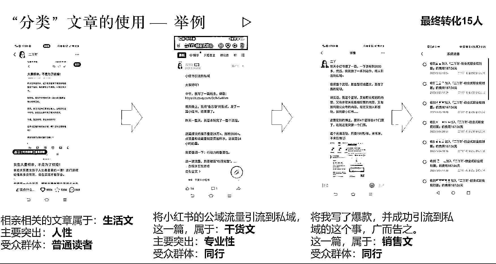

# 一篇备忘录笔记撬动 4000+，我的爆款打法与从公域到私域的变现闭环
作者：龙哥

## 红书 1 条笔记变现 4000+，聊聊我的爆款创作思路+引流变现全流程

作者： 二丫吖

日期：2024-01-05

去年 3 月，我随手用手机备忘录发了一条📕笔记。结果小眼睛直接冲到 30 多万，点赞破 9000，收藏过 5000，账号粉丝一夜从 600 多涨到 3000+。我立刻在笔记下建了群，把人先收进📕群里，再分批导到🛰️，十几个人完成了私域沉淀。

随后我用👸号和🛰️同步宣传这波爆款的经过，把我的知识星球推了出去，单价 199 元，一天卖出 15 份，营收 2980+。不少人就是冲着这个案例买单的。

今天把从选题到变现的整套路数拆开，方便你把自己的产品和红书流量打通。

我主要聊两个核心：

**一、爆款怎么找：把生活里的高热度讨论变成选题**

**二、流量怎么吃：快反应+快落地=把机会变现**

**一、爆款怎么找：有意识地在生活里捕捉能吵起来的话题**

我现在做内容，素材基本都来自真实生活，没有刻意去选题库里搜。我白天有固定工作，还要带娃，每天能分给自媒体的时间也就两三个小时，👸号也得维护。📕是我去年重点投入的阵地，也报了付费课。

我们👸号有个号主小群，里面都是聊得来的博主。有一天群里有人说正在给闺蜜安排相亲找对象。群里全是女性，这个八卦一抛出来，十几个人瞬间聊出了 100 多条消息。

我当时就想：私下 15 个人能聊这么热，放到公开平台上是不是也能炸？

于是我当晚用手机花半小时把这个故事写出来。就在我报课的付费群里刷到“📕爆款模板”，其中有个账号叫 KKの成长日记。翻完她的笔记，我才明白备忘录截图这种粗糙排版的逻辑。

我直接把相亲的故事复制到备忘录，截图发📕，10 分钟完成就去睡觉了。早上起来，已经爆了。

复盘这条爆款，我归纳了三点：

**1、日常里保持雷达，私域吵得起来的话题，公域一样能炸。** 有讨论就有传播，有传播才有爆发的可能。

**2、文章里要有让人记住的金句。** 这篇我写起来很顺，因为是亲身经历。结尾用 123 做提炼，读起来很有力量，这和我长期写👸号养成的习惯有关，我习惯在文中埋金句。

这篇的点睛句是“大量相亲，是为了跟自己的落后价值观战斗”。📕女性用户多，女性议题正处在风口，配上这句话很容易被传播。

读者看完一篇通常记不住细节，一句上口的金句能成为记忆锚点。文章被@传播起来的第一波阅读量，就是因为这句话被大量转发。

**3、标题决定能不能起步。** 这篇标题里同时踩了“相亲”“结婚”两个大词。

“相亲”在📕的浏览量是 30.4 亿次

“结婚”在📕的浏览量是 54.7 亿次

一个标题吃两个热词，再加上悬念钩子“大量相亲，不是为了结婚”，用户自然会好奇：不为结婚，为啥相亲？答案给到“为了跟自己的价值观战斗”，正好契合当下的女性主义情绪，所以就跑起来了。

**二、变现复盘：快比完美重要**

22 号那天，我基本把从曝光到变现的一整套流程跑完了。

笔记 24 小时展示量 20 万+，涨粉 3000+，点赞收藏数据如图所示。

我要特别强调行动力。这一波流量我吃得很完整。

**公域到私域的操作实操：**

1、22 号早上我每 10 分钟刷一次，评论区一直是 99+，我就判断要爆了。
2、第一个人问“有群吗？”，我一分钟内就在📕建了群。
当时我根本不知道建群入口在哪，研究完才发现群可以绑定笔记。于是我把群绑定到这条爆款笔记上，一个群能同时绑多条笔记，这样群会跟着笔记的流量走。

点“查看群聊”就能直接申请进群。现在群里已经有 380 多人，笔记还在持续推流。

先把人拉到📕群里。我在群里先发了一句过渡话术：大家好吖，群今天刚建，我在上班，晚上来分享。📕群是申请制，需要群主通过，人会分批进来。为了让晚上的转化更集中，我会定期复制这句话顶一下。

我也见过笔记火了但涨粉很差的案例。我的这篇前期点赞收藏很高，但涨粉一般。我马上在评论区做引导关注。

用户说“我缺一个军师”，我就回“关注我，军师在这”。我会在评论区喊话“来关注我呀，入股不亏”。有人说“关注你了，宝藏博主”，我就回“爱你宝贝，有眼光”。

一篇内容冲击力强，但排版一般、博主还是素人，粉丝只有 600 多，读者看完后很难立刻想起来点关注。这时他们会去看评论区看大家怎么说，我在评论区活跃互动，就提升了好感度。二次安利下，关注转化就上来了，当天涨了 3000 多粉，群也有 380 多人。

接着我做了三件事把人往下沉：

1、从👸号里挑出关于相亲、婚姻、彩礼的相关文章做匹配；
2、整理好分享链接；
3、做引流图。

⚠️ 注意：
1、群里不能出现🛰️、👸号等字样，会被封号，拼音也不行。
2、平台风控很严。

我这次冒了点风险，但我本身内容质量还不错，群里也认真分享了，所以目前没事。富贵险中求，想搞就搞大一点。做图引流相对安全。

我在群里分享了学历差这一点，我大专，我老公硕士，勾起好奇心后，引导到🛰️准备分享链接和回复模板，用链接导到👸号关注。

就这样一个闭环走完了。虽然当天只有十几个人加到🛰️，因为群里在线人数只有 40 多。**但一天之内：群建起来了，全流程走通了，后面复制即可。** 24 小时完成闭环。

引流是营销，转化是销售。我的销售动作在爆款第二天，也就是 3 月 23 号才做。

销售需要三种内容承接：干货文、生活文、销售文。

我这次就是这三种内容的结合。

销售一旦出现批量成交，就可以再用截图二次放量。我又截了星球出单记录，基于截图写了一篇新文案发朋友圈，又卖了 6 个。

总共卖出 21 个，199 元/个，合计 4179 元。这就是一条爆款带来的直接销售业绩。

总结一句话：**做自媒体，反应快、行动快，就能把流量变现。整个过程不复杂，最关键的是搞起来。**

* * *

评论区：

暂无评论

* * *