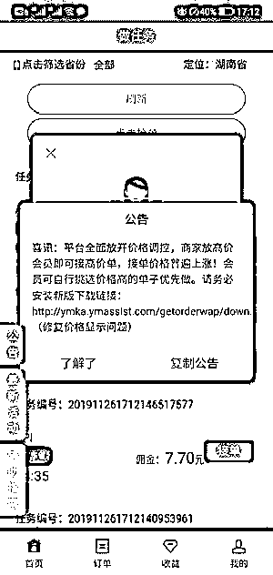
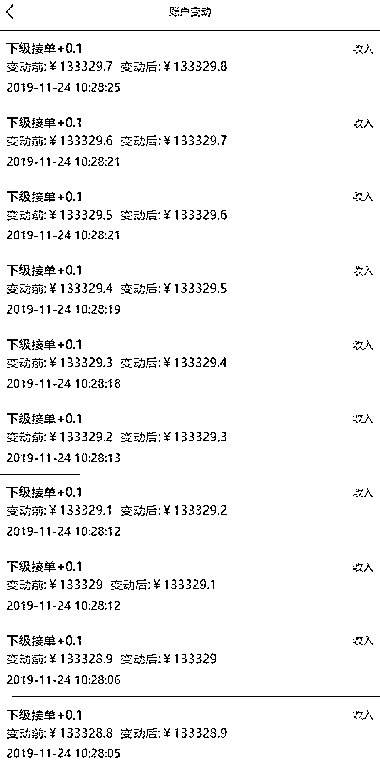
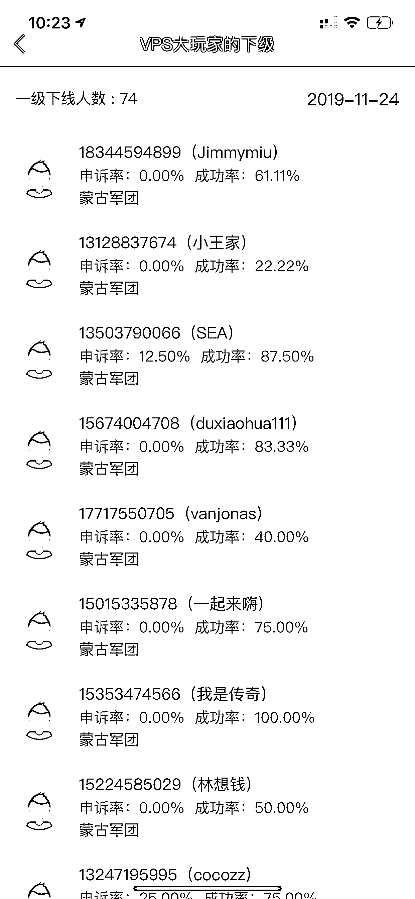
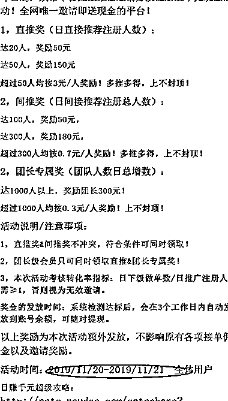

# 七年收款一千万，美国广告联盟

七年入账超千万，我靠美国广告联盟CJ赚到了人生第一桶金

今天想和大家聊聊我的老本行——联盟营销（Affiliate Marketing），准确说，是带我入门的美国广告联盟CJ Affiliate。

第一次撞见这个圈子，是在米课创始人老华的“老华带你飞”栏目里。他在那期视频里，现场拆解了自己如何通过CJ联盟中一个叫iContact的广告主，实打实拿下了两百万佣金的全流程。看完之后，我一下子就被这种玩法勾住了，转头就去研究CJ联盟和affiliate marketing。

有个特别逗的小插曲——我注册的第一个CJ账号，用的Gmail邮箱前缀是“XXXYZ10000000”，翻译过来就是“一定要赚一千万”。当时纯属给自己打气，谁也没料到，几年后这个玩笑竟然成了真。

不过得说清楚，我并不是从CJ联盟“纯赚”了一千万，而是账户累计收款超过了一千万。做联盟和做别的生意一样，有成本也有开支，但刨去这些，利润相当可观——厦门五缘湾那套海景房，就是靠CJ的推广佣金拿下来的。

但要说联盟营销给我带来的最大一笔回报，反而是在国内。

2018年年初，我们盯上了🛰️生态里的一个隐性需求，索性照搬CJ的商业模式，搭了个任务分发平台，连接发单方和接单方。没有正经程序员？没关系，我们在淘宝上找了个“草台班子”技术，花几万块做出了一个简陋到不好意思形容的App，就这样开工了。

结果谁也没想到：两年多时间，一分钱推广费没花，纯靠地推和口碑裂变，平台做到了上百万注册用户。16万人在上面发布任务，超100万人接单。单笔任务只有5到30块钱，但总流水硬是破亿，给我和合伙人都赚了个盆满钵满。

直到2020年底，帽子叔叔登门，平台被强制关停，我差点就要去踩缝纫机。原因在于上游不少发单客户业务本身不合规，我们收的钱、提供的服务自然也就跟着“染了色”。现在回头看真的后怕——当时监管没那么严，只罚了点钱、勒令停业，放到今天这个体量，百分百进去了。

抛开这个结局不说，这个项目本身绝对能算一个非常成功的affiliate marketing创业案例，服务了上百万用户，也让我过足了创业的瘾。

很多人一提联盟营销，脑子里全是各种广告联盟平台的奇技淫巧，我觉得这个理解太窄了。联盟营销是一种商业逻辑，不是某一平台或某个玩法能定义的，它几乎可以嵌入所有你能看到的生意模式里，是当下流量碎片化时代极其有效的推广手段——所以我的🛰️签名一直写着：affiliate无处不在。

这个概念在国外很火，国内也一点不逊色。淘宝联盟、淘宝客就是最典型的affiliate业务，多少没资源没背景的普通人靠着它翻了身。这些年创业自媒体圈子里活跃的不少KOL，就是从淘客大军里跑出来的。我还做过一个有意思的尝试：把国内淘客的玩法搬去国外，效果一样能打。

在国内搜“国外广告联盟”，高频出现的无非三个词：CJ、CB、Amazon Associates。CB就是ClickBank，Amazon Associates是亚马逊联盟，这俩以后再展开聊，今天只把CJ讲透。

CJ的全称叫Commission Junction，非常典型，国外好多联盟平台都是照着它抄的。可以说，把它吃透了，国外affiliate领域的规则和黑话也就懂了个七七八八。

从注册开通、收款方式、税表怎么填、后台各项功能，到广告主的考核指标、通用操作策略——我把整个CJ affiliate从头到尾捋了一遍。相信看完，你对国外的affiliate marketing会有一个比较完整的认知。内容量比较大，我整理在了飞书文档，点下面链接即可阅读：

[`zo58x45lxn.feishu.cn/docx/Itrfd7QIHoPIFkxedMrcj36Cn5b?from=from_copylink`](https://zo58x45lxn.feishu.cn/docx/Itrfd7QIHoPIFkxedMrcj36Cn5b?from=from_copylink)

评论区：
阿甘｜汽车出口：谢分享
Rio：超出我的认知，觉得厉害，但不知道怎么赚钱
陈辰：先关注，以后会继续分享更多affiliate marketing的内容
陈辰：核心还是流量生意，国外也有抖音📕知乎搜索引擎个人IP，想办法帮广告主带流量，拿约定佣金，就这一件事
zhAzha：是vps大玩家？你博客看过很多遍，学到不少
陈辰：我不是大玩家，和他认识，当时推任务平台时他帮推过
陈辰：写这篇分享时，在老手机里翻出了当时的截图
北瑜：是做的EMU吗？

