TikTok美区小店的“午餐盒”玩法，最近有点意思。刷PIPIADS广告数据库时，我看到这个类目正被一批卖家悄悄测试，而且已经有店铺做出了6万单的成绩。别看单价不大，量能却相当惊人，整个赛道早就奔着亿级去了。先看这组背景数据：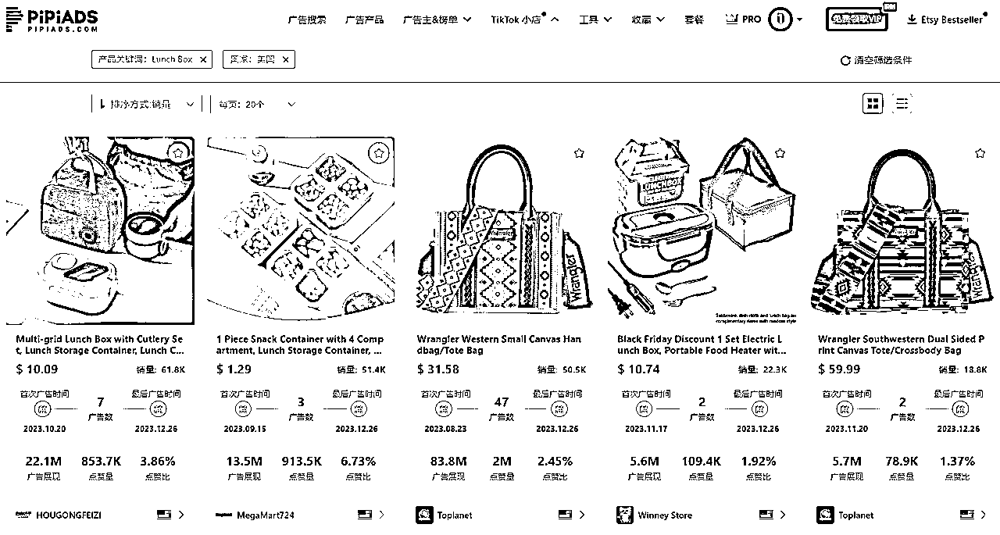

皮皮后台选了五家代表店铺做样本，结果很直观：排名前五的店面，每一家都卖出了过万单。这至少说明，午餐盒不是一个昙花一现的伪风口。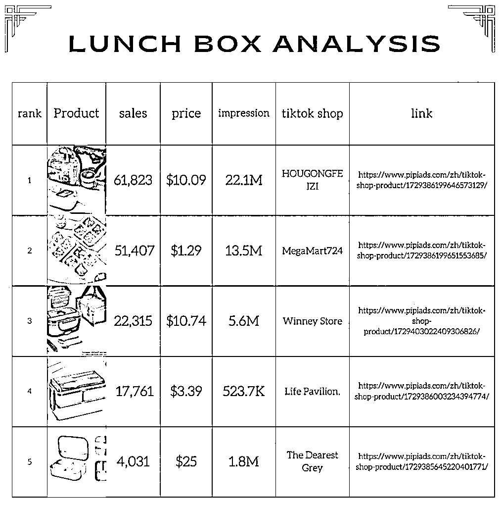

具体拆解一家店吧。比如这家叫MegaMart724的TikTok小店，我把它在平台上的投流记录调了出来：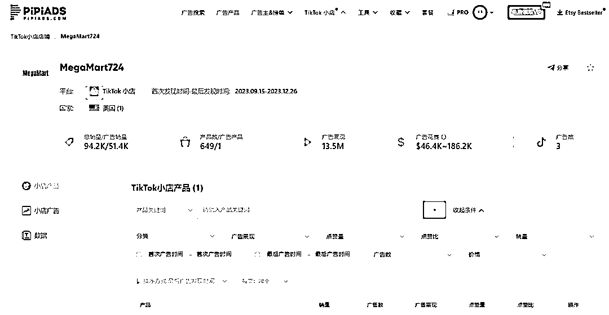

（店铺链接：https://www.pipiads.com/zh/tiktok-shop-store/8646959139956229525#nav2）

这家店从2023年9月15日开始投放，一直到12月26日结束，前后跑了94天，累计曝光13.5M，相当于1350万次。整轮投放只用了3条广告素材，目标市场在美国。按美区常见的每千次展现5美元成本来估算，大概烧了6.75万美元的广告费。值得注意的是，这家店只挂了一个商品链接，客单价只有1.29美元，总销量却做到了5万单。再看同行同款产品普遍卖到10美元左右，基本可以判定：这套玩法的核心是全托管模式，由平台承担运营和履约环节。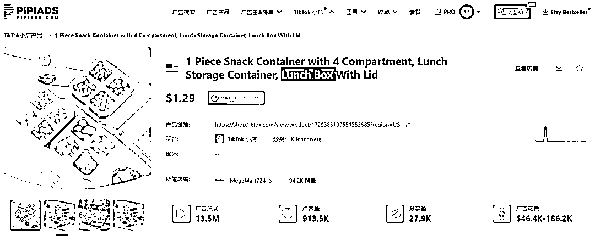

接着看它素材端的特点。合计13.5M的曝光主要由三条短视频拉动，跑量最大的那条如下：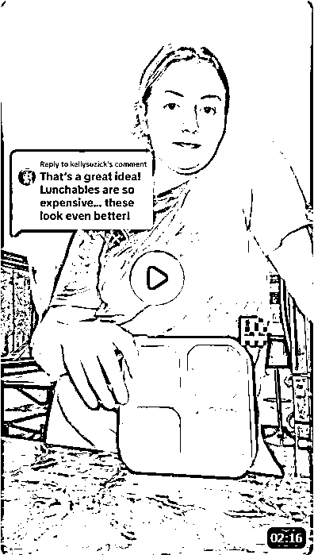

这几条素材的套路非常一致：达人真人出镜，边演示边口播。由于午餐盒是功能导向型产品，直接讲清楚“能放什么、怎么分格、使用多方便”，用户一感兴趣就会停下来多看，转化率自然更容易拉起来。

如果拉通整个午餐盒大盘来看，目前平均每个转化订单的成本在18.5美元左右。临近年末，大家投放普遍收缩，所以整体数据不算突出，只能用平稳来形容。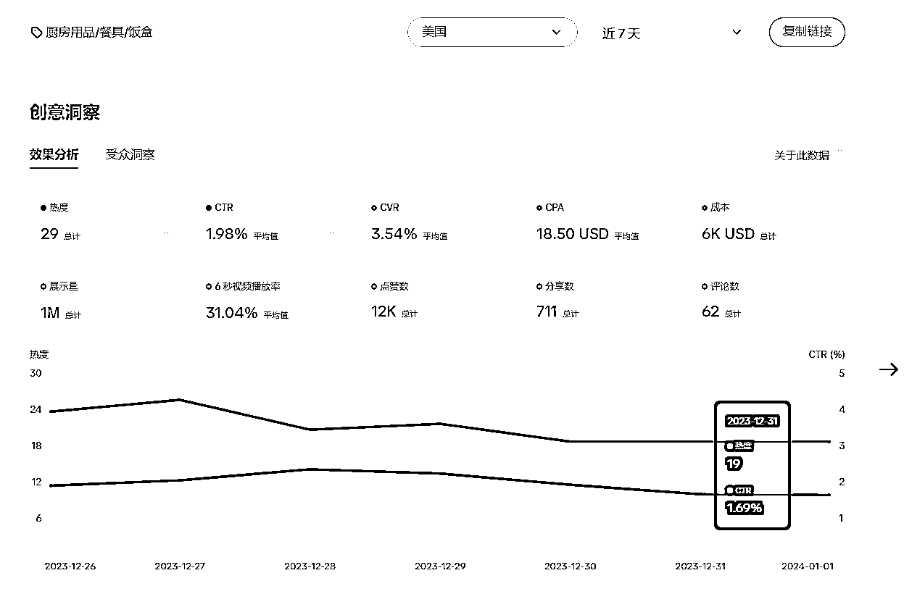

然后我去TikTok上搜了下“lunch box”这个核心词：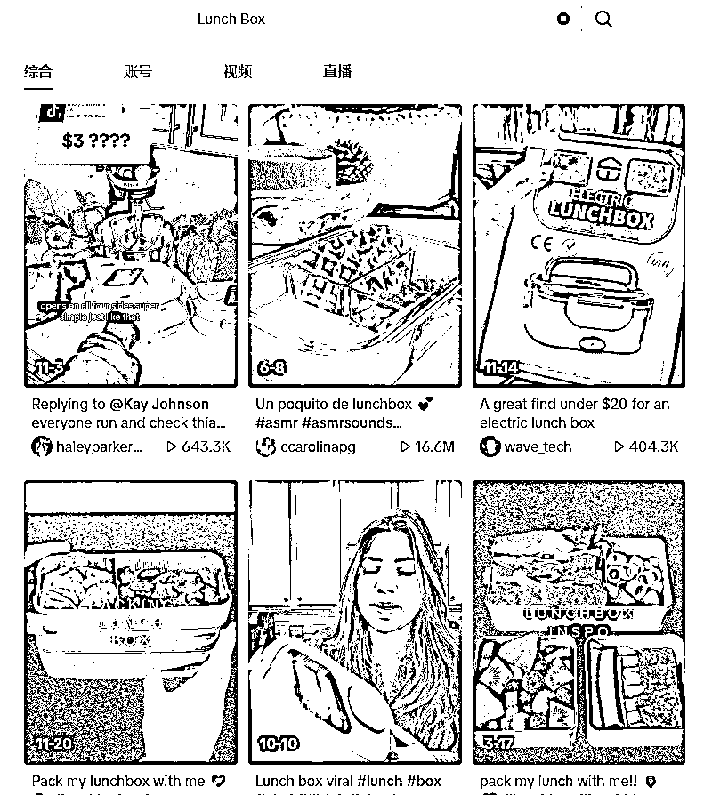

可以看到这个品类已经聚集了大量广告主，视频播放表现不错，评论区也透着很强的买买买欲望。海外用户对午餐盒的需求是实打实的，不是凭空造出来的。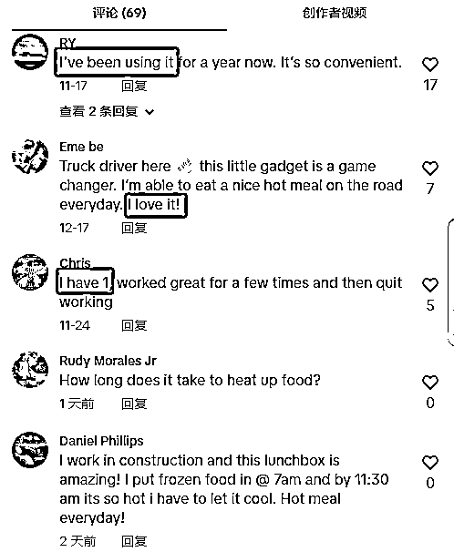

再看亚马逊，这个类目的销售热度同样在线。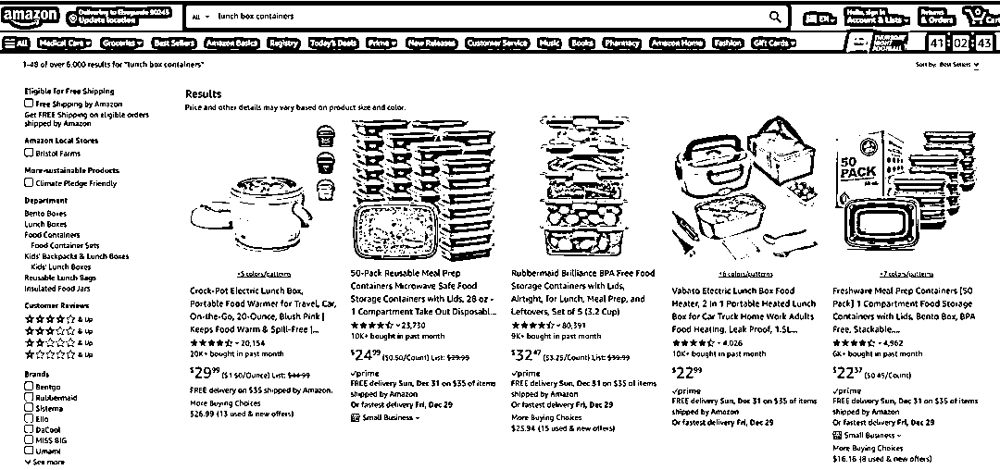

榜单排在第一的产品是一支多功能沙拉盒：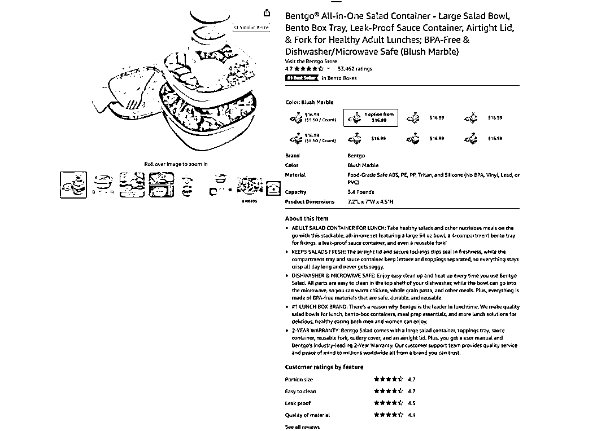

它的具体使用场景、顾客预期和购买动因，可以参考下面的截图：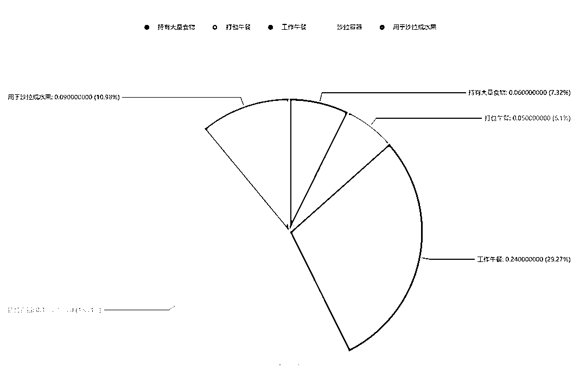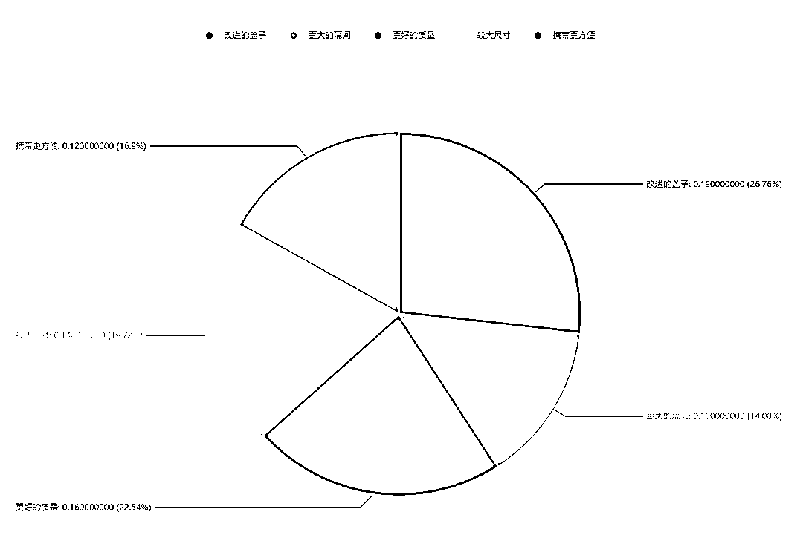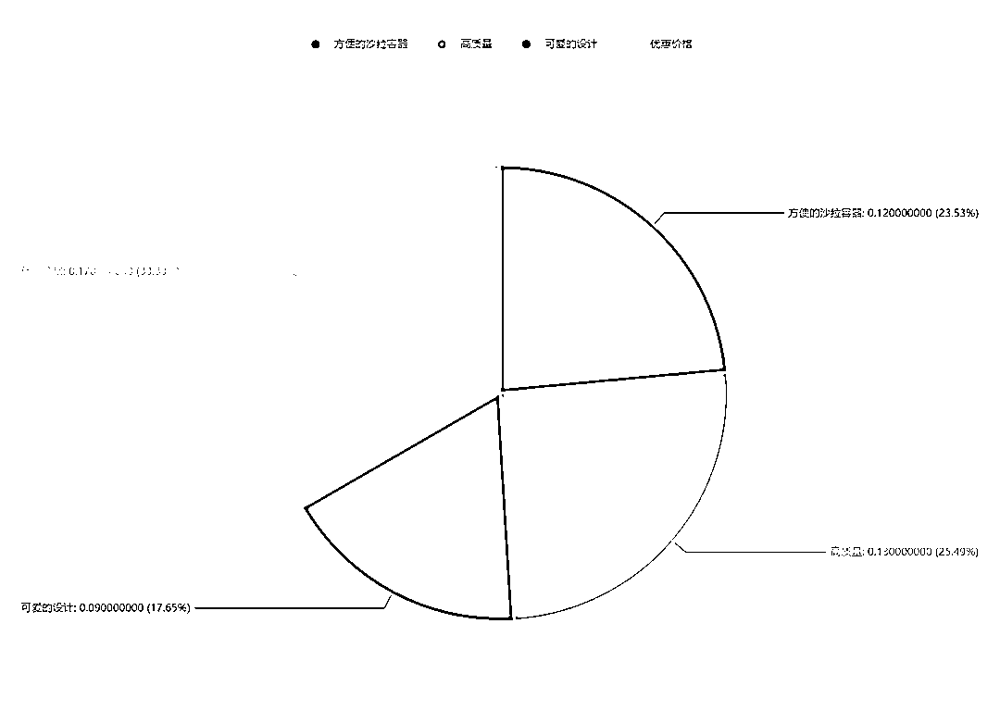

我把评论区里的高频评价做了个提炼，核心诉求无非三块：第一，喜欢刚刚好的容量，携带方便，能多装食物，还要耐用、做工好，最好设计还带点可爱感；第二，密封性必须过硬，尺寸选择要灵活，内部隔间要多；第三，随餐配套勺子和叉子很加分，清洗轻松，同时能帮自己控制饭量。可以说，这些都是选品阶段可以直接对标的机会点。如果还想看更多评论需求，欢迎点赞后私信“皮皮”获取完整整理。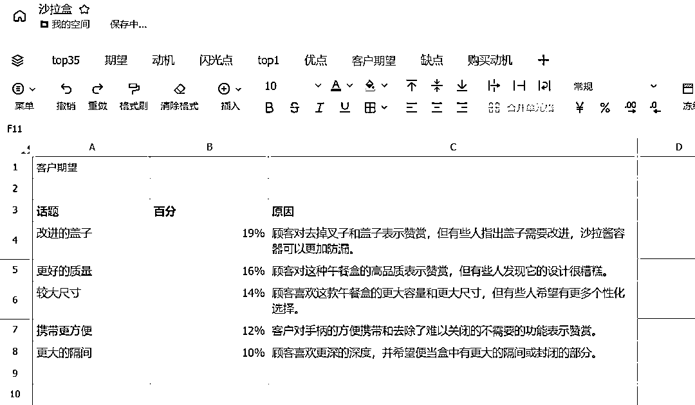

切换到Etsy再看，画风又是另一种感觉。用etsyshop.ai这一选品工具搜索，会发现大量店铺都在卖木质定制午餐盒，图案和创意选择非常丰富，主打个性化定制的差异化路线。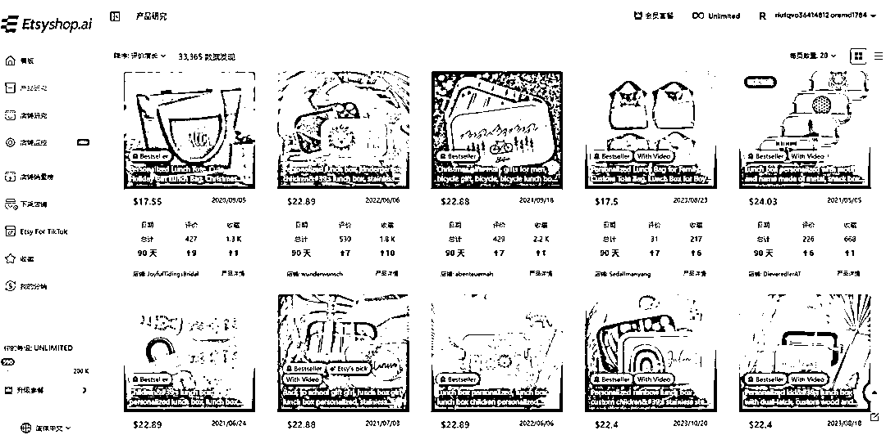

谷歌趋势也验证了市场的温度。只看美国地区“lunch box”的搜索曲线，整体相当稳定，而且每年8月都会出现一波显著爬升。原因是美国恰逢返校季，学生和家长要集中采购物资，午餐盒的需求自然被点燃。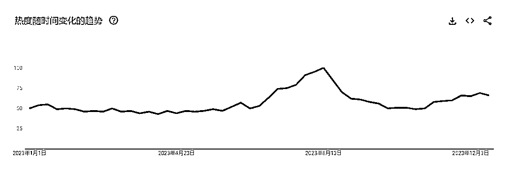

供应链端更不用说。1688上有大量午餐盒工厂与贸易商，普通款式拿货基本在5-20元人民币。想做短期测款的爆品玩家，可以直接从那些尚未开通TikTok电商的货盘拿普货测试；想长期扎根的卖家，更适合跟稳定供应商建联，甚至考虑开模定制。当然，开模成本不低，工厂那边的报价普遍在10万到20万元人民币起。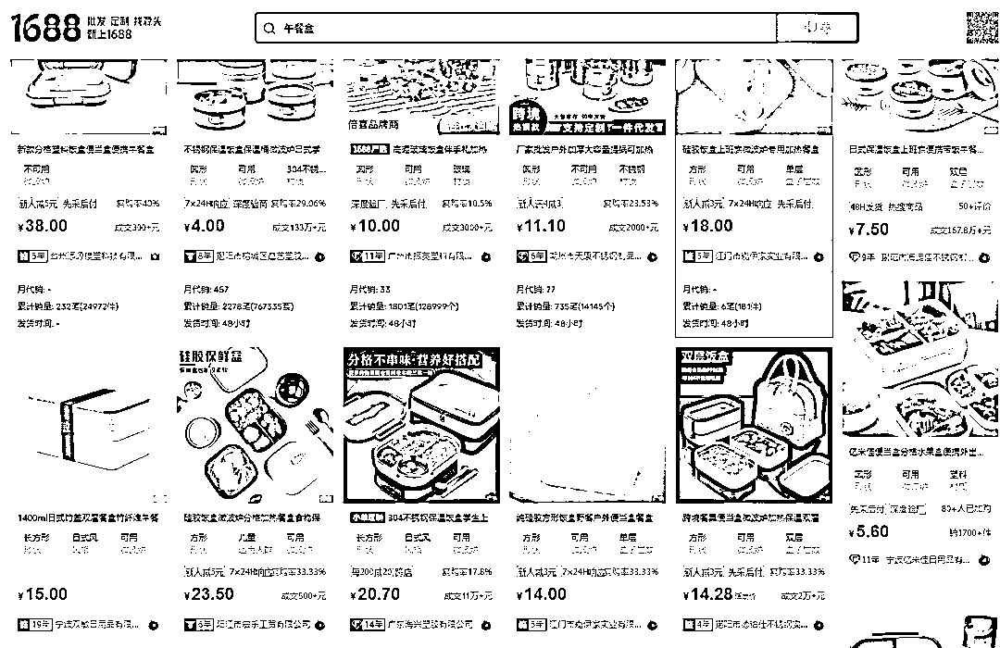

回到产品层面，午餐盒在海外的走红并非偶然。首先，海外不少学校并不供应午餐，学生需要自带午饭，低龄儿童的家长更关心餐食营养。午餐盒体积轻巧、分格明确，完美贴合了这种带饭场景。其次，海外健康饮食观念浓，许多上班族和成年人都愿意按计划吃饭，所以沙拉盒、轻食盒这类衍生品也越卖越好。第三，午餐盒是高频使用的物件，光有功能还不够，颜色、外观等个性化设计同样能戳中用户。对卖家来说，这就是微创新和品牌化可以发力的方向。

节奏上也要踩准节点。美国的返校季一般在每年7月中旬到9月中旬，是仅次于圣诞节的购物高峰，文具、电子设备、衣物乃至生活用品都会迎来大促热潮。午餐盒在这个窗口期的销量尤其亮眼，一些广告主反馈，提前到6月和7月做预热效果会更好。此外，南半球的季节恰好相反，澳洲的返校季大约在2月份，所以1月份前后也可以顺势往那边安排投放。做跨境生意，一定要学会看区域和日历。儿童返校这个大赛道里，其实还藏着许多延伸机会——饭盒、餐具、收纳盒、清洗用品等等，把爆款思路迁移过去，很可能挖到新金矿。

再往深处做一轮选品延伸。用TikTok关键词工具搜索“lunch box”，系统会自动带出“lunch bags”等相关词。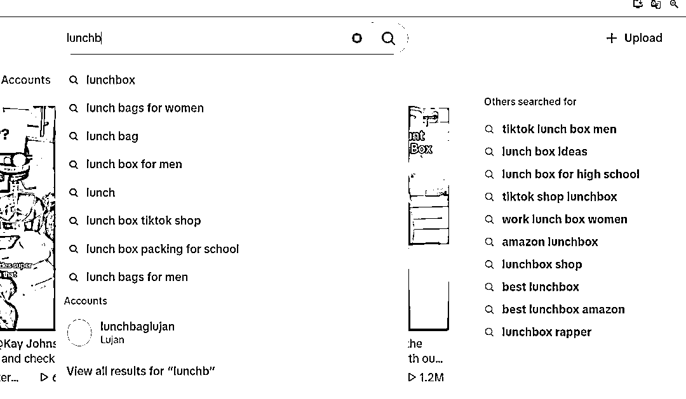

我就沿着这个线索继续调研了lunch bags的投放情况：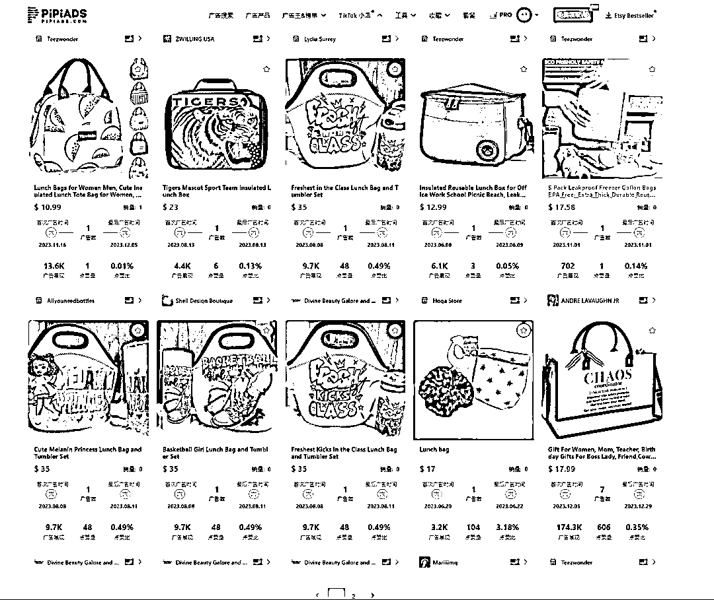

结果发现，目前入局的商家非常少，销量普遍偏低。但我没有停下，而是转去看了亚马逊的同类产品：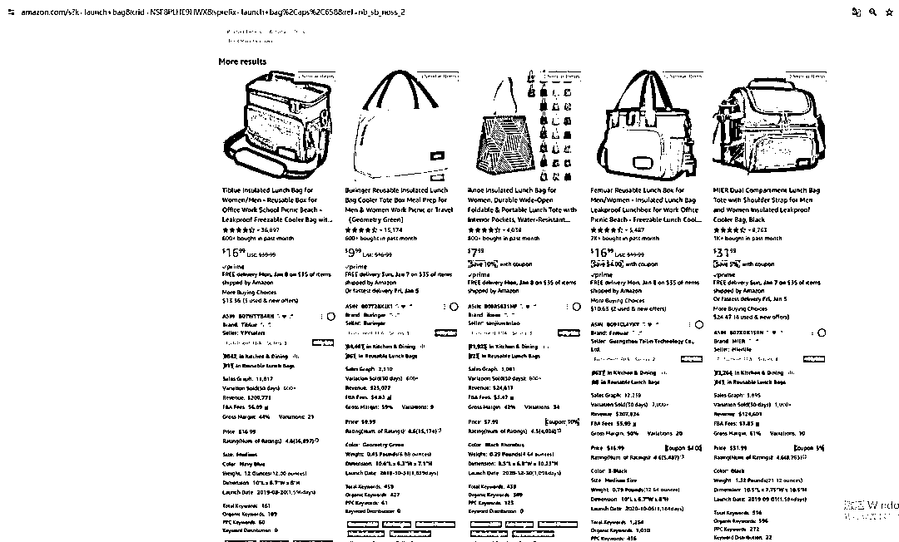

亚马逊上好多链接都卖得相当好，这就说明赛道有机会，只是TikTok这边暂时没有人在午餐袋上做出爆款。既然信息差已经找到，打法就有了：可以把午餐袋和午餐盒组个套装一起卖；也可以学Etsy的思路，加印花、贴纸做微创新，让产品更匹配TikTok内容调性；甚至先去摸一摸自然流量，探探lunch bags的真实需求到底有多少。很多时候，爆款就是从老品类的延伸中长出来的。

目前评论区暂无评论，欢迎你来说两句。