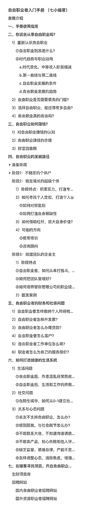

# 自由职业者入门手册

最近翻看龙哥盟的往期内容时，无意间被“自由职业转型”这个专题吸引住了。作为一个已经单干两年半的“老自由人”，读完之后只觉得句句是大实话——要是当初能早点看到这些经验，肯定能少走好多弯路。

好巧不巧，这一期我被赚钱团队邀请来担任自由职业交流航海的教练，那自然得拿出点真本事，给大家贡献些实在的干货。于是我把这个转型专题从头到尾整理了一遍，又翻阅了不少行业报告和出版书籍的资料，最后捣鼓出了这份《自由职业者入门手册》。

手册的目录已经放在图片里啦，完整正文可以点进飞书文档查看：[`mkfwp3u79v.feishu.cn/docx/Uia8dIhUxoTznXxJ2Q5cMBsxnEe`](https://mkfwp3u79v.feishu.cn/docx/Uia8dIhUxoTznXxJ2Q5cMBsxnEe)

如果觉得对你有帮助，别忘了点赞支持一下~

🛰️：rickea150，加好友时记得备注“赚钱圈友”，欢迎随时来聊。

👸号：七小的人生游戏攻略

* * *

评论区里一片欢呼，有人说“还得是七哥”，有人说“底层逻辑掌握得真扎实”，看来这份手册确实戳中了不少人的心。