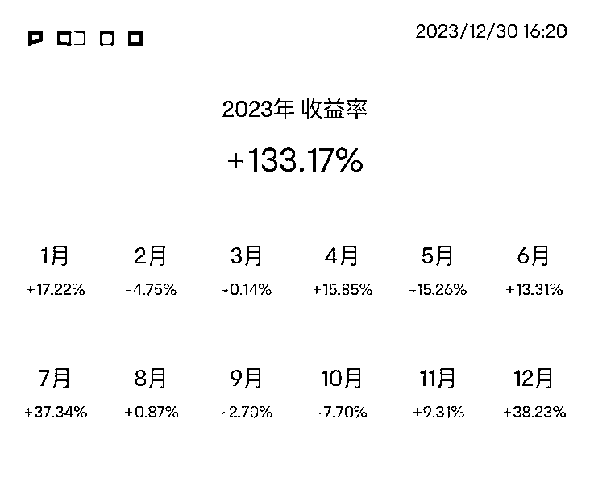
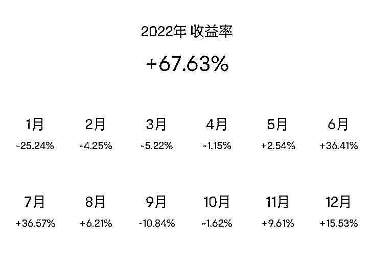
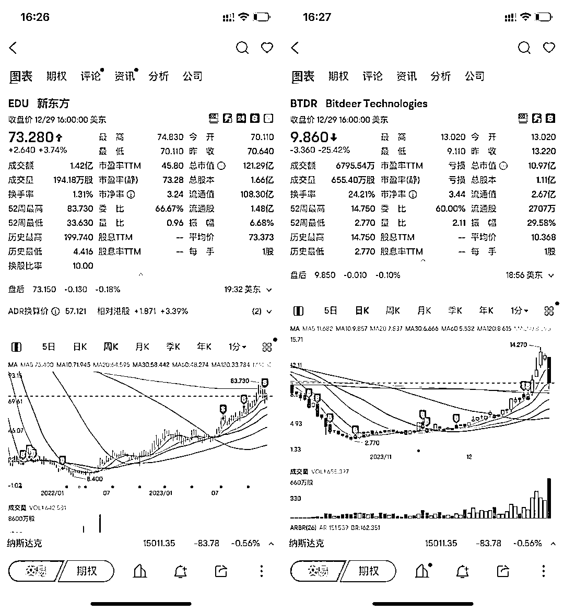

# 禅与股票投资艺术

2023年港美股收官那天，我盘了一下账：过去三年，我的收益率分别是2.47%、67.63%、133.17%。从2021年正式接触港美股算起，差不多两年半。如果你以为这是个天才交易员的故事，那还真不是——我只是一个从厌恶投资、迷信知识、依赖术数，最后走到禅修这条路上的普通人。

⚠️ 先说清楚：这篇不是主流观点，也不构成任何投资建议，所有内容都只是我个人的经历记录。从2017年到现在，我花了六年时间，经历两轮币圈牛熊，试过各种方法理论，才终于找到一条适合自己的路。

在我看来，投资是一面镜子，你内心深处的贪婪和恐惧，都会被它照得清清楚楚。我对金钱和投资的信念，可以分成四个阶段。

第一阶段：钱只能辛苦赚，投资碰都不碰。
小时候父母总说赚钱不容易，长大后见人“割韭菜”就反感，买贵一点就觉得自己不配。于是我只靠工资活着，接点设计私活也不敢报高价，不买股票、不碰投资，认定那是富人的游戏。结果存款没多少，还总爱买便宜但没用的东西。按这条路走下去，我大概会勤勤恳恳做设计，然后35岁被优化。好在2016年出现了两个变量：我误打误撞进入一家数字货币公司的人工智能部门；同时开始做自媒体。2017年，公众号“非科班设计”有了流量，看到身边朋友光广告费就超过工资，原来“只能靠工作赚钱”的信念开始松动。那年币圈大牛市，我花6000块买了人生第一个BTC；又因为在AI行业，顺手买了英伟达。理由很简单：不管未来是数字货币还是人工智能的天下，算力都是硬通货，英伟达一定会重要。命运已经把泼天富贵塞到我手里了——可我，一个都没拿住。

第二阶段：以为补上金融知识就能赢。
买了BTC和英伟达后，我很不安。虽然身处消息最灵通的行业，但因为不懂，只敢小仓位试水，一点涨跌都能让我紧张。BTC从6000涨到1.2万，翻了一倍，我却恐惧起来，加上一点政策风声，很快就卖了。英伟达更夸张，跌了10%我就受不了，马上清仓。我把问题归结为“不懂金融”，于是从2017年开始大量读书。身边也有不少知识渊博、热爱交易的朋友，判断很准，奇怪的是他们也赚不到什么钱，尤其在熊市。2021年我办好香港卡，又入职一家港美股交易所公司，虽然还是做设计，但可以光明正大地研究股票了。那年港美股和币圈都是大牛市，我还跟风买NFT，结果基本归零。混久了就会看到：圈子里大多数人都是一阵子赚、一阵子亏，理论再完美也没用，黑天鹅遍地，连美国顶级机构都暴雷，木头姐那套打法后来也让重仓科技股的公司很难受。

第三阶段：用术数去算命。
金融知识解释不了所有现象，我就开始用五行流年找规律。比如2021辛丑年，金旺，利好金融、医疗，那一年这两个板块确实火；金克木，教育属木，K12受政策打击一地鸡毛，但2022、2023是木旺流年，理论上2021就是抄底教育股的时机。于是我买了新东方。回头看，方向大体正确，但又不完全正确：新东方最低点在2022年上半年，我在最低点附近因为恐惧不敢加仓，甚至怀疑自己的判断。虽然后来新东方从最低到最高涨了10倍，我却因为买卖点没踩好，赚得不多。我还认识同时精通金融和术数的朋友，预测几乎个个准，却总有办法用骚操作亏钱。我这才意识到，想当预言家的时候，忘了自己还在棋局里，不是下棋的人，而是棋子。我们被自己的认知和信念锁死，怕得到也怕失去，动弹不得，真正操纵一切的，还是恐惧和贪婪。

第四阶段：干脆用禅修交易。
今年上半年，我在一个YouTube视频里认识了期货交易员孔令艺。他非常离谱：不看基本面、不分析数据、不打听消息（虽然全会），重仓、凭感觉，只用一部手机。结果靠禅修拿了2020年和2022年两届期货大赛冠军，几十万做到3000万。他做期货20年，修行10年，参赛只是为了检验自己的修行。他不开课，也不帮人操盘，公众号只讲修行。我后来专门把他的体系整理成了文字，大致是：世界皆是虚幻，大多数人“心随境转”，于是被欲望和恐惧锁在命运里；如果每天观照情绪和念头，并能转念，就能“境随心转”。这套话B站小红书上很多人讲得更好听，但生活过得一团糟，没有说服力。孔令艺不同，他直接用实盘连续验证了两次。他说，每个人都在想着怎么战胜市场、对抗市场，但市场根本没法战胜，到最后你会发现，你就是市场，市场如实映射你的贪婪和恐惧。2022年比赛他也是后来才拿到第一，中间回撤非常大，他的做法是让自己开心起来，状态好了再交易，并且始终坚信自己能拿第一。

我自己呢？经过前两轮熊市，我对暴跌的恐慌已经小了很多，对判断也更坚定。今年下半年逐渐卖掉新东方，开始买bitdeer，并在最低点坚持了抄底。相比去年，我能更好地处理恐惧，收益也远超去年。孔令艺的方法反直觉、反主流，但这两年我跟他有三个相似点：

1. 重仓。看准了就满仓一两只。2021年底到今年上半年，新东方长期占我九成仓位。如果信一只股票却只买一点点，等于没信。我从不因为别人推荐就买，不信就一股不碰，宁可空仓，信就all in。买一堆股票分散风险，很多时候只是分散了收益。

2. 直觉。尽量通过冥想、禅修把脑子放空，然后跟着直觉行动。这个状态能让人摆脱恐惧导致的骚操作，而且直觉经常比逻辑更早看准方向。举个例子：今年下半年我逐步减掉新东方，换成bitdeer，但到12月还留了三成。12月21日那天，我突然觉得不能再拿了，于是当天全部清仓，换进bitdeer。结果第二天起，bitdeer连续三天每天涨20%。最后一个交易日回撤25%，但我本来就不做短线——新东方拿了两年，bitdeer也是在等BTC减半周期。我能把握的是长周期趋势，不是每次涨跌，所以不动最好。

3. 富足。文章开头说早期没抓住机会，本质是匮乏。匮乏只会制造更多匮乏，你不可能一边觉得自己不配，一边等钱来找你。于是今年我搬了家，住进有大落地窗的阳光房，对自己慷慨起来，去吃贵价餐厅、旅游、看风景。神奇的是，我对自己越好，生活就越回馈我开心；我花钱最多的那个月，投资收益也是最高的。这不是鼓励盲目消费，而是想说：每个人都值得最好的，值得被爱，你得先相信这一点。钱会流向不缺钱的人。

总有人说这两年市场极度低迷，低迷是共识，也是一种自我实现的预言。反过来也一样：你心里富足还是匮乏，最终都会如实写进账户里。市场什么都不是，它只是你的镜子。

评论区里，有人感叹“神奇”，有人说“需要很高的能量”，有人复述了那句“市场什么都不是，它只是你的镜子”，也有人分享自己去年港股亏了85万。谢谢这些回应，愿我们都能在投资中照见自己。

