# 前两年猛赚的抖音推广小程序，现在还有机会吗？

最近总有人问我这个问题。我的看法是：机会依然存在，但躺赚的时代确实过去了。

先别急着关掉文章，看完下面这些，你也许还能在夹缝里找到属于自己的一杯羹。

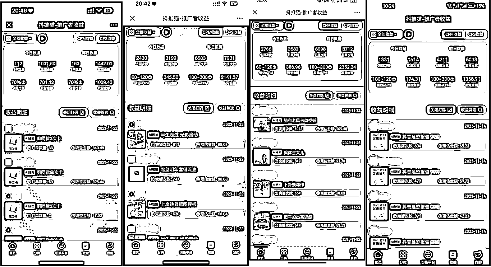
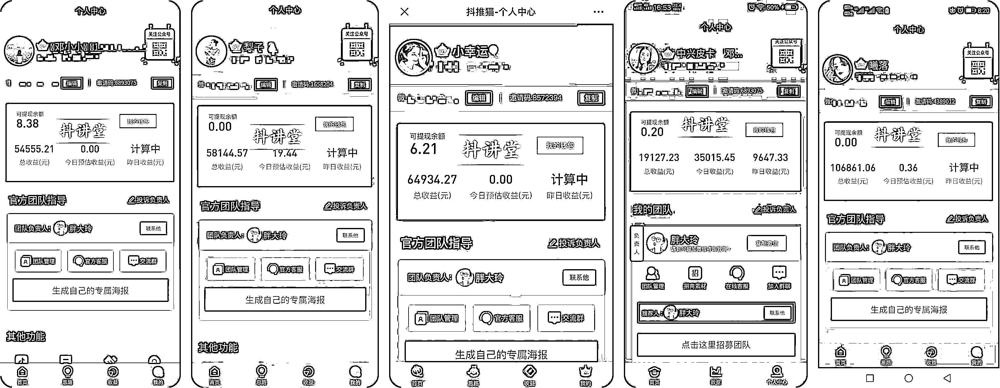
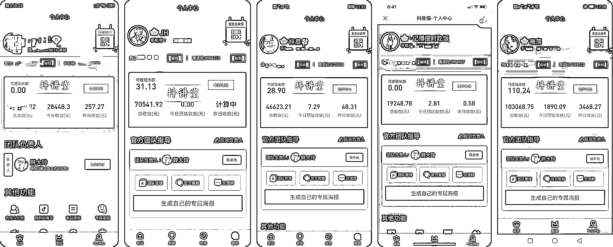

先简单介绍一下自己。我叫胖大玲，混短视频行业五年了，做过抖音IP知识付费、小游戏培训、小程序培训，带过一支十万人以上的小程序推广团队，也靠这个项目赚到了人生第一个一百万。

小程序这个玩法，在市场上已经存在三四年了。很多人一听说做了这么久，第一反应就是“肯定快凉了吧”。但现实是，现在依旧有不少人在这个项目里稳定赚钱。抖音、快手、视频号这些大平台，都把小程序广告当成了重要的收入来源。你说，它们会轻易砍掉一块能赚钱的业务吗？

当然，比起前两年，现在确实卷了很多，平台管得也更严了，想轻轻松松赚得盆满钵满，基本不可能。但另一面，平台对小程序的扶持力度一直在增加，流量给得更多，激励政策也时不时冒出来。对新手来说，这依然是一个门槛不高、启动资金轻、项目也稳定的入场机会。

这时候入局，跟以前比有什么不同？其实也有几个好处：

- 当初跟风的大批人早就撤了，现在坚持下来的竞争者反而少了；
- 前面积累了大量爆款案例，拿过来拆一拆、重组一下，就能做出新爆款；
- 小程序平台对市场热点越来越敏感，产品更新迭代很快，根本不愁没有东西可推；
- 平台规则越来越规范，变现通道反而更靠谱了；
- 用户早被市场教育过了，对小程序测试、互动这类玩法的接受度，比前两年高了很多。

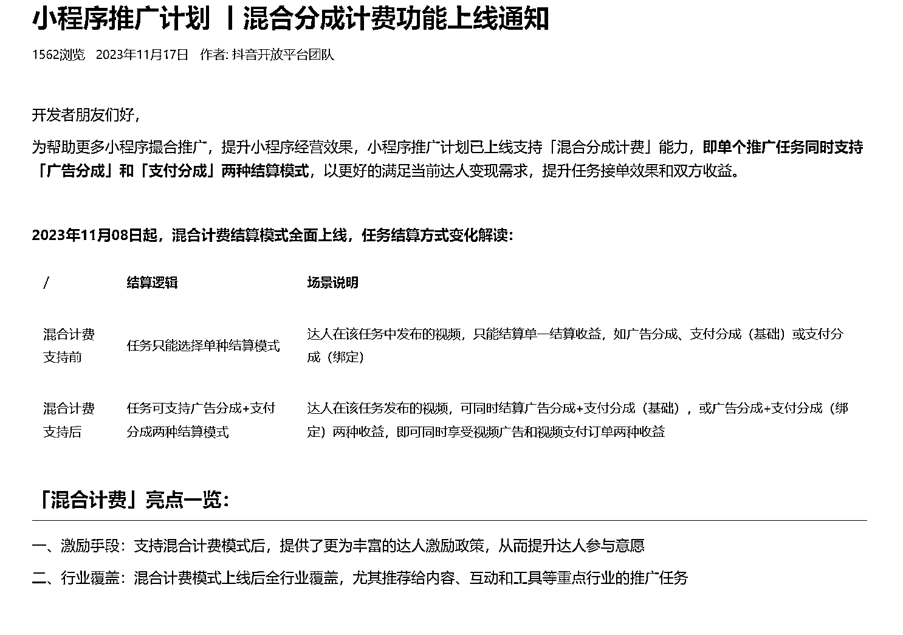

说白了，小程序推广和小说推文是同一类逻辑，本质就是CPS分成：你拍短视频挂上小程序链接，用户点进去产生消费，你就能拿到最高90%的佣金。另外还有一种广告分佣模式，叫CPM，用户在小程序里看广告，你也能分到钱。

在这个项目里，你“卖”的其实并不是小程序本身，而是小程序里面的广告或付费功能。小程序只是一个入口，它可能裹着娱乐测试、答题互动、图片生成、功能服务、小说、短剧等各种外衣。

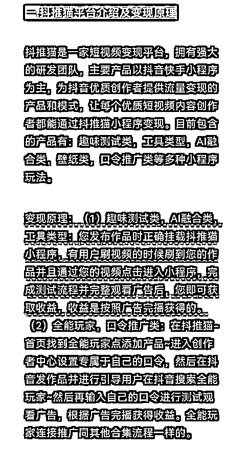

那小程序到底是啥？简单来说，就是一种不用下载、不用安装的轻量应用，在平台内部直接能用。它有几个特点：不需要安装、跨平台、体积小、更新及时、还能根据设备信息提供个性化服务。你可以把它理解成抖音、快手、🛰️内部的一个小生态，开发者在这个生态里提供游戏、工具、社交互动等各种玩法。

这个项目适合谁呢？上班族、宝妈、大学生都可以尝试。投入成本主要是一些平台的会员费，每天花上一两个小时就够了。风险主要集中在账号运营上，比如操作不当被限流，解决办法就是多学运营技巧、遵守平台规则，基本不会出大问题。

那它在各个平台上是怎么展示的？其实不太一样：

抖音上，发视频时可以在左下角挂一个链接入口，用户点击就直接进去了。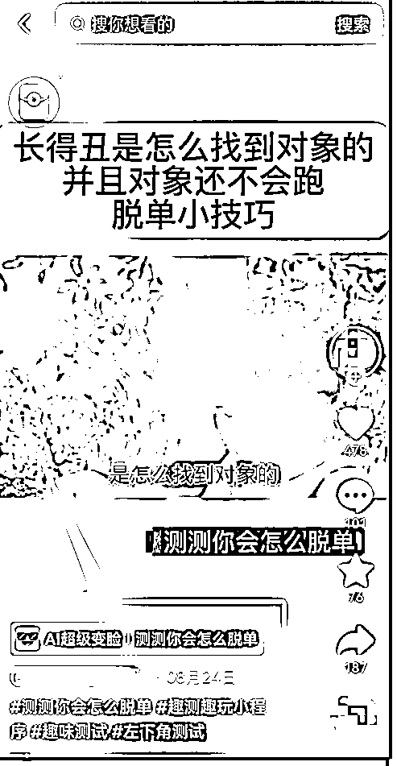 也可以在视频里引导用户搜索小程序名称，再输入专属口令才能使用；口令可以放在评论区，也可以私信或回复粉丝。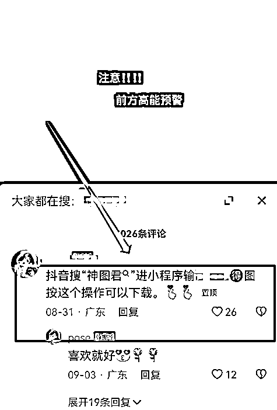

快手的玩法和抖音差不多，要么挂链接，要么在评论区引导搜索。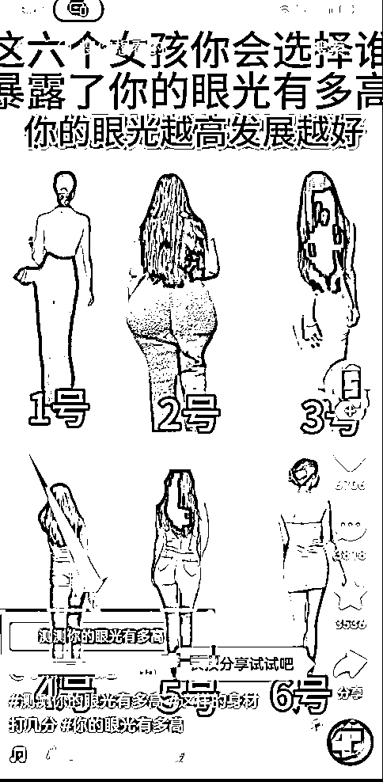

视频号稍微麻烦一点，需要先授权给👸号，发视频时挂载👸号的文章链接，用户从评论区找到链接点进去；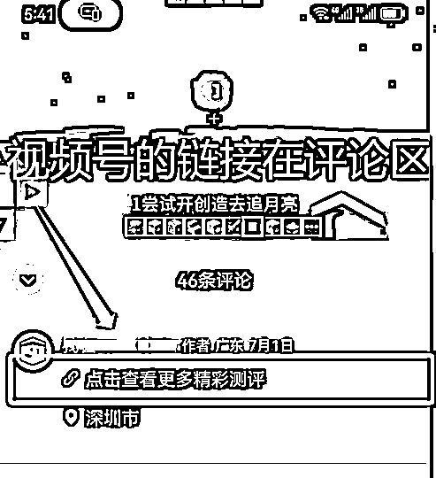 也可以引导用户去🛰️搜索小程序名字加专属口令进入。

接下来聊聊大家最关心的：收益怎么算。

先说CPS付费分佣。就是用户每真实消费一单，你按佣金比例拿分成。比如产品定价100元，佣金比例是10%，那你推成一单就能拿10元。具体比例得看平台和产品怎么设定。

举个例子，抖推猫平台在抖音渠道的《风云定制》系列，CPS分成比例是70%。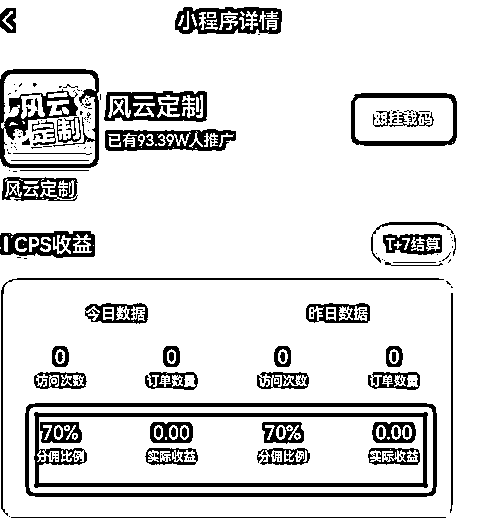 这个系列里有几十款产品，拿《头像定制》来说，制作一次要6.8元，推广者能拿到4.76元。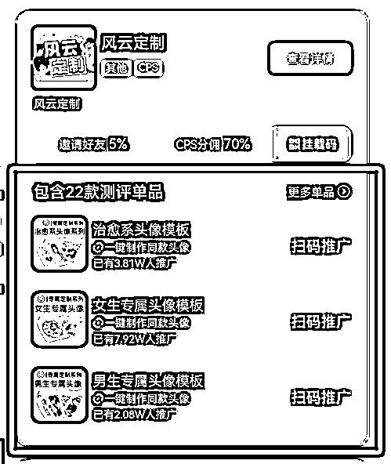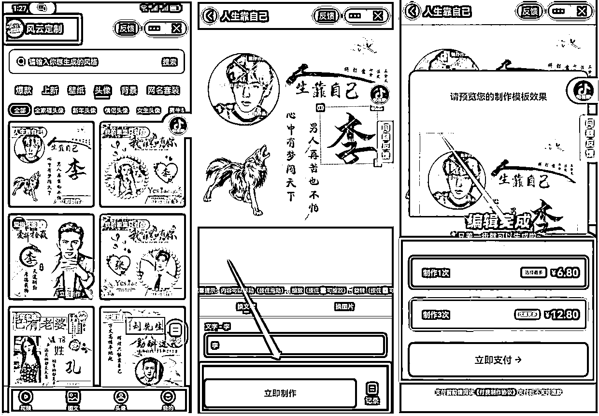

再看快手渠道，《照片工具箱》系列的CPS分成比例能达到90%，里面产品有几百款，计算方式都是一样的。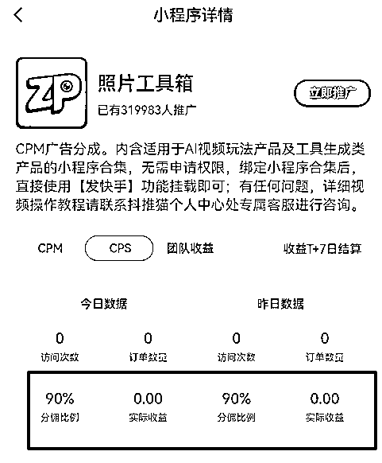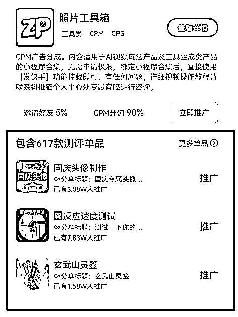

🛰️视频号渠道也有对应的产品，收益在后台都能看到。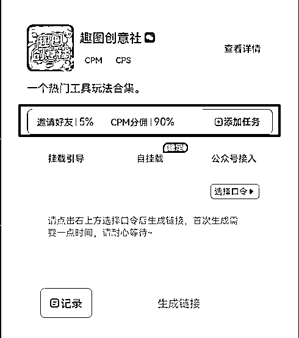

再说CPM广告分佣。用户不需要付费，但在使用过程中会看到激励视频广告。广告每展示一千次，平台就能获得一笔广告费，推广者按比例分成。这里的ecpm就是千次展示收益，平台一般会预估次日的ecpm，你只要知道大概怎么算就行。

还是以抖推猫为例，抖音渠道的《AI随拍》系列有4000多款产品，推广任意单品都能拿到90%的CPM分成。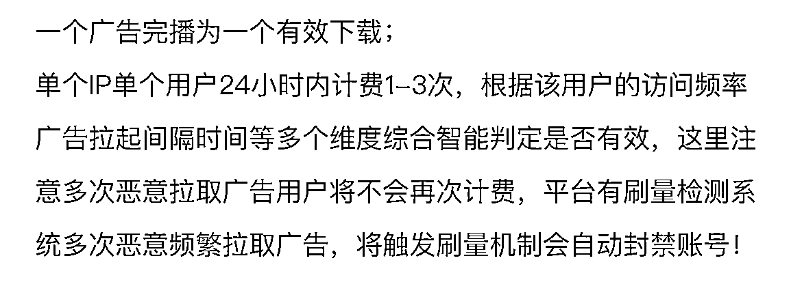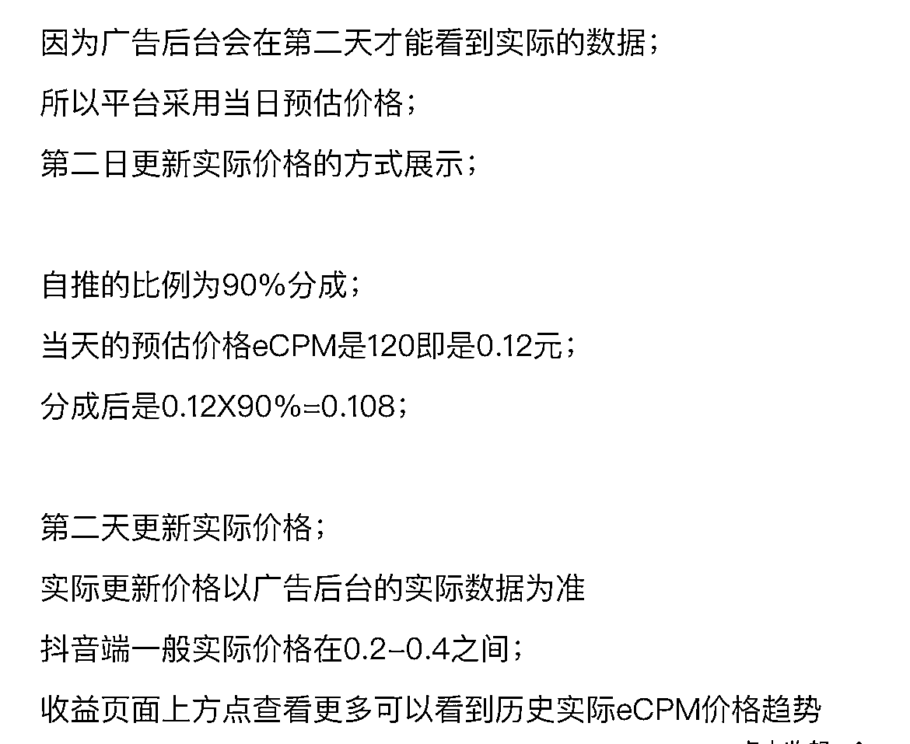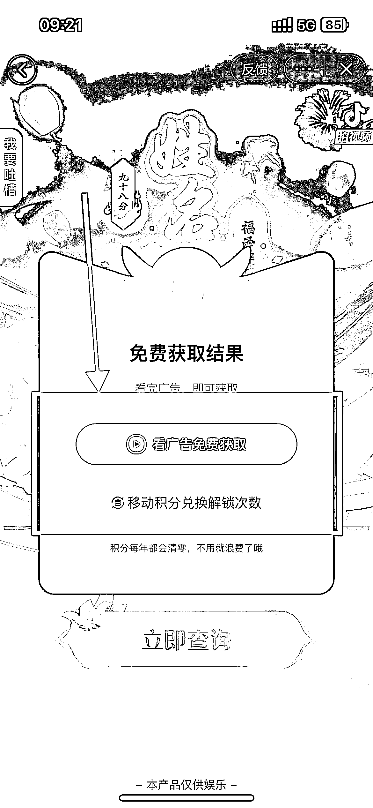 如果当天预估ecpm是120，你就能根据自己的访问量推算出收益。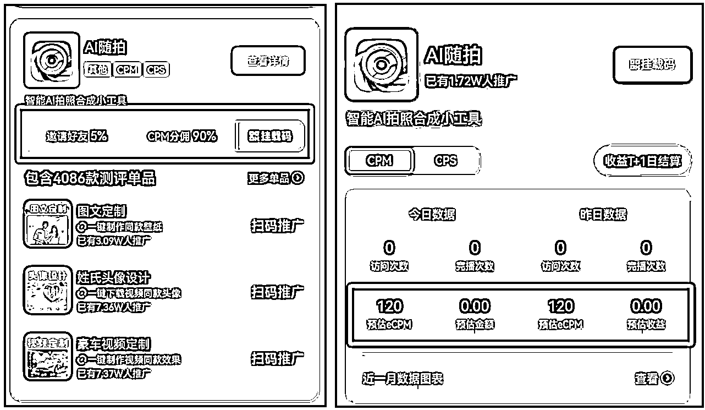

快手渠道的《趣测趣玩》同样给90%分成，不过快手的ecpm通常没有抖音高。至于选哪个平台，要看你的视频风格更适合哪边的用户调性。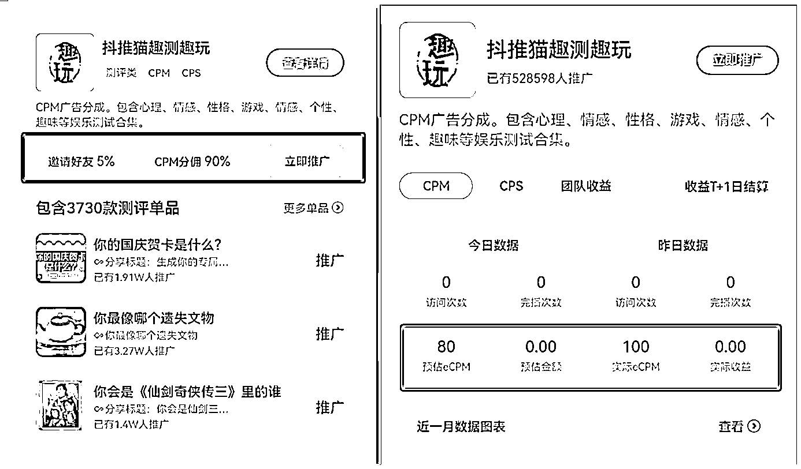

🛰️视频号渠道的分成比例也是90%，后台实际ecpm经常能到200到300，相当不错。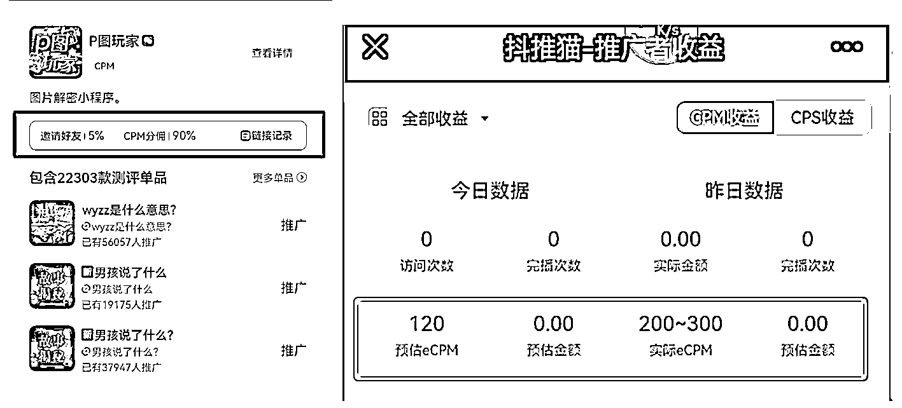

关于结算周期，主要看变现方式和平台规则。常见的有T+1、T+7、T+30。以抖推猫为例，CPS是T+7，CPM是T+1。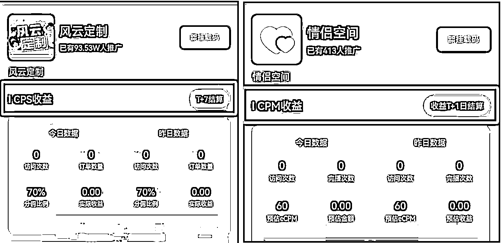

聊完收益，再来说说为什么我建议新手可以试试小程序推广。原因有这么几个：

第一，门槛低。不需要实名认证，0粉就能推广，不用像带货或小游戏那样要求粉丝量或押金。

第二，视频数量没有上限。平台允许的情况下，每天可以发很多条挂载小程序的视频。

第三，不挑人和账号。不管你是新手小白还是剪辑老手，哪类账号都能做。要是找不到跟自己垂直相关的小程序，还能跟平台申请定制专属产品，当然前提是你的账号有一定影响力。

第四，作品很容易上手。素材其实就来自小程序本身，截个屏做成图文，或者剪几段影视剧混搭，都能发。比如有人把《测试前世身份》的界面截图直接做成图文，挂上链接就能发。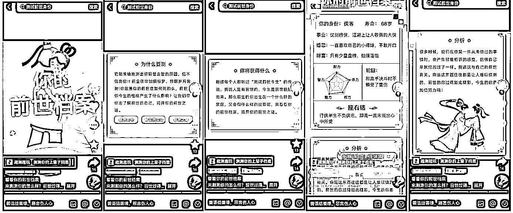 还有人用明星的电视剧画面混剪推广《AI查看你的古代身份》，画面跟产品放一起完全不违和。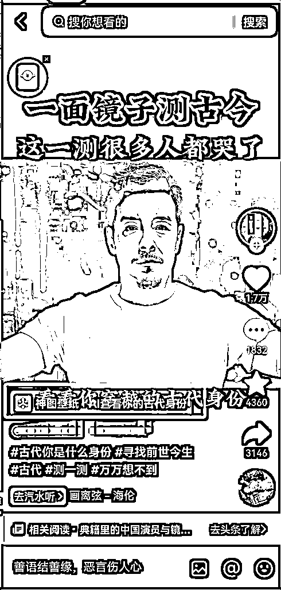

第五，消费群体很广。小程序产品覆盖动漫、趣味、颜值、塔罗、游戏、心理、性格、星座、穿搭、影视、情感等几十个分类，10到45岁的人群都有可能被吸引，只要内容引导到位，转化并不难。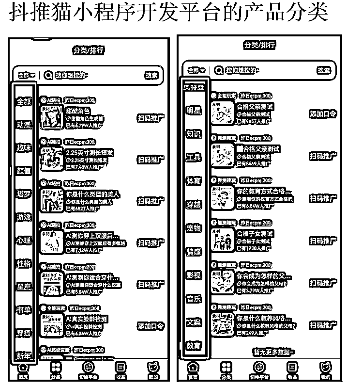

第六，平台模式友好。很多小程序平台都有邀请分佣制度。拿抖推猫来说，你自己推广产品能拿90%分成，邀请来的人推广了某个产品，你还能额外拿他收益的5%作为奖励。想单干可以，想组团队搞矩阵也没问题。还有更高阶的合伙人制度，就看业绩和平台政策了。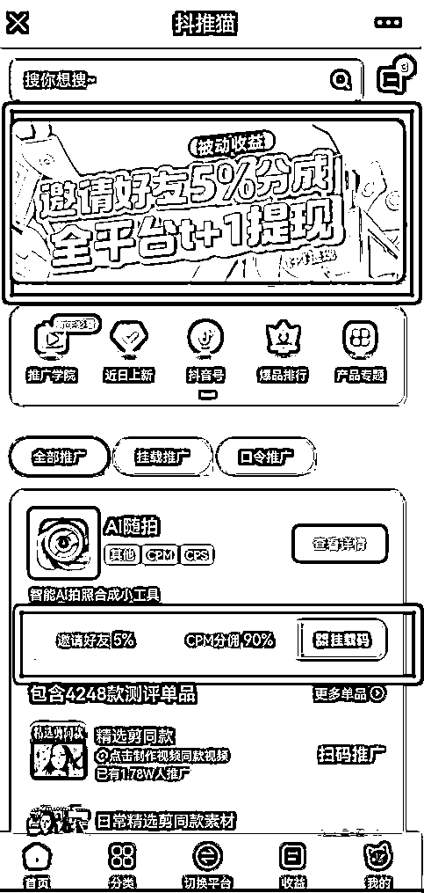

第七，产品转化率高。只要视频内容和小程序名称相关，在文案里点出用户需求，再强调“免费使用”，粉丝的点击意愿就会高很多。免费的东西，天然就有吸引力。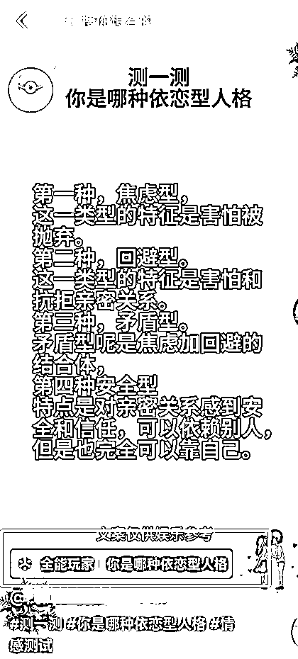

第八，佣金分成高。抖推猫的CPM分成能到90%，比小游戏还高；CPS分成也能到70%，比一般带货的分佣也不差。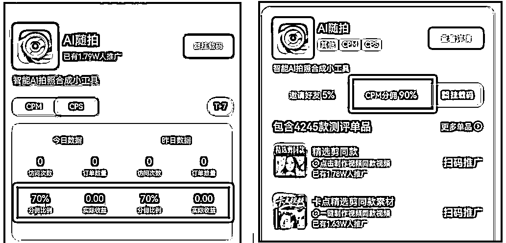

第九，平台背书强。抖推猫和抖音小程序官方有战略合作，视频自带推荐，链接不容易掉，转化持续稳定，还可能有官方精准推流。在抖音官方平台上，光相关视频就有99个，感兴趣的可以自己搜。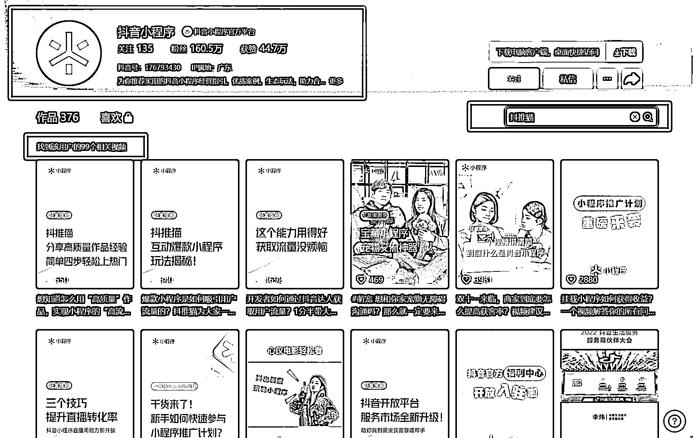

第十，结算快。很多产品支持次日或七天到账，现金流体验很舒服。

总的来说，小程序推广不是一个能让你一夜暴富的项目，但它胜在稳定、低门槛、可复制。如果你正在找一个能赚点零花钱的副业，不如先从一个小号、一条视频开始，跑通流程后再慢慢放大。平台还在给扶持，机会也还在，就看你能不能抓住。

小程序变现，最让人舒服的一点就是钱回得快。CPM 分佣当天跑完数据，第二天就能提现；CPS 结算也超不过七天。可要是转去做抖音小游戏或者直播带货，回款周期一下就长了，还得应付退货问题。两相对比，这个项目的资金流动性和风险控制都友好得多。

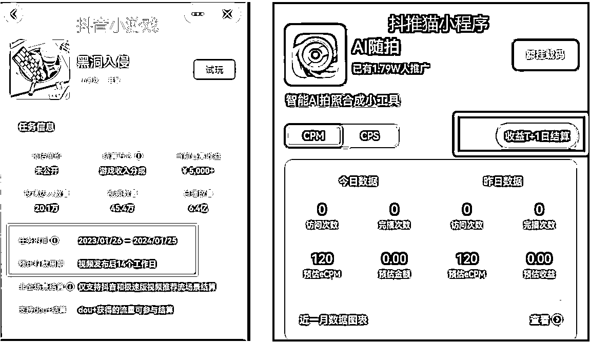

**（5）除了亲自推广，还有哪些路子能靠这个小程序业务赚钱？**

别以为只有自己发视频拿佣金这一条路，玩法其实不少。

**1. 自己做内容赚分佣**
只要你的剪辑和脚本能力跟得上，完全可以自己把整个流程跑通。常见打法有两种：
（1）专注一个账号，源源不断地产出视频，分发到抖音、快手、视频号等平台，靠数量换概率。
（2）做矩阵号。这个项目对账号是否实名没有硬性要求，多开几个号同时铺量，覆盖面自然更广。

**2. 拉人组队，拿邀请奖励**
目前几乎所有小程序平台都有邀请分佣机制。拿抖推猫来说，你自己推广能拿 90% 的分佣；一旦你邀请的人也开始推广某个产品，他拿 90%，平台还会额外给你这笔单子 5% 的 CPS/CPM 奖励，后台数据都能核对。自己单干增长是线性的，发展团队则是复利。这 5% 看着不多，可团队规模上去后，哪怕每天只有一半的人在爆单，累计下来的收益也很夸张，再往上还有合伙人制度等着你。

**3. 收学员赚培训费**
每个成熟项目到最后都会出现知识付费。把跑通的闭环整理成课程，定价可以设 299、399、599 甚至 1980。收学员既是知识变现，也是对项目价值的认可。而且培训体系和邀请奖励可以联动，两条腿走路。到底做哪个环节，看自己兴趣和擅长就好。

**（6）新手想入局，哪些小程序平台值得选？**

我亲测过的几个平台，按体验排序推荐：

**1. 抖推猫**
优势：老牌玩家，从 2019 年就开始服务短视频创作者，产品种类多，迭代速度快，能紧跟热点，和抖音小程序官方有深度合作。
门槛：基本零门槛，不要求粉丝量，也不看账号新旧，注册就能干。

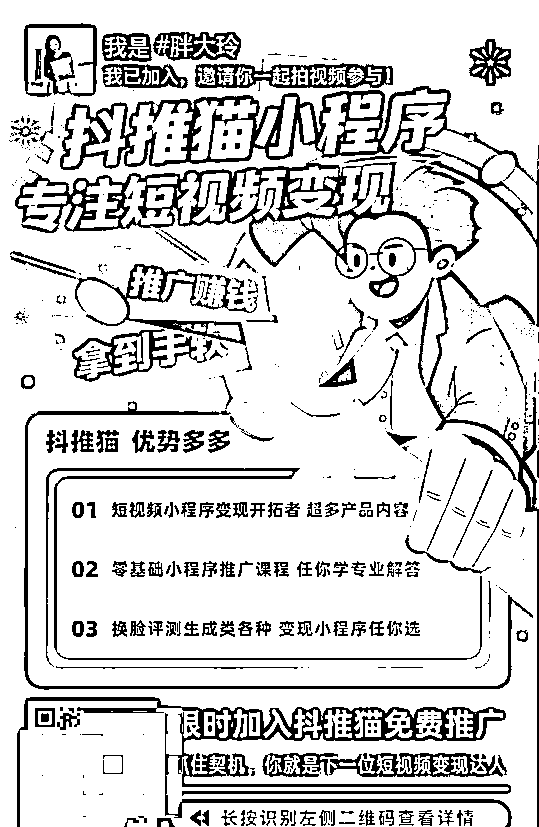

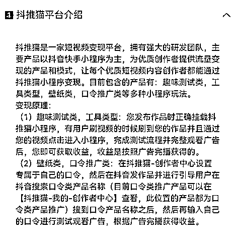

**2. 神图君**
优势：产品设计新颖，教程体系完善，客服态度好，细节体验挺到位。
门槛：同样零门槛，对账号无任何限制。

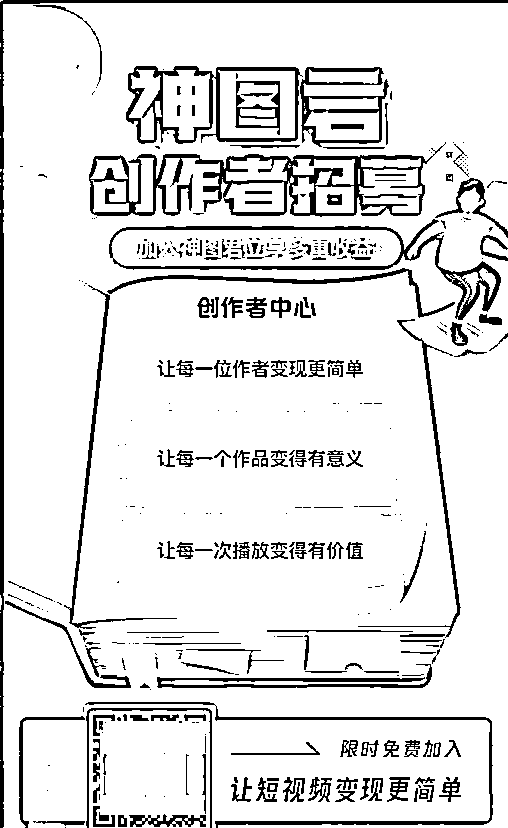

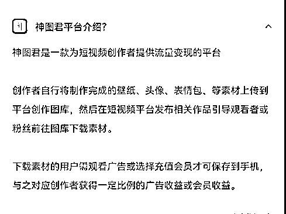

**3. 抖音小程序推广计划**
优势：抖音官方背书，权威性强。
门槛：需要粉丝量超过 1000。

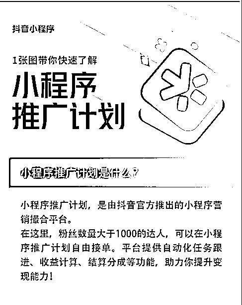

如果粉丝还没到 1000，可以先用抖推猫或神图君练手，边赚边攒粉，等到了 1000 再解锁官方渠道，选择面就大了。

**4. 创作猫**
优势：创作工具丰富，变现渠道多，还有大量短视频课程和灵感素材。
门槛：部分高级功能需要买会员。

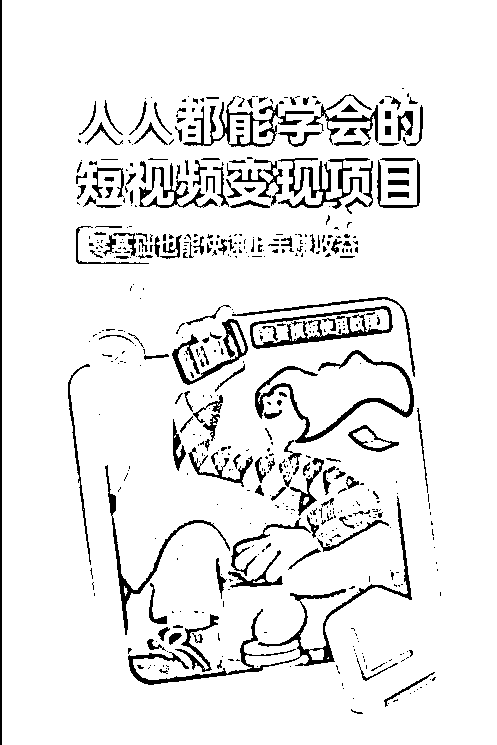

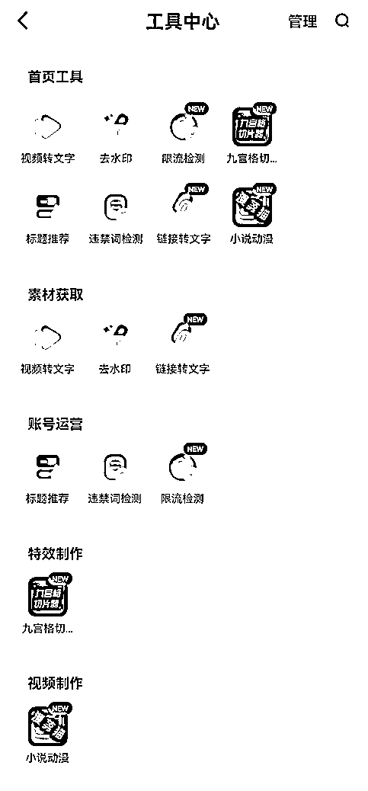

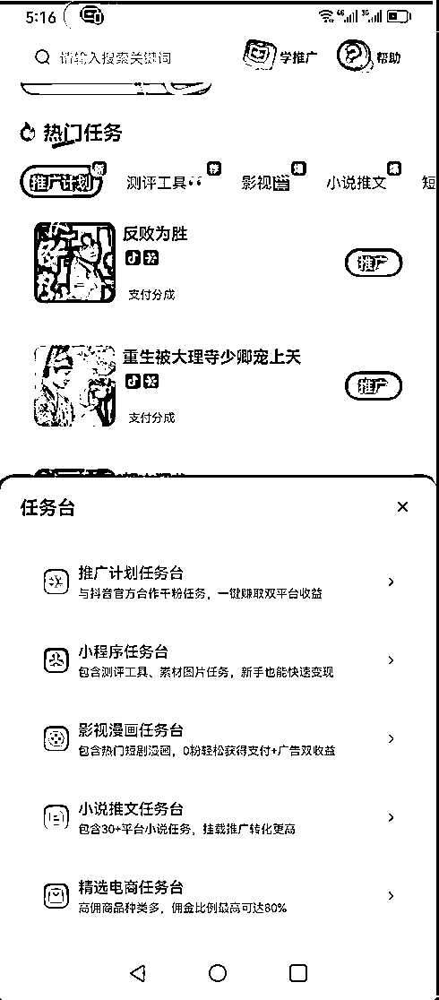

# 三、项目实操全流程

**开工前的准备**
1. 心态先放稳，短视频这事急不得。
2. 一部手机就够，每天抽 1 到 2 小时。
3. 准备抖音、快手、视频号账号，新号老号都行。
4. 注册一个推广平台：抖推猫、神图君、创作猫任选其一。
5. 下载剪映或其他剪辑软件。

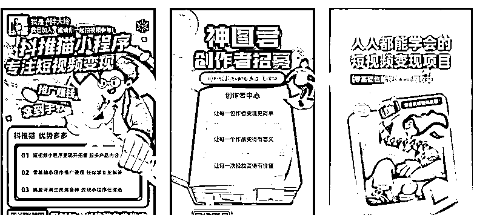

**实操一：注册平台，先把后台摸透**
第一步：申请一个抖音号（或快手、视频号），把它作为引流的窗口。
第二步：选好平台后立刻注册，因为以后的提现、收益查询都得靠它，这也是你的“选品中心”。
这里多说一句：注册完别急着发视频，自己把后台每个角落都点一遍，平台内一般都有入门教程，跟着走一遍就能懂。以抖推猫为例，官方有图文指引。

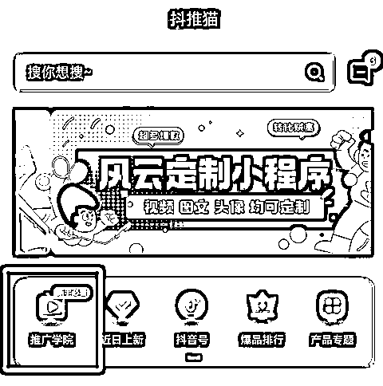

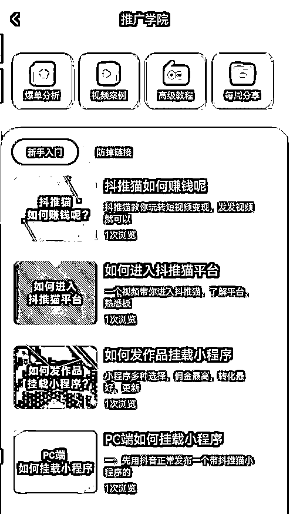

第三步：在平台里绑定你的抖音号，按提示操作就行。这一步直接关联收益，千万别马虎。

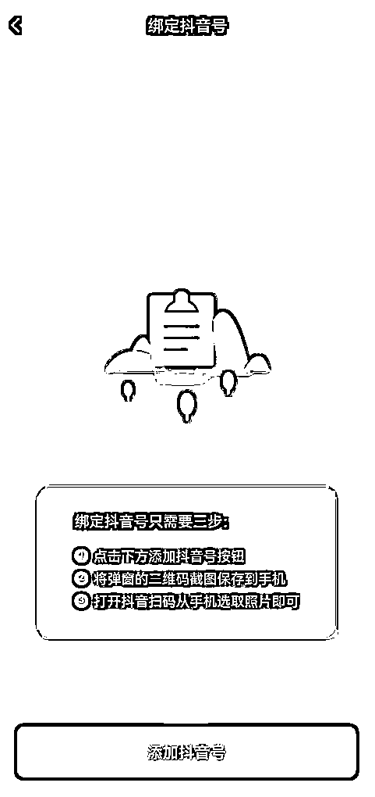

第四步：提前搞清楚收益怎么看、提现怎么操作。提现时根据平台提示绑定银行卡即可。

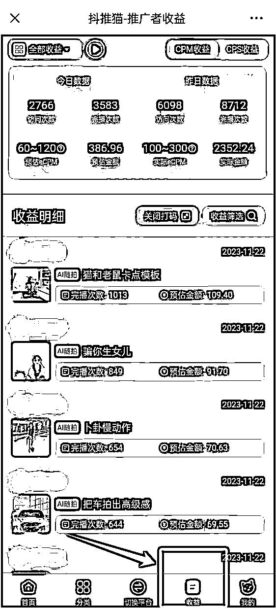

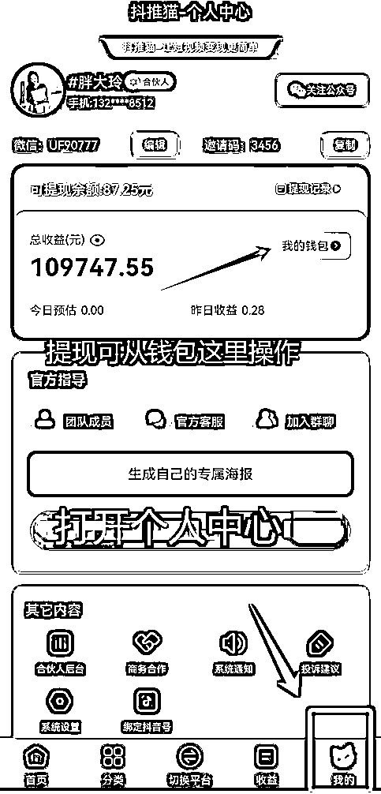

**实操二：先锁定爆款，再给账号定方向**
后台熟悉之后，新手的目标很纯粹——推广产品。所以先研究平台上哪些小程序好卖，再反过来决定账号发什么内容、走什么定位。可以参考当下热门排行榜里出单猛的产品，大量找对标视频，先模仿后超越。

**找爆款的方法一**：打开抖推猫首页的“爆款排行榜”，看看那些数据好的产品都有什么规律。

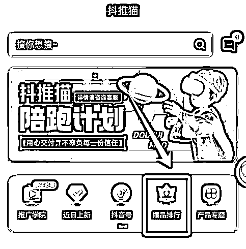

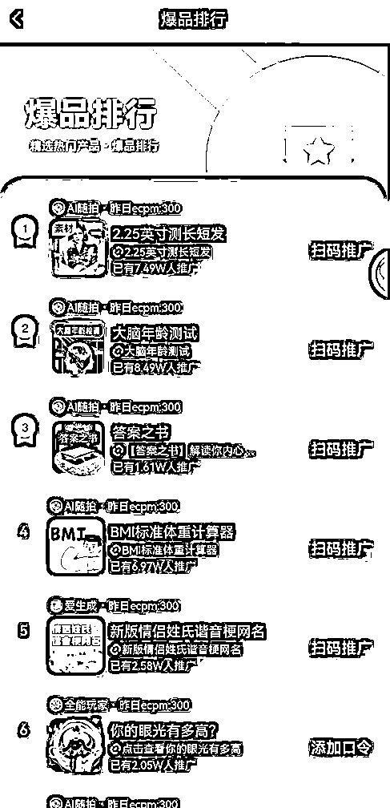

**找对标作品的方法**
1. 在抖音搜产品名，比如“2.25英寸测长短发”，在综合页或话题页都能看到同行的爆款，按发布时间、时长和风格筛选出合适的，学着做混剪就行。

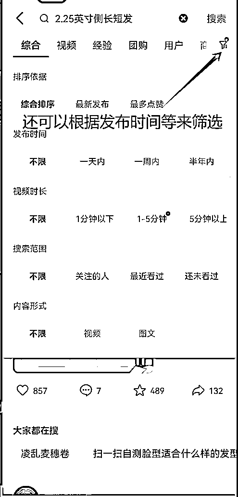

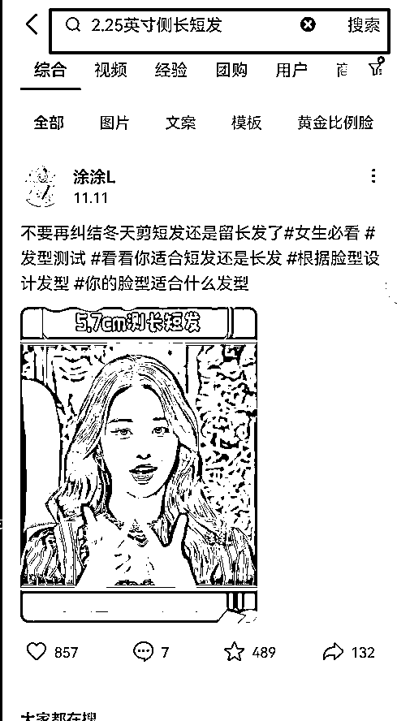

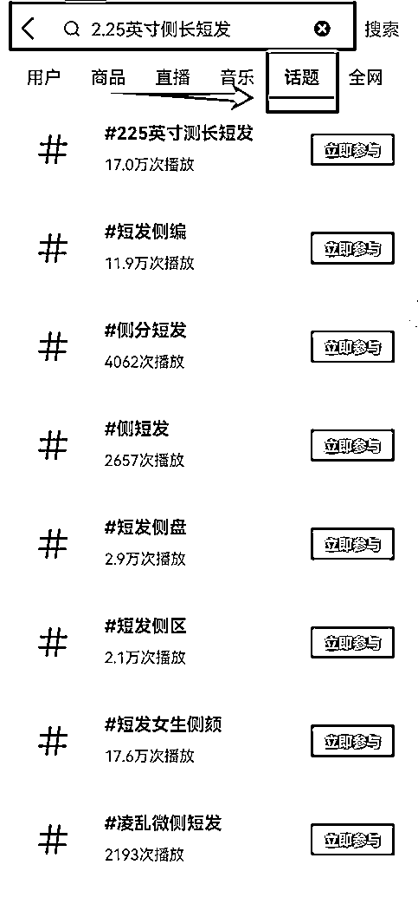

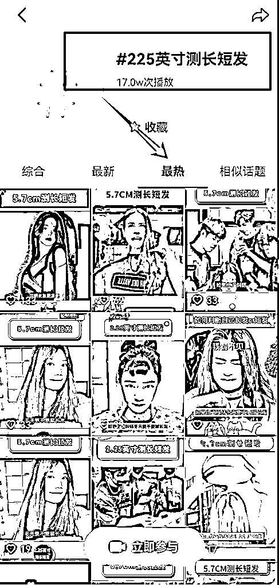

2. 多刷抖音、头条、知乎、🧣的热点榜，看有没有能对应上的小程序产品。这个需要慢慢培养网感，做久了自然有直觉。

**素材哪里找？**
追热点时，直接在各大平台收集相关素材，再用剪映混剪，这样容易蹭上热点流量。

也可以先在平台上挑一个想推广的产品，再去别的平台搜相关素材，剪完挂载即可。

**账号定位**
这个项目定位别搞复杂，按产品分类来定账号方向就好。

**实操三：剪出一条能打的视频**
素材、去水印、混剪这三步是基本功。去水印可以用“轻抖”这类工具；混剪时多做去重处理，比如蒙版、抠图、特效、贴纸、滤镜、关键帧、画中画等。剪映的基础操作在 App 或抖音上都能学，熟能生巧。要提升混剪能力，推荐看《剪辑特训航海手册》（[https://search01.shengcaiyoushu.com/docx/STTDdDfX0osaamxXIr7cErS3nkf](https://search01.shengcaiyoushu.com/docx/STTDdDfX0osaamxXIr7cErS3nkf)），尤其是电脑版。

剪辑流程一句话：找素材 → 去水印 → 导入剪映做各种去重处理。平时多刷同行作品，保持手感。

**实操四：发布时挂上小程序链接**
抖音发视频时挂上链接就行，快手也能同步发并挂载，逻辑一样。

**实操五：发完之后别晾着**
视频发出去只是开始，还得主动运营才能推上热门。爆单的秘籍，核心就是评论区运营。

**第一步：自己造槽点。** 视频发布大约 15 分钟后，用小号去评论区留下有争议或引导性的评论。不知道怎么写就去看同类爆款的评论区，把好的置顶评论改一改搬过来。等评论热起来，挑点赞高的评论置顶，在下面回复和产品相关的内容。

要是压根没有这种评论，就回到上一步，自己再搞出点讨论度。

**第二步：置顶优质评论。** 挑一条夸产品准的评论置顶；没有的话，就用大号去回复点赞最高的几条，回复方向就是“效果不错+左下角免费测试”。也可以用自己小号顶上一条优质评论，或者直接复制同类视频的评论。

评论区越热闹，作品越容易获得更多推荐。等评论区有了热度，流量、完播率和转化都会跟着提升。高情商的回复话术以后有机会再单独分享。

**资料补充**
想在这个项目里爆大单，拼的是对用户需求的网感、创意和剪辑能力，这些都要靠大量实操来积累，别心急。

1. 别执着于粉丝量，零粉账号一样能做。
2. 混剪容易遇到原创度低甚至封号，这都是必经之路，心态放平。
3. 同一个素材别反复用，不然会被限制挂载。
4. 一个设备不要登录多个账号，容易触发实名认证。
5. 过了千粉可以接抖音官方的星图小程序任务。
6. 最重要的就是持续更新。
7. 可以先给自己定个小目标，比如发满 30 条再看数据调整。
8. 短视频运营和剪辑都是硬功夫，给自己留出学习周期。

这里再放一份往期的培训资料，想自学可以打开：[https://m.qlchat.com/wechat/page/channel-intro?channelId=2000007873407979&_sfAuth=1](https://m.qlchat.com/wechat/page/channel-intro?_sfAuth=1&channelId=2000007873407979)（千聊视频课）

# 四、抖音运营常见问题

**（1）什么样的内容容易上热门？**
去同行热门视频的评论里找用户痛点，看他们关心什么，然后做出对应内容；多研究同行的爆款视频，在他们基础上做优化，同时留意评论区，很容易复制出热门。也可以去抖推猫的爆单分析或商学院课程学习。

**（2）发了作品没收益？粉丝多收益就高吗？**
不是。用户必须点进小程序、看广告，你才有收益。粉丝数和收益没有必然关系，广告完播率高才能带来高转化。哪怕你的账号一个粉丝都没有，只要视频完播率高，照样能赚到钱。

**图片素材怎么收集？**
- 抖音：关注同类型大号，下载视频后截屏，再用修图软件调色，裁成 3:2。
- 百度：按关键词搜索，比如情感类能搜“恋爱”“分手”等。
- 快手：搜关键词后截屏处理，同样调色裁剪。

**文案素材怎么要？**
在抖音和快手找有互动性、共鸣性、引导性的文案，直接参考上过热门的视频文案，只要内容相关就能用。少用说教式文案，反而是那些带点争议、让人想吐槽的文案更容易引发评论，播放量自然就上去了。

**（3）新号怎么快速出单？**
多刷抖音，多看同行，收藏好内容、音乐，研究他们的评论区，摸清现在的年轻人在想什么。第 2、3 天就可以把对标账号的热门视频下载下来，图片截屏剪裁成 3:2，直接套用原文案或稍作改动，再配一首调性匹配的音乐发布。记住去重。核心就三点：网感、持续发、情感共鸣。

**（4）视频什么时候发？**
没有硬性标准。常规来说，中午 11 点到 12 点、下午 5 点到 6 点、晚上 9 点到 11 点都是不错的时段。

**（5）新号冷启动怎么做？**
标题和文案要有互动性，最好能制造槽点。文案写长一点，配上当下热门的音乐，视频长度控制在 7 秒左右。

**（6）怎么提高曝光？**
抢热评。多关注自己领域的大号，在他们视频发布的最初时刻留下精彩评论，一旦视频上热门，你的评论也会跟着曝光，大号粉丝还会顺着点进你的主页，源源不断带来关注。

**（7）短视频背后的核心逻辑？**
点赞代表认同，评论代表参与，转发代表感动，关注代表期待。

**（8）抖音怎么给你推荐流量？**
主要看四部分：点赞量、评论量、转发量、完播率。

**（9）视频发了 0 播放是怎么回事？**
打开创作者服务中心的视频管理，看看视频是不是还在审核中，或者根本没有发布成功。如果没发布成功，换个内容重新传一次。如果仍然不成功，可能是账号活跃度太低——先停一两天，去刷视频、点赞、关注、看直播，把账号养一养。如果发布成功但播放量永远是 0，那就是视频内容本身的问题，要在内容和文案上下功夫。

**（10）建议关注这几个抖音账号**
- 抖音安全中心：了解规则，避免踩坑。
- 抖音小程序：掌握小程序的最新动态。
- 巨量课堂：学习运营基础。
- 抖音小助手：获取热点分析和运营技巧。
- 抖音创作者学院：全是实操干货。

**（11）视频发得越多，涨粉越快吗？**
不一定。发太多低质视频容易让粉丝审美疲劳，反而起反作用。与其一天发十条，不如精心打磨一条。

**（12）我是不是被限流了？**
抖音是算法分发，不存在人为限流。视频没以前火，先从内容上找原因。算法很公平，好内容一定能跑出来。另外现在创作者越来越多，用户的口味也在变，所以一定要不断升级内容质量，多学多总结。

# 想靠小程序赚钱？这几点建议请收下

最近总有人问我：现在做小程序还来得及吗？赚不赚钱？作为在这个圈子摸爬滚打很久的“老油条”，我想掏心窝子跟准备入局的朋友聊几句。

先说说“蓝海”这件事。没错，前两年确实是红利期，那时候门槛低、平台管得松，稍微做做就能有收获。但现在环境变了，很多人担心：红利没了，是不是就赚不到钱了？

我个人觉得，蓝海期更多意味着“轻松”，但任何赚钱的事都不可能永远轻松。今天进来的新手，虽然没了躺着赚的机会，但好处也明显——行业规范了，同行爆款案例一大把，等于站在巨人肩膀上起步。不求像以前那样盆满钵满，但跟进时代喝口汤，还是有机会的。毕竟它依然是轻资产、低门槛的项目。

那什么时候能看到回报呢？别指望剪个视频就爆单。做小程序有积累期，你得先搞定短视频运营技巧和剪辑基本功，让作品能上热门，后面才谈得上出单。想要爆大单、高收益，拼的是网感、创意、剪辑和心态，而这些都需要拿时间去堆，急不得。

**网感怎么培养？** 多刷抖音、看榜单、翻同行作品和评论区，搞清楚现在的用户都在聊什么、爱看什么。网感不是一天练成的，做短视频都得过这道坎，沉住气慢慢来。

**创意哪来？** 还是那句话，大量研究热门同行，总结他们的套路，好的吸收，差的跳过。说白了就是先模仿再超越。

**剪辑技巧怎么办？** 多剪多练，熟能生巧。把同行的热门视频拆开来看，照着做，剪多了自然有感觉。

**心态问题——敲黑板，这是重点。** 不管什么项目，没有谁一上来就爆单的。别看到别人月入几万几十万就热血上头，结果做了两天没动静就撤退。赚钱是需要耐心和沉淀的。

为什么我反复强调心态？因为前期收益真的很慢，慢到可能怀疑人生。短视频赛道现在卷得厉害，玩家多、模式多，只有你想不到，没有别人做不到。新手没有思维和创意优势，只能先模仿、再创新。

很多人在开头就放弃了——没人看、没赞、没评论，几天后热情全灭。这不是行业不行，这行业很赚钱，真正做成的人少，除了专业技术不过关，最大的问题就是没坚持住。今天发一两条视频没起色很正常，可要是一个月都没动静，你还能稳住吗？这里面涉及运营、剪辑的各种功夫，都需要时间去补。

还有一个隐蔽的绊脚石：周围人的眼光。身边有人说“别做了”“竞争太大了”“你干不了”，再加上作品迟迟没起色，心态很容易崩。所以，坚定自己的选择同样重要。

做这个，戒骄戒躁，别乱了节奏，要有目标、有方向、有恒心，也别太在意别人的嘴。等你熬过那个最难熬的前期，回头你一定会感谢那个没放弃的自己。

* * *

评论区：

胖大魔 : 在学剪辑了

战劲 : 可以留个联系方式链接下？

星月 : 大玲威武

* * *