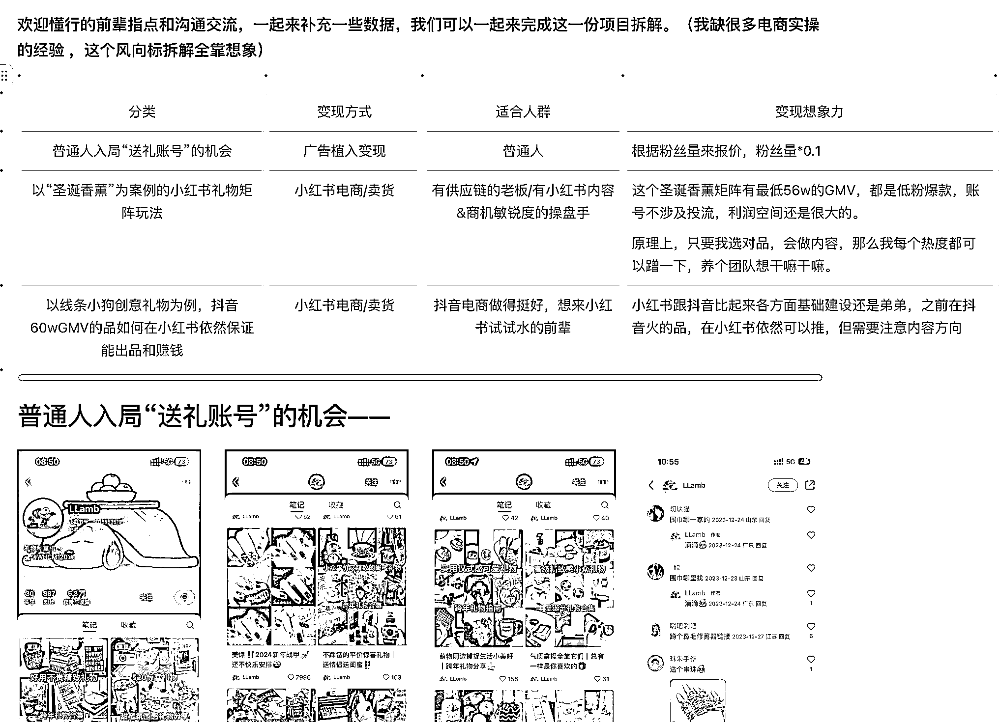

# 📕“送礼号”到底赚不赚钱？拆了3个案例，我发现了一条可行的路

大家好，我是小丸子。2023年从人大毕业，目前主要在做📕副业，连着三个月副业收入稳定破万。去年12月开始，我在龙哥盟的风向标里投了三条📕相关案例，虽然没赶上拆解提交的截止时间，但赚钱算是我商业和副业路上的启蒙，我很愿意毫无保留地分享一些有意思的发现。

先直接回答标题里的问题：📕送礼账号能赚钱吗？我的答案是肯定的——能赚。而且我有个观点：任何物品都可以成为礼物，关键就在于你想不想让它变成礼物。礼物没有固定形态，全凭人的定义。

这次的拆解，我主要看了三个账号/产品，分别对应不同的玩家和玩法：

1. **普通人的机会在哪？** 一个粉丝只有800多的📕号，单篇广子报价100元。内容做起来不复杂，还能批量生产，非常适合刚入门的新人练手。

2. **有供应链的操盘手能玩多大？** 我拿“圣诞香薰”举例，两个📕账号粉丝都没超过500，结果不到两个月做出了56万左右GMV。因为是素人号，粉丝量低，基本不用投流，算下来在还没扣人员成本之前，利润大约有30万，性价比相当高。

3. **抖音玩家转战📕行不行？** “线条小狗创意礼物”是个典型——这个品在抖音做到60万GMV，换到📕后，依然能稳定出单、持续赚钱。所以这个案例特别适合那些在抖音做得不错，到了📕却有些“水土不服”的电商前辈。

当然，这次的拆解更多是我主观想法加初步市场调研，缺少真实电商数据，也没有完整的下场实操经验。如果各位前辈有经验，欢迎来和我交流讨论，咱们一起把内容补得更扎实，争取帮到更多人。

完整内容放在飞书文档里了，想深入了解的话可以点开看看：[文档链接](https://btd7lq93bx.feishu.cn/docx/BS4edRjqeoqBg2xQUXPcBepWnFg?from=from_copylink)

也欢迎大家在评论区聊聊你的看法或经验。

