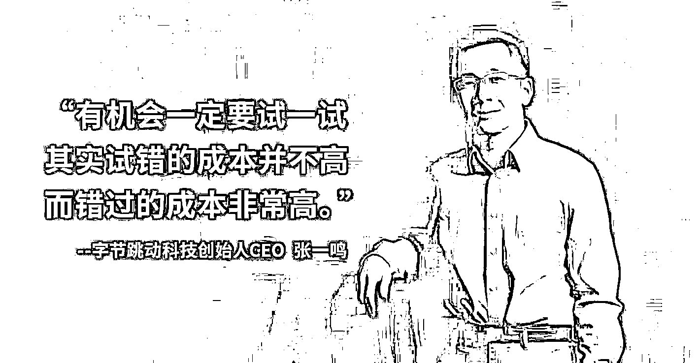

# 其实试错的成本并不高，而错过的成本非常高
作者：龙哥

**别让“不敢试”成为你最大的遗憾**

面对一个机会时，我们的本能不能总是勇敢地上前一步，更多时候，我们在原地反复盘算：万一失败怎么办？钱打水漂了怎么办？被人说“折腾”了怎么办？

于是，很多可能就此沉寂在犹豫里。

但如果换一种算法，你会发现另一笔账：试错，说到底不过是花一小部分资源去验证一个未知。成功固然最好，即便没成功，你也换回了经验、摸清了边界、看清了方向。投入再大，大不过你内心的那点底气。

真正昂贵的，是错过。

当机会从指缝间溜走，你连失败的样子都没见过，只剩下“如果我当时试了会怎样”的反复追问。这种遗憾，永远没有答案，成本也无法计算。

所以，如果你正站在选择的路口，不妨问自己一句：最坏的结果，我能不能承受？能，就去行动。

尝试不一定带来最好的结果，但错过一定会留下最深的悬念。趁机会还在，别让它变成一句“早知道”。

该出手时，别光顾着想。

* * *

* * *