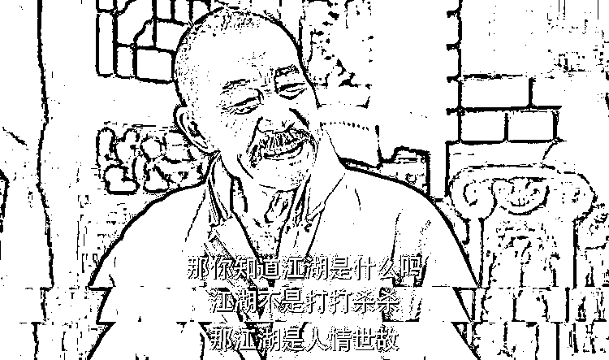

# 混社会必备：120条让你少走弯路的“血泪经验”

作者：V先生  
整理：2024年1月9日

我有个私藏笔记，叫《真相》。里面记的全是我这些年对人性的观察——有自己踩出来的坑，有看别人摔出来的悟，也不乏老祖宗流传下来的老话。

今天挑了120条，分享给各位朋友。

先说三点，免得误会：

1. 琢磨人性，不是为了给人下绊子，而是给自己排雷，让相处不累。
2. 有些话不好听，尤其是没怎么栽过跟头、一直顺风顺水的朋友，可能会觉得扎心。
3. 我讲的不一定对，仅供参考。

---

**一、关于关系，别高估了人心**

01\. 真正让人记住你的不是你的好，而是“你还有用”。兔死狗烹、鸟尽弓藏，自古如此。

02\. 最折磨你的往往不是别人的眼光，而是你太把别人的眼光当回事。

03\. 这世上没有真正的感同身受，你牙疼，别人永远不知道有多疼。

04\. 没吃过别人的苦，就别轻易劝人大度。

05\. 别随便给人介绍活、搭线介绍对象、拍胸脯出主意——成了，那是人家自己有本事；砸了，全是你的锅。

06\. 骂人“垃圾”前先照照镜子，扪心自问时，谁心里没点脏东西。

07\. 收礼要小心。很多礼物看似心意，实则是以小博大的筹码。

08\. 你认识谁不重要，重要的是谁认你。借钱、办事的时候，才知道自己几斤几两。

09\. 别拿你的时间单价去算别人的时间成本。

10\. 吃人家的嘴软，拿人家的手短。

11\. 单身是糖，婚后是柴米油盐酱醋茶。

**二、翻翻利益的底牌**

12\. 聊得好好的，对方正说自己的事，你突然把话题扯到你自己身上，这很招人烦。

13\. 犯错的代价为零时，没人觉得必须做对。

14\. 一个组织，利益相关的人越少，它的根基就越不稳。

15\. 你觉得岁月静好，不过是有人在替你扛风挡雨。

16\. 把一切都看清楚的人，往往成了骗子眼里的傻子、傻子眼里的骗子。

17\. 想独吞成果的人，最先出局。

18\. 刀没割在自己身上，谁都不知道有多疼。

19\. 对错，从来都是由赢家说了算。

20\. 敌人拼命反对的，多半是我们做对了的。

21\. 能改变自己是神，想着改变别人是神经病。

22\. 感情可以锦上添花，也能雪中送炭，但唯独不能互相消耗。

23\. 功高盖主，从来没好下场。

24\. 古今中外的痛苦根源，无非是才华撑不起野心。

25\. 关系越近，越觉得对方不过如此——距离产生神秘，近了只剩接地气。

26\. 大多数人上网不是找真相，是找认同。

27\. 很多吵架不是观点不合，是态度不对。

28\. 会哭的孩子有奶吃。

29\. 谁家都有一地鸡毛。

30\. 靠近权力，容易让人觉得权力是自己的。

**三、人性的那些“刺”**

31\. 经济上不独立，政治上也硬气不起来。

32\. 你值多少钱，不由能力决定，由供需决定。

33\. 可怜之人，往往也有可恨之处。

34\. 利益一上头，理智就掉线。

35\. 立场跟着利益走，屁股决定脑袋。

36\. 脸皮厚，才吃得饱。

37\. 没了分寸的“亲密”，其实是越界。

38\. 不回应，本身就是一种回应。

39\. 没有哪张邀请函是无缘无故送来的。

40\. 没有期望，就不会失望。

41\. 没人扛得住利益诱惑，扛不住，通常是筹码不够大。

42\. 舍不得大投入的爱，都是嘴上说说。

43\. 每句说出口的话，背后都藏着没说出口的潜台词。

44\. 名不正则言不顺。用人办事，要给人正名（明确身份权责），也要给人利益（明确回报激励）。

45\. 时间花在哪，钱花在哪，爱就在哪。

46\. 你不给自己做计划，就等着成为别人计划的一部分。

47\. 你没实力，认识谁都没用；你有价值了，人脉自己会来。

48\. 你坐在什么位置，决定了你是谁。

49\. 有些人的“脑回路”不是坏了，是立场偏了。

50\. 别指望全世界都喜欢你。

51\. 没看清对方的真实利益之前，他在你面前的表现，都可能是表演。

52\. 努力不一定暴富，但不努力一定会负债。

53\. 被喜欢，不如被需要；有利用价值，比被欣赏更重要。

54\. 人都渴望被看见、被回应、被认可、被挺一把。

55\. 人一不顺、迷茫、缺爱，就容易找信仰。这也是各路“神棍”的商机。

56\. 人总是得不到的念念不忘，得到的习以为常。

57\. 很多感受和评价，都是彼一时此一时。

58\. 神长什么样，是根据人的需求画的。

59\. 所谓的利他，很多时候是自己心里舒坦。

60\. 人们习惯把威胁自己利益的东西，叫做“恶”。

**四、别太拿自己当回事**

61\. 人穷衣破，说什么都是错。

62\. 人微则言轻，财大则气粗。

63\. 人心别试探，手机别翻看。

64\. 人有个弱点：你越在乎什么，什么就越拿捏你。

65\. 一旦不怕失去，态度就随性了。

66\. 人靠谎言获利，也会反过来被谎言反噬。

67\. 人和人的冲突，无非是利益、三观、沟通和习惯的碰撞。

68\. 关系，常常是“麻烦”出来的。

69\. 压力一来，谁都藏不住真面目。

70\. 人总是掂不清自己在别人心里的斤两。

71\. 不管哪儿，人一多饭不够吃，就开始卷。

72\. 爱感恩的人，最容易被收买。

73\. 手里没筹码，谁会心平气和跟你谈？

74\. 撒娇，不过是察觉到了被偏爱的可能。

75\. 再蠢的共识，也是共识。

76\. 谁最容易被替代，谁就是最弱的那一个。

77\. 谁脾气大，谁心里有怕。

78\. 格局是什么？是你心里装了多少人、能为多少人负责、能养活多少人。

79\. 世上没有无缘无故的爱，也没有无缘无故的恨。

80\. 只要钱到位，什么姿势都会——重赏之下，必有勇夫。

**五、看清世道，也看清自己**

81\. 事情没落在自己头上时，人人都可以是圣人。

82\. 所谓共识，有时候就是一群人达成一致认为同一个“游戏”很好玩。

83\. 所有不辞而别，都是蓄谋已久。

84\. 关系处得好，本质就是八个字：需求匹配、利益一致。

85\. 每一句马屁背后，都提前标好了价码。

86\. 你没变成威胁之前，人人都可以喜欢你。

87\. 太照顾别人情绪的人，自己心里不会好受。

88\. 贪念一上头，智商就下线。

89\. 听“专家”话之前，先搞清楚他坐在哪边、替谁说话。

90\. 不再抱怨，是修行的起点。

91\. 人心散了，多半是因为跟着带头大哥吃不到肉了。

92\. 希望像饭一样，不吃不行。

93\. 很多时候，只要价格合适，什么都能摆上货架。

94\. 再热闹的宴席，也有散场的时候。

95\. 要求别人，永远是张嘴就来。

96\. 有人主动来找你，要么借钱，要么借力。

97\. 一句话的份量，内容只占两成，剩下八成看谁说。

98\. 最优秀的猎人，常扮成猎物。

99\. 有评论区的地方，就有抬杠的。

100\. 你可能觉得某人逻辑奇怪，只不过是你没看清他心里的欲望。

101\. 最常见的幻觉是：“他们会上当，但我不会；上次栽了，这次总不会吧。”

102\. 有一种绑架叫“为你好”，明晃晃夺走你的选择权。

103\. 不管是谈恋爱、带孩子还是拉客户、带团队，第一要义永远是搞懂对方要什么。

104\. 怕什么，就来什么。

105\. 越穷的人，越信一夜暴富的故事。

106\. 越往底层走，垃圾人越多。

107\. 越急于掩盖的，越是真相。

108\. 再蠢的骗局，也有人心甘情愿往里跳。

109\. 说话之前想清楚：得到之前，你准备拿什么换？

110\. 日常生活里，关系比观点重要。为了对错赢了口舌，往往输了感情。

111\. 在乌鸦的世界里，白羽毛就是原罪。

112\. 真话，从来都不好听。

113\. 政治的精髓，不是对抗，是看在利益份上的妥协与合作。

114\. 只要是人，就都有说谎的可能。

115\. 失去的一刻，才看得出谁离不开谁。

116\. 棺材板面前，才知道什么最要紧。

117\. 真正安心的人，才敢坦然说自己哪里不行。

118\. 中国人的务实信仰是：谁灵验，就拜谁。

119\. 最重要的那句话，藏在下半句里：“但是……”

120\. 这世上最要命的三个字：我以为。

---

评论区依然精彩：

Shiny 💜 炆紫：文字的力量太强了，太多共鸣，感谢🙏  
丁丁：很多时候不是人改变事，而是事改写了人。  
V先生：你有哪些“行走江湖”的独家心得？欢迎在评论区聊聊～  
V先生：谢谢Shiny[也来分享几条你看到的“真相”]  
丁丁：[强][强][强]  
执笔写洪顺：信法律的人，大多活得舒坦；迷信人情债的人，往往人财两空。  
V先生：白纸黑字签合同，最保平安。

* * *

[内容完]

