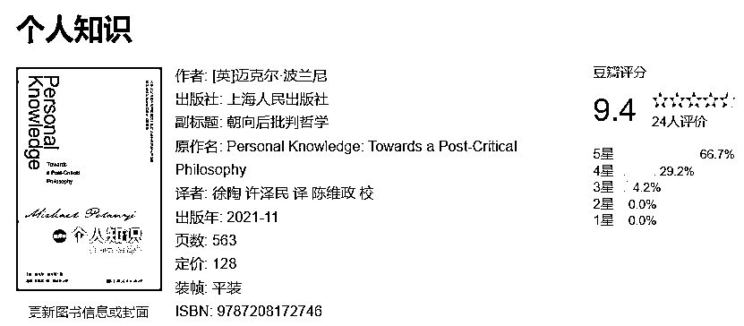

# 赚钱大航海到底值在哪？很多人只摸到第一层皮
作者：龙哥

## 谈谈赚钱大航海的三层价值，看航海手册只在第一层

作者： 老黄牛

日期：2024-01-12

普通人参与航海，本质上能拿到三档完全不同的回报。

1. 第一档：不下水只看攻略，拿到的只是“客观知识”。
2. 第二档：跟着一帮人一起实操，沉淀出自己的“主观知识”。
3. 第三档：把努力公开化，吸引贵人入场，借到贵人的主观知识和资源，完成命运拐点。

最近被“个人知识”这个概念狠狠打通了，下面用大白话拆开说。

### 第一层：行能带知，知却带不动行。个人知识只能靠干出来

大航海的厉害之处，就在于用群体压力加押金机制，逼你真做。

毛泽东和曾国藩都很推崇王夫之，他那句“**行可兼知，知不可兼行**”说透了这件事：实践能顺带学到理论，可光有理论绝不等同于实践。

这背后是物理化学家兼哲学家迈克尔·波兰尼在《个人知识》里提出的观点：**个人知识 Personal Knowledge。**

很多人默认知识是客观、中立、放之四海皆准的。波兰尼则补充了另一半：有一种知识是深深扎根在个人经验、直觉和信念里的主观知识。

**① 知识从不脱离个人处境。**

为什么网上开杠永远吵不完？因为大家都觉得自己手里的答案才是唯一正确答案。

举个简单的例子：看实体书好还是电子书好？
坚持实体书的人，可能家里书房大，每天能安静看三小时。
推崇电子书的人，可能常年出差在路上，实体书根本拿不动。
两者都合理，关键看场景。

给个图感受一下，美国的阅读习惯，他说得对吗？

**② 有些东西，理论懂了也没用，必须上手。**

骑自行车是最经典的例子。向右倒时把手往右打，车子曲线向右偏，产生的离心力把人推向左侧，抵消向右的重力；随即又会偏向左侧，再把把手往左打……靠一连串微调才保持平衡。

光背下这段解释，新手能骑上路吗？

赚钱和创业也一样，需要大量只能靠亲手试出来、带有浓厚主观色彩的个人知识。

### 第二层：比信息本身更值钱的是，承载信息的那个人。如何借用别人的个人知识

假设你想问：广州北京路摆个冰糖葫芦摊能赚钱吗？

你去问一个真正做过生意的老炮，聊几句他就能调动起脑子里一堆经验。他会结合具体位置、人流、成本给你画像，也会提前点出你踩坑的点。

这种针对性极强的答案，你在网上搜几乎搜不到。高手本就不多，能把所有经验整理成标准答案放网上的更是稀缺。

**航海群的价值就在这里。**

群里有实战过的同伴，有成绩突出的教练，随时能被你点名对话。没有航海这个载体，自己去找人搭线、约交流，成本和难度会高很多。

### 第三层：贵人相助带来质变。让你的努力被看见

个人的努力多数时候是量的累加，是线性的增长。除非遇到一次质的跃迁。

量的叠加像刷题，质的跃迁像真正走进考场参加高考。量的积累像持续定投，质的跃迁像赶上大牛市。

#### 用行动力换取贵人的青睐

当你把量的努力做到一定程度，遇上贵人，就可能发生质变。但前提是，你得有值得被信任、被帮助的理由，你的优秀必须被看见。

#### 航海天然提供了被发现的舞台

以做无货源为例，单打独斗每天上架、发货，增长是线性且卷的，因为和你做一样事的人太多了。
但在航海上，如果你的执行力在线，公开复盘、公开思考，就有可能被某个老板盯上。他把你带去做他的事，你就直接借到了他的资源和上升期的事业盘。

现实里，执行力强的学员被赚钱老板挖走的案例并不少见。老板缺能干的人，能干的人缺好机会，航海刚好把两者撮合在了一起。

那你现在在第几层？

* * *

评论区：

koalabear : 第一层

老黄牛 : 💪🏻

* * *