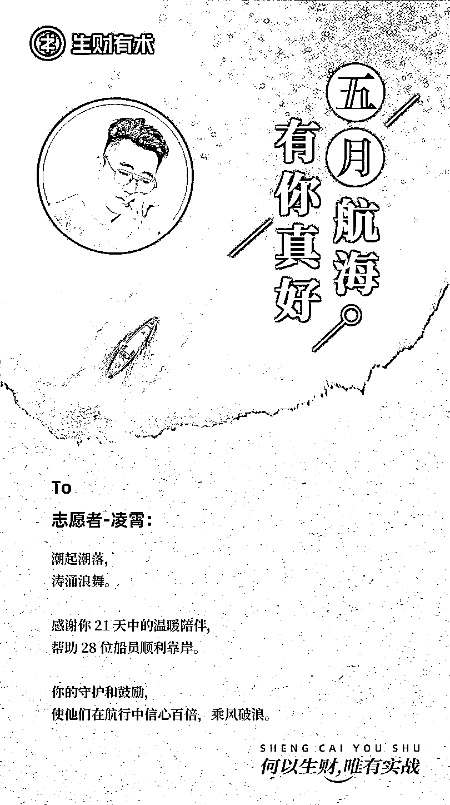
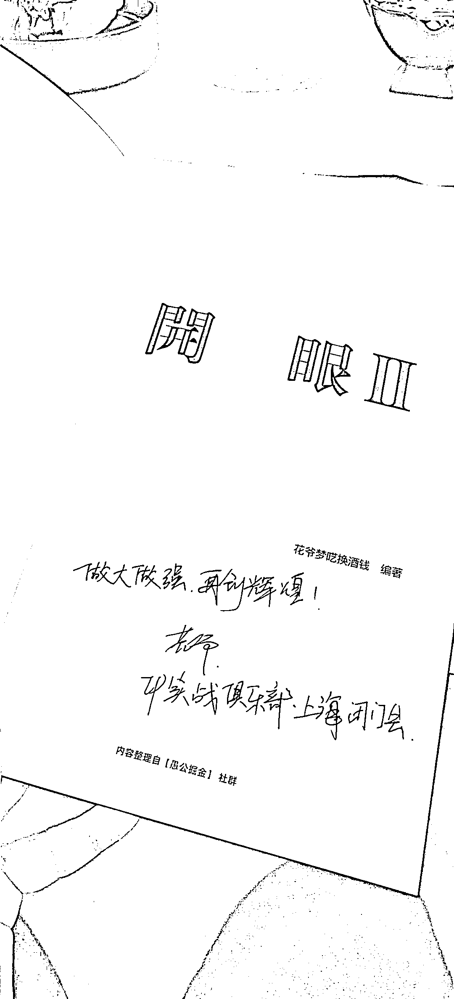

# 6 年 10 倍成长！一把烂牌的普通人，还可以改变命运吗？
作者：龙哥

6年时间，10倍增长。普通人拿一把烂牌，还能不能翻身？

凌霄的亲身经历，给出了最直接的答案。

一开始，他也只是在龙哥盟里默默潜水，直到报名参加了📕电商的航海志愿者，才真正踏进这个高能圈子。在这里，他见识了太多高手的深度分享，也体验了那些极其扎实的实战项目，更重要的是，他遇到了之后并肩作战的两位合伙人——小马哥（5年空军退役）和锐锋（3年战支退役）。

在凌霄看来，花爷和谢无敌就是他做IP路上的引路灯塔。他出自花爷IP训练营第九期，后来又连续担任9-14期的📕组长。正是这些积累，让他在2022年底下定决心裸辞，拥抱自由职业。然而到了2023年初，迷茫与焦虑还是如约而至。还好，花爷的合伙人Eason及时出现，为他重新定位，给了那个确定的方向。

凌霄把这段经历完整串成了15000字的长文，只希望能帮到每个刚起步做自由职业的伙伴，少走一些弯路。完整版已经整理好放在飞书了，想读的朋友可以直接点链接：

