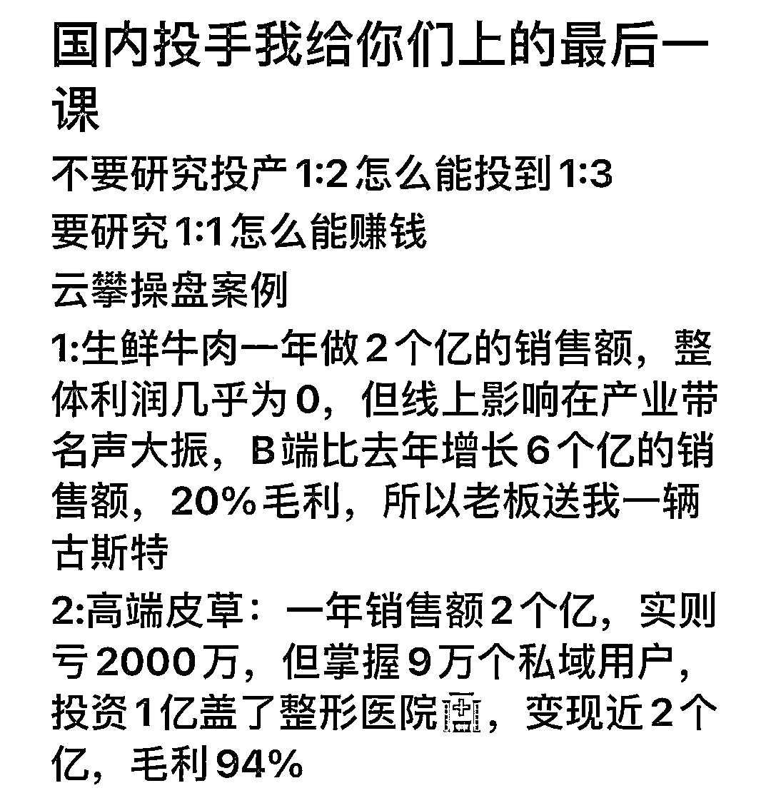

# 两次发售，3天回款200万+：我的私域“浪潮式发售”全复盘

大家好，我是龙哥。加入赚钱后，我一直在其中学习和汲取养分，三年里，公司利润从年入百万走到了千万级别。今天想把我私域操盘的核心打法分享出来：一个前提、四个关键动作、一手绝活。这套打法，曾让我在2022年和2023年分别做出3天收款200万+的成绩。

先说句实在话：当初设计这套打法时，我还没看过市面上的私域流量理论课，靠的是顺着人性、从战略层面拆解问题。战略不是玄学，而是通盘考虑每个阶段、每个动作能对整体贡献多少，然后把有限的资源排好优先级。后来回头再看，很多心法也能和书里的观点相互印证。我不是理论派，也不喜欢空谈，这些都是打出来的数据和结果。

但我也想说句大实话：私域运营是锦上添花，不是雪中送炭。别把顺序搞反，先拼命搞流量，再认真做留存；产品力更是地基。你能帮别人多赚多少钱，才能赚到更多钱——赚钱不是从别人兜里掏，而是别人多赚了1000，你从多出来的部分里拿100。

## 一个前提：先让用户感知价值，再引导行动

发售之前，一定要让用户预先感知到产品或服务的价值。否则产品再牛，冷不丁丢出来也只会自我感动。价值感知到位后，再引导用户做出行动：点个赞、回复666或888都行。这里没有固定模板，不同场景、不同标签、不同信任度，引导方法完全不同，得靠悟、靠实践。而且引导行为本身就是技术活，标签怎么打、话术怎么说，都有讲究。

## 四个关键动作：造势、预售、发售、升华

### 第一，造势：把能量场撑起来，把注意力抢过来

势能就是能量场。你自己蔫不拉几，用户一眼就能看出来——别人看你的眼神，其实就是你看自己的样子。所以先把能量提起来，再谈造势。

造势的目的只有一个：抢夺注意力。注意力集中的地方，生意就会生长出来。抖音之所以赚钱，就是因为大家都把时间放到那里，而钱本质上是时间的血酬。产品还没发布，就要把卖点、差异点、价值点、背书、成绩全部抛出来，先占领用户心智。

造势也可以借力，拉上KOL/KOC一起助阵。金枪大叔《借势》这本书值得一读。我做的两次大发售，用的都是倒计时造势：一天天递增、一层层剥开，最后在发售日集中引爆。

### 第二，预售：比发售更关键

很多人以为发售才是重头戏，其实真正的高手在预售阶段就已经把客户收得差不多了。普通选手在结果上使劲，优秀选手在原因上优化，顶级选手直接换一套模型。预售，就是在换模型。

当你前面造势的时候，潜在用户已经用行为暴露了兴趣，这批人就可以提前锁定。给点优惠或小赠品，先转化一波。预售一定要一对一私聊，慢慢聊需求、聊疑虑，每一个都是“轻铁杆”用户。很多人在倒计时那几天就已经把业绩收得差不多了，靠的就是预售环节。

但前提是发售物料得磨到位。我两次发售，文章都改了不止一周，每段话、每层逻辑都要反复推敲，牵一发动全身。

### 第三，发售：把高潮推上去

发售是整个流程的高潮，是集中爆发。呈现方式有直播、👸号文章、海报。有条件的话，优先用直播，直播能快速拉近距离、提升信任。做生意的本质，其实是在跟信息不对称和信用不传递作斗争，凡是能打破信息不对称、增强信任的方式，都值得用。

如果用文章发售，必须精心打磨，文案、产品力、情绪价值都要做到极致。想创造卓越，自己就得先追求卓越。

发售现场也有很多小机关：明天涨价、满人数调价、买赠、拼团……这些都是顺着人性设计的。但具体怎么用，要看场景、产品、人群。平时多读心理学和史书，对人性的理解越深，越能顺着人性赚钱、逆着人性让自己和产品值钱。

### 第四，升华：善始善终，做精细化跟单

发售结束不是终点，后面还要收拾战场。借助前面打好的用户标签，做精细化追单：咨询过没下单的、交了定金没付尾款的、说要介绍朋友还没介绍的，分别处理。公域里那些还没触达或没做过动作的好友，可以持续触达，但记得屏蔽已付费用户，别打扰他们。

触达的时候，不断释放产品力、用户反馈、成功案例，用长周期慢慢转化。同时也别一根筋，再牛的产品也只能服务一小部分人，放低预期、别玻璃心，才能踏实交付。

## 神之一手：客户终生生命周期价值管理

最后这个神之一手，说白了就是客户终生生命周期价值管理。前提是认认真真做好交付。

我专门设置了一个VIP🛰️号，所有付费用户都导到这里，这个号的优先级比我的私人生活号还高。为什么要这么做？第一，服务好客户是根本；第二，老客户的价值远大于十个新客户。你成就客户，客户也会成就你，利他到最后，是多方共赢。

我的基本盘是大学生，手里有近10万的大学生私域。一层层筛选下来：买了创赛资料的，可能再买数学建模辅导、保研服务、付费内推、考研伴学、留学服务、论文辅导；毕业后又会买赚钱实战营，甚至成为合伙人。只要基数够大、交付够好、创造的价值够大，这个链条越往下走，产出越惊人。我这边有些用户五年单人产值超过50万。

所以当别人都在抢创业粉的时候，我在培养和筛选大学生。这条路看起来慢，但回报率极高。我的盘子越来越大、估值越来越高，就是因为有“神之一手”这只看不见的手，把客单价和终生价值一起挖到底。看不见的竞争，才是最高维度的战争；能被看见的，只是高手露出的冰山一角。

最后，真心感谢赚钱、感谢龙哥哥，也谢谢一路支持我的朋友们。希望能为你们创造更多价值。

