# 2024 🛰️公开课现场复盘：视频号创作与直播带货的官方信号全汇总
作者：龙哥

## 2024 🛰️公开课，视频号第一手信息分享

作者： 亚超

日期：2024-01-11

前几天受邀参加了 2024 年🛰️公开课，我重点去了视频号原创作者专场和直播带货专场。现场坐着视频号各业务线的负责人，等于直接听到平台的原话。回来后我把干货整理成了下面的问答笔记，和大家一起过一遍。

下面是关于视频号短视频创作和直播带货的核心要点，全部以 Q&A 的方式呈现，正在做视频号的朋友建议收藏。

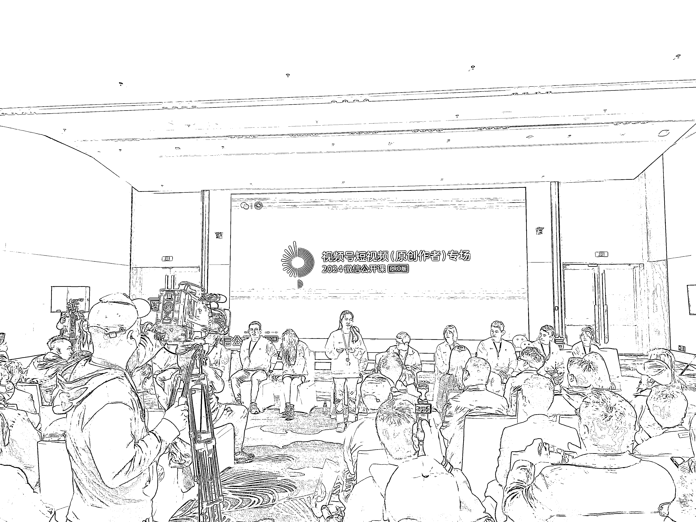

在场第一排基本都是视频号的核心负责人，下面这些回应可以理解为平台的官方态度。

### Q：怎样让视频号获得更多曝光？

A：平台明确偏爱原创。评判主要看三点：
1. 内容质量，比如 3 秒、5 秒的留存表现，用户互动行为、好友点赞等都是关键信号。
2. 内容的垂直度和更新节奏，鼓励做垂类账号并且保持稳定更新。
3. 创作者的运营意愿是否强，比如是否积极回复评论、私信的频率如何。

### Q：哪类内容更容易实现变现？

A：要能把品牌价值讲清楚，做自己擅长且粉丝买单的垂直赛道，平台不建议账号定位频繁跳变。

变现路径目前有几条：
1. 互选平台承接品牌广告。
2. 创作者分成计划，用流量价值换收益。
3. 重点行业扶持，例如游戏赛道可和主播做 CPS 分成，知识类博主内测会员制专栏。
4. 短视频带货，挂车视频的分发正在被重点优化，转化类内容明年的流量配比还会继续提升。

### Q：黄 V 认证会影响推荐吗？

A：认证主要是身份标识和功能开通的用途，帮助用户辨识，不会直接加权也不会压制。平台鼓励认证，尤其财经、医疗等垂类，认证后才能发布更多合规内容。

### Q：把同款内容授权给别的账号发，自己会掉流量吗？

A：从 22 年起原创内容占据流量主导，23 年上线原创声明并与变现权益挂钩。授权发布对双方流量都没有负面影响，且持续做原创仍可获得扶持。被授权方发布的内容同样可以申请原创声明。

### Q：违规视频是机器审还是人工审？诱导点赞怎么界定？

A：审核包含人工环节，也会结合用户举报。口头说“喜欢就点赞”本身没问题，但不能是整条视频唯一的表达。

如果感觉流量下滑但没收到处罚通知，大概率不是限流，而是内容需要调整，平台更偏爱真人出镜的原创。

### Q：挂车带货会影响分发吗？

A：平台鼓励挂车变现，不会做负向干预。挂车视频数据差，通常是因为带货干扰了内容体验，要保持账号风格统一。

### Q：可以在视频号讲视频号教学吗？

A：平台希望大家能交流涨粉，但也要保护用户体验，不会封禁这类内容。

### Q：平台对矩阵号的看法？

A：平台不希望同一个人换个角度把同一内容拆到多个号上。同一家公司、不同脚本、不同出镜人做矩阵是被鼓励的。高度重复的账号会被限制，个人最多维护 10 个矩阵号。

### Q：评论、私信回复出现功效类敏感词会违规吗？

A：正常介绍产品可以，但不能明示能解决某种医疗问题。

### Q：实名认证能改吗？

A：目前不支持修改，平台在考虑是否放开，受监管因素限制。

### Q：有没有敏感词库可以自查？

A：不会提供。敏感词的判定会随政策和环境变化，今天合规的内容明天可能就不合规。涉及经济环境、政策导向的内容要格外谨慎。

### Q：文案查重做到什么程度？

A：针对真人出镜的洗稿搬运，平台正在持续攻关。同时一键投诉功能也在规划中，降低投诉门槛。

### Q：直播切片能发短视频带货吗？

A：可以发，按正常短视频审核和分发逻辑走。只要是真人原创、用户体验好即可。

### Q：短视频和长视频的推荐机制不一样吗？

A：机制一致，下半年起中长视频会获得扶持，比如“稍后看”功能推出，用户更偏爱短视频是目前的主流偏好。

### Q：有没有白名单？

A：没有，白名单传闻不实，规则统一执行。

### Q：AI 生成内容会被限吗？

A：工具本身中性，只要内容受欢迎就没有限制。数字人视频也可以，但最好在片中做提示，避免误导用户。核心永远是内容大于形式。

### Q：引流私域的通道还会变吗？

A：去年上线过引导加企业🛰️，后因大量违规引流被下线，改为客服功能，是为了保护用户。

### Q：2024 年会重点扶持哪些赛道？

A：不做赛道定向扶持。2024 年重点扶持视频号原生作者，即主要精力放在视频号、在平台投入更深的创作者。

判断标准包括：是否经常回复评论、私信，是否把更多时间花在视频号上。回复频次等将成为考核指标之一。

### Q：挂车视频的付费加热效果如何？

A：当前加热更看重触达量，转化会让位于曝光。挂车视频投放后转化表现通常不理想。交易后用户满意度也会影响后续推荐。2024 年平台会着重培养用户点击小黄车的习惯。

### Q：为什么之前流量不错现在下滑了？

A：最常见原因是入局者增多，竞争加剧。可通过创作者中心查看自己的数据与同类创作者对比，找到问题。

### Q：私信能否直接发🛰️？

A：形式上允许，但不能给用户差体验或恶意截断信息。比如发一半内容，剩下要加🛰️才看就不行。

短视频用手势动画强行引导进直播间会被限制，建议口播引导。数据也显示手势并不能提升转化，反而影响体验。

### Q：挂车与不挂车的视频考核规则不同吗？

A：核心规则是一套，看内容本身。挂车视频会叠加电商相关的考量。中长视频和短视频的推荐策略也保持一致。

### Q：账号受罚恢复后会带负面影响吗？

A：处罚解除后，只要新内容合规就不会有残留影响。建议账号定位清晰，只做一个垂直方向。

### Q：同城账号有扶持吗？

A：本地同城仍在加大投入。

### Q：一个人能认证几个视频号？

A：受监管要求，未来个人实名认证上限为两个。

### Q：会限制引流私域吗？

A：平台希望公域和私域联动，而非单向导流。未来会探索视频号与小程序、👸号的协同。

### Q：有账号权重说法吗？

A：没有权重概念，只有是否违规的判断。

### Q：视频号会放到🛰️一级 Tab 吗？

A：不会，是谣言。

### 关于直播带货

下午旁听了直播带货分享，会上透露了几个重点：

1、直播带货团队从去年底开始扩招，内部没有分家，一直是同一团队运作。
2、接下来会加大研发投入完善直播底层能力。
3、为商家和服务商建立成长机制，按任务完成情况提升等级，服务商的政策和成长体系会在近期明确。
4、后台数据工具如直播大屏、数据罗盘会持续完善。
5、平台会把直播算法的黑盒尽量透明化，给每场保底流量并给出优化指标，在数据大盘中提供同行对比和大盘对比，帮助主播定位差距。
6、直播与私域结合还在探索。之前推送企业🛰️的功能因被用于违规售卖被下线，2024 年内会给出更符合🛰️生态的方案，不会照搬其它平台。
7、达人方面持续支持真人原创、主战场在视频号的达人，会给予流量和佣金扶持，不会刻意限流，欢迎更多创作者入局。
8、过去一年视频号直播带货 GMV 增长三倍。
9、用户体验优化方面，今年将推出用户三个月内可享受 5 次退货包邮。
10、部分品类商家将获得官方团队的全程陪跑。
11、官方强调没有标准答案，实践是最好的检验。

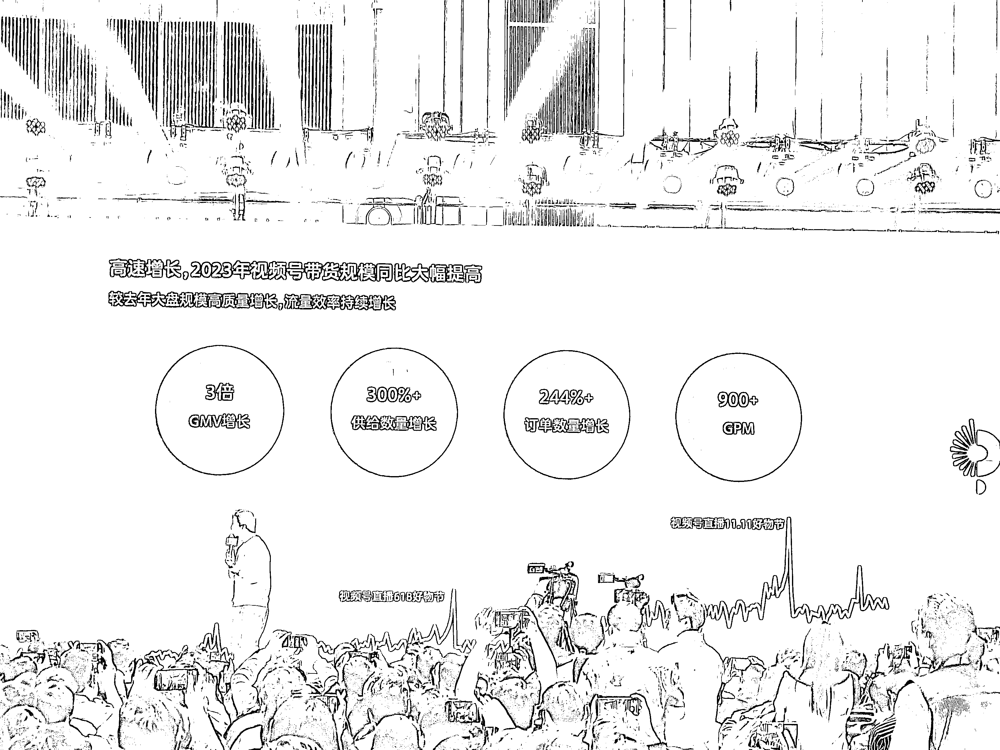

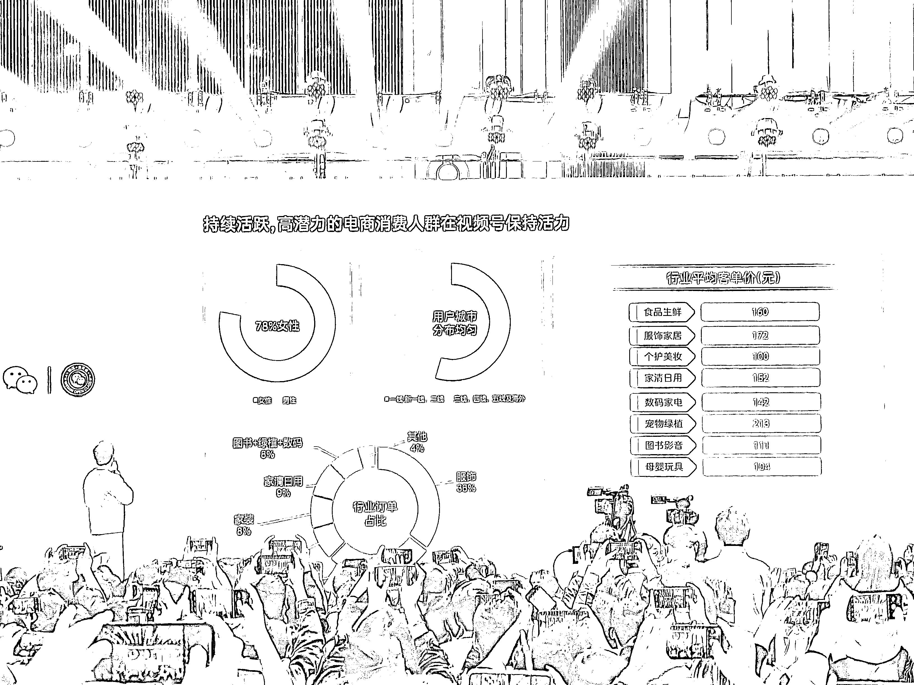

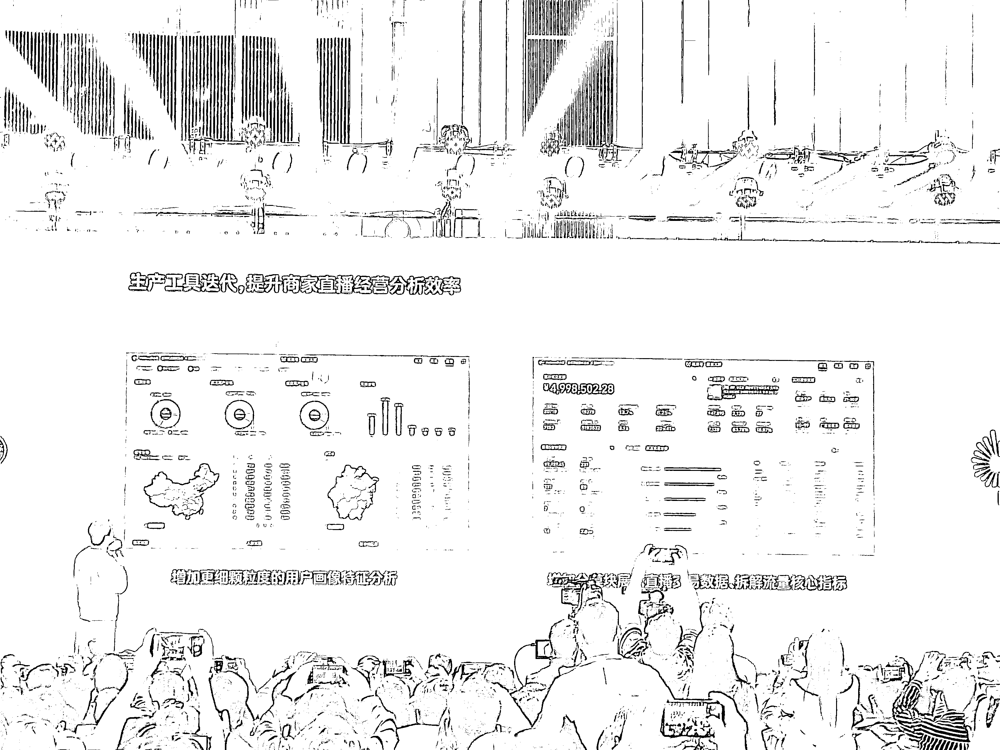

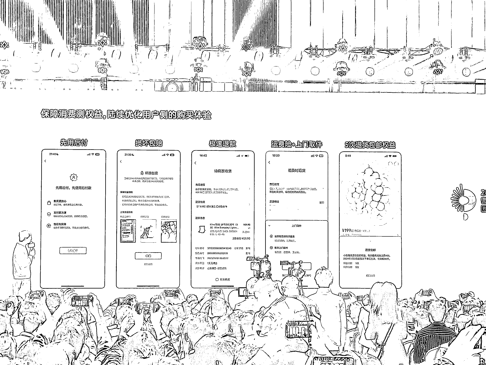

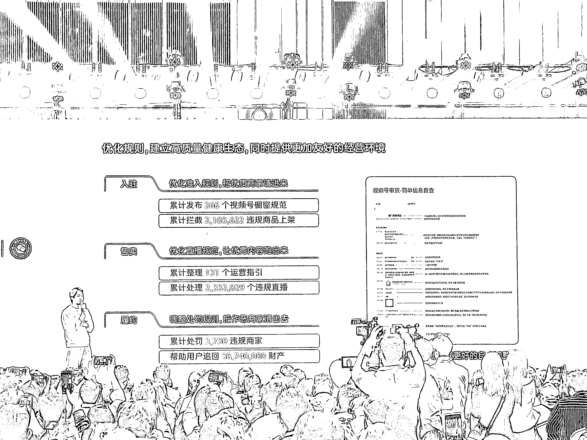

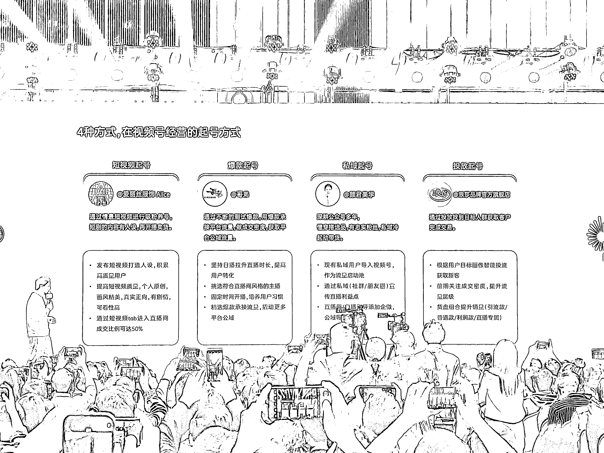

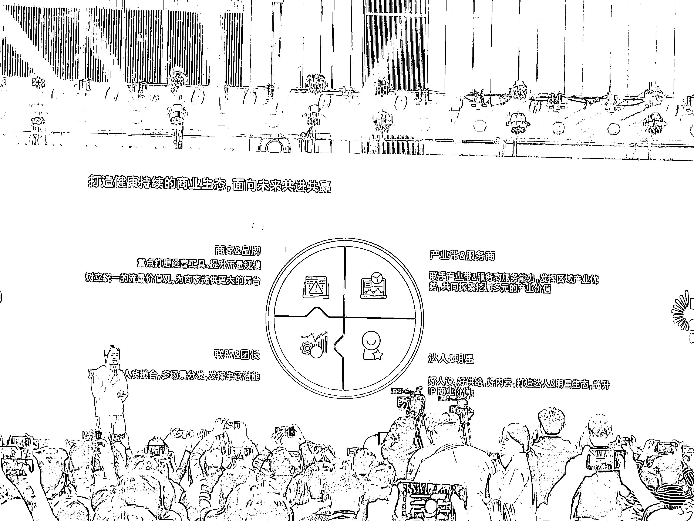

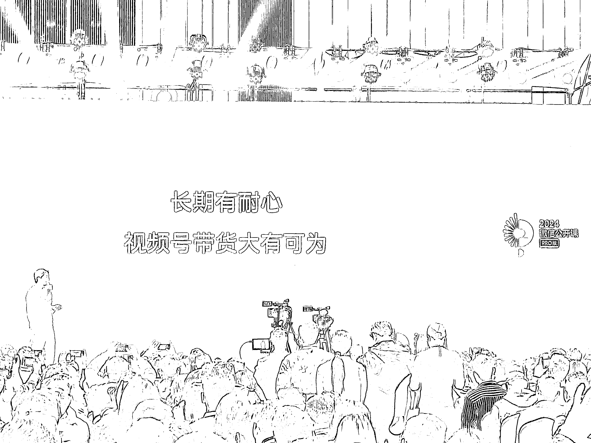

最后，🛰️在今年还会推出更多 AI 能力，比如🛰️对话平台、小微助手等。具体产品全景和上线规划如下：

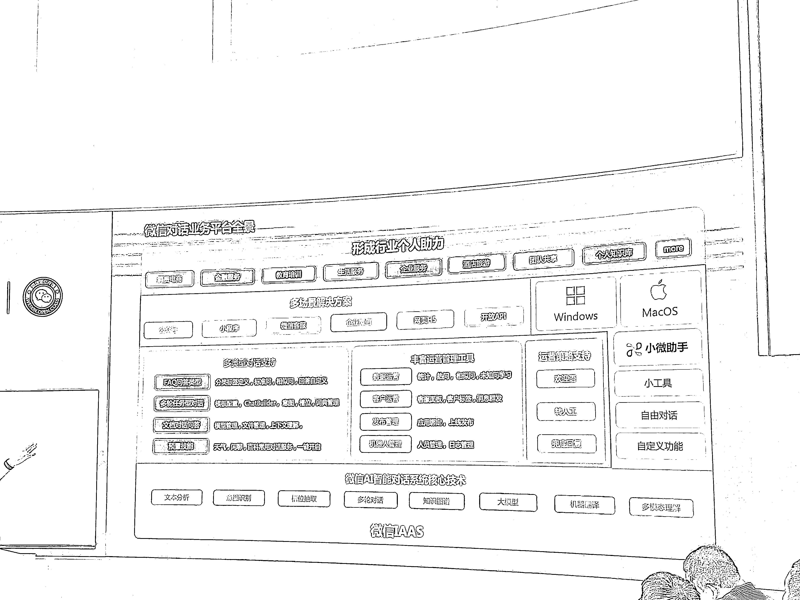

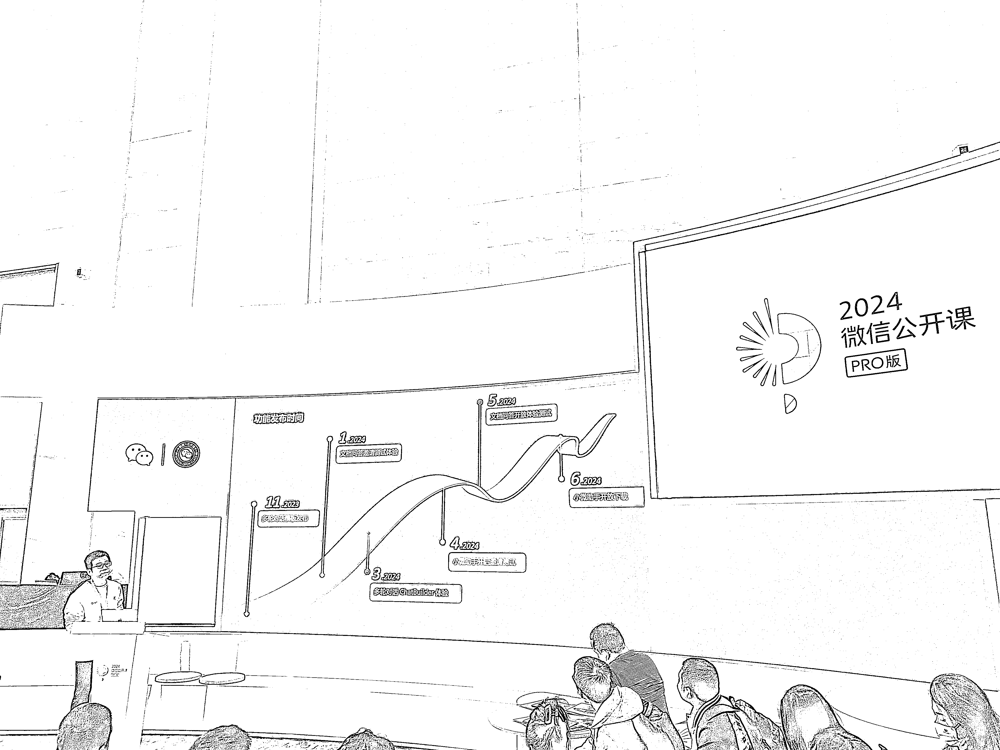

* * *

评论区：

程为自己 : 晚上还想着问下之前不是有直播吗，今年只有线下了吗？谢谢老师分享，感谢[抱拳][抱拳]

芮 rui : 太棒了。6666 好好

书豪 : 牛

旭宏 : 感谢分享

浅浅 : 感谢分享

西瓜🍉 : 感谢🙏

风与月 : 很及时 感谢分享

* * *