# 用数据说话的📕商业打法｜一套验证过年入百万的方法论

## 📕商业方法论｜半年实测不到100万GMV的底层逻辑

作者：徐宿
日期：2024-01-12

除了硬上，我更想把一条能复用的底层思路拆给你。过去半年多，我和两个合伙人用这套体系在📕实操，GMV接近100万，净利润约50万。

我判断这套东西不只适用于📕，放在其他平台也通用，因为它足够底层。每一步我都做了思维导图，希望能成你的那把剑。

这篇会拆解：
**1、选品的本质**
**2、选题的本质**
**3、网感的本质**
**4、交易的本质**
**5、商业写作的本质**
**6、数据分析的本质**

先放一些实战成绩自证：

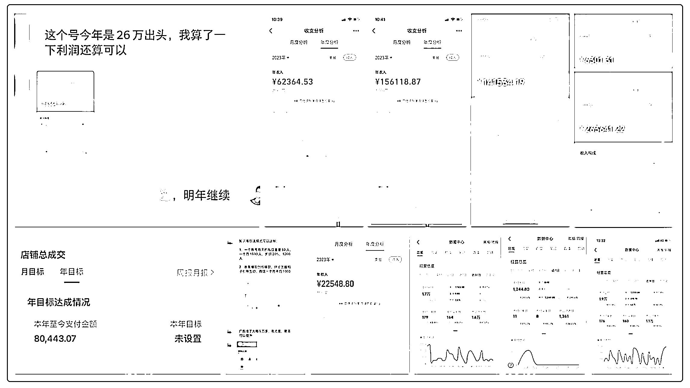

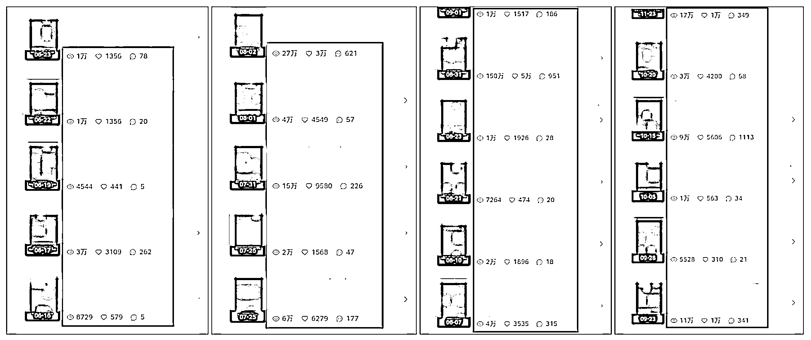

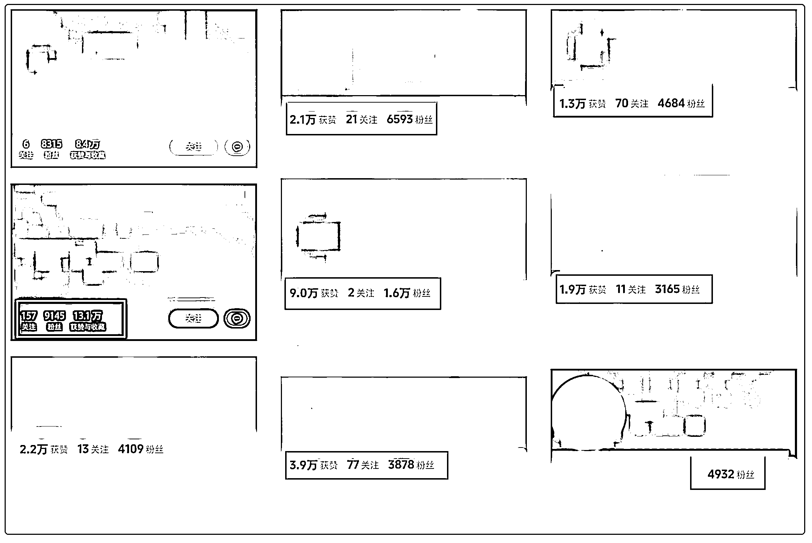

数据都能查到，真不是夸张的案例，只是想说明这套方法经过实战检验，大概率能提升你赚钱的命中率。

# 第一部分：📕商业的底层世界观

# 世界观

我之前说过，创业的本质是搭建一个经济系统，赚到钱只是系统里的一个环节。

在此之前，你得先补齐基础认知，是这些基本条件的归位才造就了结果，而不是听一句鸡汤说熬过苦日子就能发财，那不靠谱。

新手进📕创业或做副业，我觉得必须先吃透两个词：**价值交换、交易理由**。

**价值交换**

生意的第一原理就是价值交换。谁跟你说可以无视价值交换赚钱，多半是劫匪。

想在📕变现，先想清楚你跟谁在交换价值。至少需要和两方交换：**平台&读者**。

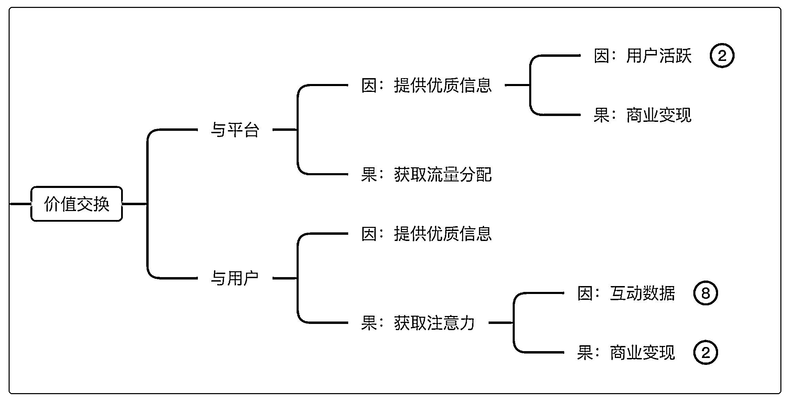

圈子里不少人想着白嫖平台流量，的确有人能薅到，那是人家本事。但大多数普通人没这本事，还总想钻空子引流，最后的结果就是一个号没一个号。

引流的法子我可以全告诉你：

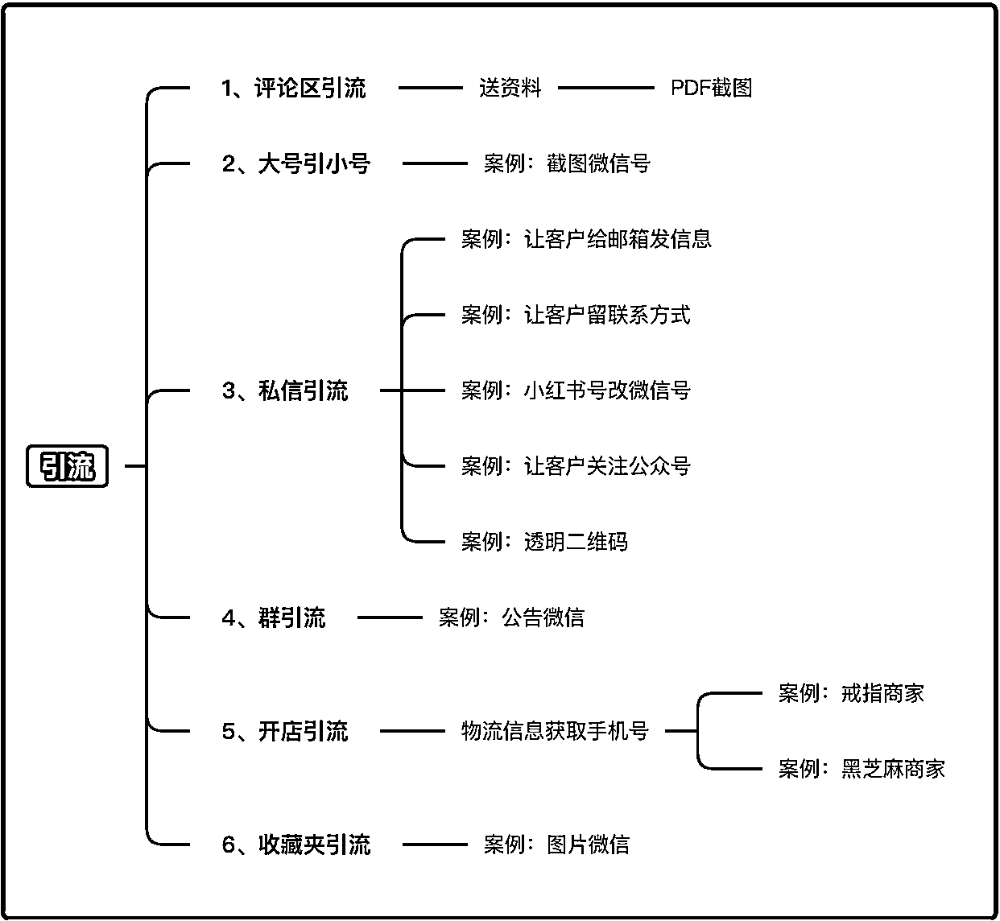

但你扛得住号的损耗成本吗？

理解价值交换的第一层意义是让人明白凡事有代价。赚钱是权衡利弊，空手套白狼很难，你总得付出点代价，哪怕只是时间，而时间往往是最大的成本。

**与平台交换**

创作者的第一步交易对象其实是平台，因为平台是你搭经济系统的载体。平台也是人运营的，要扛服务器、研发、运营的高昂成本，所以你必须读懂平台要什么。

**1、平台要什么？**
很简单，活下去、赚钱。

**2、平台怎么赚钱？**
看财报就能看懂：资本输血、广告分成、电商服务。

**3、凭什么能拿到这些钱？**
核心是**注意力资源**。

经济学的常识是资源有限。中国14亿人，一天24小时，人均能刷App的闲暇可能不足4小时，全国的总注意力就是一个有限池子。

任何交易都需要时间投入，时间背后就是注意力。你在抖音、拼多多买东西，不会看到就下单，总要先了解、建立信任、判断价值。

**4、📕的注意力从哪来？**
就是从用户身上来。资本愿意投、品牌愿意投广告，正是因为📕聚集了大量用户注意力。

所以平台要的是用户活跃度。活跃度高，等于全国人的注意力被锁在这里，资本和商家就能在这个池子里持续收割，平台才有钱分给你。

基于此，创作者必须持续输出优质内容来留住用户。内容越有价值，用户停留越久，平台推你的流量就越多。

**5、你到底和平台交换什么？**
交换的是你的时间成本。你用时间做内容，换曝光。

📕不是你爹，不会因为你内容好就赏你流量。它推你，是因为你的内容对用户有价值，帮它减少了用户流失。

**6、平台怎么判断内容是否优质？**
不会人工一条条审。它有一套内容价值识别的技术逻辑，大致因果如下：

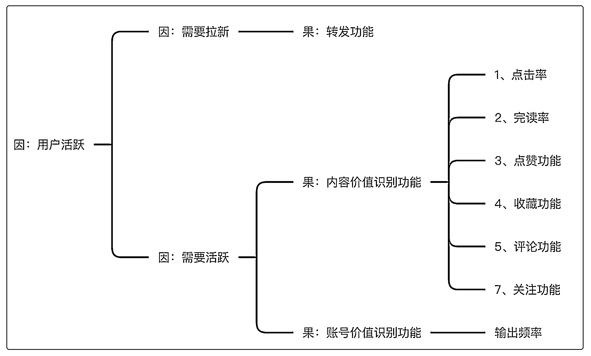

按这个逻辑推，你就能读懂每个功能背后的意图。祛魅之后，赚钱就成了因果自洽的结果。

**与读者交换**

人是大脑的信息动物，天生需要不断摄入信息来确认自己还活着、还能思考。

创作者借平台发出优质信息，吸引读者阅读，这就是在获取读者的注意力。

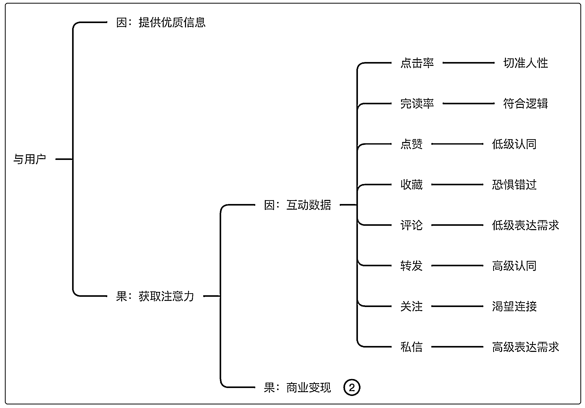

内容被推送后，读者会用互动行为反馈价值：先是小眼睛点击，再到读完、点赞、收藏、评论、转发、关注、私信，最后购买。这是价值认同的递进。

这就是凯文·凯利说的：目光所及之处，金钱必然跟随。

📕的每个功能都有意义，都是价值的试金石。没人会因为你随手发条笔记就掏钱，现实中看到东西也不会立刻买单，都需要了解和信任的过渡。

想在📕做生意，不是做内容就够了，你必须同时兼顾平台、用户、自身三方利益，才能长期稳定赚钱。

搞懂价值交换，就能读懂平台功能和数据，用数据指导行动。这是成功率暴涨的关键因果链。

**交易理由**

交易不只是付钱买货。前面说过，用户最初付出的也是注意力。你花时间写内容，他花注意力看内容，这本身就是交易。

最终目的是金钱交易，但在那之前，你要先和用户完成多场注意力交易。整个路径大概是这样：

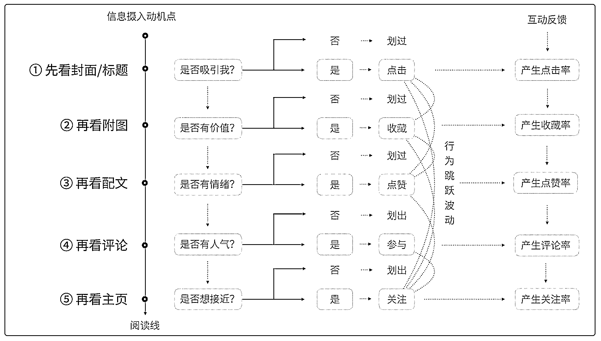

每一步都靠内容来推动。因为你产出了有价值的内容，用户才愿意投入时间，注意力才会被你抓住。

而如果你想让他掏钱，就必须在他在你内容里停留的这段时间里，激发购买欲。

交易是一连串互动行为。它的本质是持续产生互动。对📕来说，因果是这样的：

封面击中信息需求→**点击封面↓**
内容有价值→读完↓
一时看不完→收藏↓
有共鸣→点赞↓
还有疑问→评论留言↓
觉得你靠谱→关注↓
你有商品→**付费购买**

没做过生意的人以为交易就是一买一卖，确实简单，但真实交易不是瞬间完成的。

金钱交易来自于事前千百次的对望，需要多回合用放大镜看。

每个环节都需要一个互动理由，你的内容必须创造这些理由：**点击理由、收藏理由、评论理由、关注理由、购买理由**。

你要给读者一个无法拒绝互动的理由，才能一路把他带到最后的付费。

别念出来这句话：**我会给他一个无法拒绝的理由**。

我相信小钱靠科学和努力能赚到，而「**给对的互动理由**」就是让赚钱变成高概率事件的核心。如上是我的两个核心认知，下面进入整体方法论。

# 方法论

做📕或任何平台，核心流程很简单，分三步：**挖掘需求、制作产品、交易运营**。

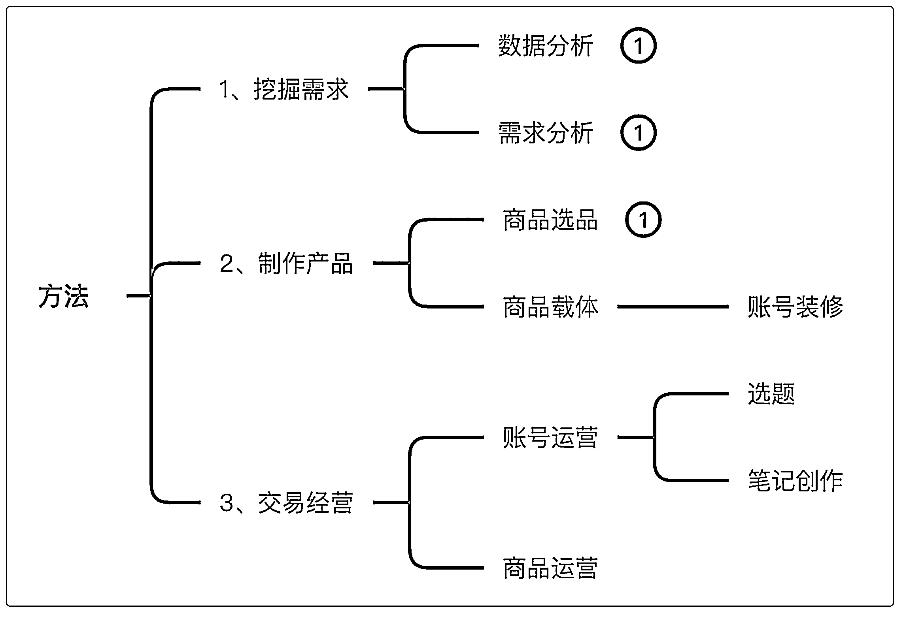

**环节1：挖掘需求**
要赚钱就得交易，要交易就得有需求。没有需求就没有交易。

新手常按自己喜好做内容，比如我一年前选了个小众赛道，做了两个月没反馈就放弃了。

按自己喜好做，满足的是自己的需求，不是别人的需求，没人会为你的喜好买单。

所以老师都建议新手先找对标，**对标找得准，弯路少一半**。

**早期为什么必须对标？**
因为对标账号已经帮你验证了商业逻辑，验证了市场上确实存在这个需求。

正如查理芒格说的：钓鱼两原则，第一，去鱼多的地方；第二，别忘了第一条。

需求也有层次。浅层是阅读需求，比如搞笑段子、恋爱技巧，看完点赞收藏不付钱。深层是解决痛点的需求，比如洗衣机怎么买、成绩怎么提、羽绒服怎么选，会评论、关注、私信、甚至直接买。

尽量找离钱近的需求。

挖掘需求需要两个核心能力：数据分析能力和需求分析能力。数据分析我会在【数据分析的本质】里详说，需求分析能力会另文写。

**环节2：制作产品**
交易需要给对方东西，这就是产品。很多人以为产品就是商品，但我会在【选品的本质】里讲，产品是解决方案，商品只是其中一部分。

**为什么要区分？**
因为价值交换原则在。你分不清，就会漏算成本。

抖音很多美女靠黑丝照吸流量，看似零成本，却因为没有好的商品变现慢慢倒闭。实际他们付出了时间成本、机会成本，这些在产品思维里都是高价值成本，商品思维看不到。

制作产品包括选品，也包括账号装修。📕账号本身就是你提供解决方案的载体，就像线下店铺，装修不好，商品也卖不出好价钱。账号装修方法我会文末给出。

**环节3：交易运营**
挖掘需求是确认有市场，制作产品是确认能解决问题，剩下就是持续交易运营。

交易运营为什么要强调交易？因为前面说过交易是一系列互动。部分环节可自动化，比如笔记发出去后的点赞、收藏、关注是平台可自动完成的。但部分需要人工干预，比如评论区引导、小号互动、有人咨询购买方式需要人工回复引流到私域。

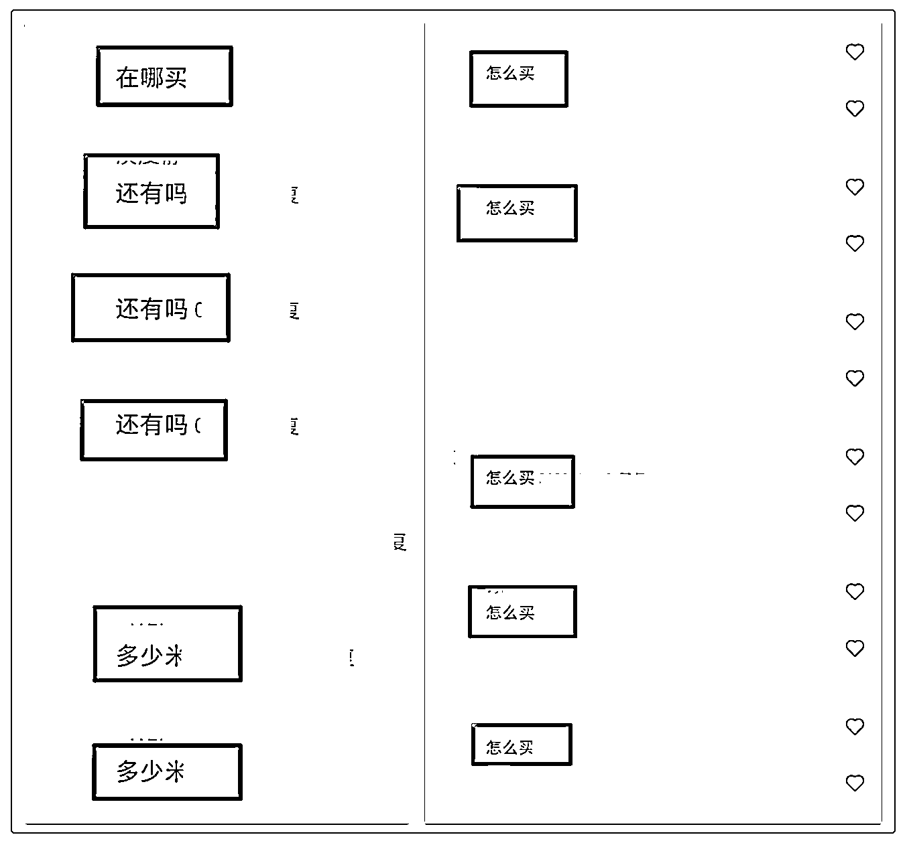

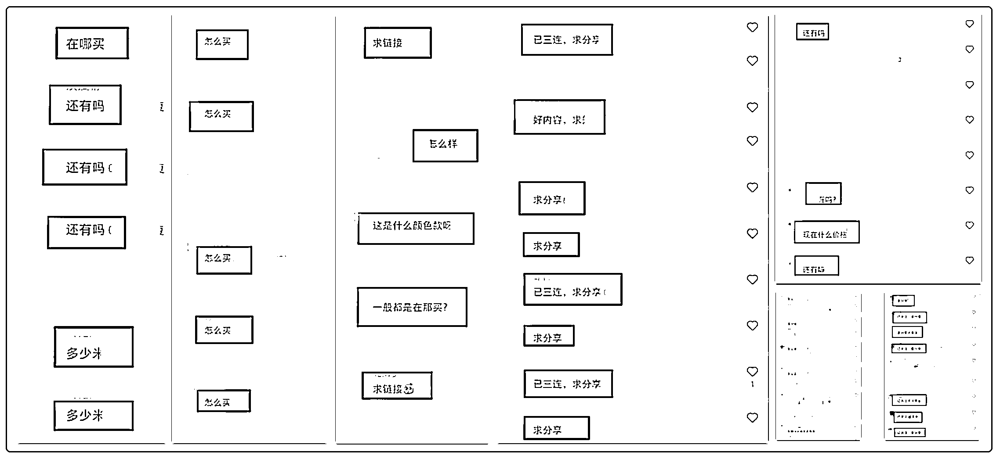

上面几个点其实就是提升内容带流量的关键。

交易运营分两块：**账号内容运营**和**商品交付运营**。前者负责出内容拿流量，后者负责接待客户完成金钱交易。

账号内容运营的核心我会在《商业写作的本质》《选题的本质》《网感的本质》里展开，商品运营会另文分享。

搭建📕商业系统就这三步：挖掘需求、制作产品、交易运营。听起来简单，实操里至少有8个重要环节需要你亲历。

下面进入细节↓

# 第二部分：选题的本质

# 选题错了，内容白做

2017年过年，我陪爷爷贴对联。最后剩一张福字，他想贴在已有福字的门上。我觉得丑，他觉得喜庆。争了半小时没结果。

后来我姑姑送年货来一句“贴多了会**破财**”，爷爷立马把刚贴的撕了。

多年后我才明白，每个人都有自己的认知框架和语言系统。想说服别人，必须先挖到他大脑里的记忆痛点关键词。挖的过程，就是选题的过程。

# 选题的本质是什么

把人脑记忆抽象成二维图，每个概念词的权重深浅不同：

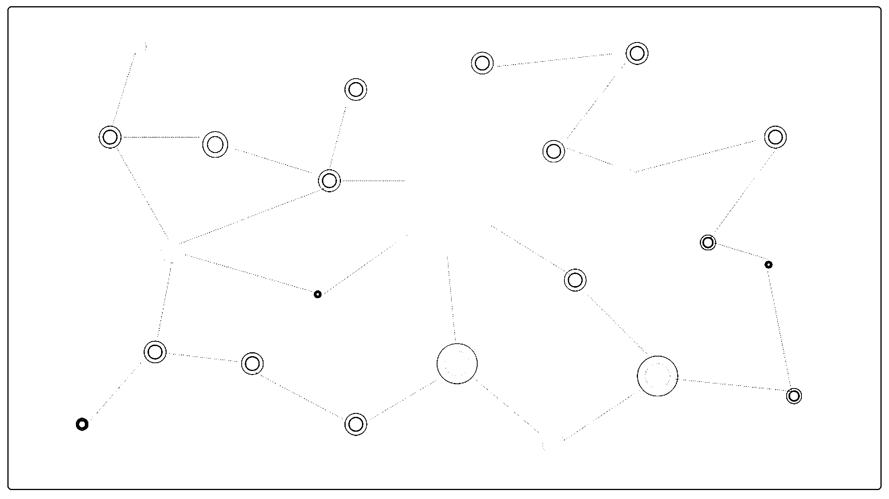

每个人对不同词的记忆深度不一样。比如我爷爷对“破财”这个词恐惧度极深，在他大脑里这个词就是最红最痛的大圆点。

把大量人的图谱叠加，就能看出群体的记忆图谱：

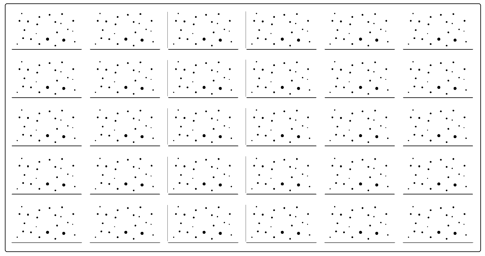

样本足够大时，你会发现有些关键词是大多数人都印象深刻、想了解、有点击冲动的。

我们叫这叫**共识度**。共识度越高，内容覆盖面就越大。

选题的本质，就是基于这个思维，去挑更大范围或更精准的共识痛点。

一个流程担一个流程的责。选题的责任是尽可能吸引更大范围或更精准的人群注意力，具体要广还是要准，取决于你的目标。

掌握底层选题法，你的内容就能获得更基础的阅读量，或更精准的读者。

# 选题怎么做

主要分三步：**搜集案例、分析案例、实战测试**。

**第一步：搜集案例**
选择需要样本量，没有数量就没有选择空间。

想在📕起号，先了解目标群体的共识痛点。最快的方法是搜集一批对标账号和内容。

简单操作：在📕搜索框输入领域关键词，在“综合”和“最热”里从前向后取20-50位博主，筛选收集，爬取这些博主的全部笔记。

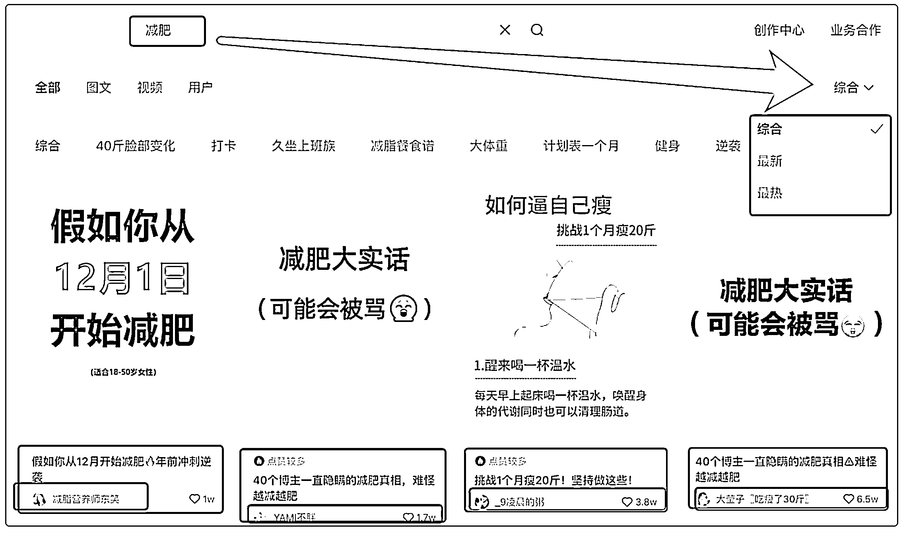

关键点我跟梨云学到的：搜集时应**爬取对标博主的全部笔记**，而不是只用标签链去搜优质笔记找共识痛点。因为对标博主的账号已经垂直验证了哪些是共识痛点，直接爬话题标签看到的全是爆款，没有对比空间。

案例入口很多，最终目的是沉淀一个选题库，模板如下：

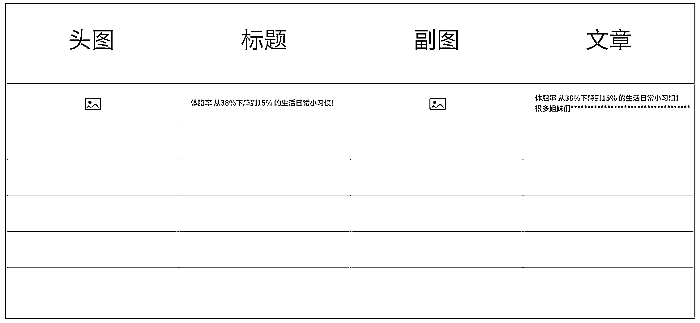

用飞书等云文档持续沉淀。当案例量够了，就能开始挖共识痛点。

**第二步：分析数据**
很多人说爆款，我习惯换成**异常值**。

爆款听起来玄学，运气成分重。异常值更科学，用数据对比就能判断。

分析数据的目的就是找异常值内容，通过点赞、评论等数据对比，筛出数据高的内容，里面藏着共识痛点，痛点即需求。

简单需求分析模板我会在【网感的本质】里再细讲，先给你个框架：

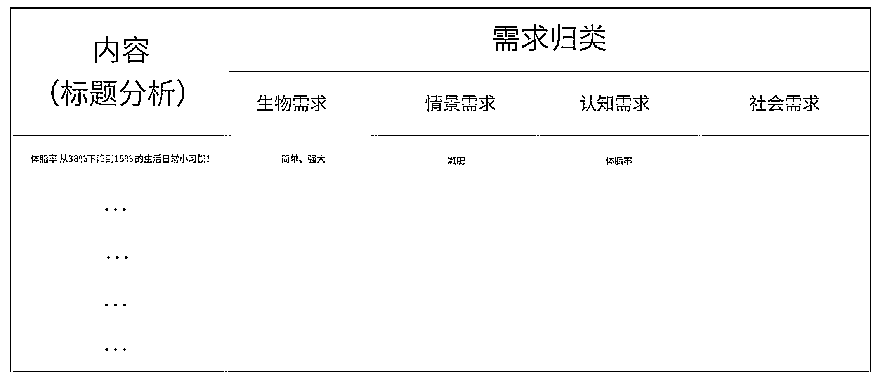

做内容到一定阶段，你会发现选题并不神秘。把领域内那些反复被提到的痛点收集起来，凑到50~100个左右，再按共性归归类、整合一下，一个专属于你的垂直选题库就建成了。

接下来说到第三个动作：实战测试。这一关没有技巧，一句话：亲自上场去试。人想改变别人，先要有改变自己的经历。只有亲手做出过东西，才谈得上有底气，那种握住方向盘的感觉，会让人越来越上瘾。经济学里有个词叫路径依赖——人一旦在某件事上得到过正反馈，第二次会下意识复用旧方法，因为省力又稳当。反过来，如果不实际去跑一遍，你就永远等不到正反馈，没有正反馈，坚持自然无从谈起。回头看我过去那些还过得去的成绩，真不是能力多强，只是我实在太喜欢琢磨那些东西，琢磨到痴迷。这里放一张知识导图：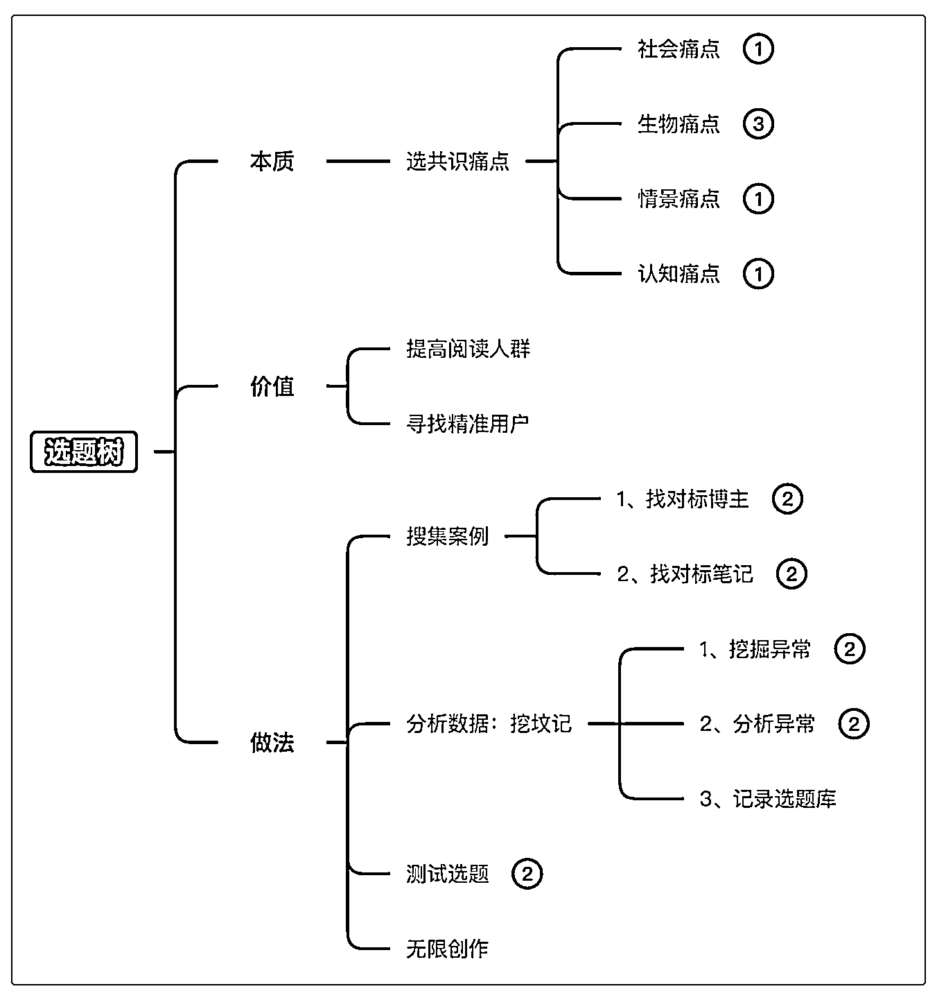

接着想聊聊网感的本质。2008年，我第一次被同桌带进网吧，一百二十平的空间里全是电脑。陌生的环境让我紧张，只能跟在他身后。他比我能聊，跟谁都能三言两语摸清底细，递颗口香糖就能称兄道弟，还把我介绍给一圈人。那种察言观色、见人下菜的能力，当时我特别羡慕。现实里有人天生会与人打交道，他们能从简单的言行里判断对方的风格和需求，然后切换合适的方式建立关系。把这种“感知对方并选择对应行为”的能力搬到网上，大概就是大家常说的“网感”。

有网感的人随便发一条动态都可能小火，没网感的人像教室里那个木讷的孩子，很难和人产生深度互动，也掀不起什么浪花。今年6月我开始专门研究网感训练，用了大约两个月，在📕连续发了20多篇笔记，爆款率98%，数据大概是这样的：

内容本质上是一种产品，无论文章、视频还是图集，它被做出来的首要目的都是抢占读者注意力。如果把注意力想象成一种货币，读者凭什么把它花给你？答案只有一条：你的内容对他有价值。有价值，他才愿意付出时间；没价值，谁都不会多看一眼。所以，所谓网感，说到底就是你对内容价值的一种感知力——你能不能站在读者角度，判断出哪些内容让人一定想点开、想点赞、想评论、想关注。能，就是有网感；不能，就是自我感动。

把内容当产品，读者就是用户。俞军在《俞军产品方法论》里讲，所谓理解用户，要先从一个个具体的人积累案例，案例够多了，再形成用户分布模型，再基于模型调整策略、迭代验证。网感训练也是这个思路，先积累读者感知，再形成读者模型。具体分三步。

第一步：感受价值。注意，你觉得有价值没用，得读者觉得有价值。价值是主观的。同样是100万现金，对我来说是巨款，对马云可能可有可无；同样一篇文章，对写作者也许价值连城，对不创作的人可能就是废话。所以训练网感的第一步，是搞清楚什么内容能覆盖更多人的价值需求。怎么办？先去大量分析爆款，找共性。以📕为例，挑你所在领域最火的内容，按表格一项项拆开来分析：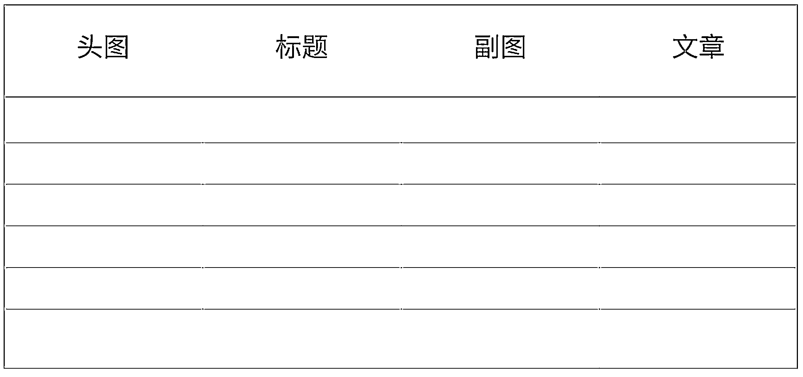 分析时要重点看读者读到每处时的需求，他为什么看、能解决什么问题。解决得了问题，才叫价值；没有对应问题，价值就不存在。人的大脑是按固定单位吸收信息的，脑科学认为，人一瞬间最多只能吸收四个信息单位。所以你会发现很多营销高手的封面都用极简关键词，比如金枪大叔；成语、三十六计这些模型也特别好记。因此，分析需求的一大秘诀是从关键词下手：把爆款标题拆成关键词，直接判断哪些词更戳人。分析模板大概是这样：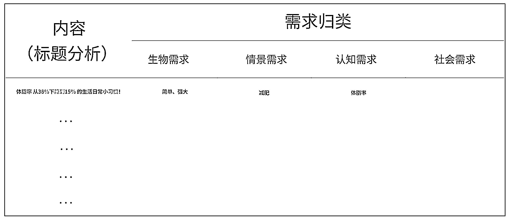 至于每种需求怎么甄别，后面再单独写，这里先略过。

当你分析到100篇左右，很容易看到领域里大多数人的认知共识，比如减肥领域大家到底在意什么。于是你可以沉淀出各种模型库：选题库、标题关键词库、图片模板库等等：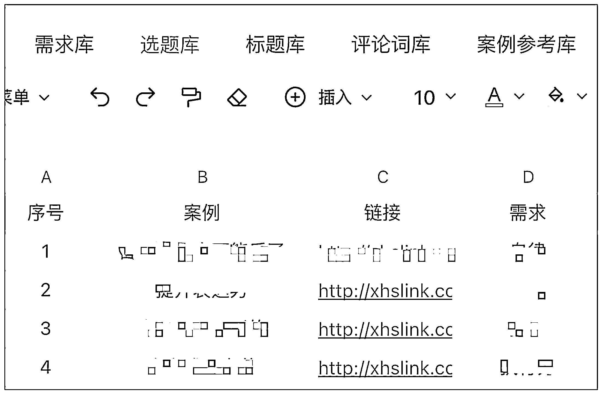 这些模型库既是写作加速器，也是定位仪，能让数据保持稳定。

第二步：制定标准。能爆的内容一定有规律，把它总结出来，原本飘忽的网感就能变成可执行的SOP。有了模型库，定标准不难。一个简单模板是：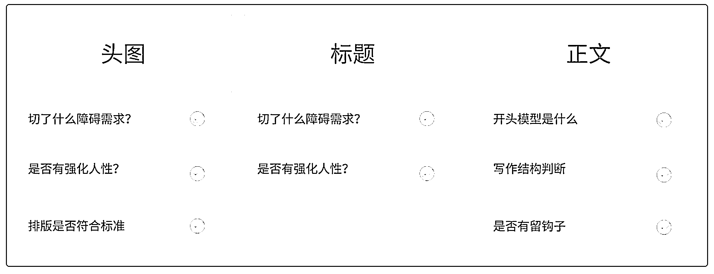 内容标准是互动数据的源头，怎么定具体标准，我后面也会单独写。

第三步：实战迭代。四个字：下场输出。网感训练的本质是洞察信息与用户需求的关系，而要验证这种关系，必须自己去写、去发、去测。网感这能力，吃的就是理解力和阅历，没经历过流程谈不上理解，老师怎么教都没用。记住，学习这件事，重点不在于见闻，而在于输出。大脑真正把思路理清，是在你表达的时候，而不是在看课程的时候。很多道理年纪大了自然会懂，但这个社会不看你懂多少，只看你比别人早懂多久；早懂和晚懂，走的是两种命运。这段知识导图送你：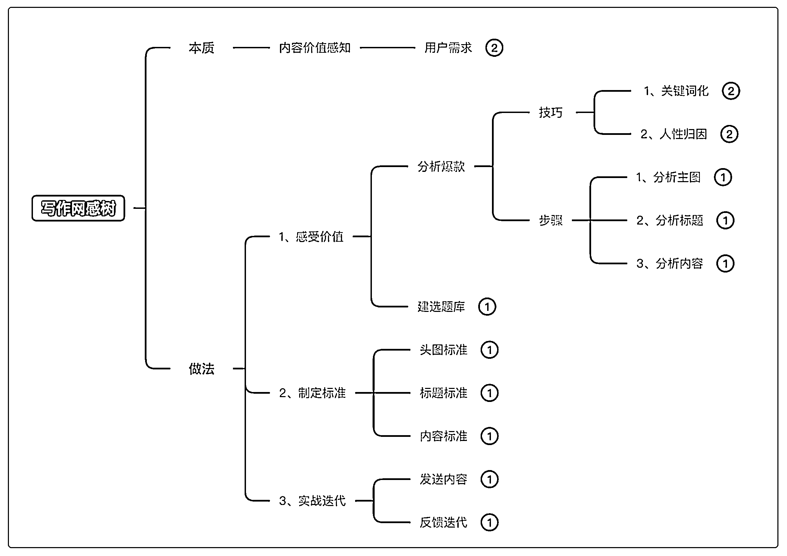

接着说说商业写作的本质。写作是用来表达和展示的，人表达通常有两个目的：要么找共鸣，要么找资源。商业写作偏向后一种，它天生带有功利性。如果你把一个📕用户的路径从头模拟一遍，大致是这样：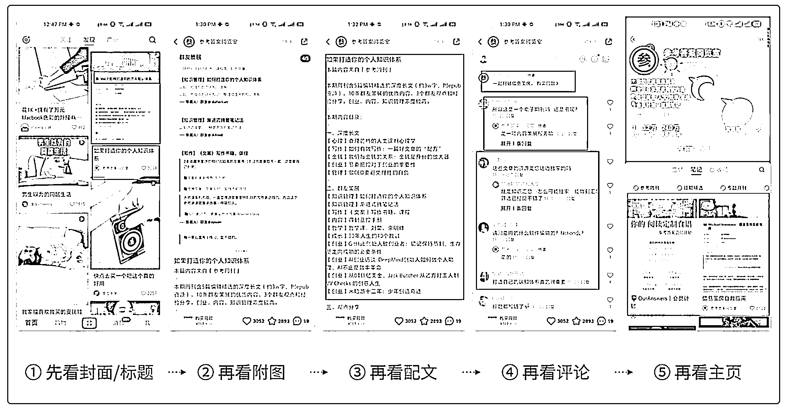 整个过程里，读者每一步都在投入注意力，同时也都在做价值判断。用图形表示，大概是：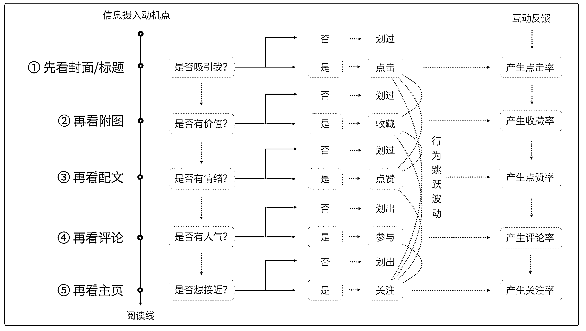 大家偏好不同，细节动作有差异，但宏观上平台的信息流就是这套流程。所以在📕做商业写作，核心就是在每个环节多创造互动机会。阅读本身是无声的，只有互动才能产生商业价值计算。平台设计了点赞、收藏、评论、关注、私聊、购买这些互动功能，写作者要明白，每一种互动都对应一种需求的满足或产生，从点击到购买，都是商业价值。

商业写作的内核，其实就是制造互动机会。创作者提供内容价值，读者付出注意力和互动，双方完成价值交换的闭环。

做法上，基础流程分三块：撰写内容、植入互动因子、持续迭代沉淀模板。撰写内容，就是把选题扩展成标题、头图、正文和附图。这里涉及很多写作细节，推荐去看圈子里的梨云的内容，她有系统课程。第二个环节是植入互动因子。互动因子是我自己创造的说法，指能刺激人产生行动欲的要素，可以是词、图片或符号。它直接击中人的需求，像有魔力一样驱动行为。一句话概括：一个因子服务一个结果。标题和头图要为目标读者的点击欲服务；附图要为完读率、点赞率、收藏率服务；正文和评论区要为转粉率服务。看这是两组关于手机的标题头图对比：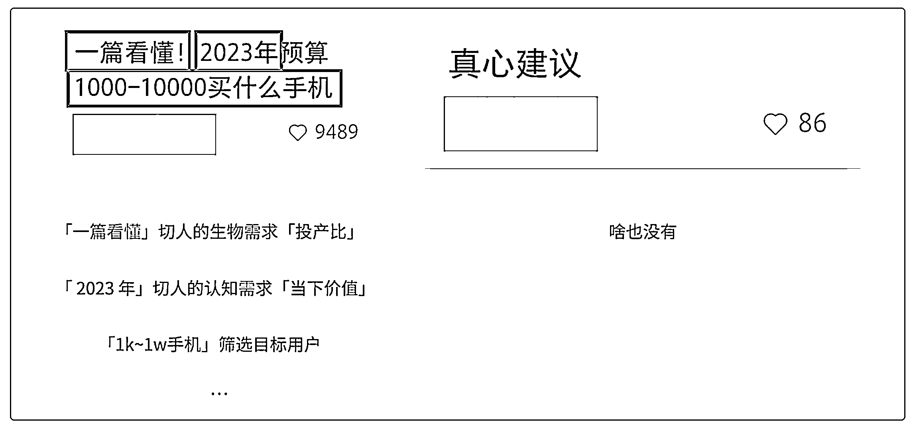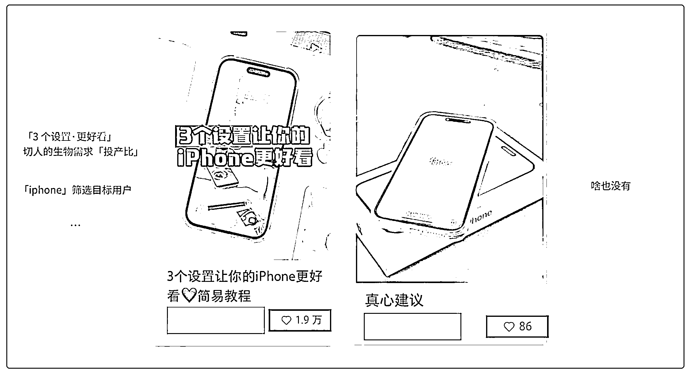 因子不同，数据效果立刻拉开。再看附图对比：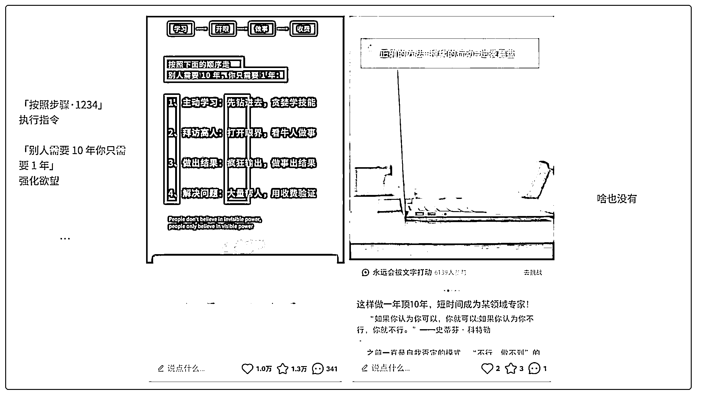 左图加入“执行步骤”这种因子，右图什么都没有，数据差距就很明显。再看评论区：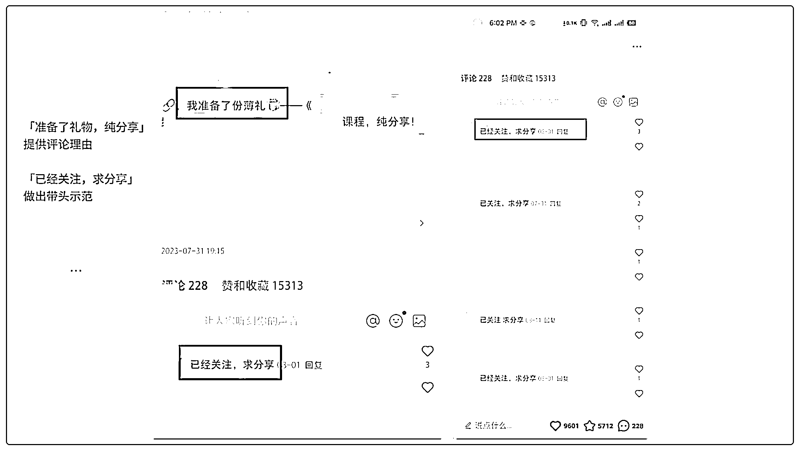 通过“赠送礼物”、“演员示范”这类因子，能明显拉高互动率。额外说一句，在📕这个平台上，评论的互动量对推流影响很大。我运营的两个账号，选题方向接近，左图的赞藏和评论接近1:1，创造了1万点击；右图赞藏加起来快1000，评论却不到10个，最终笔记没破万。样本不多，不敢说评论一定比赞藏高很多倍，但我保守估计评论价值是赞藏的2~3倍。数据如下：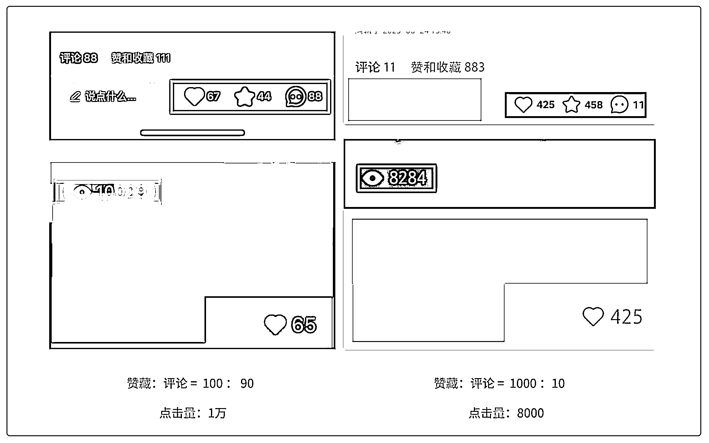 到这里你会发现，互动因子的本质就是给人一个行动的理由：人家为什么评论你？一定是你内容里某个点给了理由；点赞、收藏、关注、私聊、购买也一样。所以收集互动因子，本质上是在修炼理解力。我整理了一个模板供参考：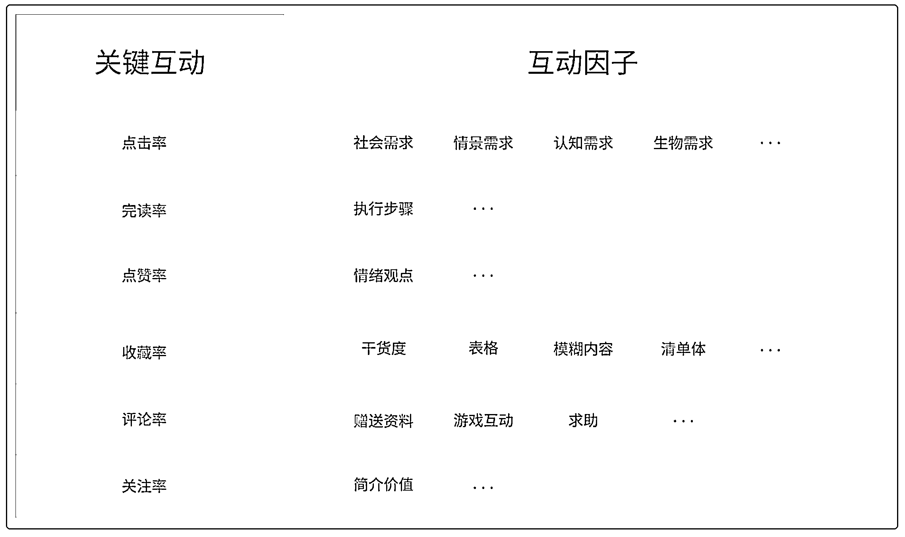

第三个环节是沉淀模板/持续输出。长期稳定输出，必须有自己的模板。你看四个优质案例，都有固定风格：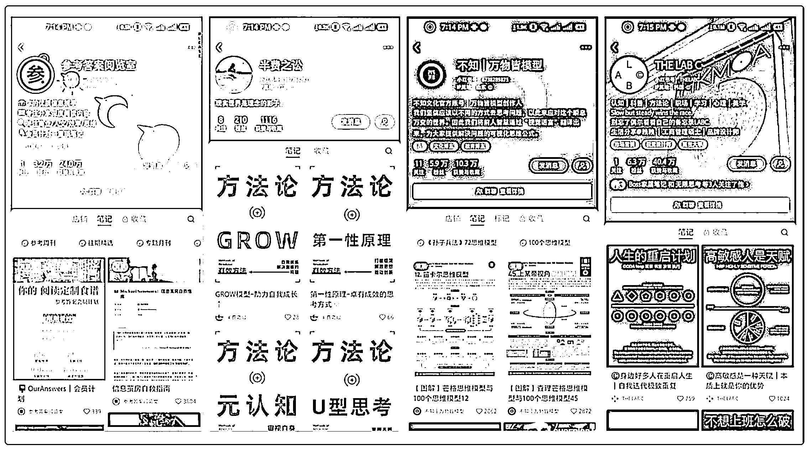 表面看模板是形式，其实它是在引导用户认知。我在讲选题时说过，要尽量降低读者理解难度。很多新手把模板弄得很花俏，自以为有个性，其实完全没考虑用户理解成本。表达什么很重要，怎么表达同样重要。内容模板核心价值就是降低理解门槛，同时提高你的生产效率。最后只需要持续输出，去测试用户反馈，看看有没有达到商业目的，然后迭代质量和模板。知识导图：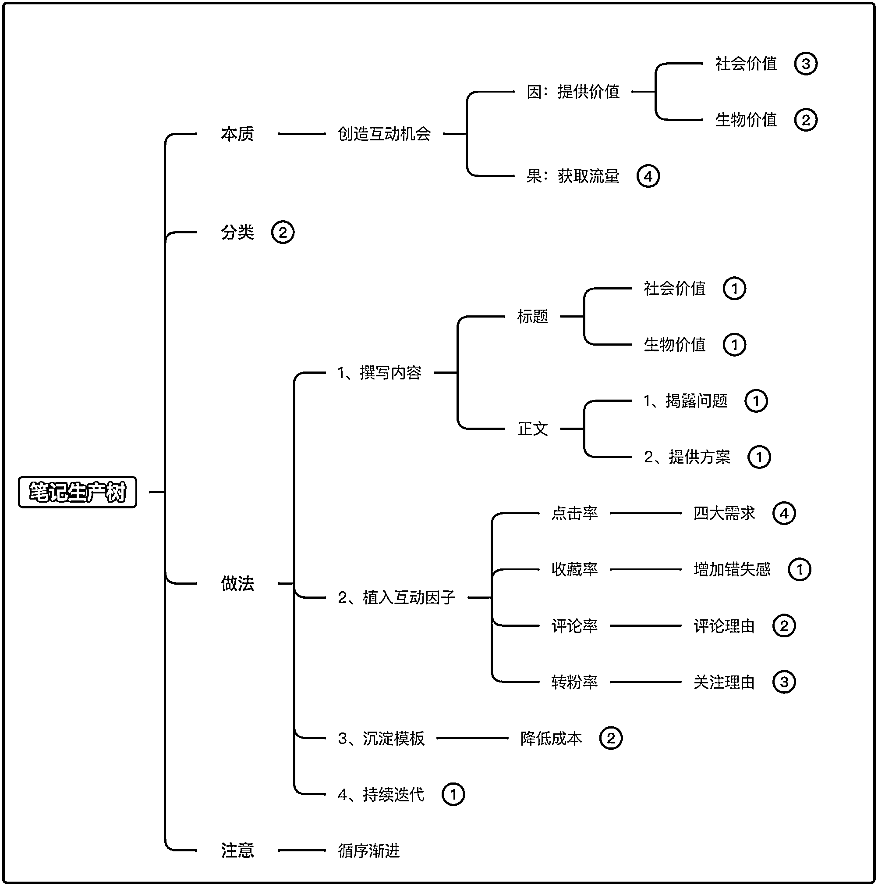

最后说数据分析的本质。开头提到过，人之所以要选择，是因为资源有限。选择是为了做对自己更有利的投资决定。拿📕来说，写什么选题，本质上是在计算哪种内容回报率更高、涨粉更快。凡是说到“更高更好”，都是一种相对感受，必须把两组数据放在一起比较才成立。所以说到底，数据分析就是在一个个数据里判断谁能带来更高回报，找出那条利润差——我把它叫作挖掘利差。

做法三步。第一，收集数据。选择大于努力，但选择要基于数据，而且得是真实、足够量的数据。没有样本，分析不出好决策。怎么收集、用什么工具，赚钱圈友写得很全，这里直接给个参考模板：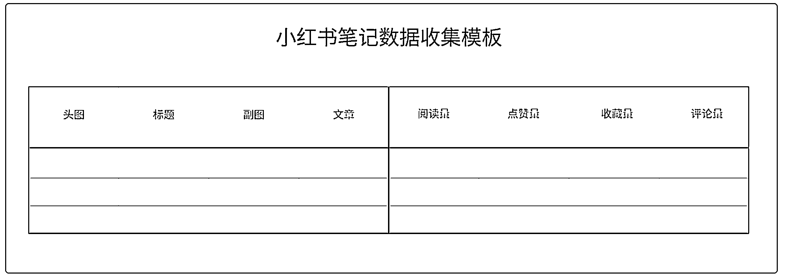 第二，分析共性。每一组数据背后，都藏着一群人的行为；而行为背后，是没被满足的需求。你要找的就是共同需求。标题分析还是用之前那个模板：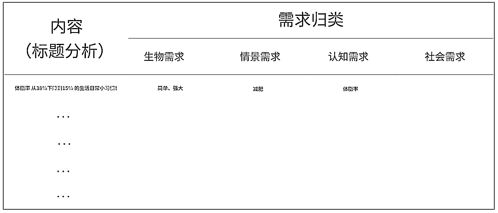 不同类型的数据，分析目标也不同。分析选题数据，要看出什么结构更引流；分析账号数据，要看变现模式、存活周期。第三，优劣排列。把不同数据按目的指标排序，比如完读率、点赞率、收藏率、转粉率，就能得出最优策略。比如家电领域空气净化器赛道，我如果想点赞高，就直接按点赞量排序，提取前20篇的标题和内容模型来模仿写作，效果不会差：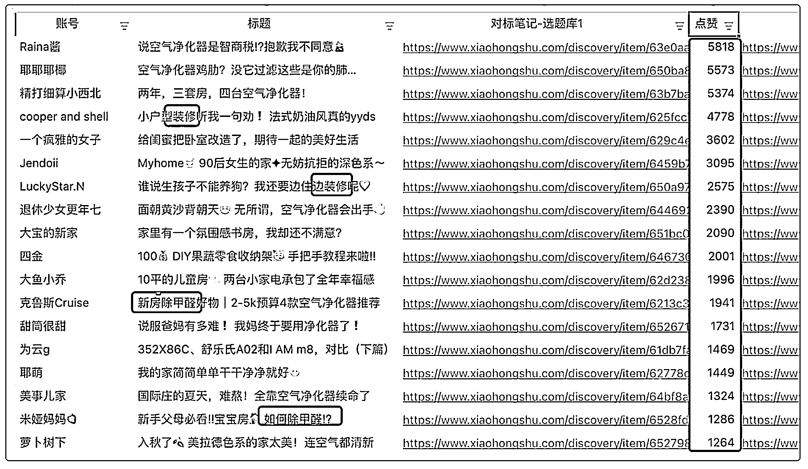 这套方法换到抖音、快手、知乎、🧣也都适用。

但要提醒你一个陷阱。几乎每个培训老师都会说数据分析是必备技能，还能从书里学会。可我要说，这是个骗局。拿我自己举例，两个月前有两篇笔记：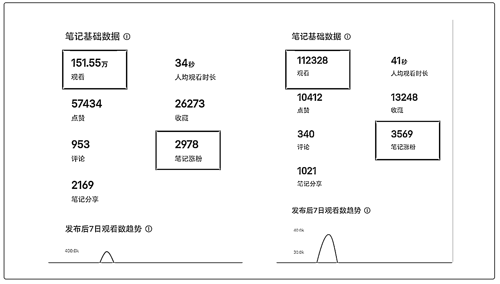 第一篇阅读150多万，转粉不到3000，转粉率只有0.2%；第二篇阅读10万，转粉3500，转粉率3.5%，两者相差17倍。我前前后后对比了十多次，发现两处区别：读者人群上，前者吸引的多是认知层次较低的人，后者吸引的是商业/职场有一定认知的人；内容上，前者偏鸡汤、玄乎、大而无当，后者科学严谨、逻辑清晰。你可能会想：那以后照着后者写就行。抱歉，没有“既然如此”。大多数新手照老师的方法分析，根本啥都分析不出来，只有事后才能理解。我想表达的是：在没有亲身体感之前，那些纯粹从理论推导出来的数据分析，基本都只是个人偏见。你不下场做事、不复盘，就没有分析能力，所谓分析只是自我欺骗。数据分析本质是归纳现象、推理预测，而归纳推理必须建立在亲身体验上。这和费曼“以教为学”一个道理，你可以叫它“以做为学”。

最后讲个故事。2008年，我的数学老师迷炒股，觉得自己在小镇上最懂互联网炒股，每天守着电脑看K线。上课忙的时候宁愿把女儿托给我照看，也要准时买卖。那一年下半年，她怒亏70万，气得住进了医院，发誓再也不碰股票。最倒霉的是她老公跟着背债。为什么那些天天宅在家里看网络信息炒股的人，大多赔多赚少？答案其实就是：没有下场，没有体感，理论再漂亮也没用。

很多人以为靠自己的聪明脑瓜就能把时局算准，可市场从来不会按剧本走。你不在一线盯着，拿到手的永远是别人嚼过的二手信息，分析来分析去，很可能得出个寂寞。

终于聊到这套体系的压轴部分，也是含金量最高的一环：选品的本质。下面这些心法，大部分取自圈友刘小排和盗坤，我加了些自己的实操体感。

有些项目，如果能早一点看穿结局，那么无论现在割舍掉多少，对将来而言都是划算的。可惜世界没有“如果”键。

“选择大于努力”这句话总被挂在嘴边。就拿做知识产品来说，我今年参与了四款，前三个的销量甩开第四个十倍还多：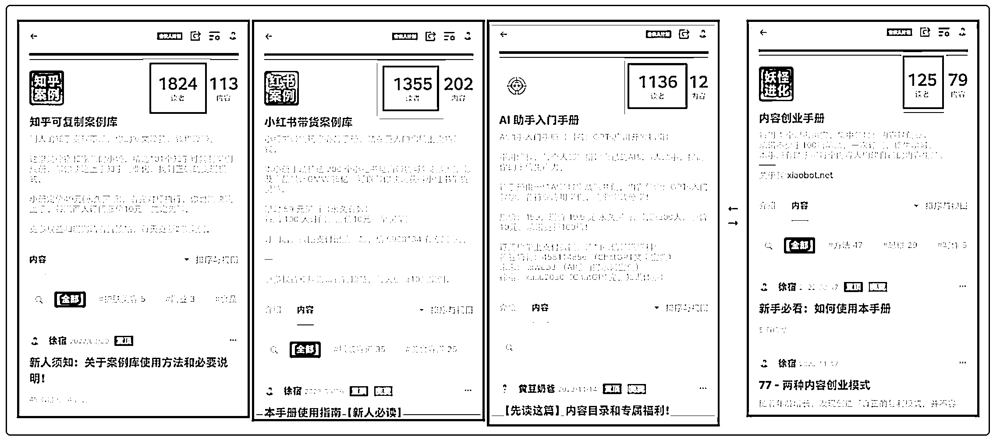虽然我主观上觉得第四款的价值比前三款都高，但客观数据很诚实——大家就是愿意为前三款掏钱（先不考虑营销差异）。

我认同选择大于努力，可要是把它当成一项技能，又不肯下地失败几回，普通人根本练不出来。创业新手找方向，往往要烧掉大量时间去试错，代价真的不小。

# 选品的本质

研究任何事物的本质，本质上就是给它下个准确的定义。所谓选品，说白了就是做生意时该去卖什么货，它直接决定你能赚到多少、未来一段时间你往哪儿走。

世界观决定方法论。你对一个东西认识得越透彻，提炼方法时就越容易命中。所以别急着谈方法，先把“选择”和“产品”这两个词嚼碎了。

## 1、为什么要做选择？

道理不复杂，做起来才知道难。必须做选择，是因为这世界资源就这么多——时间是限量、体力是限量、能叫来的人也是限量；可欲望却永远嫌少，想赚更多、攒更多、时间掰成两半用。

资源有限，欲望无限，冲突就这么冒出来了。从基因底层看，我们每天最大的本能诉求其实是：追求回报率。追求回报率，就得做最优决策，而选择，正是做“最优决策”的过程。如果人生选择稀少，你压根没有做最优决策的机会。

## 2、产品是什么？

俞军在《产品方法论》里讲得干脆：“产品本质上是一种解决方案。”这个定义一锤定音。

强调产品是解决方案，等于说你做的不是孤零零的一件物品，而是一整套流程和系统。比如卖衣服，衣服挂出来不会自动卖得掉：你得定价格、安排客服答疑、做海报推宣传，这堆顾客看不见的成本，全都是产品的一部分。所以我们不妨把递给顾客的那个物件叫“商品”，把你在背后运营的整个系统叫“产品”。商品只是产品的一个切片，产品则是一套接一套的方案。

## 3、产品来自哪儿？

说产品是解决方案，就等于承认产品源自问题，或者叫需求。有难题才需要方案，没有难题，方案自然也就没有存在意义。比如人类爱干净，又希望洗衣省事儿，这才有了洗衣机。可如果你邋遢得心安理得、根本不需要换洗衣服，那洗衣机作为商品，价值瞬间归零。

一个产品，要担起一份责任；担得越重，价值越大，你赚到的钱也就可能越多。下文我会把“产品”这个词统一说成“方案”：方案 = 产品。

## 4、选品的本质就是选择解决方案

到了这儿，结论也浮出水面：选品的本质，就是选择解决方案，而且最好挑现成的。如果是自己从零做产品，那不叫选品，那叫创品，完全是两码事。

为什么非得选品？因为早期的创业者还没能力无中生有地造新品。很多时候我们自以为惊艳的方案，对用户而言不过是一场自嗨——前面列出的那几款知识产品销量差，就是活生生的证据。想要提高赚钱概率，最稳的办法是去市场上挑那些已经被验证过的方案，先确定需求真实，再照着复制，把基础利润攥到手里，赚那些更容易赚的钱。

# 如何选择解决方案

## 1、收集方案

前面说过，选择的前提是足够多的选项。没有数量，就没有“最优决策”，因为你根本没得选。不少人早期创业卡壳，就是手里好项目太少。所以第一步，去市场里搜刮足够数量的方案。这里有三个落地关键：收集的标准、收集的维度、收集的方法。

### 1）收集标准

标准来自目的。第一个标准必须是：有稳定的交易量。也就是专挑那些持续在赚钱的方案。比如想去📕、抖音选品，就去看商品的销量和销售额——一个东西摆了大半年都没出几个单，大概就是没市场，数据在绝大多数时候不会骗人。

交易量能告诉你市场有多大需求量；交易频次和稳定度，能告诉你这是不是一门能长期做的生意。这个标准背后的逻辑很简单：大多数人做生意，核心诉求就是赚钱；而从用户的角度看，只有真能解决自己问题的东西，他们才愿意掏真金白银。两头一夹，筛出来的方案基本是能持续赚的。

但这还不够。世界上能持续赚钱的方案太多了，可绝大多数跟你没啥关系，给你你也干不了。于是第二个标准，是那种“方案特别差”，差到你一看就觉得“我上我也行”。

这就是条反直觉的逆向思考。正常人总想收集最成功的案例，可这些案例拿回来，往往是你做不了的。为什么需要“选品”？因为你资源少、能力小，只能捏软柿子。上面两条标准，能确保你收到足够多、市场验证过、而且自己够得着的方案。

### 2）收集维度

有了标准，还得有能上手的着力点。我给出三个维度：从商品、人群、需求出发。

**从商品出发**，是最省力的方向。商品是方案最直观的载体，成交量放在那儿，谁都能看见。比如你想在淘宝上做事，直接去搜自己想做的行业，看各种商品的交易数据：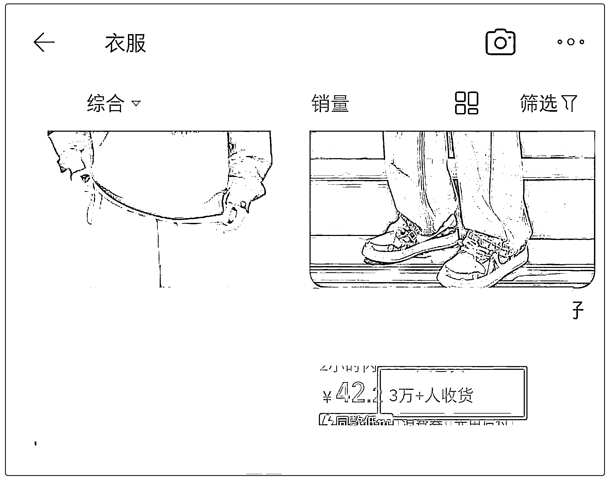平台上的交易量都明晃晃摆着，你只管去收那些有量、且你撑得住的方案。至于各平台更细的收集招式，以后有机会再聊。

**从人群出发**，门槛稍高一点，但你要是长期泡在某个圈子里，就会对那一群人隐藏的痛点非常敏感。我有个朋友酷爱运动，篮球、羽毛球、乒乓球、徒步样样沾，混圈子久了，特清楚圈友喜欢什么，隔三差五还拉我去打球。后来我做知乎带货，灵光一闪，以这个人群为切入口选品，然后天天泡在百度贴吧、中羽社区跟几个他的聊天群里，泡了三四天就动笔写带货文章。结果流量生猛得很，一个月卖出几千单。

**从需求出发**，说到底还是要回到用户的需求。你要是能精准锁定目标市场的真实需求，其实就能直接从需求反推选品。这里有两个切入方式：

- 从自己身上找：我爸自己爱养花种草，天天刷抖音绿植视频。我顺手一查，发现这个赛道的市场空间大得吓人，再去龙哥盟一搜，已经有人靠它赚了100多万。
- 从别人身上找：以前有个学员在月子中心上班，待久了，发现孕产妈妈在孕育期有一大堆需求。三年后她自己开了一家服务月子中心的小公司，专门解决当初收集到的几个核心需求。

### 3）收集步骤

主要就三步：第一步，确定关键入口；第二步，人工或工具搜集；第三步，录入电子表格。

搜集方案得先有个入口。线上渠道有五个基础入口，可以反复用：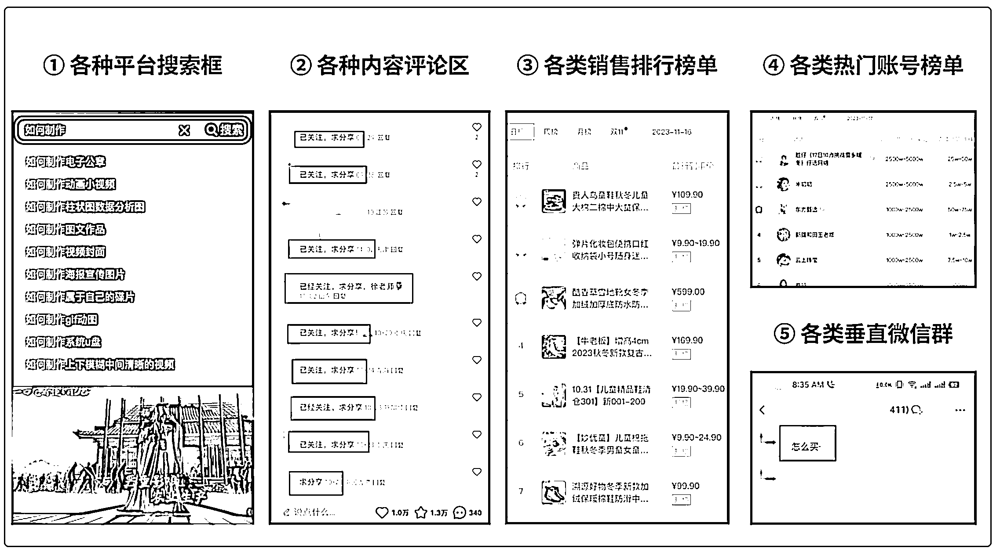

搜集时不光可以用工具，也可以人工去翻。我自己在某些阶段，为了保持对异常需求的敏感度，会强制自己每天刷淘宝、抖音、📕这类平台一到两个小时，有时候还更久。最后，把收集来的所有方案整理进表格。给新手推荐一套模板：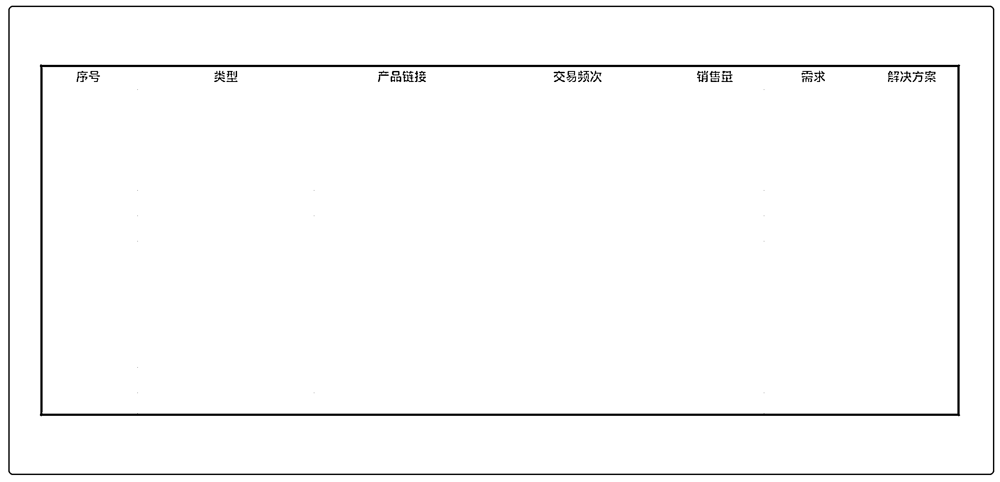

顺着这套流程，你就能给后面的“选择”供上足够多的弹药。

## 2、分析方案

分析的目的是做判断——判断这套方案能不能用、这个市场能不能进。

### 1）分析核心需求

前面说了，方案源自需求，没有需求就没有方案。所以分析的第一步，是搞清楚每个方案到底在解决什么核心需求。

比如绿植市场。我最开始以为我爸他们就是喜欢花花草草，但往深了想，他们真正迷恋的不是植物本身，而是“自然的东西和环境带来的安静生长的感受”。他们需要把注意力投到某个有生命的东西上，体验那个“慢慢养成的过程”。这跟小孩搭积木是同一个逻辑，过程能给他们带来内心的平静和舒服。抓住这层核心需求，后续判断和测品才能更准。至于核心需求怎么一步步锚定，应该回到需求等级图谱里，这块我以后专门写文细说。

### 2）分析成功因素

一个方案能变现赚钱，绝不是一个环节做对了就行，得找到整个流程上的关键成功节点。

年初我做了个信息产品叫“知乎案例库”，一周卖掉1500多份，累计销售额近10万。后来几个朋友跑来说他们也做同款，结果惨不忍睹：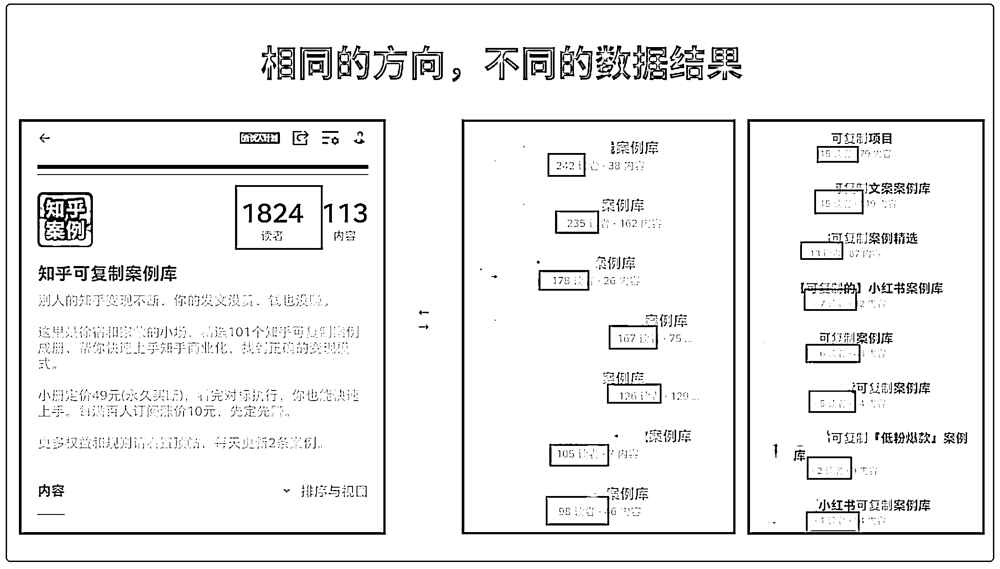同一个方向，为什么结局天差地别？因为决定结果的，远不止方向本身。那个小产品能爆，靠的是我过去积累的影响力，加上运气好，请到了几位有分量的朋友帮忙推广。商品可以复制，但它背后的供应链、推广渠道却很难复制——有就是有，没有就是没有。只有把成功因素拆明白，才能判断自己到底能不能复制。

### 3）分析供需市场

查理·芒格说过：手里拿着锤子的人，看什么都像钉子。你看中一个方案后，很容易觉得全世界都需要它，可现实根本没那么多用户。

分析供需空间，就是去看某个市场的卖家数量和买家数量，判断这里还有没有你的位子，目标则是看准这个项目能长多大。比如洗衣机的例子：家家户户都得洗衣服，不看数据你会拍脑袋说中国今年得卖14亿台。但按家庭口径算，只有3到4亿家庭；再刨掉已有洗衣机且不打算换的，2022年中国洗衣机实际销量是3600万台。拍脑袋和实际市场之间，可能隔着100倍。我们要做的，就是尽量去那些供不应求、尚未被垄断的市场里找机会。至于供需更细的分析招式，以后也另写文章说。

## 3、判断匹配性

把核心需求、成功因素的可复制性、市场空间都捋过一遍，接下来就该拍板了：判断自己的资金、精力、人手能不能扛得住这个项目。很多项目看着亮眼，但你缺时间、缺钱、缺人，根本落不了地。具体判断流程如下：

第一步，确定目标；第二步，筛选配对；第三步，匹配就做，不匹配就换。

先确定目标：比如你给自己定一个明确的赚钱目标。人生阶段不同，能力跟欲望也不一样，20岁时一年能赚10万就算赢，可到了30岁，你可能会给自己定一年100万的目标，而这并不容易实现。再筛选配对：用你手头的资金、时间、人脉、货源，和项目逐一配对。匹配上了就进入测试，匹配不上就回方案库重新走一遍上面的流程。

## 4、测试方案

走到这一步，我想泼一盆冷水：前面所有步骤，都只是假设！

只有真正下场去试，才知道方案通不通。1931年，数学家阿尔弗雷德·科日布斯提出了一个经典思维模型：“地图不等于疆域”。意思是，所有文字理论、数据调查，都只是对过去发生之事的抽象统计，并不等于未来还会照着演。一个方案到底能不能变成钱，最终得靠你真的动手去卖——这件事，任何文字和思考都替不了你。

测试方法也不花哨：像素级模仿市场上已经跑通的解决方案，先把钱赚到手、把流程跑顺，确认有效后，再考虑复制与创新。

《财富流》里有句话说得透：所有成功的企业家和投资者，就算生意失败，也能东山再起，因为他们掌握着“了解他人需求并提供解决方案”的能力。他们明白，这种能力是人类迄今最好的工作保障。

附上这部分的知识体系脑图：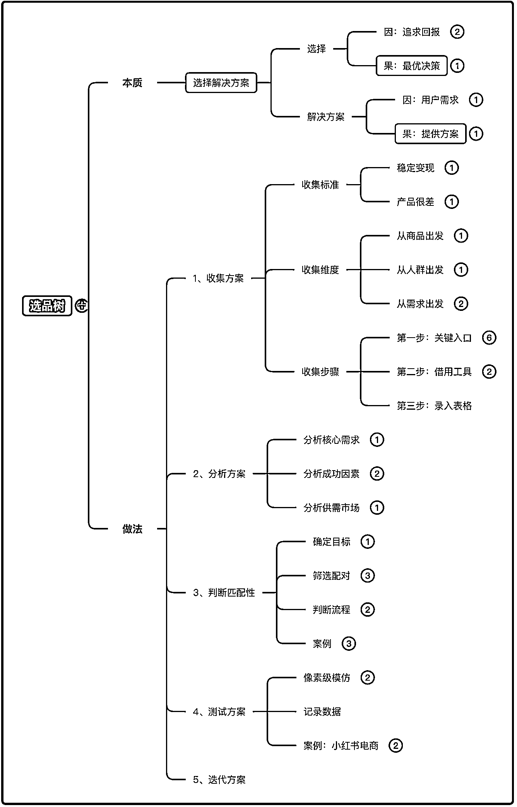

正文完！

这套知识体系，我磨了4个月，边实操边迭代，边记录边搭框架。看过的赚钱精华文章超过120篇，亲手试废了6个账号，写下的文字稿累计不低于5万字：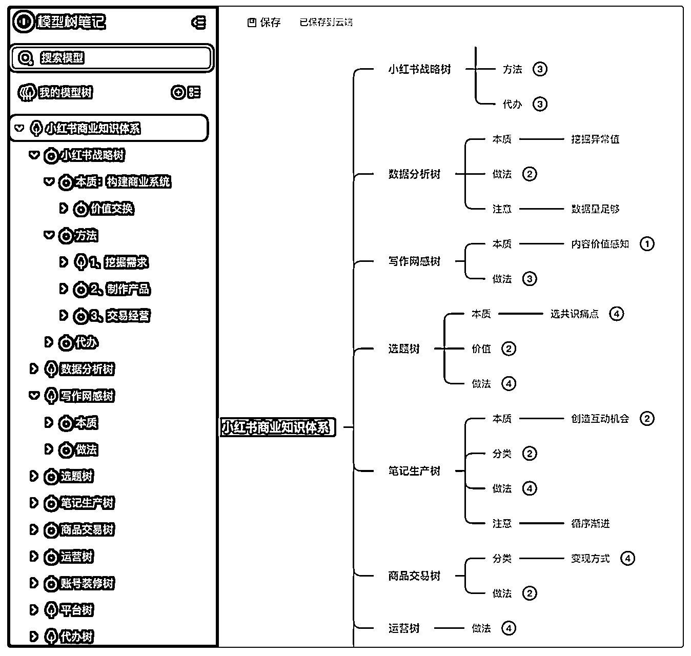从价值来讲，我觉得至少值10万。

你要是有点迁移能力，应该看得出来，这套东西不止能用在红书，底层逻辑放到抖音、快手、B站也说得通——龙哥盟里已经有人拿我的框架改一改，去闲鱼上跑起来了：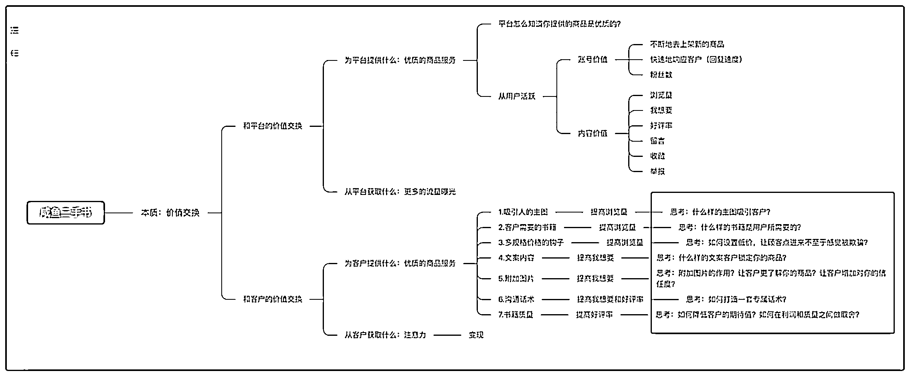

写作是整理思维的过程。对作者本人，它是思考的痕迹；对读者来说，它是你可以继承的遗产。可你能吸收多少，最终还得看你自己的经历和理解力。

# 需要注意的一些陷阱

《道德经》讲“道可道，非常道”。我原先的理解是：能说出来的都不是真道。后来想通——很多经历过的事，一旦用文字写出来，价值就打了折扣。我自己在研究知识体系的过程中越来越清楚地意识到，方法写得再细，本质仍是抽象概念，不等于真实本身。

日常里，我们每个人都在盲人摸象，你有一个视角，我有一个视角：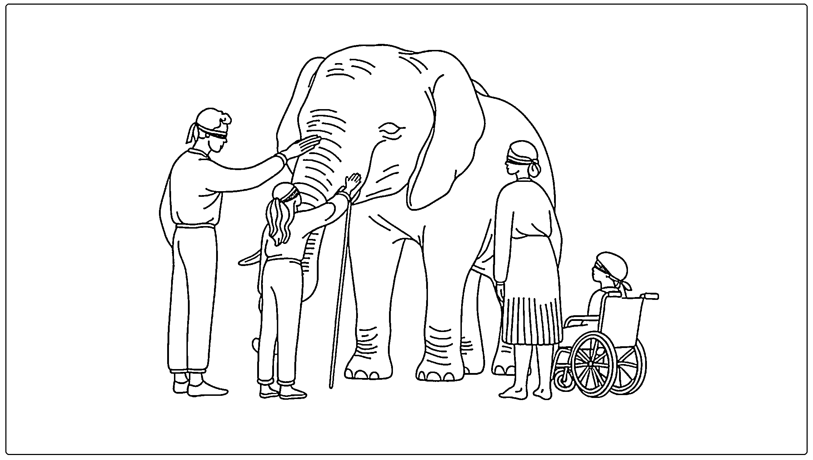

想拿到真正的成绩，必须亲自去做那些具体的事，在事里千锤百炼，才可能熬成大器。我给你的这套系统，不是让你躲开千锤百炼，而是帮你找到一条值得自己千锤百炼的路。

这个时代难混，信息又爆炸，太多人教你“什么都要学”。可事实是：大脑的内存是有限的。你真正该做的，是尽量清掉那些杂七杂八的东西，只留下最有用的知识，长期去实践，拿到现实里的结果。

# 写这篇文章的两个目的

一是补个后续：上次在赚钱分享过《什么样的知识体系对于赚钱是有意义的》：[`t.zsxq.com/16YuPRpyw`](https://t.zsxq.com/16YuPRpyw)，这篇算是那种理念的落地延伸。要是能帮到更多人，我很开心。

二是顺手介绍一下自己：我有“个人知识体系”和“商业知识体系”相关的培训业务，如果圈友或老板需要掌握这套东西，可以通过这篇文章来认识我、链接我。

这篇文章其实拆开足有6到8篇，但没必要，索性一次性说完。能看到这里的，估计是真的读进去了。我是徐宿，祝你好运。

另外，我本人不做任何📕赛道培训，该写的都在这里了。有更细的问题，推荐找@梨云，我在📕上的成绩，都是受她指点得来的。

评论区：

梨云: 大家习惯从用户角度思考，徐宿这篇却把视角拉到了更高维度，从平台侧把注意力资源的变现逻辑讲透了，让人对内容创业又多了一层理解。关于数据分析，他文中提到的《如何分析各种📕账号的赚钱模式》正好做加餐[机智]：[`t.zsxq.com/16raegeyv`](https://t.zsxq.com/16raegeyv)

徐宿: 强烈建议把梨云这篇看十遍，太有价值了。我当时就是被这篇文章启发，才对数据分析有了真正的体感[得意]，梨云牛。

朝暮拾花: 这波联动太妙了。

朝暮拾花: 半夜拜读，辗转难眠，索性爬起来再读一遍，晚安😴

不然: 反复读了几遍，酣畅淋漓，感谢大佬。不只是做📕，文里讲的底层逻辑放到其他领域也完全成立，庆幸自己没有错过。

徐宿: 能给你启发，我很开心，一起发财。

徐宿: 哈哈，不然，你慧眼识珠。

空: 感谢分享[抱拳]。学了一堆“术”层面的技巧，今天这篇“道”层面的文章，一下子把零零散散的知识全打通了。[强]

