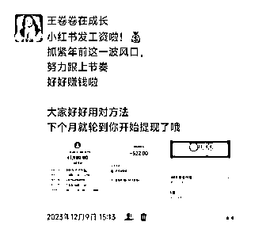
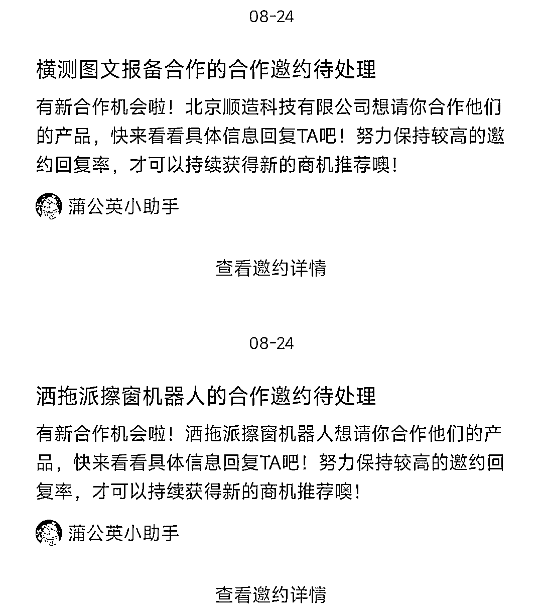
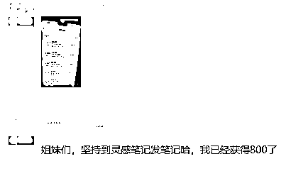

# 做📕变现，我好像摸到了一条很稳的路子

## 我是怎么一边带娃一边用📕赚到10万的

大家好，我是卷卷，93年的全职妈妈，边带娃边玩自媒体，去年靠📕变现了10万+，也算是重新找到了自己的节奏。

我手上做过好几个📕号，之前都卡在千粉就懈怠了。今年直播起来了，我想试一把，把账号做成万粉体量，所以今年的主力战场都放在📕上。

今天就把我目前摸索出来的思路拆开说说，24年想靠📕做点收入的姐妹可以收藏。

对了，刚起步不知道从何下手的话，可以来找我拿“7份📕运营资料”，先关注我，后台回复我就能领。

我们直接进入正题：

直播间里经常有新手问我第一步该干嘛，说实话一两句话很难讲清，所以干脆整理成这篇。

一、怎么注册和养号

先去注册一个📕号，如果赛道还没想好，可以直接用🛰️、🐧这类社交账号登录，开始大量刷你感兴趣的内容。

等方向定了，再换成绑定手机号去刷竞品账号。

养号这件事别神化了。想想你自己以前单纯刷📕是什么状态，就用那种心态去操作。点赞、搜索、收藏、评论、关注，这些动作你平时是怎么用的，就照常来。

唯一的区别是，把你原本随意的点赞对象，换成你想学习的对标账号就行了。

二、定赛道，也就是定定位

选好赛道基本就等于把定位定了。虽然很多前辈说定位是做出来的，但起步前至少有个大致方向。

**给两个参考方向：**

愿意出镜的，可以做有人设的个人IP号。分享个人成长、学习自媒体的心得，真人出镜+真实场景去拍。这样账号起来后价值高，接广告的空间也大。

愿意出镜又有自己的产品或货源的，依然走个人IP路线，但选题要围绕你的产品展开。做人群就要做精准，不要又想要泛流量又想要精准粉，这两者很难兼顾。想赚精准人群的钱，就得放弃泛流量。

举个例子：你是教孩子画画的老师，想做线上教学。那就不要发你开画室创业的辛酸史。要发的是：你教孩子画画的现场、你的绘画专业技巧、学生作品多好看、画室环境多好。线下也能引流，等有客户了再推你的儿童绘画课。思路就这么通。

**不愿意露脸怎么办？**

给自己搭一个学习氛围感的场景，只拍不露脸的照片或视频就行，这个思路你可以去看静静教主。

完全不想露脸、没经验、也不想花太多时间学习的怎么办？

我去年8月才知道的一个玩法，上手快、变现也快，很适合普通人。它的名字就叫“**📕商单**”，说白了就是做蒲公英广告接商单的号。

和大博主动辄几千一单不一样，这类单子报价很低，大概200-300左右。

账号做到1000粉就能开始接单了，一个月接个8-10单，赚1500-3000就够用了，接太多怕蒲公英等级异常。

为的是保号，让第二个月还能继续接。所以有人可能会说，赚1500块有啥意思。

你别小看这个数，你多开几个号看看。很多人会问，📕涨粉多难啊，跟登天一样。

我之前也这么想，我做过两个IP号，涨粉慢还费时间，写文案做图两三个小时就没了，发出去没动静，特别打击人。这种模式对自媒体小白来说很难坚持。

所以去年8月发现这个赛道时我觉得太适合普通人了，当下就开干，10天涨粉1600，直接变现了。

后来用同个方法再开一个号，也是一样很快起量。所以我一直强调，要多账号一起做才能放大收益。我在一个群里看到有人同时运营3个号，一个月变现8000多。

赛道定了，就开始搭建账号。

二、账号搭建

确定好要模仿的账号风格后，就要做“门面装修”了。包括头像、昵称、简介、邮箱、实名认证，这几个都要弄。

头像：建议用真人照，方便建立信任。如果实在不想露脸，用一张好看的动漫头像也可以。做商单这种不露脸的类型，动漫头像完全能用。

昵称：常见套路是“××在成长/××极简生活/××在逆袭”这种格式。不露脸的就起个好记的名字，也可以参考对标账号，改个后缀加上你自己的辨识度。

注意别用英文名或繁体字，不好念也不利于传播。

三、内容要利他

随时问自己：别人为什么要看我的这条笔记？我给了干货价值还是情绪价值？想清楚这个问题，内容方向自然就清晰了。

四、封面要统一

封面风格统一，粉丝点进来看到整洁一致的视觉，会更愿意关注你。

五、发布渠道有讲究

实测好用！我有个学员就经常用笔记灵感去发，她薅了很多官方的流量券，性价比很高，建议大家优先在这里发。

**还有一个小技巧，新号一定要去订阅【笔记灵感】，直接送200流量券，很划算**

今天的内容就到这里，明天继续讲后面的实操。关于📕的干货我会持续更新，有需要的姐妹记得先关注。

#📕

* * *

评论区：

坏脾气的小可爱 : 卷卷太厉害了宝！

王卷卷在成长 : [调皮][调皮][调皮]终于开始骨气勇气更新了谢谢小可爱么么哒

书豪 : 牛

芮 rui : 学到了，有用知识又增加了。

对我小红薯运营航海非常有帮助

微微星光 : 怎么做到一千粉呀

* * *