# 3分钟上手，用AI一天产出100条小红书爆款笔记的方法

> 原文：[`www.yuque.com/for_lazy/thfiu8/fgs64nw40mxmez3w`](https://www.yuque.com/for_lazy/thfiu8/fgs64nw40mxmez3w)

## 3分钟，学会批量制作100条小红薯爆款笔记

作者： 💖善士笔记💖

日期：2024-01-10

这是**善士笔记**打卡的**第 24 天**

日更一万天，做长期主义创业者

开个头先抛个问题给你：**一天能搞定100条小红书笔记吗？**

看到这个数字是不是有点懵？别说100条了，就算是灵感爆炸的时候，写个10条小红书内容也够把人掏空，更别提还要保证质量。

觉得做不到？太难了？

**善士要说的是，现在都2024年了，把AI工具拉进来当帮手，效率直接拉满。**

我自己每天都在用AI干活，今天就把批量做小红书笔记的实操流程拆给你看，带你进入一个更省时、更有趣的内容生产模式。

**1**

**AI如何帮你批量写小红书笔记？**

小红书内容主要分图文和视频两大类，今天先讲图文的批量打法。批量之前，先从用AI做一篇笔记开始练手。

**一、AI写文案**

市面上的AI写作产品真的不少。国外有ChatGPT、NationAI，国内有百度文心一言、copyAI、腾讯混元助手、火山写作等等。

我几乎每个新工具都会去试试，发现它们写小红书文案时都还有优化空间。**不过在长期测试后，确实筛出了2个写小红书特别顺手的工具，分享给你。**

**1\. 多种草 AI**

[`duozhongcao.com/`](https://duozhongcao.com)

多种草现在上线了16个AI智能写作功能，从账号定位、简介撰写，到标题生成、正文创作、视频脚本，全流程都覆盖了。

**怎么用：**

把你的核心想法丢进去，再补充几个风格要点，就能一次性拿到5个标题+一篇带emoji的小红书风格正文，还会附带相关搜索话题。

一篇笔记就这么成型了。

想要结果更准，可以按这几个维度去喂信息：

**1.内容主题 2.创作要求与背景 3.产品卖点 4.目标人群 5.表达语气等**

想做同系列批量笔记？点一下【生成】就继续出下一篇，基本不到一分钟就能刷出一批。

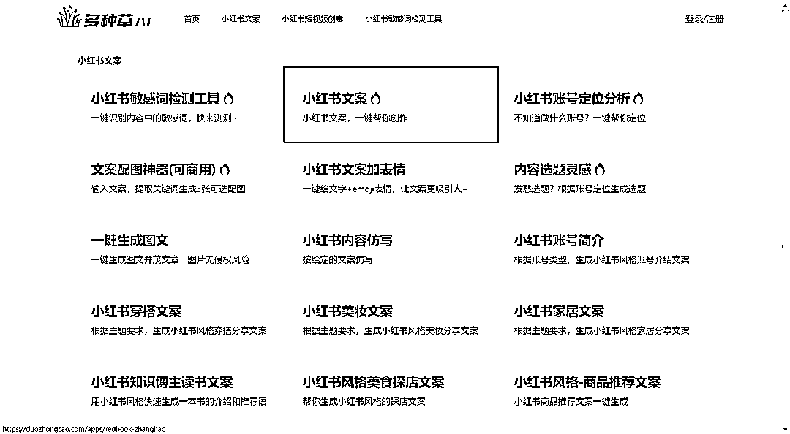

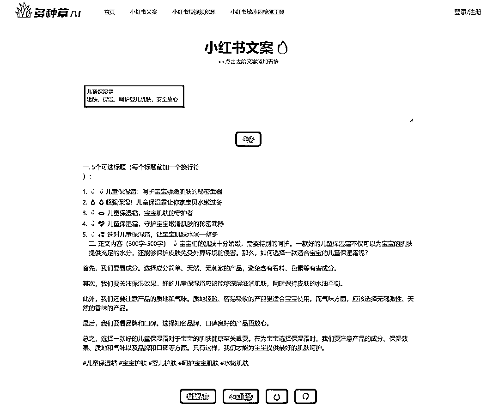

**2\. iThinkScene**

[`app.ithinkai.cn/`](https://app.ithinkai.cn)

这款能自动生成各平台自媒体文案，覆盖小红书、抖音、知乎等，图文、短视频脚本、直播话术都能一键搞定。

**怎么用：**

操作极简，输入一句话需求就行。比如输入：介绍6个免费的AI绘画工具。立刻就能生成一篇适配小红书的文案。

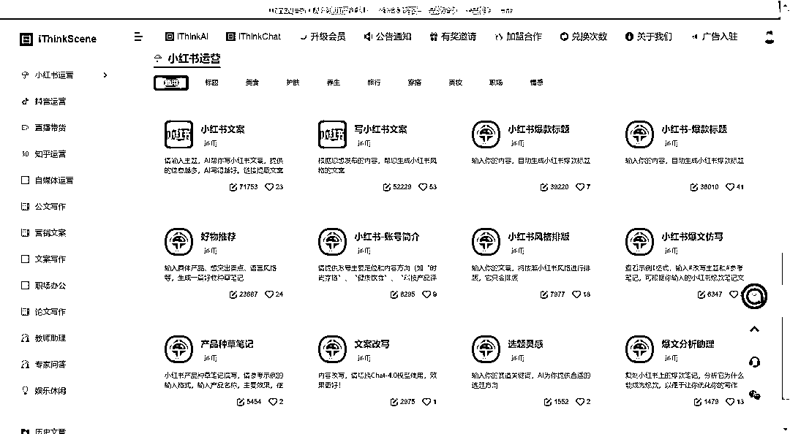

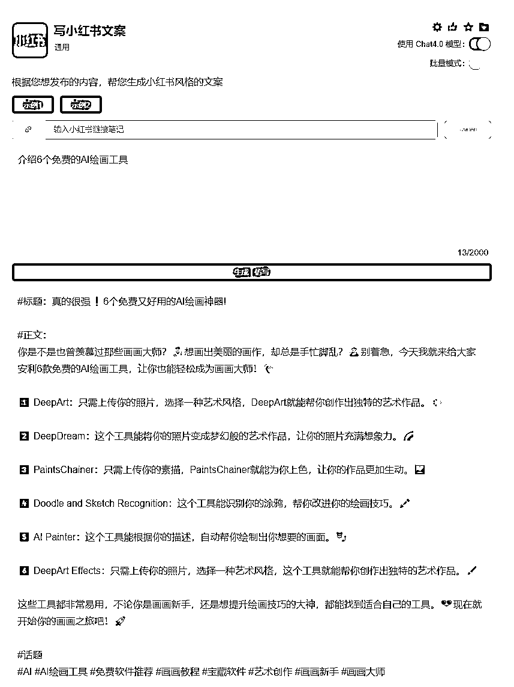

一个加分点是，iThinkScene的笔记制作页里藏着**【批量模式】**，一次可以并行生成两篇内容，效率直接翻倍。

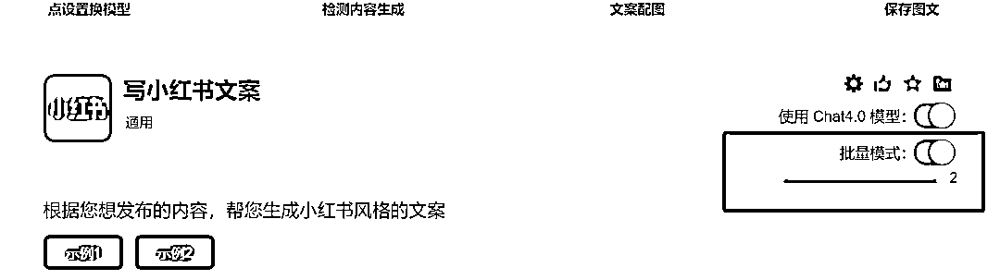

文案有了，下一步是配图。

**2**

**二、小红书图文怎么批量做？**

**1.iThinkScene**

[`app.ithinkai.cn/`](https://app.ithinkai.cn)

刚才提到的iThinkScene，在文案生成下方有【文案配图】入口，打开后就能在站内模板库里挑封面，一键生成图文。

**注意点：**

1.标题字数必须和模型要求匹配，只能在模型最大字数范围内使用。
2.这个功能需要开通会员才可用。

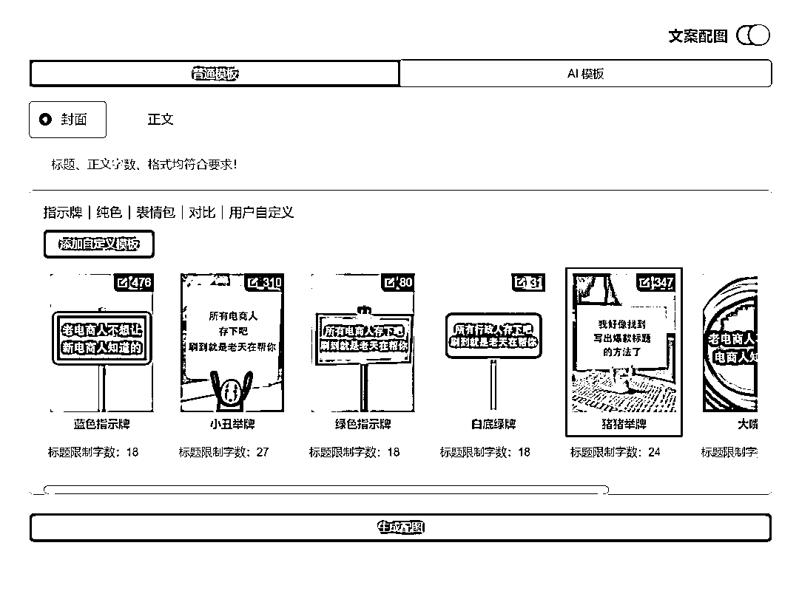

**2\. canva**

[`www.canva.cn/`](https://www.canva.cn)

Canva的模板大部分免费，直接拿来改就好，素材库也足够丰富，我自己也在用。

常规流程：选一个小红书模板，把笔记文案粘贴进去，微调一下排版做完一页后，右上角点添加页面，就能连续批量出图。非常友好，新手也能快速上手。

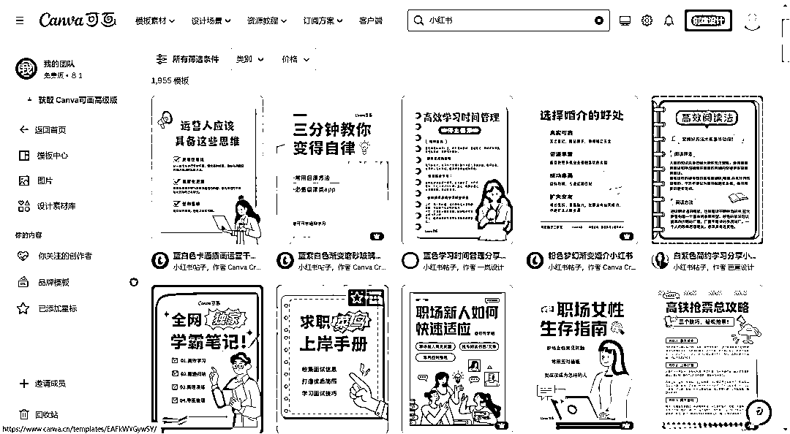

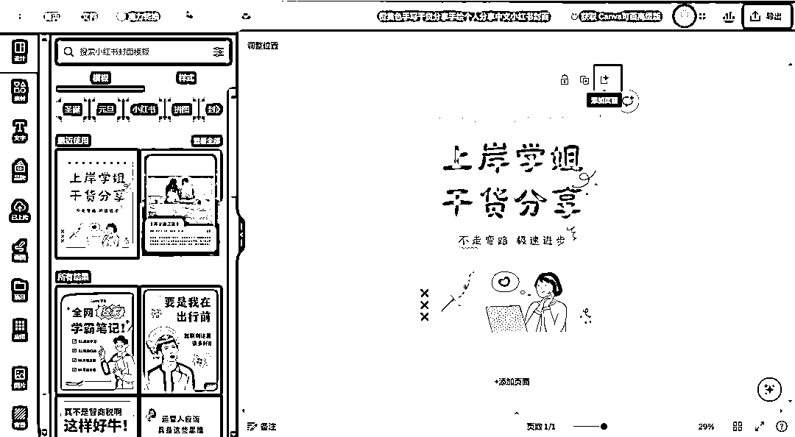

**3.稿定设计**

[`www.gaoding.com/`](https://www.gaoding.com)

稿定设计里我常用的批量图文方法有两种。

第一种：

直接搜索小红书模板，和Canva思路一样，找模板、换文字、加页面即可。

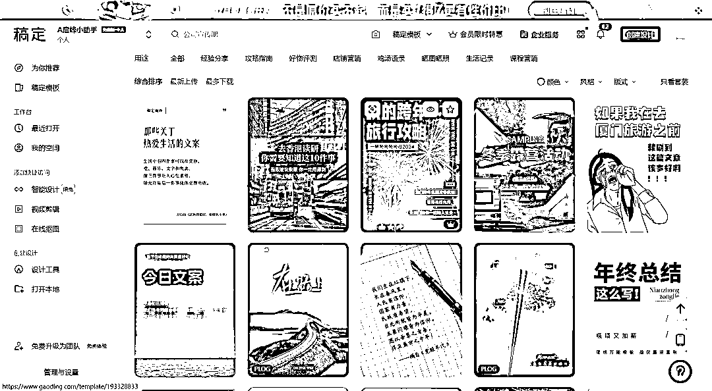

第二种：

稿定从2023年中就开始接入AI功能。如果不想用现成模板又不会设计，可以去【设计工具】里的【小红书封面】，填入主副标题，AI就能自动生成一张封面，再继续加页面稍作修改就完事了。

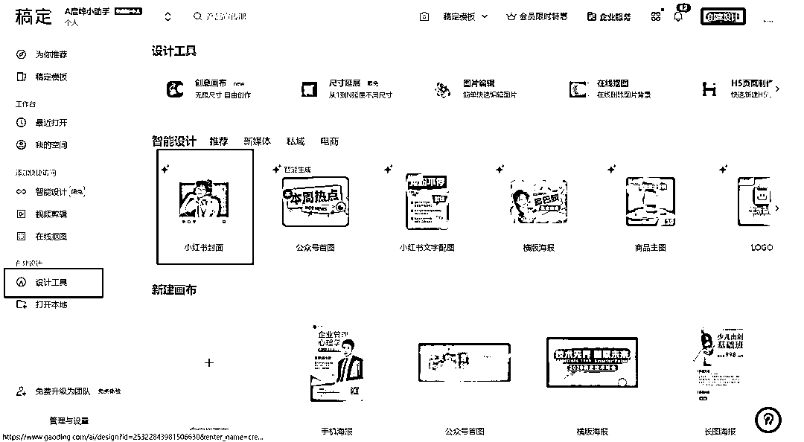

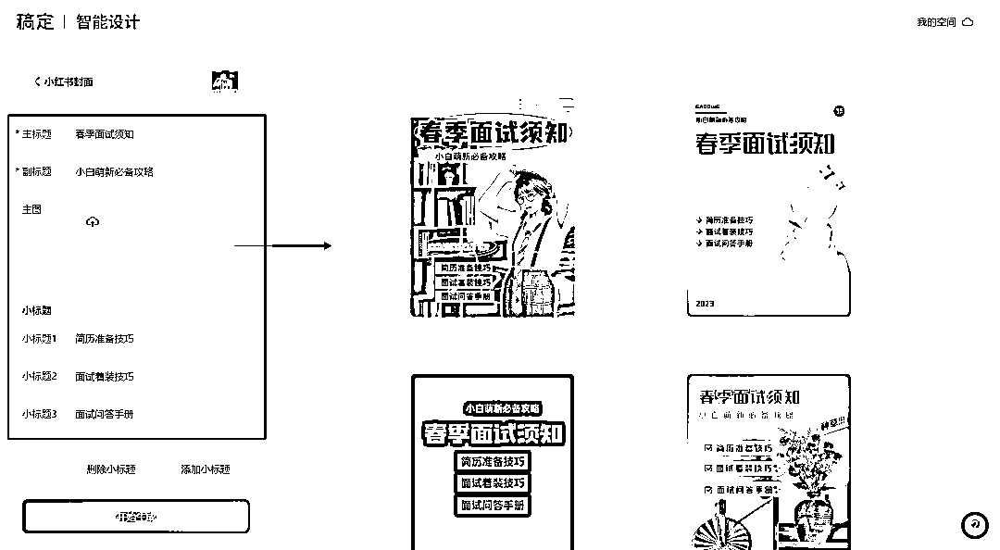

**总结一下，今天分享的思路就这些。流量为王的当下，如果内容储备不够，就先用数量堆出来。**

多上手实操几次，量变自然会带来质变。别觉得复杂，工具用对了，全流程会变得异常简单。

* * *

评论区：

💖善士笔记💖 : 这是善士笔记打卡的第 24 天

日更一万天，做长期主义创业者

快乐小新 : 感谢

Jeffrey : 多种草用起来不错

💖善士笔记💖 : 有用就好

芝士巧克力 : 感恩分享[强]

💖善士笔记💖 : 喜欢就好

* * *