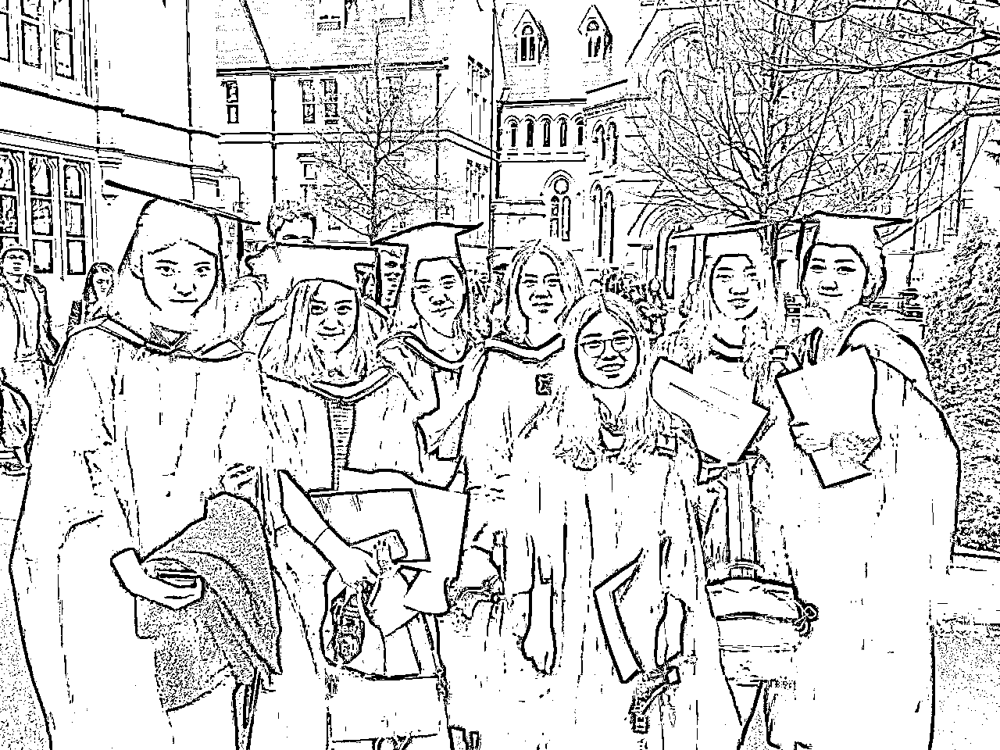
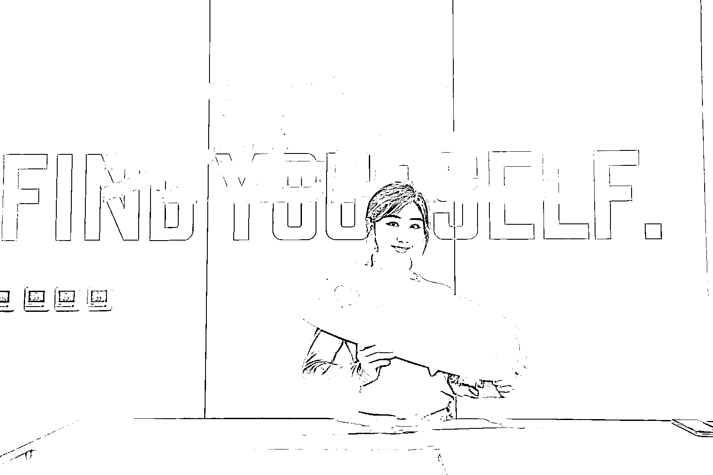
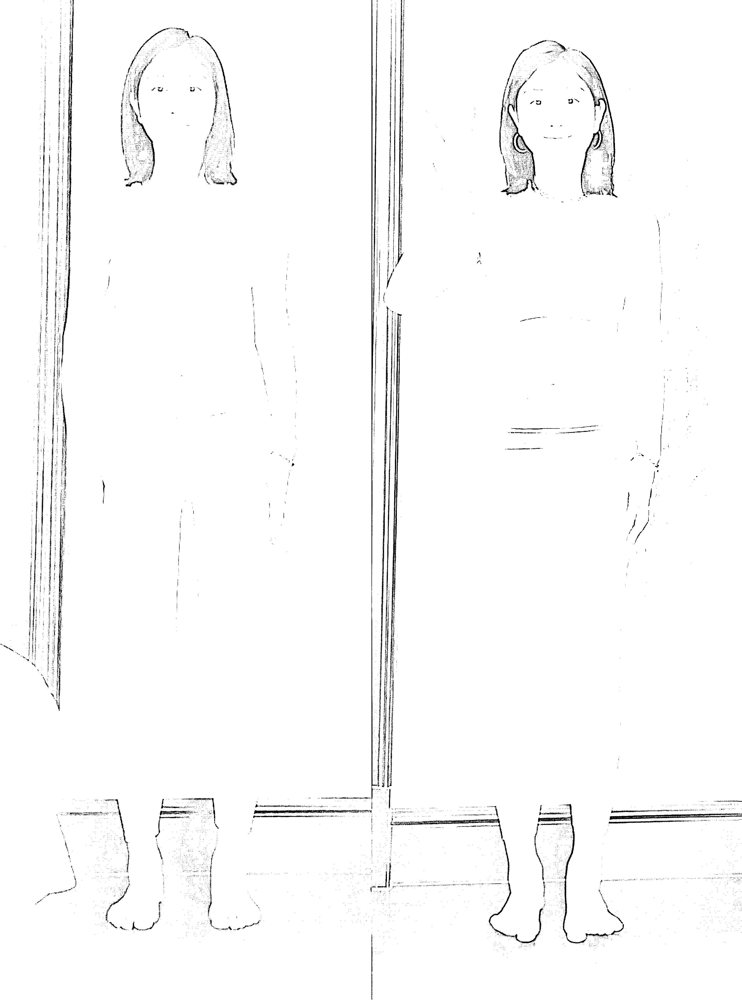
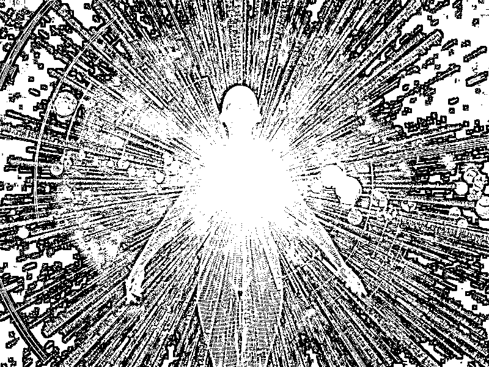
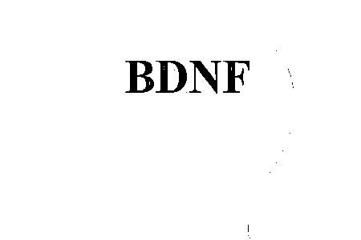
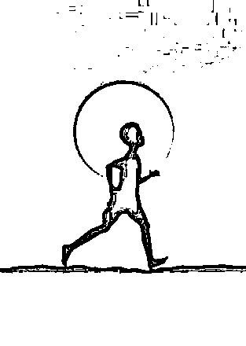
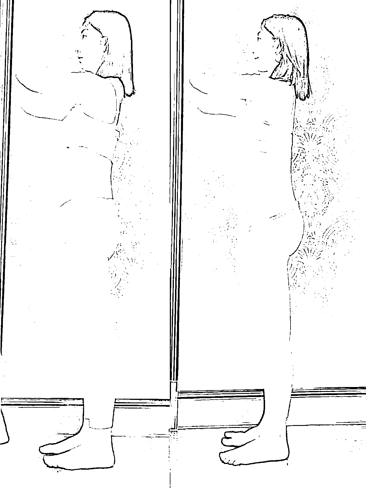
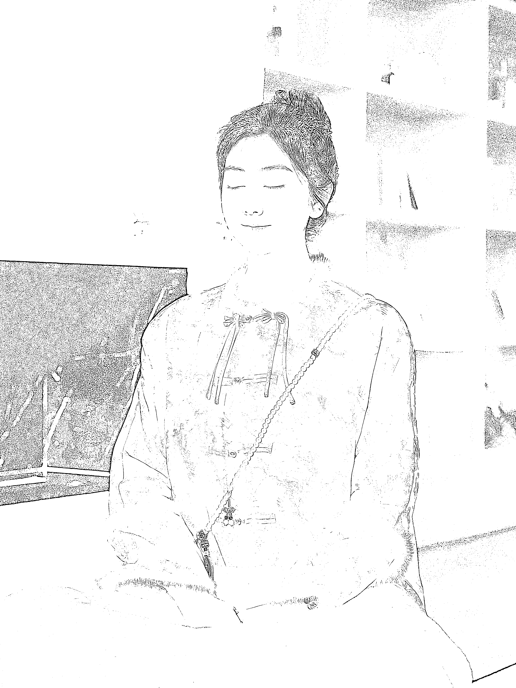
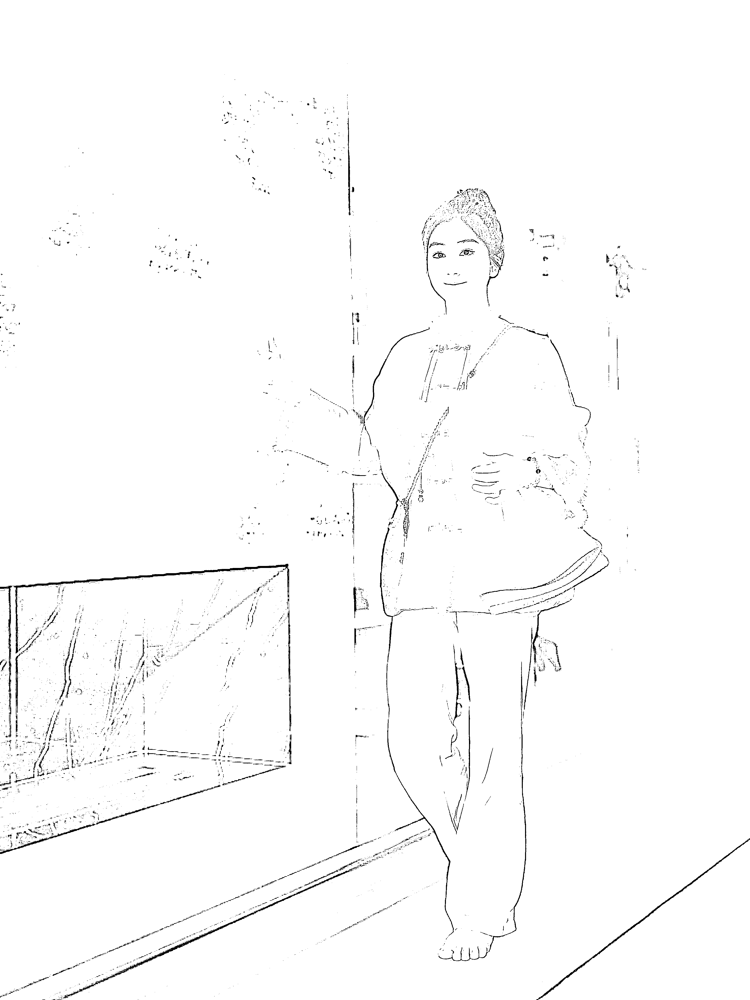

# 创业路上，你的“守护能量”还剩多少？这套充电心法，帮你把焦虑内耗清零

> 原文：[`www.yuque.com/for_lazy/thfiu8/gn2cka3eozzw7zw7`](https://www.yuque.com/for_lazy/thfiu8/gn2cka3eozzw7zw7)

## 创业者电量告急：从内耗到满血，我靠的是这套组合打法

作者： 碧瑶

日期：2024-01-10

先做个自我介绍——我是碧瑶，全网过百万粉的「治愈系运动」博主，一名专注运动疗愈的教练。我擅长借助动静结合的训练方式，引导人调整情绪、卸下压力、重塑体态、告别内耗，让身心重新对齐，再从容地去表达自己。

创业这条路上，谁没经历过“身体还在，精力已尽”的时刻？前一秒还在人前硬撑，后一秒只剩自己清楚——那口气随时会断。那种像被抽干的感觉，跟提线木偶没什么两样。

今天，我也以创业者和疗愈教练的双重身份，把我和学员实际用过的“回血方案”摊开来讲，帮你**快速回血、持续续航，甩掉焦虑内耗，满血状态去搞钱。**

三年前，我做了运动行业的MCN机构，创办了自在身心瑜伽教练培训体系，提出了“运动疗愈师”的职业方向。我自己，则把运动当成了信仰。

2016年，我在Keep创始团队做产品研发经理，负责瑜伽板块的架构。说起来很多人不信，我并非体育科班出身，本科学的是金融与会计，后来去英国曼彻斯特大学商学院拿了金融硕士，还是ACCA持证人。

> 一切是怎么开始的

转行这件事，还得从我的身体和情绪说起：

12年前，我因为代谢类疾病，吃饭、睡觉、情绪、状态全都乱套了。医生下了结论：遗传病，终身吃药维持。那会我刚18岁，看着周围同龄人活力四射、身材好、状态好，我却像被关进了一个透明罩子，越来越不想见人。

但我骨子里不服气。当时还是男友、现在是我老公的那个人，硬是把我拽进了健身房。我开始规律训练、调整饮食，系统地补人体与心理的知识。没想到，这一练不仅治好了身体，还让我收获了让人羡慕的身材，更让我找到了那股“运动精神”。这股劲儿后来带着我走过了很多人生高光，也替我定下了往后的事业方向。

所以，我现在做的事情，背后是12年的积累。

我自己一边练，一边在社交平台分享心得，后来又从线上教练做到线下教练，再进入Keep做课程研发。慢慢我发现，大多数人坚持运动并不是单纯想瘦，而是想缓解内心的焦虑，想在变好看的同时，也变成那个更厉害的自己。

2020年，公司刚起步，我正好怀孕。初为人母、公司一堆杂事、还有几件突如其来的变故，压得我喘不过气。脸上疯狂爆痘，身体发胖，整个人像被掏空，提不起劲做任何事。

于是我开始第二次自救。这一次，除了运动，我把静坐修心也加了进来。

给你们看看当时状态最差的我，坚持“动态训练+静坐冥想”30天后，脸和身材的变化：

这30天让我彻底相信，运动加冥想，就是守护状态和精力的最佳组合。

“自在身心瑜伽”体系，也就在这个过程中慢慢打磨成型了。

它跟我平时接触过的瑜伽不太一样，底层逻辑是东方智慧，上面嫁接的是西方人体学、运动学、营养学，最终形成一套适合东方人体质的练身+修心体系。

1.  练身，管身材；
2.  静坐冥想，管情绪；
3.  读书，提认知、练心力。

这三件事，是我眼里成年人最该修的底层能力。课程也不是一个人瞎练，而是社群里大家互相陪伴、一起共修。

> 她怎么从“快散了”到“活过来了”

有个学员，创业能力很强。她只花一年时间，就把一家从零散订单起家的广告公司做到了几千万流水，还能接到头部综艺的广告植入。但做到第二年，她跟我说她想解散公司了——不是因为不赚钱，是心真的累了。

她是在我直播间认识的，跟我做了一次晨间拉伸加静坐。做完后她很惊讶，说原来精神也是可以充电的。她说这两年，钱有了，团队也靠谱，但她整个人一直处于高压状态，精力早就被榨干了。身体、体重、情绪、神经，全是红灯，跟提线木偶没什么两样。

她暴饮暴食，又间歇性疯狂运动，睡眠越来越差，一到夜里就莫名恐慌、空虚。事业做着有钱进，但只要一开工，就觉得自己随时要散架。

她也试过很多找回状态的办法：拼命睡觉、坚持运动、找心理咨询、出门旅游……但都治标不治本，始终找不到那种“精神被喂饱”的感觉。她跟我说：我明明是个能力强的人，怎么现在觉得自己这么没用。

我问了她一个问题：你想过没有，能力和能量，根本不是一回事。

她愣住了，想了很久。

能力，是帮你把事情做成的本事，创业者当然要有。

但能量，是让能力能够使出来、并且持续能使得出来的地基。

有能量的人，遇到压力能稳住，遇事不慌，做事不累，解决问题时精力满满。

有能量的人，目标感方向感都很强，不容易迷失，能清楚看见自己的优势，行动的热情一直烧得起来。

有能量的人，情绪很稳，反应很准，表达很顺。能跟自己好好相处，也能跟别人好好相处。

所以有能量的人，内在力量是厚的。他们对自己的认识、觉察和表达，都是自在的、通透的、欢喜的。

后来她跟着我上线上共修，每周按我排的课表来：疗愈主题的运动、早晚冥想、正念饮食练习、共读身心相关的书。一个月后她跟我说，自己活过来了，又是那个鲜活的人了。那一个月，她跟食物和解了，能睡整觉了，运动也规律了，还健康地瘦了5斤，皮肤都透亮了。

> 充电公式，其实就一行字

很多创业者一直忙着向外赶路，从不回头看自己。直到状态崩塌，才发现能量才是能力的地基。这几年，越来越多人尝过身体差、情绪差的苦头，开始认真对待运动、冥想这些修心的事情。

内在有能量的时候，身体差不到哪去，想做事的心也会冒出来，人会从里到外散发一种吸引力，带着你去做曾经不敢想的事。反过来，没什么能量的时候，别谈做大事，能别生病就谢天谢地了。

我结合自己的训练经历，还有带学员这么些年的经验，把充电的公式浓缩成了一行：

能量=外貌➕健康➕精力➕脑力➕心力

外貌这东西，其实就是内心的投影。

要让这个等式成立，路径是：

疗愈运动+正念冥想+读书写作

练身管外在，管健康，管精气神；修心管身心脑合一，管认知升级，管内在韧性变强。

> 运动，为什么能改命

我提出“运动疗愈”这个概念，是因为运动本来就带人走向内在。一个从不运动的人，往往连自己身体的信号都读不懂。但运动的影响还可以再往下挖一层——有一本书，叫《运动改造大脑》，看完你会重新认识运动这件事。

下面我用书里的三个核心观点，讲一讲运动到底怎么影响我们的大脑和情绪。

第一个观点，运动会刺激脑神经元，让大脑“变强”。

我们的运动和思考方式，其实跟祖先的进化路径分不开。远古时代要靠大量跑动才能捕到猎物，大脑和运动因此形成了一种绑定关系。运动刺激了脑神经元发育，又反过来推动出更复杂的动作，一点点长成今天这颗结构精巧的人类大脑，连带着我们的思维模式也被运动影响。

可你想想，现在的人一天动多少？

运动量塌方式下滑，抑郁、焦虑这些心身问题，跟动得太少脱不了干系。

关键在一个叫BDNF的东西。

BDNF的全称是脑源性神经营养因子，你可以把它当成大脑的肥料，专门给脑细胞供营养。BDNF的水平上来，神经元之间的连接就更活跃，连接多了，大脑自然更厉害。书里的实验证实，运动能促使BDNF分泌——也就是说，你练的是身体，补的其实是脑子。

第二个观点，运动能大幅减压，因为它给人“掌控感”。

压力通常来自失控。事情管不了，未来不敢想，人就容易自我怀疑。但当你通过运动拿回身体的控制权，你会相信自己也能掌控人生，那种快乐和踏实感，会冲掉很大一部分压力。

第三个观点，运动能疗愈焦虑。

运动能放松肌肉，提升血清素，还能调动抑制性神经递质GABA，把焦虑往下压。临床上医生给焦虑症患者开β受体阻滞剂，而运动能让身体自己分泌类似的东西。心率到了一定水平，体内就会自动产出这种物质，焦虑和恐惧感就会淡下去。

另外，大家常听说的内啡肽和多巴胺，也是运动让人上头的原因。

> 看到这里你应该懂了：光靠安静地冥想不够，必须搭配动态的运动。

动加上静，修身加上修心，这才是真正托底的方式。

> 运动那么苦，怎么坚持下去？

很多人跟我说：道理我都懂，但运动真的太痛苦了，我自律不了，坚持不了。

其实方法对了，根本不需要“坚持”。你想想，吃火锅、吃甜品，让你一周吃三次，你要用意志力逼自己吗？肯定不用，因为你享受那个过程。

一个人能长期做一件事，唯一的理由就是：做的当下，他是快乐的、满足的。除此之外，装出来的自律都会崩。

那运动能不能做到像吃火锅一样让人上瘾？我的答案是：可以。我之所以做自在身心体系，就是想让每个人不只练完之后舒服，练的过程中就是自在的、愉悦的。那具体怎么做到？

> “无痛自律”背后的三个开关

一、顺着身体结构去安排训练

更多人放弃运动，要么是选的项目太猛，要么是刚开始就受伤。究其原因，是对自己不了解，对运动也不了解，一上来就挑高难度的。身体从来没被这样练过，你要硬上，它当然抗议。

所以正确顺序是：

先松【筋膜】

再调【呼吸模式】

然后纠【体态问题】

接着练【关节灵活和稳定】

最后才轮到高强度的【燃脂塑形】

可太多人跳过了铺垫，直接上强度。身体又痛又伤，怎么可能坚持得下去？自在身心瑜伽里，练身部分就是从筋膜开始。筋膜一松，身体和心都先舒服下来，习惯才养得住。而且效果来得很快，从筋膜入手，你会肉眼可见地发现自己瘦了——就像做一次筋膜美容，脸马上小一圈，是同一个道理。

练的时候是享受的，练完效果又立竿见影，你还需要逼自己坚持吗？

二、把冥想门槛降下来

冥想的本质是静心、内观，重新连接自己，也是心流最容易出现、内心最容易充盈的时刻。

*当你能经常待在平和的状态里，就会吃得好、睡得香，之后也有精神去运动。运动加上冥想，内心稳了、脑子清了，坚持下去反而变成自然的事。

还有个特别有意思的研究：拖延症一犯，不用多想，马上坐下来做10分钟冥想，效果出奇好。

三、读一点身心相关的书

知其然，还要知其所以然。当你理解了做一件事的底层逻辑，它就不再是“咬牙坚持”，而是自然想去做。所以我的体系里，运动、冥想、读书，三样搭着来。每个训练阶段不一样，搭配的冥想法和书也不一样。

我会带着会员啃《运动改造大脑》，让他们真正懂运动对身体的魔力；

啃《清醒地活》，让他们亲眼看到冥想带来一个全新的自己；

啃《学会吃饭》，让他们在静坐中建立对食物的正念，找回吃饭本该有的享受，而不是在“克制”和“暴食”之间反复横跳。

靠这三样东西打配合，加上我十年线上线下教学的经验，我带过太多“想变好但坚持不下来”的人，走完了蜕变。最让我动容的是，有好几个线上学员，爱上运动已经快十年了，后来干脆去做了兼职瑜伽或健身教练，把这份疗愈的正能量继续传下去。

所以，用身和心两条腿走路，你完全可以做到外在好看、内在有劲，整个人自带磁场。吸引力的法则说白了就是——你先亮起来，好东西就会朝你走过来，而且不会太费力。那些回报，是自然而然的事。

因为那时候的你，整个人都在发光。

最后，真心希望大家动起来、静下来、读起来。找到那份能托住你能力的东西——它叫能量。

* * *

评论区：

哇咔丸 : 我在做运动疗愈课，能加 v 交流吗？

碧瑶 : biyaoli ～

Jaffe 西木 : 高度认同，非常科学[强]

* * *