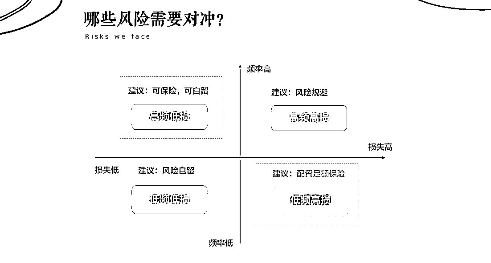
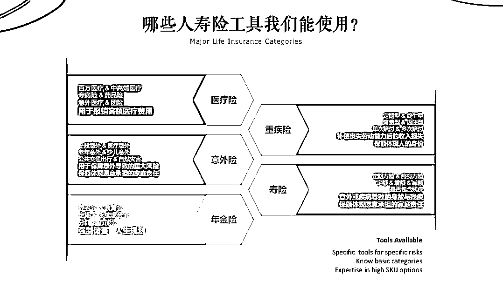
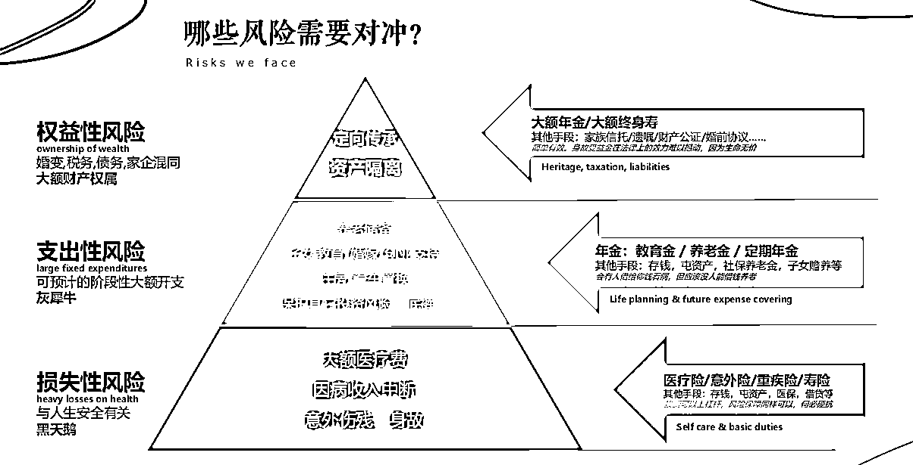
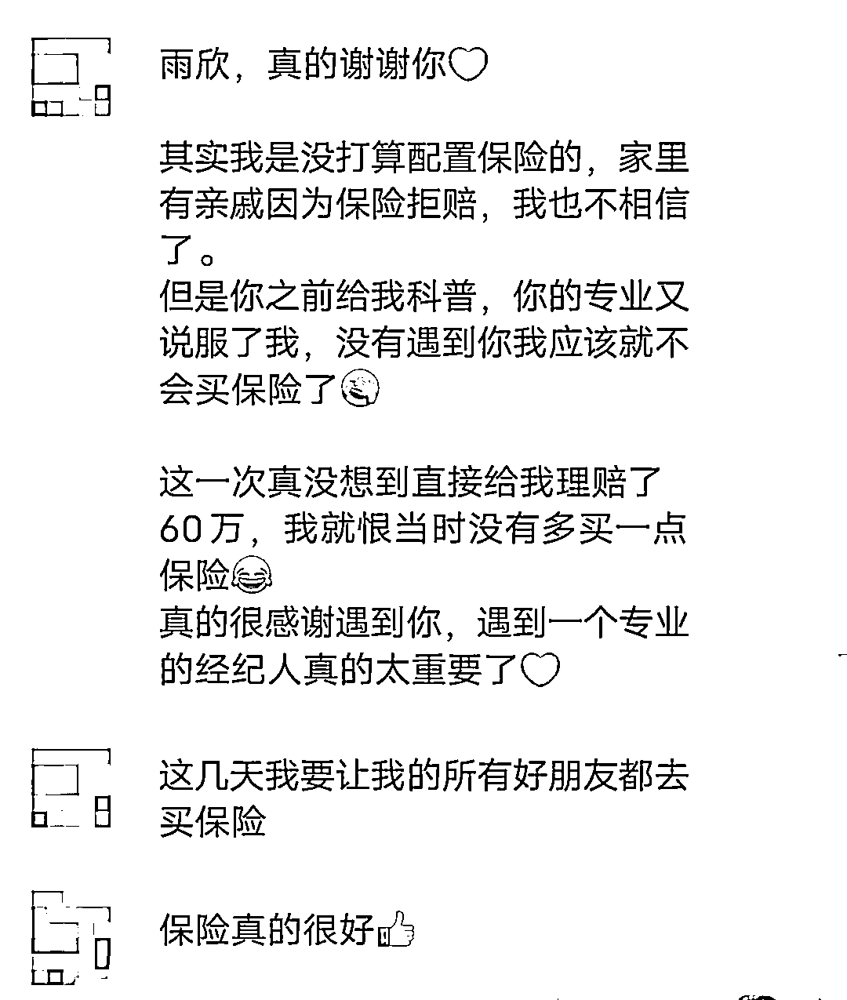

# 自由职业者保险配置实战笔记
作者：龙哥

赚钱之星大家好，我是龙哥。

从体制内语文老师辞职，到保险经纪，再到理财顾问，这条路是我用一堆证书和不断解决问题走出来的。聊理财时，我发现身边的自由职业者、做多份兼职的朋友，几乎都卡在同一个点上：不知道钱该怎么安排，更没有建立保险意识。

后来我跟他们说，先把兜底的需求补齐，再去谈进取。他们纷纷点头说应该有基本保障。结果一拉体检单，有人已经因健康原因买不了保险了。也有人大呼家里买了保险却等于白花钱，几十万的性价比就这么浪费掉。

如果你也在纠结要不要把保险放进家庭资产，或者对现有保单心存疑虑，甚至只停留在理赔认知的层面，这篇文章会帮你理清如何为自己做一份清晰的资产配置。

全文约6000字，不做产品推销，只解决思路问题。

想把保障做扎实，却总觉得混乱？看这一篇就够了。

目录：
1、从语文老师到保险赛道，我的转行路径
2、服务600+家庭后，我归纳出的理财底层框架
2.1 保险如何保障人？自由职业者该怎么配？
2.2 保险如何保障钱？自由职业者该怎么配？
2.3 最佳理财框架怎么搭
3、总结：一厘米宽，一万米深

## 一、从语文老师到保险赛道，我的转行路径

我曾是编制内的语文老师。问题解决型人格让我在岗位上坐不住，教书育人之外是党会、KPI、活动组织、上万字读书笔记，大量面子工程消耗时间却得不到成就感。

为了找出口，我开始系统学习。考了中科院心理咨询师证书想解决学生心理问题；学英语、啃《西方文明简史》、考雅思准备跳槽；因为月光问题开始研究金融和理财规划，拿下理财规划师、养老规划师等证书。

那段时间就接触过保险，只是没想过自己会成为经纪人。我在为辞职做准备的路上，把遇到的坑都先填平了。回头看，英语、心理学、宏观微观经济、社会学、逻辑学、金融与资产规划，都在为现在的我加持，只是当时只想快速试错，找到适合的赛道。

转折点是我的学生家里遭遇重疾。亲眼看到疾病拖垮家庭，我意识到重疾风险可以用保险来对抗。自己存款不多，不想因病把积蓄耗光，于是开始认真研究并为身边人配置保险。

我清楚代理人与经纪人的区别，经纪人不会被单一公司绑定。**我的初心是为自己和家人定制专属方案，为信任我的朋友提供私人定制的保险组合。**因此我选择自学、考证、先给自己和家人配置好。

配置完自己和家人后，我开始服务好友、同事、学生家长。研究不同家庭的风险画像时，我发现这份工作极度契合我的学习需求。本来想做独立教师，却意外转入金融赛道。

前期大量的知识沉淀，也为我从保险经纪人升级为宏观理财顾问打下基础。现在我不仅懂保险，也懂股市、基金等金融工具。今天重点讲保险，后续我会再分享普通人如何追求年化10%的思路。

## 二、服务600+客户后，我归纳出的最佳理财框架

先说底层逻辑。保险首先是一个金融工具，核心是杠杆。用1000元撬动100万的保障，这就是医疗险、重疾险、寿险的杠杆本质。

其次，保险是优秀的对冲工具。巴菲特和芒格都偏爱保险，因为它能对冲高风险投资，Hedge Fund的名字就源于此。

对冲是什么？对冲哪些风险？怎么对冲？

简单说就是做一件事来抵消另一件事的风险。你炒股有亏损可能，就需要一个低相关性的工具来降损，比如银行理财或保险。并非所有风险都要对冲。比如切菜切到手，频率高但损失小，可以自留。

真正需要对冲的是低频高损且必然会来的风险，比如车祸、癌症、心梗等。

自由职业者更需要保险。一方面作息不稳定，熬夜多；另一方面收入不稳定，体制内可一边领薪一边休假，自由职业者一旦重疾就是几年零收入，这种打击很难承受。

高频高损的风险比如工地、跳伞、警察，风险极高且多家公司不承保，除非热爱，否则建议直接规避。

**2.1 保险如何保障人？自由职业者如何配置？**

保障人的险种统称人寿险，各自用途不同。

**医疗险**：用于报销院内医疗费。社保是基础，但覆盖有限，像去食堂能吃饱但吃不好。社保覆盖甲类、乙类药，对丙类药这类昂贵进口原研药不报销。辉瑞等药企研发成本上亿，药效好但价格高，《我不是药神》说的就是这个困境。

社保之上是惠民保，政府主推，价格便宜、无健康告知，适合老年人过渡。

再往上是百万医疗，类似电动车，用小钱撬大额保障，作用有限但性价比高。

再往上是中端医疗，像小汽车，使用频率高，自由职业者适配度高。

最高是高端医疗，像坐飞机，不仅对冲风险，还买全球医疗资源、指定三甲专家、海外顶尖诊疗。花的是效率、资源、人脉。

**重疾险**：解决院外支出。重疾险名字翻译不准，原始叫失能补偿险，本质是补偿收入损失。

举例：自由职业者翠花年入30万，得肺癌休养5年，收入损失150万，还可能请护工、买补品、疗养。重疾险就是补这部分隐形花费。

医疗险和重疾险是同一风险的两面，分别解决医疗费和收入损失，因此通常要搭配。重疾险额度一般按3-5倍年收入测算。

**意外险**：覆盖意外风险。分高频低损和低频高损。高频低损如切到手、猫狗咬伤、摔倒骨折；低频高损如车祸、空难。现代意外险多为综合型，自由职业者日常实用。

**寿险**：身故或全残给付。丁克自由职业者可不配置，因为寿险管身后事，赔付给家人。若翠花需承担孩子教育、配偶还贷、父母赡养，就需要寿险。寿险也有资产传承的金融属性。

**2.2 保险如何保障钱？自由职业者如何配置？**

保障钱的核心是年金险。

**年金险**：每年给钱的工具，用于子女教育、家庭理财、养老规划和传承。形式有像社保一样退休后终身领取，也有5年或10年后即开始领取至终身的灵活型。

很多私企和自由职业者想配年金险，是因为现交最低档社保，退休后每月仅2000-3000，不够用。年轻时配置商业养老金，退休后每月可达1万甚至2万，现金流终身可避长寿风险。

假设翠花60岁有200万，一年花10万，20年花完，若活到100岁，后20年怎么办？这就是日本的现状。若把200万变成每月领取1万，就能领到100岁，总领960万。因此年金险本质是对冲养老和可预见大额支出风险。

寿险里还有增额终身寿险，可对冲权益性风险，具体家庭资产配置可关注后续文章。

总的来说，人生绝大多数风险都可用保险对冲。

首先是损失性风险，即黑天鹅：疫情、意外身故伤残、因病收入中断、大额医疗费，用医疗险、重疾险、意外险对冲。存钱、屯资产、用医保、借贷等方式最终都会消耗本金，保险是花小钱保大钱。

其次是支出性风险，即灰犀牛：养老、子女教育婚嫁、住房、汽车置换等。体制内靠养老金或养儿防老，自由职业者更优解是用商业养老金对冲低社保和长寿风险。

最后是权益性风险。创业者积累资产后想定向传承，保险比房产、婚前协议更可靠。房产按《继承法》平均分配，保险按投保人意愿指定受益人，受《保险法》监管，确权明确。

**2.3 如何搭建最佳理财框架**

保险的本质是对冲风险带来的财富消耗。配置原则：挣钱最多的那个人保障最多，因为经济支柱倒下，挣钱能力瞬间归零。

子女想给父母买保险，也可买，但父母不挣钱，重心应放支柱。父母想给子女买高额保单，若父母自己没保障，倒下后没收入，子女反而更难。

先对冲损失性风险，再配置保财的年金险或增额寿作为安全垫。

为什么要安全垫？做高风险高收益投资时，若无缓冲直接亏损会摔得很惨。保财类保险就是你的安全垫。

框架很简单：先把下限抬高，做好损失性风险对冲和安全垫，再用剩余资金去博上限，高风险高收益部分要有心理准备可能全无。

服务600+家庭总结出的框架大道至简，但具体千人千面。不同风险偏好、负债、现金流，需要定制化规划。

高净值人群可投资资产超1000万，重疾险需求下降，更需要高端医疗购买全球资源，大额保单做资产规划。大陆无遗产税、赠与税，保单友好。若全球化配置，可考虑香港保险叠加。

## 三、总结：一厘米宽，一万米深

到这里你会发现，我不是只卖保险的经纪人。我对各国税法、国内法律、金融工具的应用及框架方法论，都有长期沉淀。

我私下内向，不善交际，所以不做花哨的销售。我把时间花在硬实力上，用专业换信任。我选择一厘米宽，一万米深！

如果你读完意犹未尽，想聊理赔细节、投保医学问题、宏观微观经济、婚姻法遗产法及更优资产配置，欢迎随时提问，我知无不言。

* * *

评论区：

暂无评论

* * *