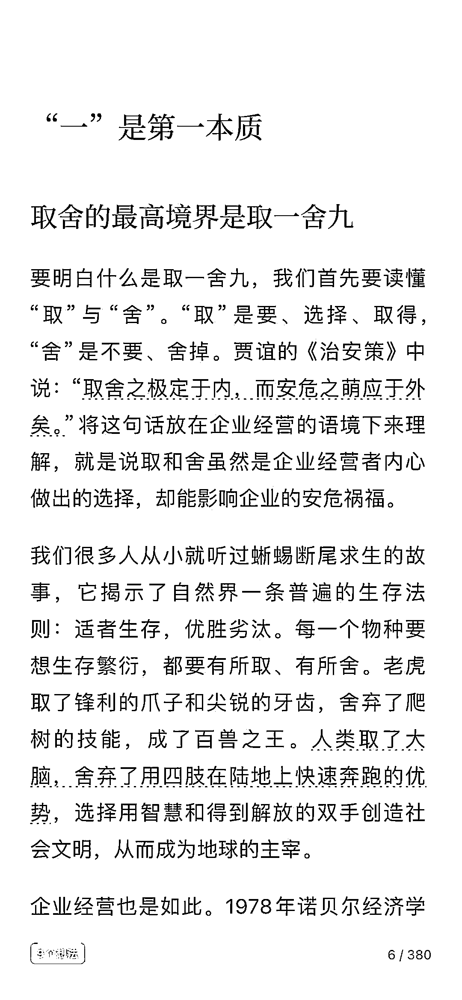

# ('取舍的最高境界是取一舍九，企业经营亦是如此', (2, 23))

真正懂得取舍的高手，往往只抓最关键的那一个，而主动放弃其余九个。企业经营，尤其如此。

所谓“取一舍九”，并不是简单的减法，而是一种极致聚焦的智慧——把资源、精力和心念，集中到那个最能撬动增长的支点上，其余枝节，果断舍弃。高手与平庸者的分水岭，很多时候就藏在这个“一”与“九”的选择里：什么都想要，反而什么都做不深；敢于舍掉九成机会，才能把那一成机会做成绝对优势。

放在企业经营的场景中，这句话的份量更重：产品要聚焦一款爆品，渠道要聚焦一个主力，用户要聚焦一群核心人群。舍，不是失去，而是为“取”腾出空间。只有先学会对九说“不”，那一才有机会成为全部。