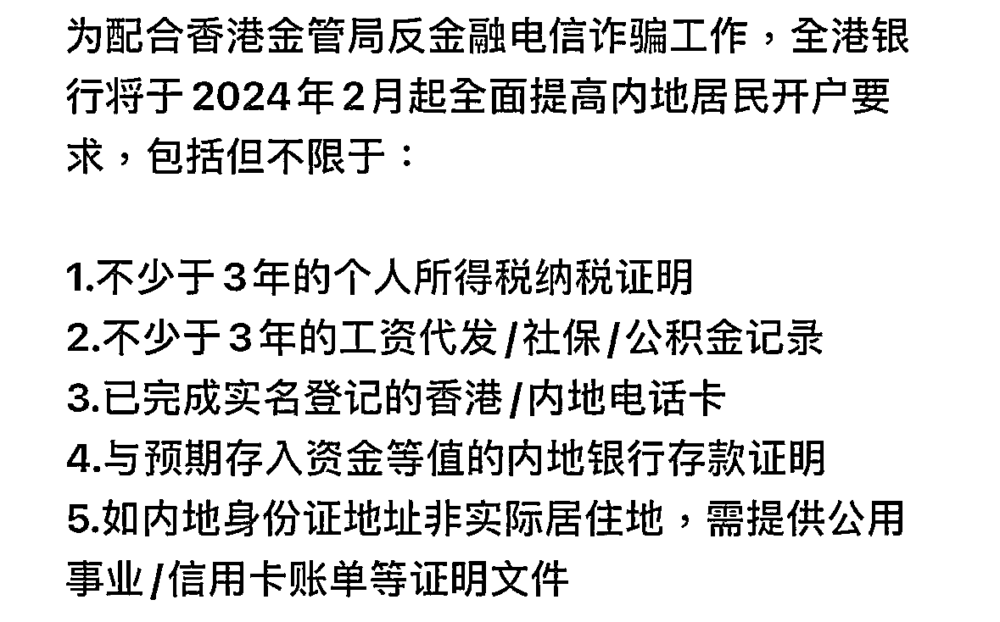
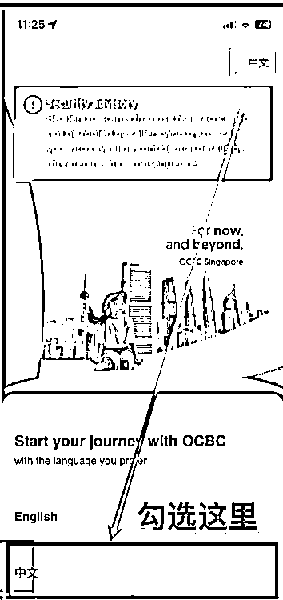
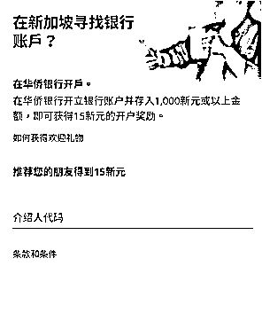
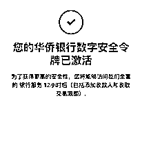

# 如何注册一个正规海外银行账户并获得实体借记卡

最近🛰️群里疯传一条消息，说香港银行开户要收紧，真假虽然不明，但确实搞得不少人心痒痒。哪怕是真的，现在才临时飞过去办，除了ZA、永隆和信银，其他家恐怕都赶不上了。我去年也动过办港卡的念头，四处调研了一圈，因为不想出门，最后改办了新加坡华侨银行的账户。整个流程出乎意料地顺利，下户和下卡都很快，关键是全程不用跑腿。刚才特意打开App确认了一下，去年的操作路径依然有效，索性整理出来，给想办海外账户和实体借记卡的朋友多一个参考。

整体来说，这个方案分六步：准备、申请两个储蓄账户、激活基础账户、申请360账户和借记卡、收卡并激活改密、开启银联支付。

**第一步，事前准备**

这套玩法依赖新加坡华侨银行（当地第二大银行）的数码银行App，所以必须有一台带NFC、且内置谷歌框架的安卓手机。用苹果也能走，但有人反馈部分机型用NFC扫护照容易失败，而且一旦中途出岔子，很可能无法回到正常流程，保险起见还是安卓更稳妥。我当时用的是小米10。经查，内置谷歌服务的小米机型包括MIX4、MIX FOLD、11 Pro、11 Ultra、11、10至尊纪念版、10 Pro、10、10s、9 Pro、9、MIX 3、MIX 2s等，供参考。

接下来依次搞定三件事：

1. 启用谷歌基础服务并安装Play商店。去系统设置里搜“谷歌”，打开“谷歌基础服务”开关；然后到小米应用商店搜“play商店”，点升级；回桌面就能看到“Play 商店”图标。
2. 🪜部分请自行解决，这里不方便教。
3. 确认NFC开启。可以在快捷设置里看NFC图标是否亮起，或者去设置里的“更多连接方式”查看开关状态。

最后，从Google Play下载华侨银行的官方App，链接：https://play.google.com/store/apps/details?id=com.ocbc.mobile

**第二步，申请“Statement Savings Account”和“Global Savings Account”**

打开App，一路点“next”，到了选语言界面，点右上角的语言标识切换成中文。如果没找到中文，退出重进。过程中弹出的权限请求（包括位置）全部同意。

接着点“注册成为新客户”→“持电子护照的外国人”→“开始申请”。相机会被调起，记得允许。如果弹出“启用NFC”，也要同意——之前启用过的话可能不会出现。

来到介绍人页面。 这页可以跳过，但如果填了介绍人代码，双方各得15新币奖励，折合人民币大概80多块，正好能抵消后面跨境汇款的手续费损耗。代码我就不放了，免得广告嫌疑。实在不能跳过的话，自己去搜“新加坡华侨银行介绍人代码”就行；当然，愿意跟我互利共赢的话，也欢迎私信找我拿。

然后选“+86”输入手机号，收取验证码；邮箱填一个海外邮箱（比如Gmail）。按提示扫描护照人像页的条形码，再用手机NFC扫护照——注意NFC模块位置，我用小米10是把手机上半部分贴在护照下半部分的。接着扫身份证正面，做刷脸认证。有两个要点：每个动作要在30秒内完成，以及周围光线要足够亮。

刷脸后点“提供我的详细信息”进入核对页。如果发现护照扫出来的生日不对，别急，先往下走，之后再找客服改。在修改邮寄地址时，一定要在地址栏里加上自己的手机号！因为后续卡片是挂号信，密码函是平信，地址还会被机翻一轮，没有手机号，邮递员根本找不到你。

核对无误后点“我的详细信息正确”，然后填就业信息。这里有几个雷区：
- 工作类型必须选“受雇”，选“自雇”会被审查；
- 年收入往高了填，太低直接驳回；
- 开户目的选“储蓄”，选“投资”也可能被拒。

税务身份如实填写，税务识别号就写身份证号；是否政治公众人物也如实选。最后确认资料、同意条款，通知偏好选“电子邮件和其他电子渠道+电话号码短信”——千万别选“邮政信件”。然后勾选“本人确认懂英文”，提交。只要没触发审查，基本秒批，当场来短信。

接下来设置账户名和登录密码，这两个以后登录都要用，记牢。再启用“onetoken”。 等几分钟，直到出现启用完成的提示。

然后点“开始”登录：访问代码就是刚才设的账户名，PIN码是登录密码。登录后点左上角“三”，右上角“EN”改成简体中文。

**第三步，激活“Statement Savings Account”**

账户批下来后，必须用同名账户转1000新币进去才算激活。如果华侨是你第一个海外账户，最便宜的激活方式是用工商银行做跨境汇款。汇款信息在App首页就有，照银行指引操作即可。

**第四步，申请“360 Account”和实体借记卡**

为什么要多此一举开360？两个原因：一是拿到它附带的实体借记卡；二是省管理费。STS账户是给非居民的，免管理费一年后，如果连续6个月余额为0会被自动销户；不然余额要保持在2万新币，否则每月扣10新币。而360账户是居民用的，免费一年后只要放3000新币，不够也只是每月扣2新币。更关键的是，通过特定渠道申请，非居民也能拿到360的实体借记卡。

所以最优路径是：先开STS→激活→申请360→把钱从STS挪到360→STS空置6个月自动关闭→只留下低成本带卡的360。

注意：为什么不能直接开360？因为非居民通过App只能先开STS。

实际申请步骤如下：
1. 登录App，点首页左上角“三”。一定要在App里申请，网页申请的结果是没有卡。
2. 点“申请”→“账户”→“360账户”→“立即申请”。
3. 填基本信息，这里“是否自雇人士”必须选“否”。
4. 填税号。
5. 填姓名：拼音全部大写，姓和名之间留空格。
6. 确认资料，通知偏好同样选电子渠道+短信，点“立即开设账户”。
7. 耐心等借记卡创建，大约三分钟。建好后会弹出卡片的到期日和CVV，马上截屏保存！这个界面之后不会再出现。

**第五步，接收并激活借记卡、重设密码**

360账户开好，第一件事是去App的安全信箱里要卡片追踪号。他们回复很慢，所以越早催越好，通常对面回复时卡片也差不多到了。万一问晚了，又遇到不负责的片区邮递员，卡被退回来就麻烦了。

可以直接这么问：May I ask if my debit card has been sent out and what is the email tracking number

拿到追踪号后，去两个地方查物流：新加坡境内查Singpost官网，国内查中国邮政官网。大概率已经到中国邮政手里了，这时直接打邮政客服，说有新加坡挂号信，让当地投递员拿到后直接联系你。这样能保证第一波入手，避免退件。

激活卡步骤：登录App → 左上角“三” → “银行卡服务” → “激活信用卡/借记卡” → 填卡片上的有效期。

接着重设密码。华侨本来会寄密码函，但那是平信，几乎收不到。所以激活后立刻重设密码，让那封寄到天涯海角的密码函作废。路径：左上角“三” → “银行卡服务” → “重设银行卡密码”。

**第六步，激活银联支付**

最后一步：左上角“三” → “个人资料与设置” → “管理Unionpay” → 打开“激活银联支付功能”。

以上就是我去年的实操流程，具体细节可能已经有变化，大家参考着来就好。如果有问题，评论区见。

