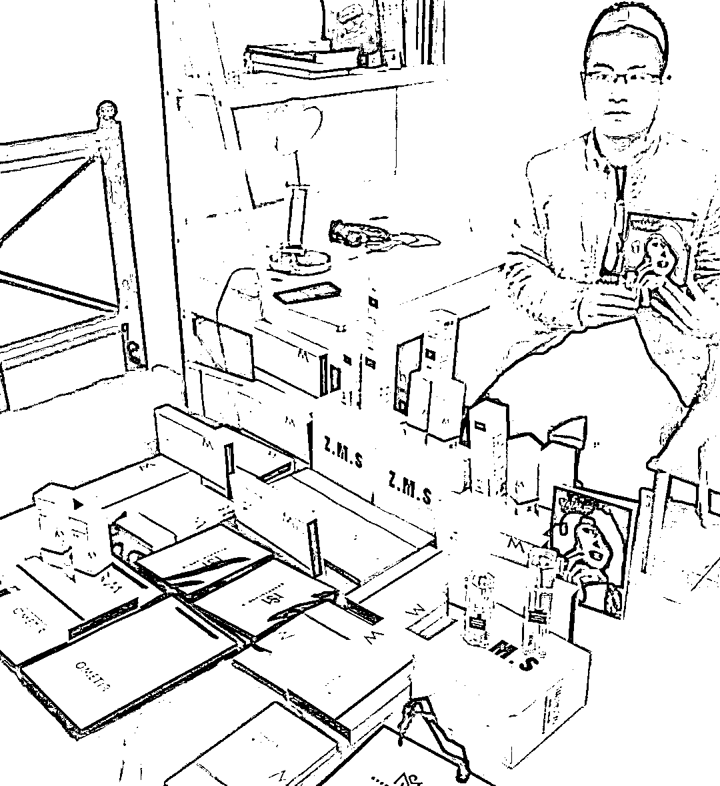

# 人生至关重要的第一个 100 万，我是怎么赚到的？！

人生第一个100万怎么来的？我把最狼狈的经历都摊开讲了

大家好，我是坐标杭州的龙珠圈友书豪，目前在做小红书店铺和直播航海教练。先感谢龙哥盟，是它把我真正带进了电商这个领域，也让我重新开启了创业这条路。

今天这篇内容，我想认真聊聊自己是怎么攒下人生第一个100万的。创业这条路，真没谁是一帆风顺走过来的。

我是在2020年4月加入龙哥盟的老圈友，同样也是在2020年，赚到了人生第一个100万。

接下来要讲的，不是什么光鲜的成功故事，反而是一些挺狼狈的经历。有多狼狈呢？大概每一个被逼上创业这条路的人，都能从里面看到自己的影子——因为没得选，才只能往前走。

我会把自己的第一年创业经历，以及创业之前在职场里的过渡过程，尽量毫无保留地分享出来。希望能给正在创业、或者准备创业的圈友们一点参考。

先梳理一下今天的几个核心话题：

1. 我为什么会去创业
2. 在职场上班时，怎么一步步过渡到创业
3. 人生的第一个100万，到底怎么攒下来的
4. 怎样才能继续冲击第一个1000万

## 一、为什么我会走上创业这条路？

老实说，不是因为什么远大理想，而是因为——我失业太多次了。

前后加起来，失业超过5次。那种感觉，经历过的人一定懂：不光是收入断了的恐慌，更多是精神上反复被捶打的挫败感，整个人又慌又迷茫。

为什么我会反复失业？

我是2016年大学毕业的。毕业后在上海闵行区一家世界五百强公司上班，月薪四五千。那时候在上海，看着满城的繁华，自己却活得紧巴巴，买一双Nike的鞋都要纠结很久。刚从校门出来时，眼里全是对未来的期待；进了社会之后，被现实慢慢磨得只剩焦虑。

后来我了解了一下，发现做IT、搞大数据分析，工资明显高不少。于是我心一横，决定转行自学编程。但我大学读的是法学，纯文科背景，自学代码的压力有多大、难度有多高，可想而知。但当时我太想在上海多赚点钱了，太想把收入赶紧拉上来，所以从2016年11月开始，我一边上班一边学编程，一点没犹豫。

2017年，我的月薪从四五千涨到了七八千；2018年，到了1.6万；2019年，又冲到了1.8万。

但在这期间，我照样失业了5次以上。原因特别坦白：我学得挺勤奋，但技术底子实在不扎实。SQL写不熟练，Python写不熟练，R语言也是磕磕绊绊。尽管我态度好，加班加点没怨言，什么杂活都愿意接，可代码产出效率太低，导致我一次次被淘汰。

失业对我来说，压力非常大。那意味着一个月没有现金流，没有收入；更难受的是试用期没转正就被公司请走，当着同事的面离开，那种“丢人感”特别强烈，脸上挂不住。

从2016到2019这三年半，我每天都觉得特别难，连一份工作都保不住。

那段日子里，感情更是遥不可及。我记得2016年在上海时追过一个女生，她直白地告诉我：书豪，我对爱情和婚姻都很现实，而且我比你大两岁，你现在没房没车，事业也不稳定。

那三年半，工资不稳，积蓄增长慢，天天焦虑。反复失业的经历也让我意识到：上班的收入太脆弱了，我必须有一条副业的路，两条腿走路才安心。

## 二、在职场上班，怎么过渡到创业？

2017年，因为工资太少，我只能在晚上和周末拼命做副业。目标很务实：把房租和饭钱用副业赚出来，工资全部攒下来。

那时候我一边上班，一边尝试了很多副业。最早是主动找网站老板合作，我来录数据分析课程，他出流量。后来也真的小赚了几万块。那个网站类似网易云课堂、中国慕课网，是垂直的大数据分析在线学习平台。

因为这个在线教育网站的老板，我进了一个微信群，群里都是做过在线课程、出版过编程书的人。也是在那时候我发现：原来靠写书也能赚钱，而且不少大学毕业几年的人都出了自己的书。我心想，我也能做到。

2018年，我主动联系机械工业出版社的主编，毛遂自荐，最后真的写了一本书，叫《R数据科学实战：工具详解与案例分析》。这本书到现在在京东上还在卖，卖了大概6000本，我也因此小赚了几万块。

2017年到2019年，我还做过微商，卖护肤品。囤了一批乳液、精华、面霜，最后只卖出大约70%的货，剩下30%压在手里。结果是没赚也没亏，不痛不痒。

2018年国庆，因为做微商的关系，我在福建旅游时注册了一个公众号。现在回头看，这一步彻底改变了我的人生轨迹。有些朋友可能知道，我早期的第一桶金就是靠公众号赚到的，这个业务前前后后给我带来过超过300万的收入。

但你们不知道的是：从2018年10月到2019年4月，整整7个月，我的公众号一分钱没赚到。我就是在傻傻地写文章，没有收入，没有反馈。

后来，我慢慢接触到了龙哥盟里编程类目的公众号圈子，才开始一点点起飞。2019年，我一边上班，一边靠公众号赚到了10万以上。2019年5月，公众号开始有收入了，第一个月只赚了1000多块，但那一刻我像打开了新世界的大门——原来坚持的方向没错，原来了解行业玩法、搞懂变现路径，真的特别重要。

到了2019年12月底，我的公众号一个月能赚1万多。那是每天下班到家晚上9点，再干4个小时换来的。

**但我从职场过渡到创业，并不是我主动选的。**

说起来有点丢人。我当时一边上班一边做公众号，有一次被上级领导抓到在上班时间折腾副业。领导发现后，第二天就让我走人了。

那是2019年底，我第五次失业。

2020年1月，快过年了，工作还是没找到。也是在这个月，YQ开始了。我意识到，2月、3月大概率也找不到工作了。

2020年一季度，市场基本不招人。我彻底没了退路，只能创业。

## 三、第一个100万是怎么积累的？

我算是2020年1月被动“被创业”的。因为失业，加上YQ期间找工作无望，我唯一的选择就是把公众号矩阵做大，多开几个号，把收入做出来。

没有别的选择，只能硬着头皮往前冲。

很幸运，2020年，我靠公众号赚到了80万。再加上之前上班和副业攒下的30万，人生第一个100万就这样达到了。

带我进赚钱的引路人是子木。我们是在做编程类目公众号时认识的，他很清楚我当年的公众号矩阵，包括“程序员大佬”“程序员涨点薪吧”“JAVA大数据架构师”“JAVA面试仓库”“不装逼的程序员”等等，一共15个。这15个公众号，帮我完成了300万到手利润的积累。2022年编程公众号彻底没行情了，我就把手里的号都卖掉了。当然，在赚钱里我也认识好几个靠公众号赚了上千万的大佬，我在他们面前真的不算什么。

2019年到2022年，这波编程公众号的历史红利期里，我的变现方式非常简单粗暴——接广告。最大的客户叫开课吧，隶属慧科集团，圈里不少大佬应该知道这家公司。可惜它在2022年接近破产。开课吧一家，贡献了我70%的收入。剩下的30%，来自拉勾教育、图灵教育、马士兵教育、极客时间、中国慕课网、网易云课堂等客户。

2020年是我创业第一年，遇到的全是硬骨头：怎么从1个号扩到15个号？怎么搞流量？怎么接朋友圈广告？我的选择是免费流量靠公众号互推。但能裂变到第15个号，靠的是一招创新的操作——**我算是编程公众号里第一个开始大量收购5万粉丝以下公众号的人**。我的逻辑是：行情正好，快速做大，不断买号来承接广告。那一年我花了大概80多万去收购公众号，压力巨大——不但要回本，还要赚钱。

涨粉、运营、变现，每个环节都有无数卡点，其中的焦虑和煎熬，真的只有走过来的人才懂。

2022年3月，公众号基本没有收入了，大势已去。我不得不转型，去做电商。

这里我也总结了几条特别真实的心得：

- 不怕大家笑话，我2020年出来创业时，连租办公室都不会。
- 我第一次创业，连BOSS直聘这种招聘工具都不知道。
- 对普通人来说，逆袭大概率要靠抓住互联网某个垂直赛道的红利。
- 普通人别裸辞创业，最好是上班时把副业慢慢做起来，等副业收入追上甚至超过主业，再出来创业，会更稳妥。
- 年轻时候赚到第一个100万，大概率要靠平台级的流量红利，比如公众号、淘宝、抖音快手、小红书、视频号。面对红利，最重要的就是赶紧入场，先干起来。**在岸上，你永远学不会游泳。**
- 如果从来没有完整经历过“从流量获取到流量变现”的全过程，就算红利来了，也跟你没什么关系。
- 大多数人在30岁前赚到第一个100万，并不是从工作的第一年就一飞冲天。前面的10万、30万、50万都是一步步攒的，上班积累资金也非常重要。
- 30岁之前，一定要把“100万”当成目标，但实现过程就像跑马拉松——终点摆在那，可你得先跑完眼前这一段，再跑下一段。比如先攒到10万、再30万，等你真的到了30万那个节点，就会攒出越来越强的信心。

2020年，我创业第一年，非常煎熬。我经常通宵达旦地翻龙哥盟的精华帖，认认真真读了500篇以上。我发现，能赚到钱、拿到结果的人，身上都有强烈的**赚钱欲望**、敏锐的**商业嗅觉**，而且最重要的是——**执行力极强**。

赚钱欲望是我最原始的动力。真实得有点俗：我就是想多赚钱，在大城市买房，在大城市找到女朋友，娶妻生子。我所有对未来美好的想象，都需要金钱做基础。

我承认自己的商业敏锐度不算高，所以做法很笨：多刷赚钱的精华帖，找到规律。看多了我发现，绝大多数赚到钱的人，都特别会玩“矩阵”——公众号矩阵也好、电商店群矩阵也好，本质都是用规模来放大收益。

创业这四年，接触的人越多，越发现人和人真的不一样。不是每个人都有强烈的赚钱欲望，更不是每个人都有执行力。

赚到第一个100万，不需要什么了不起的天赋，关键就是逼自己拼命执行。多了解商业机会，多挖掘商业项目，多发现真正值得做的事，然后拼了命去执行——这就够了。

## 四、怎么往第一个1000万冲刺？

我现在正在冲刺第一个1000万的路上，目前已经完成了大概50%的目标，希望能在30岁前实现。

身边确实有从100万冲到1000万的人，大多是在赚钱认识的朋友。这让我很有斗志：在这个圈子里，你不敢骄傲，因为山外有山，人外有人。

有人说，赚到第一个100万之后，后面的100万会越来越轻松。我觉得不一定。关键还是看项目本身是不是踩在大趋势上。互联网行业现在每个项目的红利期都在急剧缩短，夜深人静的时候，我也经常感叹钱难赚、屎难吃。

公众号这个项目，帮我赚到了300万+到手收入。但公众号已经没机会了，死死抱住这条路，彻底走不通。

2022年，我尝试做过抖音个护家清短视频带货。但做过电商的人都知道，抖音竞争太惨烈了。打品的短视频素材、投放数据、实时销量榜单，这些在第三方数据平台全是透明的。就算一个爆品能活一个月，下个月你还得靠新的原创素材继续卷，波动极大，这让我非常难受。抖音对内容能力的要求太高了，我自己的能力结构不适合这个赛道。

2022年10月，小红书店铺的红利出现了。但我当时对自己的电商能力不太自信，加上对小红书平台也没认知，就一直拖着，拖到2023年2月才真正动手。现在回头看，肠子都悔青了。这是我认知不够、决心不够踩下的坑。

但2023年，我硬是从1个小红书店铺开到了30个。从百货赛道的笔记打法，到小红书无人直播打法，把所有能挖利润的切入点都试了一遍。

我太想撬开财富的大门了，但没人能替我去挖掘机会、研究信息差、去做执行。我只能自己对自己狠。有执行力，敢尝试，敢坚持。

2023年11月，我又开始测试快手平台的短视频引流直播赛道。疯狂测品：小家电、服饰单品、日用百货、美妆……每个赛道都去切。既有测品亏钱时无处诉说的痛苦，也有爆单后想扩张、想通投拉满的兴奋。

在赚钱看了那么多拿到1000万+结果的大佬，我发现他们大多是通过两三个项目的叠加才做起来的，比如淘宝+视频号+抖音，用多个平台的红利组合拳打出大结果。同时，他们身上的执行力，真的是快与狠兼备。也正是这些人，反过来逼我把执行力也提上了一个台阶。

2022年是我二次创业的开始。那一年，我的公司倒闭过一次。这让我深刻认识到：创业永远没有稳定的阶段，如果有，那也只是自己的幻觉。

没有退路，也没有救世主。我只能战战兢兢地把每件小事做好。以前觉得电商是新手不可能学会的，真正干下去才发现，也没那么难。以前觉得付费投流特别难，后来发现，很多困难只是心里的恐惧。那些未知的恐惧，就是心中的贼，破了也就破了。

我发现，当我陷入害怕、恐惧、犹豫的时候，恰恰是我进步最慢、成长停滞的时候。

商业世界里的能力，真的都是被逼出来的。

所以我想强烈建议大家：**一旦发现一个商机，立马投身去做，别怕没做出成绩丢人，也别怕浪费时间。大部分互联网项目都是轻资产项目，做失败了也亏不了多少钱，最贵的是时间成本。**

以上就是我赚到人生第一个100万的过程，以及我对第一个1000万的一些思考。

希望给大家一点参考和启发。最后，也祝所有圈友在赚钱里找到适合自己的方法，拿到结果。遇到问题就解决问题，千万别怕失败。

我现在主要做小红书和快手这两个平台，方向是短视频直播内容电商。如果大家对我分享的内容有疑问，随时欢迎一起交流探讨，知无不言。

