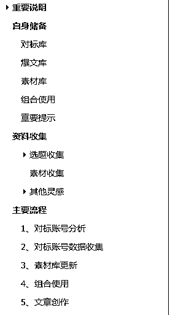
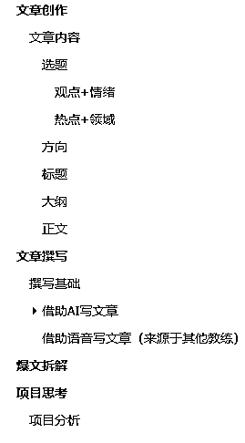

# 如何让公众号文章的质量真正起来

> 原文：[`www.yuque.com/for_lazy/thfiu8/kikf1516ca6zyhn5`](https://www.yuque.com/for_lazy/thfiu8/kikf1516ca6zyhn5)

## 公众号内容质量升级指南

作者：张波

日期：2024-01-18

大家好，我是张波，又跟大家见面了。最近我一直在带公众号爆文写作的原创训练营，实操下来收获了不少新的体会。结合当下公众号的走向，我把这些思考整理成这篇《公众号文章内容质量提升教程》，希望能帮大家把内容做得更扎实。

这期主要聊的是怎么把爆文的质感拉高。我会结合一些新思路和可用的科学工具，帮大家找到一条可以稳定产出高质量内容的路径，从而让账号权重和收益都更稳。

《公众号文章内容质量提升教程》：

项目拆解

1、公众号的单篇收益在不断下探，纯靠 AI 生成的稿子很容易触发限流。只有把写作手法打磨得更像人工原创，文章才更容易过审、更长寿；​
2、可以把其他平台的好内容迁移过来，比如播客、抖音上的优质片段，通过语音转文字工具沉淀下来，再进行二次创作。​
3、单价很可能还会继续下滑，但我判断公众号的基础流量盘依然在。冬天总会过去，春天不会太远。​

接下来的路怎么走

•一条路是继续铺机器：大量开号，用 AI 批量生产，自己手动发布赚快钱，等账号被限流就换下一个。这种打法不推荐。​
•另一条路是做质量：把内容水准提上来，让账号活得更久、更健康，慢慢把账号做成腰部。才是可持续的方向。​
•进入这个赛道的玩家越来越多，最后能留下来的，终究是能最快适应规则、做出调整的人。

如果你刚起步：

《公众号爆文进阶教程》：[`k170ac9yh31.feishu.cn/docx/KbupdqExXo8z9pxL5RqcUzJOnfb`](https://k170ac9yh31.feishu.cn/docx/KbupdqExXo8z9pxL5RqcUzJOnfb)[`k170ac9yh31.feishu.cn/docx/PlpQdDbzkoaZoMxPf3dczRiunhc`](https://k170ac9yh31.feishu.cn/docx/PlpQdDbzkoaZoMxPf3dczRiunhc)

* * *

评论区反馈：

王洋 : 我是这期公众号航海的船员，张波教练开了 4 期高手领航直播，讲解很细也很耐心

安七 : 波波教练牛逼！

幸运的弘道 : 牛的

sunyue : 谢谢波波教练分享～

对标库+爆文库+素材库，太实用了[强][强][强]最近在慢慢完善，这套体系搭起来后对账号和文章的判断清晰了很多！

还有那个笛卡尔坐标，想起大学时痛苦的高数😖

已收藏了，后面能反复翻看琢磨。很幸运能跟在波波老师的船上，感谢每次直播的用心分享和群里细致的解答～我们船上的教练都超棒🎉

陈俊贤 : 可以加一下吗？

磊 : 真是大神[强]

海阔天空 : yyds

Dancy : 太强了，牛啊

* * *