# 从零到半年200万：我们如何用聚光搜索广告切入广东公司团建市场

## 聚光搜索做广东公司团建，半年做到200万营收的实操复盘

作者：吴大脸
日期：2024-01-18

📕的旅游赛道现在很热，赚钱航海也在推实战案例。今天聊一个旅游赛道里相对冷门的分支——企业团建。

我们从3月开始试水，用📕聚光的搜索广告投放广东的公司团建，到9月结束，累计触达1000+客户，营收约200万。部分收款截图我还留着。

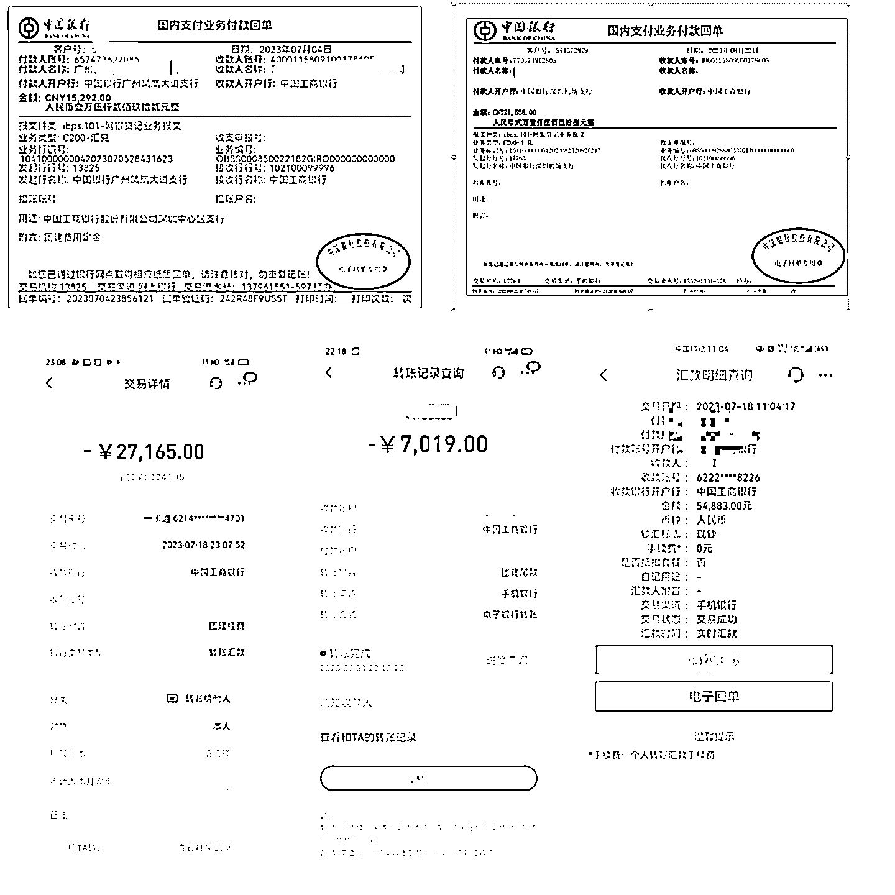

下面把从0到1的完整路径拆开讲。

# 一、为什么团建这条线能跑通

**1、流量逻辑顺**

一开始想做C端拼团，觉得自己设计产品引流过来再拼团，难度太大。没有组团社的资源积累，自己从零拉人很难起量，续航不足。

公司团建就不一样，一单落地就是10-30人，根本不用凑团。

**2、产品逻辑顺**

起步时只想推自营设计的团建线路，资源全自己把控，利润可控。跑顺之后发现实际情况和预期偏差挺大。

预期是📕来的客户质量高，自营方案客单2-3万能成交。现实是80%的客户人均预算在1000以内，根本吃不下自营方案。还有一部分预算够了，但对方案风格不买账。

于是我们引入旅行社合作，用他们的现成团建方案作为补充，把每一个线索都尽量转化。

到最后产品形态就是自营+外包。外包模式类似现在航海实战里的📕境外游玩法：客户确认方案后，旅行社给同行价，我们加价报价，后端交付全部交由旅行社。自营则是我们自己设计、自己对接资源、自己交付。

# 二、付费流量的野路子打法

我22年6月就开了聚光账户，当时测试别的业务，充了5000块，官方直客销售拉群对接了个服务商运营团队。9月开始投放，开会聊完投放细节就上线了。

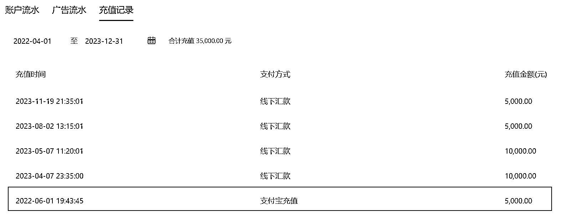

一天烧几百，服务商说先把互动数据养起来才有效果。当时看着钱烧没效果，心态直接崩了，就关停了。

这个业务因为认知不够，广告这条路就先放弃了，还把内容更新外包给了代运营。服务期结束就自己上手更新了。现在翻当时的聊天记录，真的觉得自己当时太 naive。

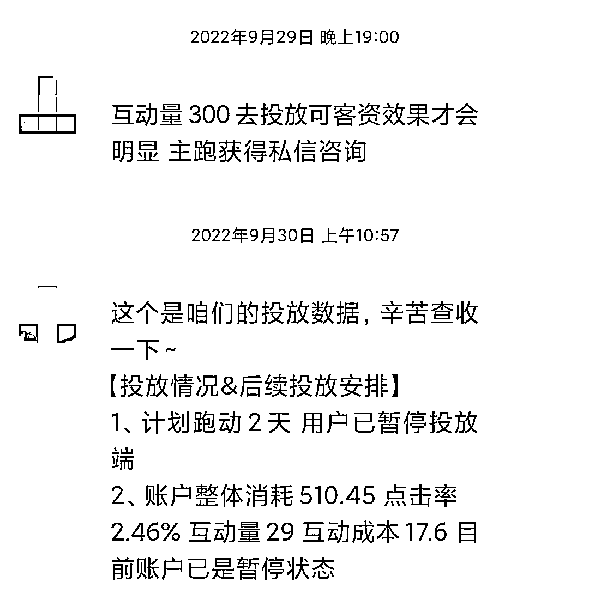

## 1、只投搜索广告

23年3月，我之前发的一篇笔记数据异常，每天会新增1-2条咨询类评论，感觉吃到了搜索流量。

脑子里一直有句话“投放是自然流的放大器”，于是自己上手试，花半天把聚光后台操作手册过了一遍，直接建计划开投，而且只投搜索。

没想到一天花几十块，就能进2-3个精准咨询。

我没有再纠结自然流放大器这个说法，直接给同主题但没自然流量的另一篇笔记也建了计划，结果一样有效。两篇叠加下来，一天能稳定拿到7-8个精准咨询。

稳定了一个月后，我发现搜索广告的本质就是把笔记硬插到用户搜索结果前面。那只要笔记本身就围绕团建方案去做产品型内容，不就更匹配吗？

说干就干，新建了一个专门做团建的企业号，刷了很多同行的高互动笔记，找到一篇和我们主推方案类似、互动又很好的笔记，虽然是22年的旧内容，但我觉得爆款会复爆。

我把这篇笔记从封面拼图、关键词选取、文案排版到标题，都做了1:1拆解模仿，标题还做了升级。图片审美和正文框架我也做了融合迭代。

当时还没建立系统的投流方法论，笔记一发出去就直接开搜索广告，结果直接爆了。

此后就靠这种“只为投流而写的笔记”玩法，每个月投放成本约1万元左右，流量稳定吃了4个多月。

## 2、搜索广告能跑通的业务前提

这种打法有运气成分，聚光早期竞争小，获客成本低。明年会不会还能这样不好说，但流量只会越来越贵。

复盘团建能跑，其他产品跑不出来，主要是两个原因：

1、业务相关关键词搜索量太小，或者搜索量大但人群太宽泛。
2、后端产品利润不够厚。

关键词量小可能抢的人多，出价高。搜索人群不精准就是大海捞针，获客成本飙升，后端利润扛不住就跑不起来。

我调研过论文代写和课题申报，出价曾经高达8块，现在3块左右，竞争极度激烈。

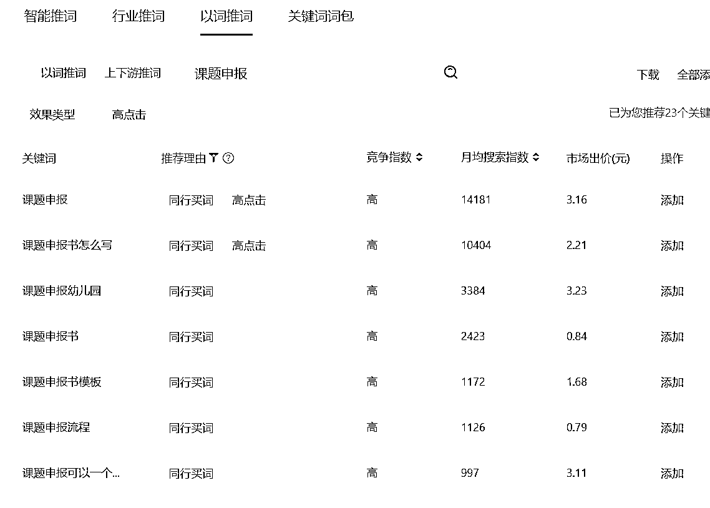

如果你的业务有明确强相关词，竞争温和，利润空间够，那就是值得用搜索广告去验证的市场。

## 3、投放流程的迭代升级

我当时是开户即投，不养号，直接写笔记就投，靠对团建产品笔记的直觉蒙到了，普适性很差。

后来系统学习后才发现流程问题很大。不是每个业务的投流笔记都能像团建这样好把握。而且红利期的低获客成本也只是暂时的。团建的获客成本其实还能通过笔记迭代再降，笔记质量越高，获客成本越低，有些案例差一倍。

优化后的标准流程：

1、养号
先用高互动内容把账号权重做起来，保证自然流能跑起来。

2、搜索广告搭建
把业务关键词分类，按照词性建不同计划，确保一个计划里的笔记素材和关键词高度匹配。千万别把不同词性的词全堆一个计划，造成笔记和搜索词错配，浪费消耗。

以旅游举例，可以按词性拆成：

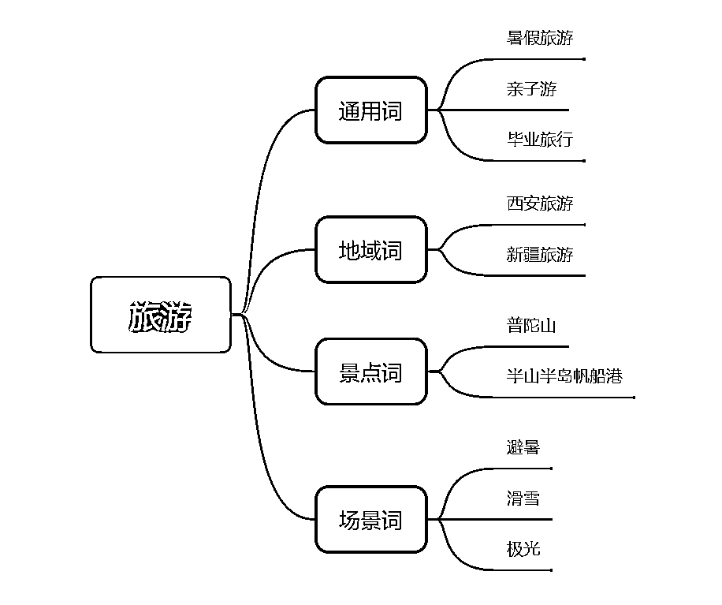

不同行业分类不一样，还有品牌词、品类词、人群词等，核心是保证一个计划内的关键词和素材一一对应。

3、测笔记
**测试期**：每个计划至少放3篇笔记赛马，跑出效果最好的。
**优化期**：筛选出首批数据好的笔记，通过预算调整、分时出价、地域定向、封面迭代等去优化，归纳优质笔记特征。
**放量期**：基于可放量的优质笔记持续复制、提价放量。

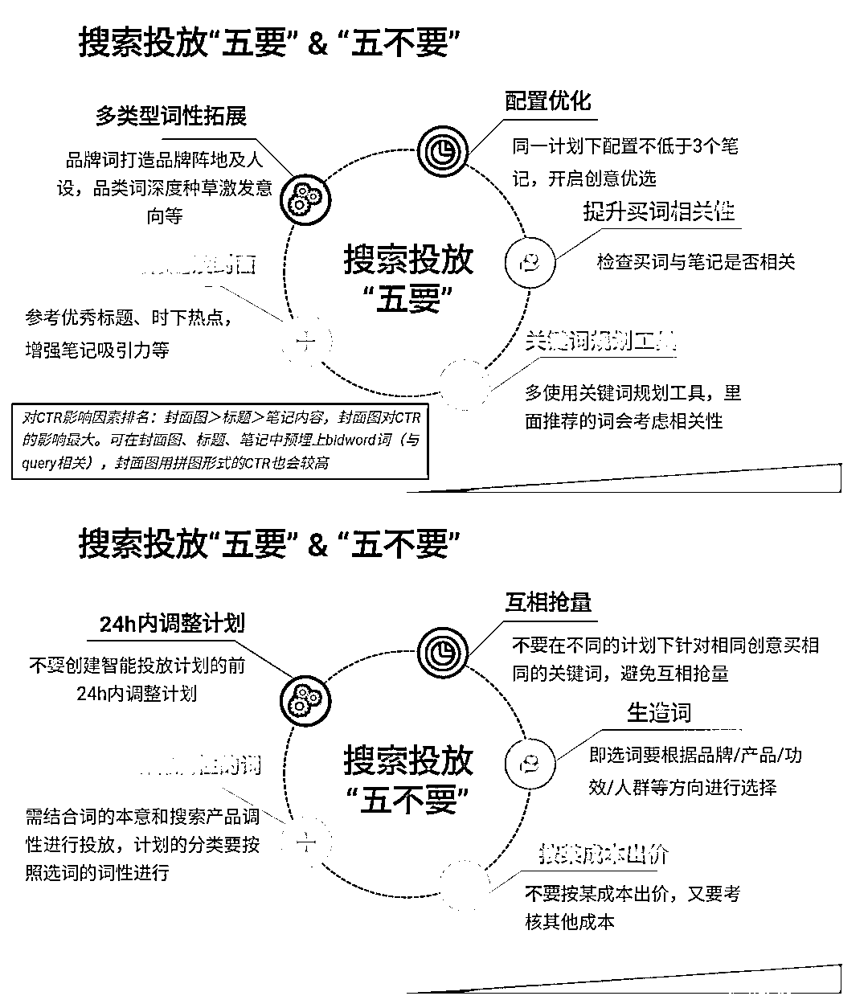

## 4、如何自学聚光投放

a）看官方手册-聚光帮助中心
3月投放时我半天就把帮助中心看完了，就敢开投。聚光学习门槛不高，手册内容就够用。有问题直接人工客服，我自己就问了20多次，响应很快。

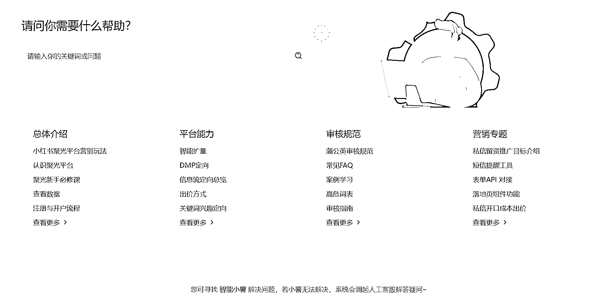

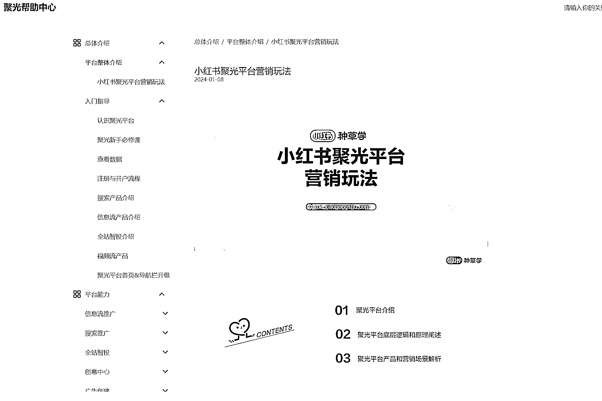

b）用官方学习平台-种草学
地址：[`xue.xiaohongshu.com/`](https://xue.xiaohongshu.com)
里面是进阶内容，有行业案例和官方商业化团队的培训，我从中获益不少。

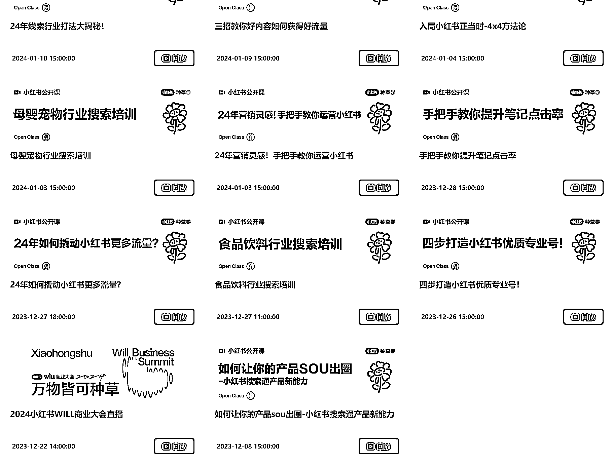

c）下场实操
光说不练假把式，开户后就立刻上手。投流手的经验都是钱烧出来的。

d）加入交流群
卡点问题有时候别人一句话就点醒了。

# 三、把高客单产品价值做出来

先讲美感，再谈价格。

团建赛道同质化严重，各家旅行社方案大同小异，人家也自己下场做。如果你只是拿旅行社的方案原样推，价格卖不上去利润薄，拼价格就是做中间商，走不远。

我们自营主推方案的图片都是请摄影师拍摄后精修，我筛选后配上简洁说明，整体质感一眼就能看出值这个价。

女性用户更看感觉，而团建咨询来的客户基本都是女性。方案的氛围感很大程度上决定了她是否愿意继续聊，只要她开始问细节了，基本就锁定了。

举个例子，我们的方案是标准模板，兼职销售为了迎合客户会改源文件，改完后客户反馈“没有原来那种好玩的感觉了”，一看图片、字体确实降级了。

自营方案在人均1000元以上的客户里转化率很高，但整体转化偏低，因为低预算客户吃不起。

于是我们又在旅行社的方案库里，按不同价格带各挑1-2套能看的方案，重新包装设计，成功转化了大量人均预算低于1000的客户。

# 四、用兼职扛住最关键的转化环节

团队前期只有2人，我负责流量，另一个负责转化。

刚开始一天5-6个客户就忙不过来，主推的自营方案只有3个，客单都高，不是所有客户都喜欢也买得起。

客户需求很分散，为了提高转化率，每天要做7-8个定制方案，对资源不熟时非常痛苦，一个月也才出4-5单。

招了一个全职旅游销售后，压力小了很多，他有丰富的方案库和资源，能快速根据需求调整，成交了不少预算或偏好不符合主推方案的客户。

一个月后磨合出问题，销售离职了。

那时日均客户30+，我自己对接不过来，只能先上兼职过渡。

有全职时，流程是客户微信承接后做基础调研，按模板记录信息，分派给销售，确认后拉群对接。链路繁琐，群越来越多，跟踪困难，还出现过漏发方案的情况。

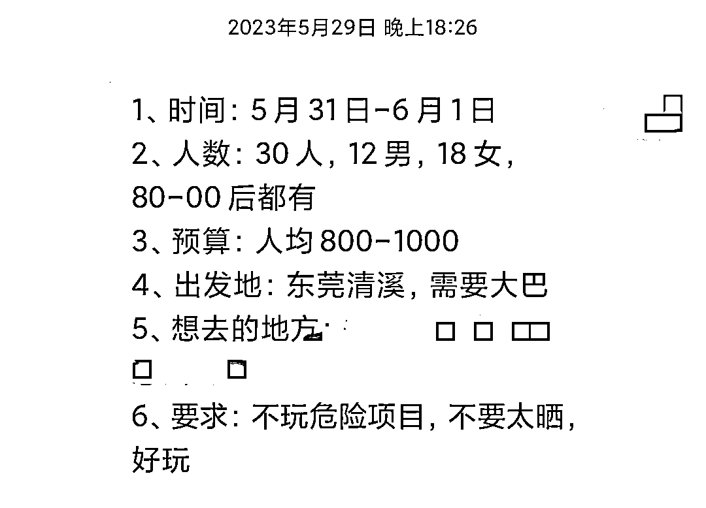

我后来做了个小改动，拉群时群名后面加上日期，每天晚上搜索日期关键词，一个个点进去排查遗漏，及时催单。

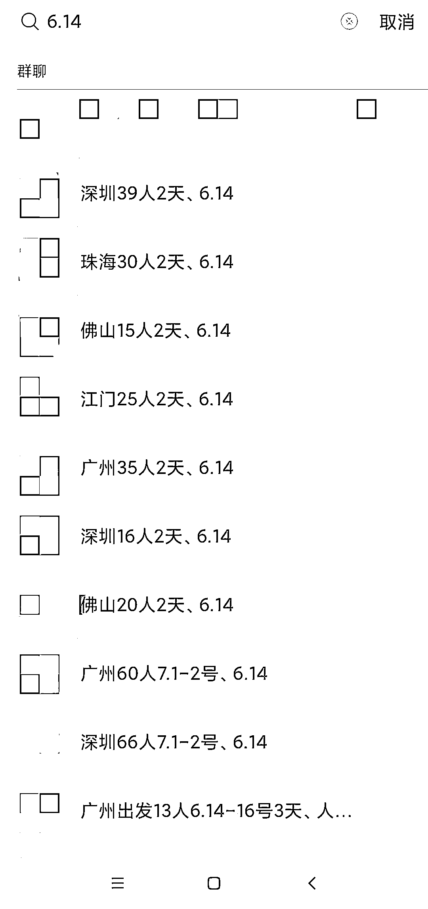

销售手机和微信是专用的，防止私加客户。

兼职怎么管理？不可能人人配手机和微信号，成本太高且流动性大。于是上了赚钱大佬团队开发的私域工具，可以创建无数客服账号。

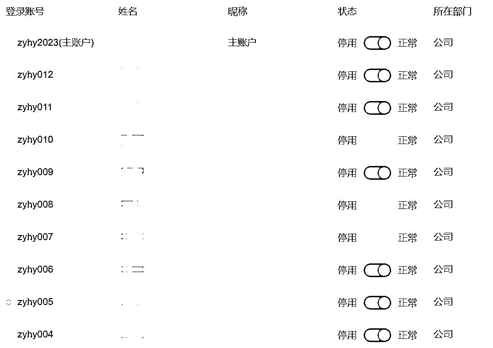

我只用分配客服账号给兼职，对方网页登录即可接手客户，界面和微信几乎一样。聊天记录在网页端和微信端实时同步，我拿着承接微信就能实时看到跟进情况，及时助攻。

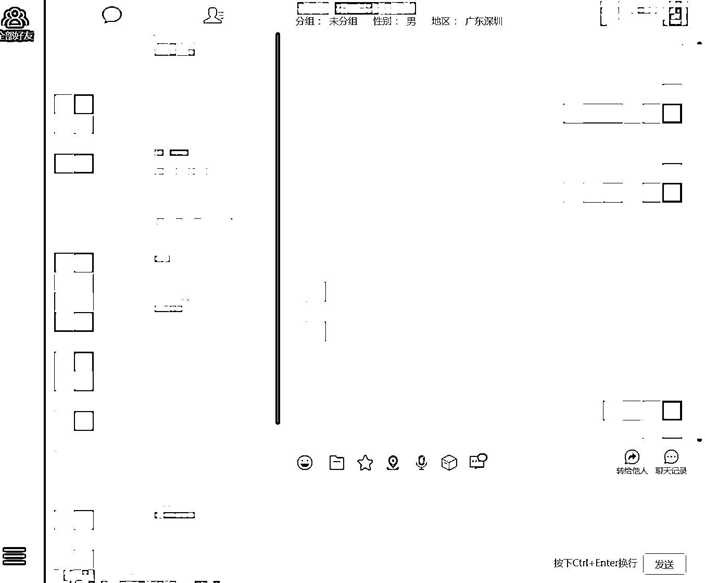

兼职符合二八定律，真正能打的只有2个，她们时间充裕、态度好、学习快，辅助5-7天就能独立出单。

# 五、调研同行补全短板

调研同行和完整体验业务链路是业务优化的关键。团建产品没法体验，但整套流程是可以复盘的。

业务稳定后，我让兼职按我给的流程做一次同行调研，从前端引流到后端转化全流程截图总结可复用的点。

几张当时的总结截图：

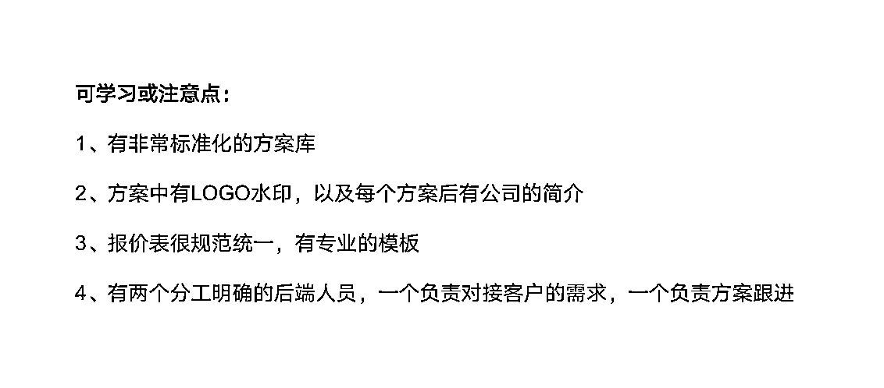

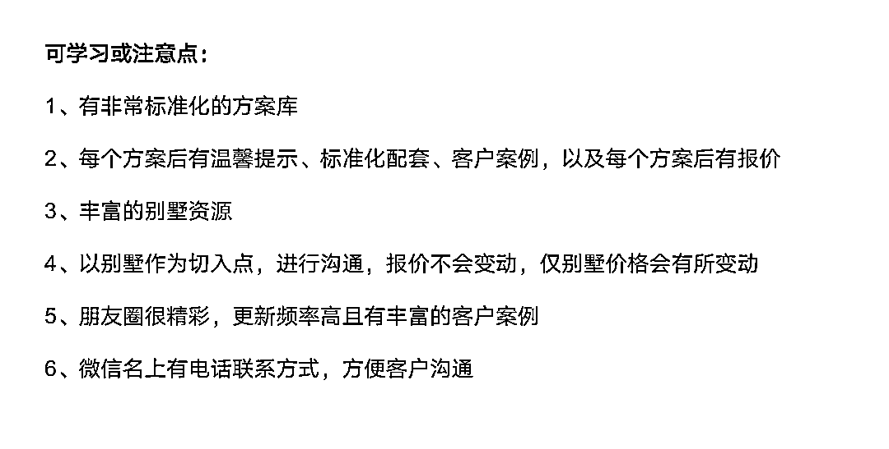

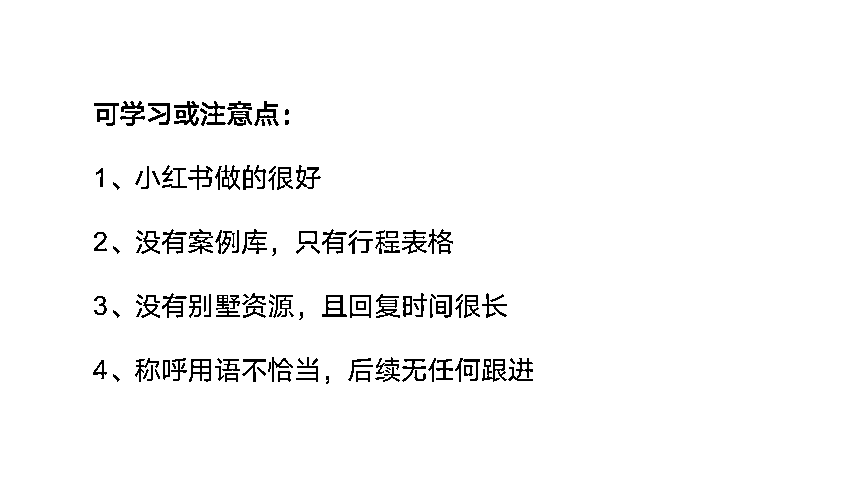
调研后我们知道了哪些同行后端转化做得好，也看到了前端流量好但后端一塌糊涂的雷点。

# 六、感悟与踩过的坑

## 1、小团队什么都得会
我前期只管流量，转化人手不够就自己上，出单后团带不动，自己去当领队。我很抗拒带团，虽然服务能做好，但气氛组不行，每次出门都特别难受。

## 2、SOP化，降低对人的依赖
受小北那篇做生意逻辑启发，“降低对人的依赖，因为人会走；把工作难度降低，兼职化。”

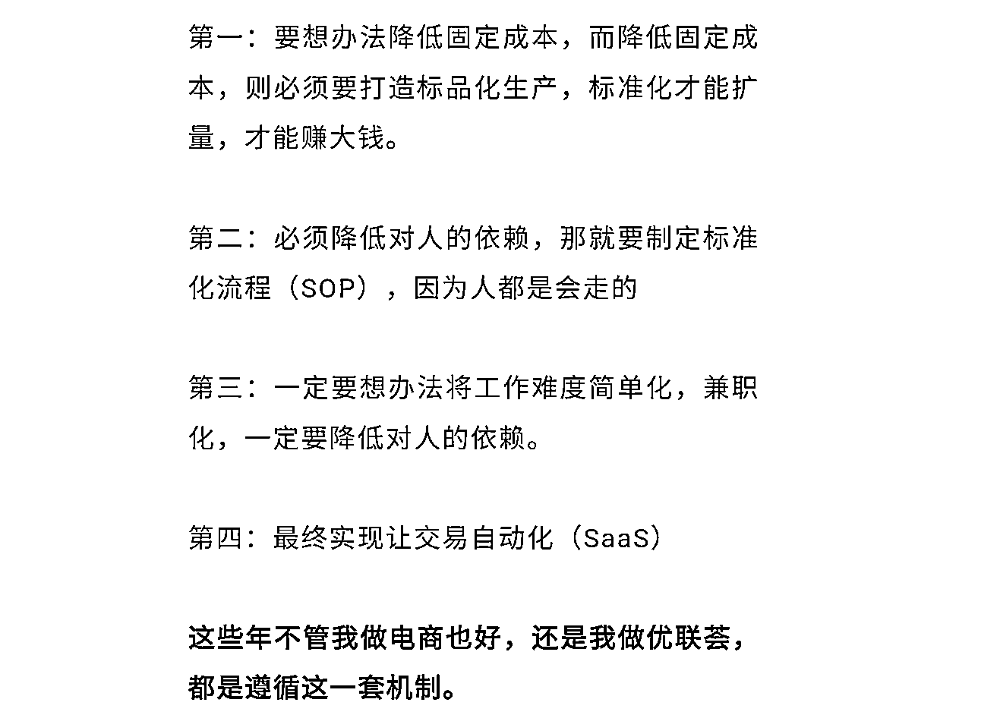

启用兼职是无奈之举，全职走后一直没招到合适的，就一直用兼职。我带人浪费了大量时间，每个新人都要重复教主推方案、报价逻辑、资源找法。

后来我把流程逐渐SOP化：

a）所有方案按价格分类，每个价位精选2-3套成交过的方案，新人先熟悉这批。
b）每个方案都有在线表格的标准报价和成本，报价阶段直接对照。
c）高频问题整理成Q&A，放在客户对接系统里一键发送。
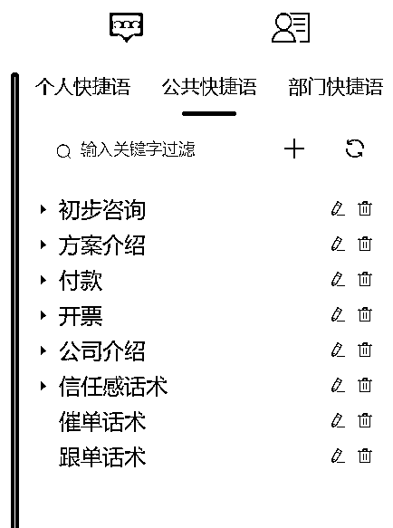

d）所有资源整理到飞书线上化，分好类。先找飞书，再找我。
理想状态是“新人进来不用多牛逼，老老实实按流程走就行”。

## 3、承接微信的朋友圈要运营
重大失误。我不擅长写朋友圈，承接客户的微信只发过2条，还没有成交晒单，头像还是卡通的，堪称雷点。

朋友圈运营好，转化率能明显提升。特别是团建客户很多是国企、事业单位和大厂部门，晒单的信任感极强。

晒单内容包括成交、交付过程、用户反馈、结果展示。别觉得晒多了客户反感，一定要改观念。

朋友圈的系统打法，航海手册里有一期，可以去学。

## 4、提高加V率的技巧
1、及时回复私信
是否加到微信，关键看响应速度。用了官方进线短信提醒，感觉还是慢，我就一直盯着手机，要求半分钟内响应。一天也就30个咨询，能承受。

2、话术设计，不要上来就推加V
我把客户常见问题和我需要问的问题写成片段，放到输入法快捷用语里，先解答再提问，最后给一个合理的加V理由，专业感有了，加V率就高。

团建业务加V后还需要二次确认需求，如果在📕问一遍，微信再问一遍体验很差。所以有段时间我反向操作，让客户先发微信号，我们加他，这样需求和身份能对上。

基本都能拿到微信，这也证明了话术设计比硬推更有效。

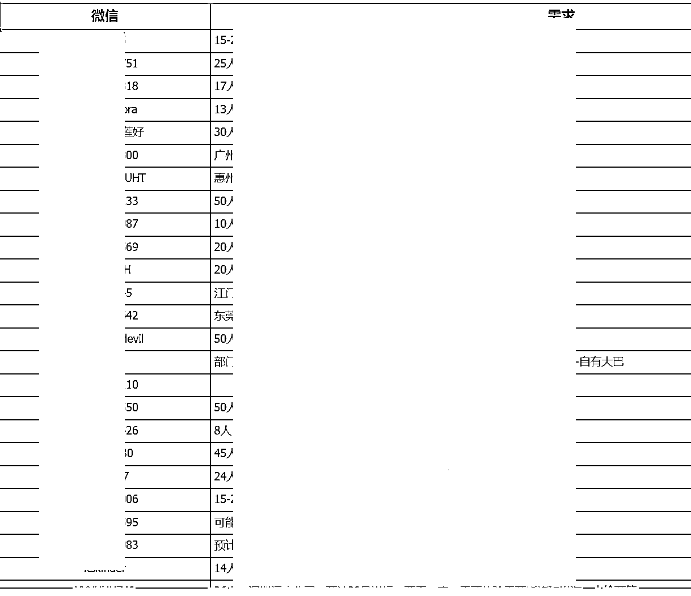

3、客户不回要追量
之前客户不回我就放弃了。后来学到“追量”逻辑：客户开口后私信不回，用新话术继续追，追到加V为止。一般分三轮。

流量不大时，还可以主动私信点赞、收藏、关注、评论的用户，每天有20个主动私信额度，坚持发能再捞一批客户。

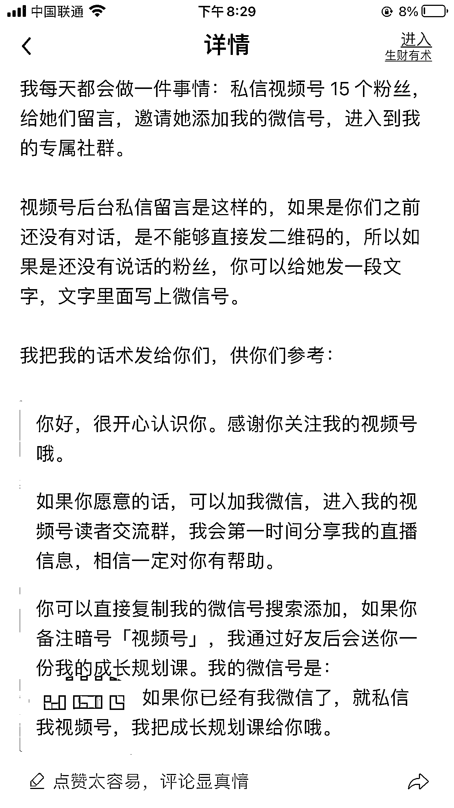

## 5、一段时间内只做一个流量渠道

团建这个项目，最初的起盘完全是靠📕喂起来的。

等📕的流量趋于稳定后，我当时就想着要把盘子做大，于是把抖音、百度都接了进来试水。结果跑下来发现，两个渠道的转化都不理想，反而把本就不多的精力给拆散了。回头想，如果当初把预算和人手死死钉在📕上持续加码，效果只会更好。

对于人手少、资金也紧的团队来说，道理很简单：一个渠道跑通了，就别急着分散。集中火力all in，把资源砸进去做饱和式进攻，比同时开几条战线要靠谱得多。

## 6、想都是问题，做才是答案

这句话听得再多，也不如自己上手一次来得实在。

团建业务刚有流量进来的时候，我们其实啥准备都没做。连专门用来对接客户的微信号都没有，第一批客户都是直接加到我私人微信上的。等后面实在扛不住了，才临时启用了一个之前空着的、什么内容都没有的小号来承接。

客户要付定金了，需要签合同，我们手上却连个合同模板都没有，当时只能去百度文库找现成的文档，东拼西凑、改几版，才拼出第一份能用的合同，就这么把第一单签了下来。

自营线路需要领队带团，可团队里根本没有人能带。只能先自己上阵带，边做边带新人上手，等体系慢慢起来了，才去市场上找有经验的导游。之前压根就没什么导游资源。

类似的坑还有很多，基本全是边做边踩、边踩边补。问题从来不是提前想出来的，而是真的干了才会遇到。想太多只会把自己吓退场，动手了才知道怎么解。

* * *

评论区：

Sy : 团建+旅行社+论文，跑搜索的底气是因为高客单，毛利率客单价低跑搜索打不住的

吴大脸 : 是的，文章里说了哈

拱卒 : 收获满满

沐轩 : 非常详细，值得反复阅读和实操。

吴大脸 : 谢谢支持

吴大脸 : 谢谢支持

悟空悟空空 : 广东团建客户量确实很大，去年兼职带过几次团，大部分都是团建，还有亲子团

吴大脸 : 亲子团倒是不知道，没涉及，你还兼职带团哇，主要熟悉哪些地方

* * *