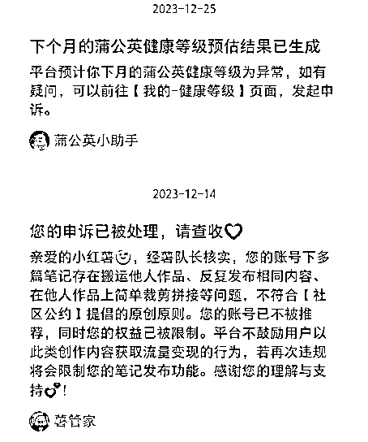
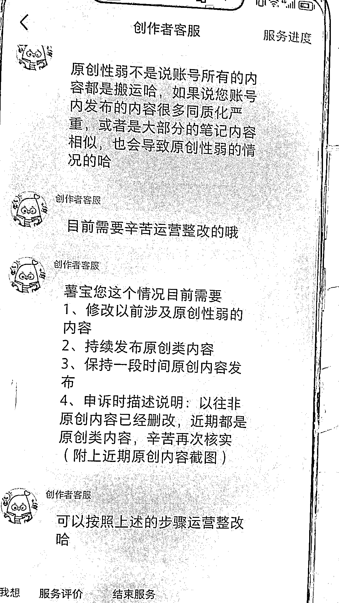
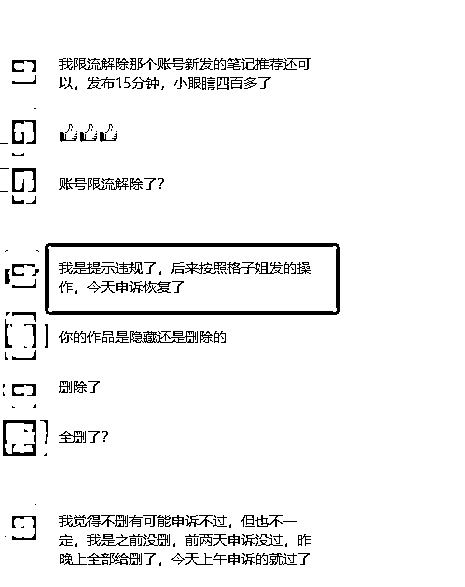

# 📕被限流+蒲公英异常？这个自救流程我实测过来了
作者：龙哥

## 📕近期严打限流，蒲公英异常的应对思路

作者：格子
日期：2024-01-15

从12月开始，📕的风控明显收紧了，图文、视频、混剪、搬运、自拍都一视同仁，平台宁可误杀也不放过。更让人崩溃的是，有时候上午笔记还在爆，下午就彻底没数据了，后台一点动静都没有。

点进去一查，基本就是被限流了。官方申诉的统一口径也只有一句：**账号笔记原创性不足，存在搬运他人素材的情况。**

限流一来，蒲公英后台也跟着异常了。很多号主更焦虑的是，账号里还有未结算的广告单，短期内根本注销不了，那这号到底还能不能救？

别慌，我们最近摸索出一套能用的恢复方法，亲测有效，分享给你参考。

**先说怎么判断是不是真的被限流了，别自己吓自己。**

正常情况下，笔记发出去后点赞收藏的消息会不断进来，曝光量哪怕不爆，小眼睛也基本能稳在200以上。一旦小眼睛掉到几十，互动完全没了，大概率就是被限了。

想确认更准，就去最近一篇笔记点右上角三点，试试薯条推广，会出现三种结果：

1、薯条能正常投放，说明账号没事，只是这条内容不行；
2、薯条不能投放，提示账号不符合社区规范，显示黄色感叹号，这是典型的账号级限流；
3、薯条不能投放，提示笔记不符合社区规范，也是黄色感叹号，这种是单条内容问题，删掉笔记就行。

最麻烦的就是第二种，也就是账号被限。

官方客服给的解决方向其实就四个字：
1、把之前原创性弱的笔记改掉
2、持续稳定发原创
3、保持一段时间的高质量原创节奏
4、申诉时要写清楚：老内容已处理，最近全是原创，请重新审核

搞清楚逻辑后，具体操作可以这样走：

1、先把历史笔记清理一遍，违规过或搬运过的直接删，笔记太多的话，至少把最近一个月的隐藏或删除；
2、之后每天稳定更一则纯原创内容，可以是随手拍的生活场景、截图、手写笔记，配上自己写的文案即可，关键是“自己产出”；
3、以7天为一个小周期，连续发满7天后去后台提交申诉。一次没过就继续发，再过7天再申诉一次；
4、按照这个节奏，通常7到21天内大多数账号都能恢复。恢复后要长期保持原创度，不能再用以前的搬运套路，不然很快又会被盯上；
5、蒲公英因为限流导致的异常，等账号流量恢复正常后再去申诉蒲公英，基本一次就能恢复健康，除非是严重违规；
6、我们实操过，发一周原创后申诉，限流确实解除了，且后续流量也没大滑坡。

当然要不要救号，还得看性价比。站在我个人的角度，如果账号本身粉丝不多、权重不高，花两三周去养回来，不如直接弃号开新。毕竟限流过的账号二次被限概率远高于新号。

但如果你是因为接了广告、注销会违约，那按上面流程救一下还是值得的。几十粉丝几百粉丝的号，建议直接放弃重来，新号一周冲到1000粉也很常见。

今天的避坑思路就到这里啦，祝大家笔记常上热搜，流量常在线。
* * *

评论区：

暂无评论

* * *