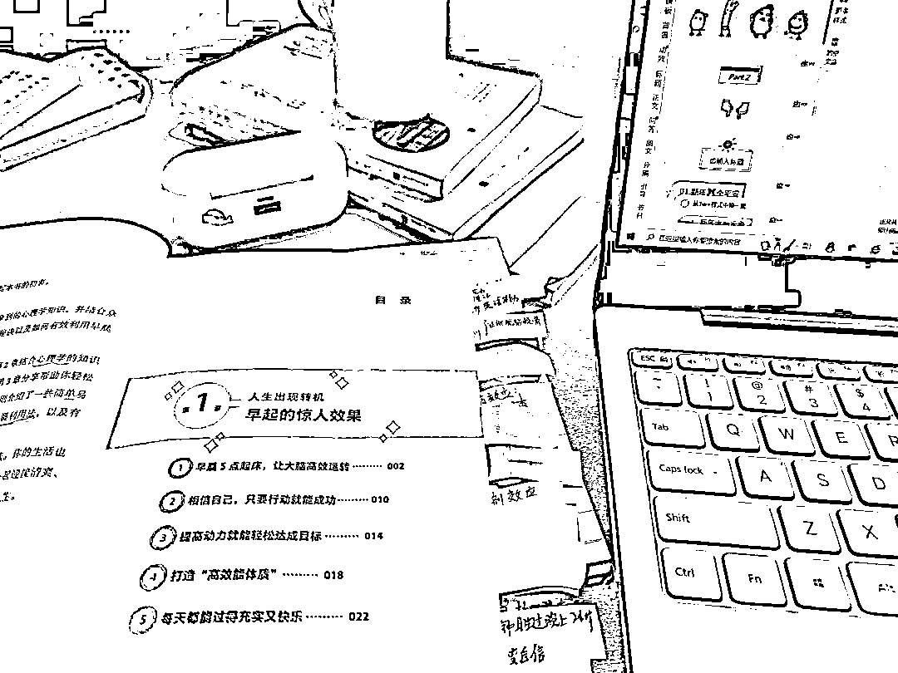
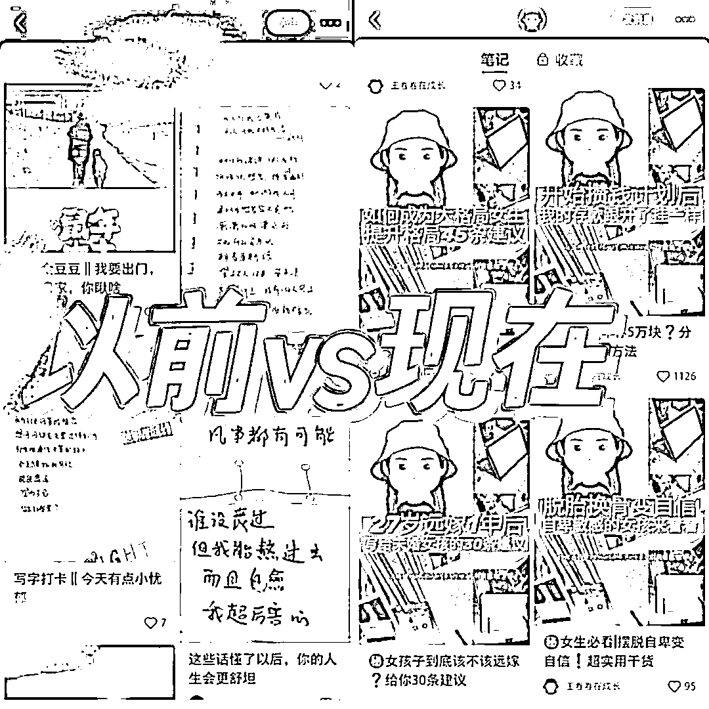
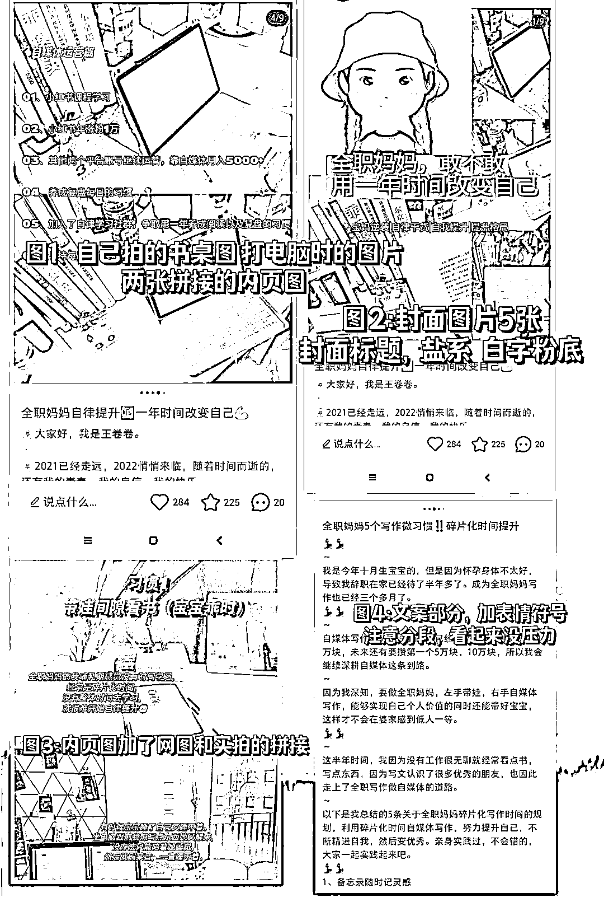
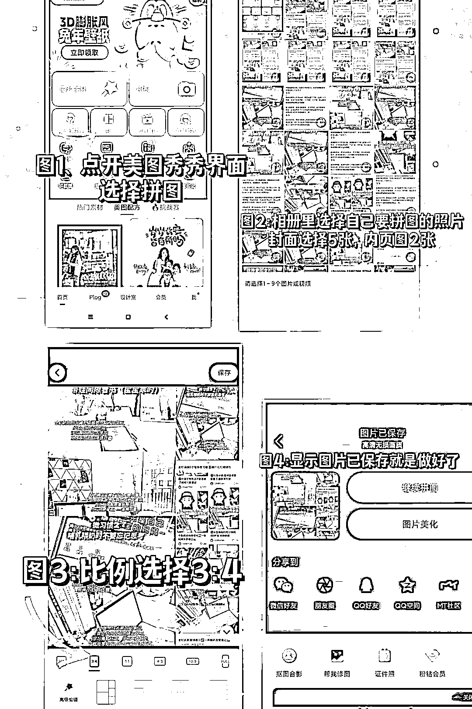
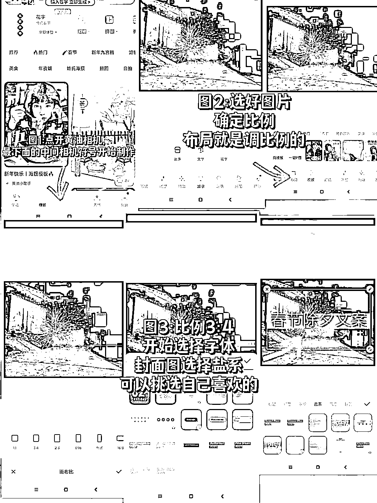
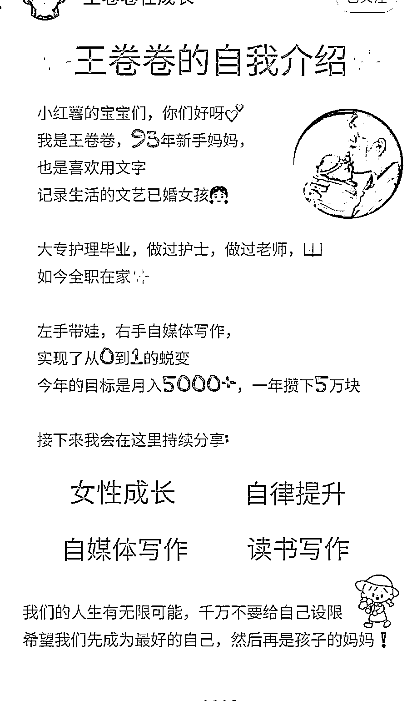
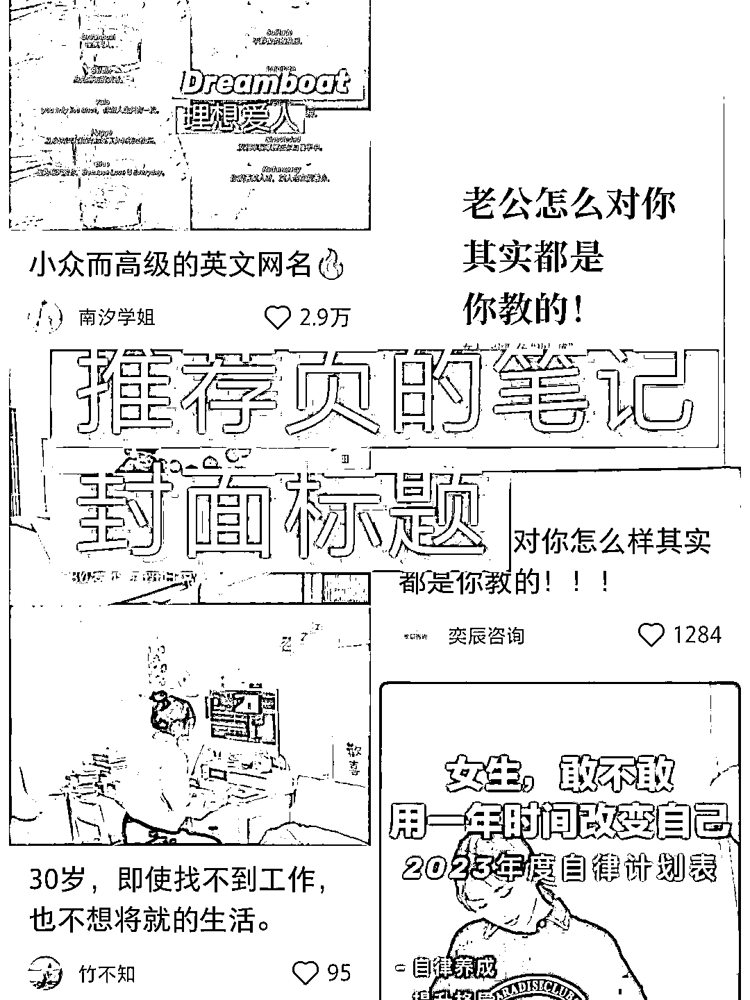
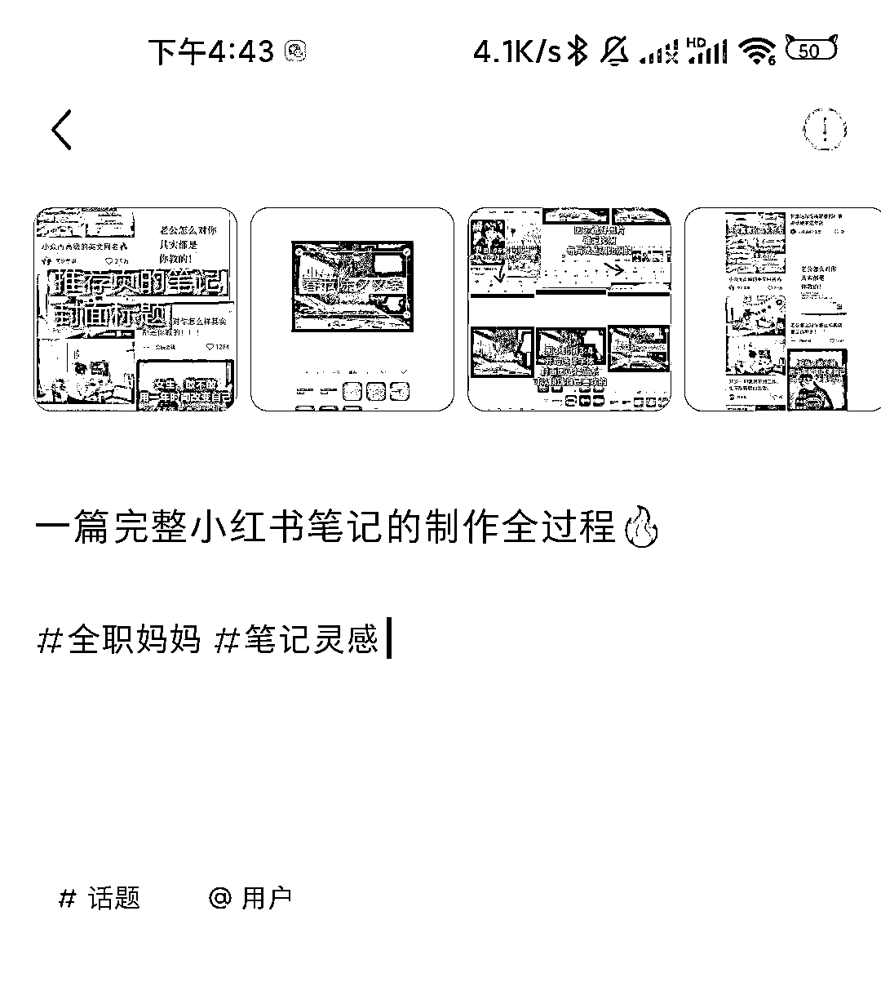
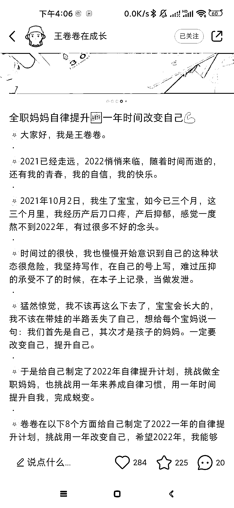
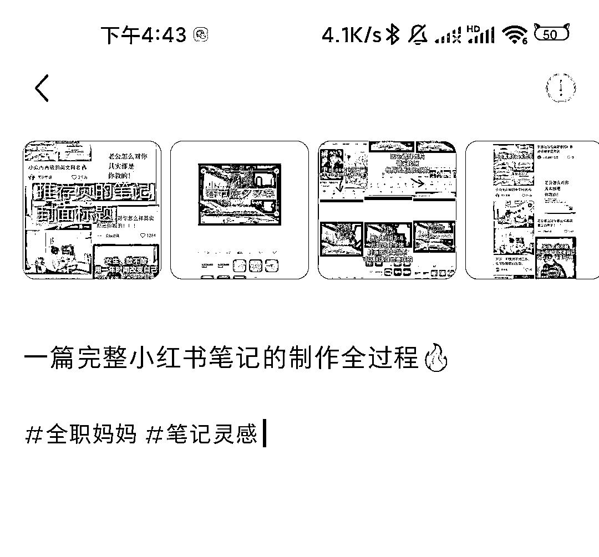

# 📕 3 个月涨粉 3000+，📕笔记制作流程大揭秘

三个月，从零到三千多粉丝，我把📕摸透了！之前分享过一篇关于蒲公英提现的笔记，好多朋友私信问我封面怎么做。其实一两句话真说不清，而且我猜不少人都好奇那些高颜值封面是怎么来的，今天干脆把我的完整制图流程摊开来聊聊，想上手的伙伴可以直接抄作业。

老实说，我一开始也是个作图小白，自己瞎琢磨半天，愣是没搞明白，后来干脆报了个📕课程，跟着老师学了一个多月，才慢慢摸到门道，也明白了什么样的笔记更容易有数据。这是我人生第一次为知识付费，还好没踩坑，真学到不少干货。因为自己体会过那种一个人死磕的迷茫和焦虑，所以更想把学到的结合实践分享出来。2024年，哪怕我写的某句话对你有启发，我就觉得值了，写作这件事也没白坚持。（俗气点说，我既想赚钱，也想唤醒一群和我曾经一样的人。）

必须说，📕对新人真的特别友好。哪怕你是纯素人，只要内容对某个人有用，就能收获关注和赞。内容足够利他，真心站在读者角度，基本就能做成。我自己就是几百粉时已经开始有收入了。所以别只收藏，一定要去动手实践，边做边完善。下面就把我制作一篇笔记图片的全过程拆给你看。

一篇📕笔记，由这些部分组成：封面图、内页图、图标、文案标题、文案，还有关键词和话题标签。

**第一步，封面图怎么做？**

我的建议是优先用自己拍的照片。第一个账号的封面大多是我拍的书桌、娃的照片，生活化的画面会更真实，也更容易打造个人IP，拉近和读者的距离。不想用自己拍的，也可以找网图，我以前常用豆瓣剧照、明星美图，淘宝也能淘到不少好图。如果你做学习博主，搜文具、书桌就有很多素材。

具体操作：挑5张照片（2张、4张也行），用美图秀秀拼成3:4的比例，保存到相册。接着打开黄油相机，加滤镜（有时不加也可以）。记得滤镜风格尽量固定，别今天一个调调明天一个调调，封面图尽量保持5张。然后在黄油相机里加花字，我一般选“盐系”字体的文字，挑喜欢的、美观的句子放上去。

图好文一半，花香蝶自来。📕用户对图片审美要求挺高，我现在也说不上多惊艳，但先做起来，再慢慢提升准没错。具体拼图和加字步骤，我放图了，跟着操作就行。

**第二步，内页图**

📕最多能发9张图。封面占1张，剩下8张就是内页。把笔记重点内容写在图上，文案区写大概框架就行。不少博主会把最后一张固定成自我介绍，你可以用心做一张专属自己的介绍页，这样前面7张就可以专心写干货。

**第三步，图标**

图标就是封面上的大标题，也是别人刷推荐页时对你的第一眼印象。很多干货类博主会做，但也有不做的，看你自己。我做图标一般还是用黄油相机加字，同样用“盐系”风格。

**第四步，标题怎么写**

文案标题最多20个字，可以加🔥、㊙️这种表情，但注意一个表情占2个字符，加一个等于少了2个字的位置。所以标题要反复琢磨，设计得吸睛又合理，别做标题党。这个能力需要你在持续更新中慢慢积累网感，不是一蹴而就的。

**第五步，文案内容**

文案就是笔记的核心，你想表达什么干货就写出来。我习惯先在有道云笔记写好，再复制到📕。另外📕的用户偏年轻，内容里适当加些表情，会显得更有趣、更好看。

**第六步，关键词和标签**

关键词就是这篇笔记的主题词。比如我写“全职妈妈靠自媒体写作实现经济独立”，那“自媒体写作”“全职妈妈”就是关键词。我在正文或标题里自然地多出现几次，这样吸引来的就是喜欢写作的全职妈妈、想靠自媒体赚钱的人群。关键词能让平台精准识别你的创作领域，持续更新后，它就会把内容推荐给合适的人。

标签就是笔记文案区最下方的#号词。比如你做文案整理，就带上#文案 #适合发朋友圈的文案 这类标签。你想让哪些人看到，就挂上相关的关键词，但别贪多，挑几个热度高的就行。

还有一点，文案区最多1000字。到这儿，一篇📕笔记就完整做完了。今天分享的主要是我常用的美图秀秀和黄油相机，不过网上也有很多博主用稿定设计做封面，素材丰富，你也可以试试。有不清楚的欢迎评论区问我。

#📕干货 #📕

