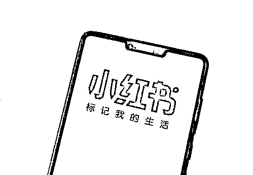
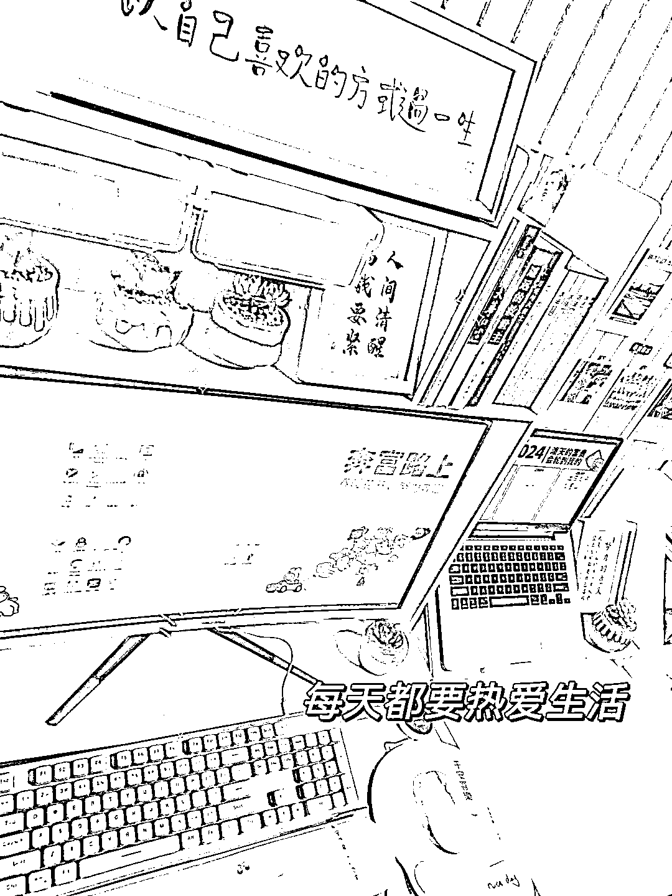

# 📕号刚注册就发笔记？先别急，你的号可能还没“活”过来
作者：龙哥

有多少人是账号刚建好就迫不及待去发第一篇笔记，结果数据平平，折腾一两个月也看不到起色。

很多人第一反应是自己被坑了，被隐性限流了。其实更多时候，问题出在太心急，账号根本还没养起来。

网上常说一句话：**养号养得越顺，内容越容易被推。**

这话我以前也当玄学，直到亲手废掉十几个号才信了。有些坑，不撞一次真的记不住。

我 2022 年就开始碰📕，那时候对平台完全没概念。注册完立刻改资料、换头像、直接发内容，号一个接一个凉。最讽刺的是，新号刚出个爆款，往往三天内就没了。

真正转折是在 2023 年下半年。我把重心放到📕后才明白养号有多关键。把号养好了，体验才不一样：上线两天涨 3000 粉，20 天破万粉，那种被流量砸到的感觉，才算真正吃到📕的红利。

今天就把我踩坑后归纳出来的养号流程完整拆给你，尽量做到一看就会。

**一、养号到底在养什么？**

说白了，就是用一个真实用户的习惯来用📕。正常浏览、正常点赞、正常和别人互动，让系统判定你是个活人，不是批量起号的机器。

养号同时也是在做账号定位。想做情感，就多刷情感内容；想做美妆，就沉浸在美妆池子里。这样等你开始发笔记时，推荐会更精准。

最怕的就是裸号发文。一注册就发，尤其是不养号就爆，系统很容易把你当成营销号、机器号，直接降权。想申诉基本没门。

所以养号其实三件事一起做：告诉系统你是真人、帮账号贴上垂直标签、顺带研究同行爆款，练手感、攒素材。

**二、养号具体怎么操作？**

1、注册时尽量克制。只填性别、年龄和兴趣标签，其他资料别动。头像、简介这些等到发笔记前一天再统一调。

2、养号周期至少 3-5 天。不同赛道要求不一样，有的要求 10 天、半个月甚至更久。

**第一天：**
打开 App 搜索你要做的赛道关键词，进同行的笔记看内容。看到喜欢的点赞、收藏，可以顺手关注博主。刷个 10 分钟左右，首页就会被同行内容占据。

刷的时候要像个真人，别一上来就狂点。看完 5 条左右再点赞第 6、7 条。评论也要克制，大概 5 个赞配 1 条评论，评论要像粉丝在互动，别发广告、别水无关内容。

**第二天：**
继续强化垂直。按第一天的方法刷。如果首页已经全是同行内容就对了，如果还是杂，就继续搜关键词把标签打深。

看到大爆款记得摘抄到自己的素材库，后续选题用得上。刷同行不只是为了走流程，更是为了拆解结构、感受当下什么题材在火。

**第三天：**
去发现页看系统给你推荐的视频。有符合赛道的，就正常点赞关注；没有的话就回到第一天，重新搜关键词引导。

**3、每天投入 30-60 分钟就够了**
不用一次性刷满。碎片时间都可以：午饭空档、地铁路上、晚上睡前。关键是持续、稳定、像真人。

不同赛道养号时长不同，有的 3-5 天就能动，有的高竞争赛道就要养十天半个月。宁可晚一周再发，也别今天急着上线。

**三、最后的避坑提醒：**

📕是“一机一卡一号”。一个手机别频繁切号，一个局域网别养多个号。一旦某个号被限流，这台设备、这个 IP 可能就被标记了。

新号最好用干净的手机，别是登录过异常或违规号的机器，真有历史最好恢复出厂设置，甚至换设备更稳妥。

手机号也一样。刚注销的号、尤其是因引流违规被封过的号，别马上拿来注册新号，至少沉淀半个月以上，最好用长期在用的号。

以上全是我用十几个号的学费换来的干货，希望能帮你少走弯路。

* * *

评论区：

贤雅 : 壁纸好看[呲牙][呲牙][呲牙]

less 💋 : 那还得多拿俩手机也不方便

格子 : 没钱更不方便吧

格子 : 谢谢

less 💋 : 你说得太有道理呢[尴尬][尴尬]

less 💋 : 向你学习～搞副业赚钱💰

贤雅 : 分享一下

水水 : 📕不用养号

* * *