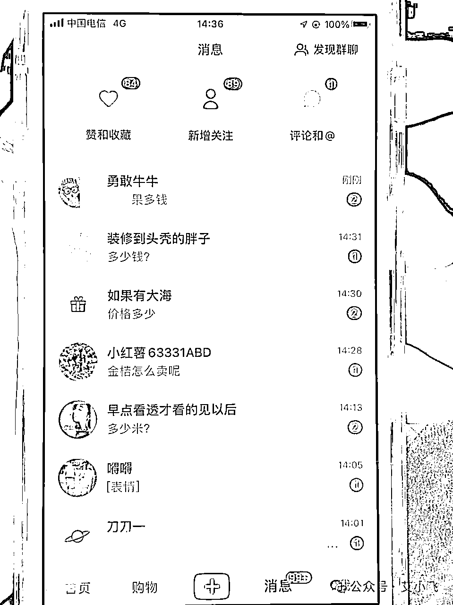

# 分享📕做电商日赚 200 的经验

日入两百，听起来不算多，但在📕电商里已经是个不错的小成绩。大家好，我是龙哥。很久没聊项目了，今天特意把最近这次的实操经验拿出来讲一讲，主要想给那些还在到处找项目、却还没真正靠项目赚到钱的朋友一些启发。

我这次做的是季节性产品，正好赶上春节前的消费需求，来自广西柳州，叫融安脆蜜金桔。我是怎么发现这个品的，以及发现之后从选品、上架到运营的具体动作，全都整理在飞书文档里了，想直接上手的可以看这个链接：

文档发出去之后，有圈友说自己一直犹豫，看完终于决定动手去试，还准备趁年前去测评宠物帽子；也有圈友反馈我的几个关键动作直接打通了他运营📕的思路；还有人为我的执行力点赞。看到这些反馈，我更确定这套方法值得复制。

