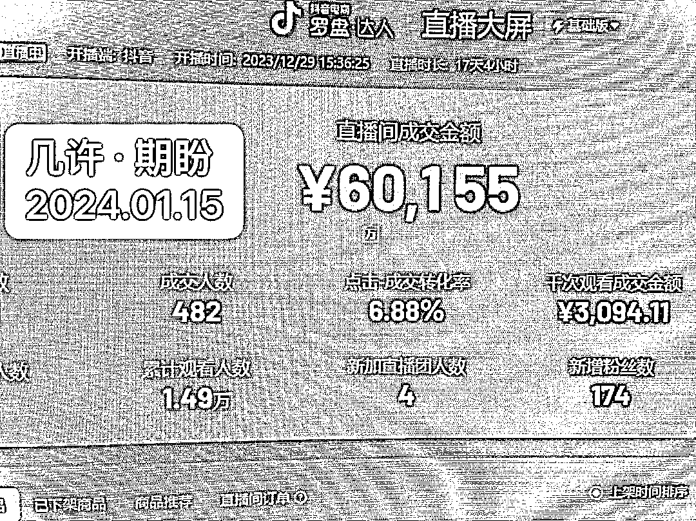
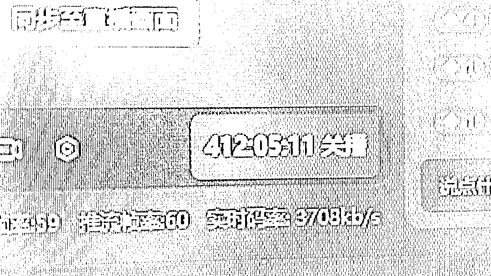

# 利用 AI 打造直播间，抖音真人转无人蓝海搜索流，高效矩阵 0 封号稳定日入 3000

我是几许，也可以叫我东伟。上班之余做副业，已经有六年。这六年里，我最深的一点体会是：不要因为自己没见过，就武断地否定一个项目。以前我对无人直播嗤之以鼻，觉得那是钻空子；可当我自己下场试了之后，才明白什么叫“真香”——从抗拒到认可，我整整用了7个月。

我们现在做的，并不是那种挂个视频就不管的无人直播，而是先跑通真人直播的打法，再用AI工具把它转成无人化运营。这套玩法在抖音无人蓝海搜索流赛道里，已经跑出了一套高效矩阵。整套逻辑，我前前后后写了近万字拆解，这次就把最核心的部分拎出来讲。

先晒一组数据：去年12月13日正式入局抖音无人蓝海搜索流赛道，到现在刚好一个月。我租了个工作室，陆续运营了10个号，单日收益在1500到5000之间波动。截至今天，累计预估佣金已经跑到88104.85元。其中最能打的一个号，12月27日启动，到1月14日，18天完成60863.14的GMV，按照40%的佣金比例，预估佣金是23425.35，扣除退货后到手依然接近2万。更难得的是，这样一套矩阵跑下来，账号一直稳稳当当，做到了0封号。

为什么标题只敢写“稳定日入3000”？因为我理解的稳定，有硬标准：按天算，至少要连续一周以上不掉链子；按月算，至少要连续三个月没有明显下滑。现在的成绩只是初期阶段的保守数据，如果继续矩阵化放大，这个项目的上限绝不会止步于此。

详细的玩法、选品、运营细节，我都整理在飞书文档里了。不过飞书官方目前限制了这个分享，如果打不开，可以直接看语雀备份。飞书链接：https://y9r93uo8au.feishu.cn/docx/SsLgdPoAUoiCVRxBNtpcnOR3nOb?from=from_copylink ；语雀链接：https://www.yuque.com/wishin/bn1ut0/wq3wyp7x232uuuix?singleDoc 

—— 以下是分隔线 ——

这篇内容能顺利发出来，要感谢谱姐帮忙审稿，也要感谢赚钱提供的平台。评论区里，有朋友问怎么链接，有朋友说文档看不了，也有朋友直接表示“膜拜、拜读”。这里统一回应：大家互相学习，有问题可以在评论区多聊，看到都会回复。